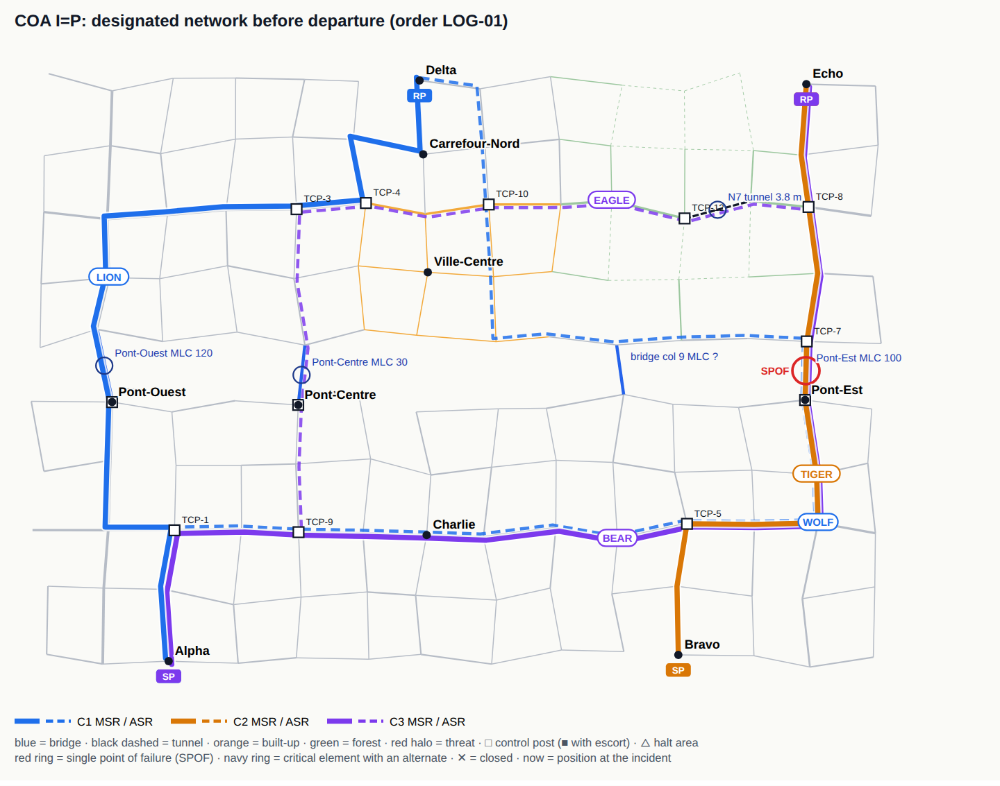
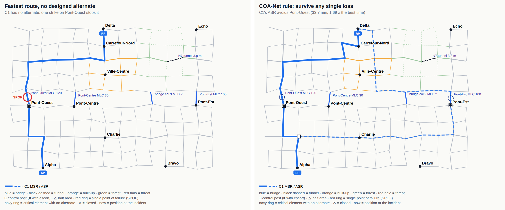
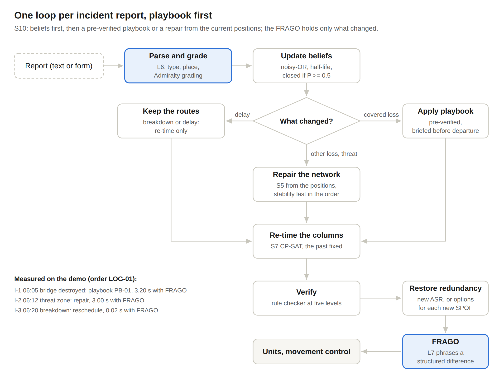
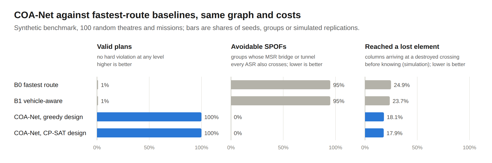

# COA-Net: survivable road networks and courses of action for logistic convoys

Prototype for the AMIAD hackathon (Rennes, 12-14 Nov 2026): design the maneuver road network for military logistic convoys from a map, doctrine, a logistic order and live incident reports, with language models of at most a few tens of billions of parameters.

**Core idea.** COA-Net plans the way a movement-control cell does. It first designates one shared network (main and alternate supply routes, route statuses, traffic control posts, halt areas) that keeps every convoy moving after the loss of any single bridge, tunnel or other critical element, wherever the road network allows it. It then gives every march unit a time slot on that network (movement credits), and presents the result as two to four courses of action (COAs) with their trade-offs. Small language models never draw a route: they turn doctrine into typed requirements, the commander's intent into an order of priorities, and computed facts into a COA comparison and fragmentary orders (FRAGOs). CP-SAT models design the network and the schedule, a rule checker verifies every requirement, a simulator measures resilience, and contingency playbooks are briefed before departure. The full design, its rationale and the experimental plan are in [docs/COA-Net_methodology.md](docs/COA-Net_methodology.md); section 11 there describes this implementation and its measured results.


## Quick start

```bash
pip install -e ".[dev]"          # networkx, pydantic, requests, ortools, pytest
coa-net demo                     # synthetic theatre, order LOG-01, three incidents
pytest                           # 48 tests, about 20 s
coa-net bench --seeds 20         # baselines B0-B1 against COA-Net, incident loop with and without playbooks
```

`coa-net demo` writes `outputs/demo/report.html` (maps before and after each incident, road movement graph, COA chart, mission and priorities, COA comparison, explanations, route network, march table, contingency annex, reconnaissance tasks, verification, FRAGOs), plus `panel_*.svg`, `network.geojson`, `facts.md`, `fragos.txt` and `metrics.json`. Everything runs on a laptop CPU without any model: each language-model role has a deterministic fallback, and `--no-cpsat` replaces the CP-SAT models with greedy versions. Python API: [examples/run_python_api.py](examples/run_python_api.py).

## What the demo shows

A synthetic theatre with a river with four bridges (Pont-Ouest MLC 120, Pont-Centre MLC 30, a bridge on column 9 of unknown class, Pont-Est MLC 100), the N7 tunnel (3.8 m), the built-up town of Ville-Centre. C1 (six heavy trucks, two fuel tankers) goes from Alpha to Delta, C2 (two tank transporters, MLC 100, 4.0 m) from Bravo to Echo, C3 (four medium trucks, one ambulance) from Alpha to Echo. The intent says "The enemy is likely to strike the crossings. Keep the tankers out of the towns.", so resilience comes first in the priority order.



**Before departure** (planning takes about 4 s on a 4-core CPU). C1 drives LION over Pont-Ouest; its alternate WOLF crosses Pont-Est (33.7 min, 1.69 times its best time, within the 1.8 detour guard), so no single strike stops C1. C2 can only cross at Pont-Est within the guard: COA-Net reports Pont-Est as an irreducible single point of failure (SPOF) and issues reconnaissance task RT-1 on bridge col 9, whose class decides whether C2 can get an alternate. C3 drives BEAR over Pont-Est with alternate EAGLE over Pont-Centre. The plan has 12 traffic control posts, 4 pre-verified playbooks, and movement credits: C1 06:00 to 06:20, C2 06:00 to 06:14, C3 06:11 to 06:31 (held 11 min to keep the time gap behind C1). The rule checker passes 325 checks; it reports C2's irreducible SPOF, three shortfalls of "should" requirements (the alternates WOLF and EAGLE cross about 3 km of built-up area each) and unknown road widths on three routes, priced as risk.

Without a designed alternate, one strike on Pont-Ouest stops C1. COA-Net's survivability rule gives it an alternate over Pont-Est:



**Incidents.**

| Time | Report | COA-Net response | Computed in |
| --- | --- | --- | --- |
| 06:05 | Pont-Est destroyed (graded A1) | Playbook PB-01, briefed before departure: C2 reroutes over Pont-Ouest on FALCON (arrives 06:50), C3 switches to EAGLE (departs 06:14, arrives 06:35) and gets a new alternate HAWK. Pont-Ouest is now an irreducible SPOF for C1 and C2, and the FRAGO lists the options: reconnoitre col 9 (with MLC 100 or more, C2's remaining route would drop from 42.5 to 17.0 min), protect Pont-Ouest, request a gap-crossing asset, or accept the risk. | 1.3 s with the FRAGO |
| 06:12 | Ambush confirmed near Ville-Centre (graded B1) | Repair from the columns' current positions: C2 on FOX (arrives 06:55), C3 on PUMA (arrives 06:39) with a new alternate LYNX; both main routes bypass Ville-Centre. | 1.2 s |
| 06:20 | C3 breaks down for 25 min | Movement credits re-solved, routes kept: C3 arrives 07:05. | 0.01 s |


The incident loop: beliefs first (graded reports, noisy-OR fusion), then a pre-verified playbook or a repair, re-timing, verification, redundancy restoration and a FRAGO that holds only what changed.



## Benchmark (synthetic, 100 random theatres and missions)

`coa-net bench --seeds 100 --reps 50`: same graphs, same travel times, same costs for every pipeline; each plan is replayed 50 times in the simulator under one uniformly drawn loss of a designated critical element (common random numbers). B0 and B1 plan the fastest route per convoy with no alternate: they are floors that show what a plan without designed redundancy loses. Full table: [docs/benchmark_100_seeds.md](docs/benchmark_100_seeds.md).



| pipeline | valid (all levels) | avoidable SPOF groups | resilience (veh.min, lower is better) | travel time (veh.min) | network km | reached a lost element (sim) | design time |
| --- | --- | --- | --- | --- | --- | --- | --- |
| B0 fastest route | 1 % | 95 % | 177.0 | 676 | 29.9 | 24.9 % | 0.05 s |
| B1 vehicle-aware | 1 % | 95 % | 175.3 | 670 | 29.0 | 23.7 % | 0.00 s |
| COA-Net, greedy design | 100 % | 0 % | 77.1 | 708 | 47.1 | 18.1 % | 0.00 s |
| **COA-Net, CP-SAT design** | **100 %** | **0 %** | **71.5** | 700 | 46.1 | **17.9 %** | 0.15 s |

Reading it: COA-Net removes every avoidable single point of failure (95 % of groups have one with the fastest routes), gives 99 % of groups an alternate at 1.16 times the main route's time, and, by the plan's own model, cuts the expected delay over loss scenarios from 175 to 72 vehicle·minutes, for 4.5 % more travel time and 59 % more designated network than the vehicle-aware fastest routes. The simulator shows a smaller gain, about 10 %, with overlapping intervals. Its plans meet every requirement level (halts, time gaps, control posts, survivability), and fewer columns drive into a lost element, partly because a loss covered by a playbook reaches the columns as a broadcast trigger instead of a new order. On-time probability is 100 % for every pipeline on these missions (deadlines are loose) and threat exposure is zero (the random missions carry no threat zones), so neither metric separates the pipelines yet. In the incident study (100 random incidents 10 minutes after the first departure), 48 incidents miss the designated network and are only logged; with playbooks, 28 of the other 52 get a playbook response and 24 a repair. Those 52 take about 0.5 s on average and about 3 s at most, without language models, and 85 % of the resulting plans are valid (81 % without playbooks). The other plans keep schedule or halt violations, and the order is still written; see methodology section 11.4.

## What is implemented

| Stage (methodology section 5) | Module | Status |
| --- | --- | --- |
| S0 theatre preparation | `graph.py`, `corridors.py`, `loaders.py`, `scenarios.py` | Road graph contracted into corridors between decision points (shortest paths stay exact); critical elements: bridges, tunnels, level crossings, fords, ferries, defiles, and per-group articulation points; OSM and BD TOPO loaders; synthetic theatre with planted constraints and halt areas. Missing attributes stay *unknown*. |
| S1 requirement base (L1) | `requirements.py`, `doctrine.py` | 26 requirement templates at five levels (road, route, network, schedule, protection) and four tiers; compiler with a model path (schema, verbatim quote, tier and range checks) and a pattern fallback; coverage report (95.7 % of the sample doctrine). |
| S2 order and intent (L2, L3) | `parsing.py`, `mission.py`, `intent.py` | Order parser (model or regex fallback, unknown vehicle types flagged), convoy groups and march units, intent mapped to a priority order with quotes and imperatives to confirm. |
| S3 candidate routes | `candidates.py` | Pareto routes, label-setting search for halts, crossings and range, turn-expanded search for long vehicles, replacement routes, cheapest element-disjoint pairs, articulation points. |
| S4 criticality (L4) | `criticality.py` | Exact structural impact of every loss, irreducible SPOFs, likelihood from the red-team model or a table by element type, fused with reported threats; loss scenarios. |
| S5 network design | `design.py` | Path-based model on CP-SAT: survivability, detour guard, objectives optimised one at a time in the priority order with tolerances (lateness first); COA archetypes; greedy fallback. |
| S6 refinement | `refine.py` | Road-level routes, halts, traffic control posts and escorts, route statuses, route names, GeoJSON overlay. |
| S7 movement credits | `schedule.py` | CP-SAT: time gaps at both ends of every shared segment, order between units as a decision, meetings on single-lane roads, junctions, halt-area capacity, time windows, deadlines; greedy fallback. |
| S8 verification and anticipation | `verify.py`, `anticipation.py`, `simulate.py` | Rule checker at five levels; contingency playbooks; reconnaissance tasks by value of information; discrete-event Monte Carlo with report and order delays and breakdowns. |
| S9 COAs and briefing (L5, L8) | `coa.py`, `explain.py` | Facts table, COA comparison whose numbers are checked against the facts, contrastive explanations. |
| S10 incident loop (L6, L7) | `belief.py`, `incidents.py`, `orders.py` | Admiralty-graded reports, belief update, playbook or repair from current positions, re-timing, verification, redundancy restoration, FRAGO from a structured plan difference. |
| Evaluation | `baselines.py`, `bench.py` | B0-B1, COA-Net greedy and CP-SAT, incident loop with and without playbooks. |
| Outputs | `render.py`, `pipeline.py`, `cli.py` | HTML report, SVG maps, road movement graph, COA chart, GeoJSON, optional Folium map; `COANet` session object; command line. |

**Not done yet:** the long-context and vision-language baselines (B2, B3), runs on real map extracts (F2) and on the organisers' scenario (F3), checking SCH.VARY (needs several rotations), most ablations (only A5a greedy and A7 no playbooks are in the benchmark), and the human evaluation. No language model was run for the numbers above: they come from the deterministic fallbacks, so token budgets are not measured yet. The deviations from the methodology are listed in its section 11.4.

## Using a local language model

Any OpenAI-compatible server works (vLLM, llama.cpp, Ollama), on one GPU or on a CPU:

```bash
vllm serve mistralai/Mistral-Small-3.2-24B-Instruct-2506 --tokenizer-mode mistral --config-format mistral --load-format mistral --port 8000
# or: ollama serve & ollama pull mistral-small3.2

export COA_LLM_BASE_URL=http://localhost:8000/v1      # Ollama: http://localhost:11434/v1
export COA_LLM_MODEL=mistralai/Mistral-Small-3.2-24B-Instruct-2506
export COA_LLM_JSON_SCHEMA=1                          # 0 if the server lacks structured output
# COA_LLM_API_KEY if the server needs one

coa-net compile-doctrine path/to/doctrine.txt --llm --out rules/requirements.json   # draft instances, to review
coa-net demo --llm --requirements rules/requirements.json
```

Every model output is checked by code (schema, verbatim quotes, numbers and identifiers that must appear in the computed facts) and replaced by the deterministic fallback after one failed retry. Token usage per stage goes to `metrics.json`.

## Real maps

```bash
pip install -e ".[osm]"
coa-net fetch-osm --place "Guer, France" --out cache/guer.graphml          # cache before the event
coa-net plan --graphml cache/guer.graphml --places examples/places_brittany.json \
    --order examples/order_brittany.txt --incident "22:20@bridge destroyed near Montfort" --out outputs/bzh

# IGN BD TOPO (Lambert-93 GeoPackage with a troncon_de_route layer); --dem adds slopes (needs rasterio)
coa-net plan --bdtopo BDTOPO_D035.gpkg --places places.json --order order.txt --out outputs/bdtopo
```

`--places` seeds the gazetteer (`{"name": [lon, lat]}`) so that orders and incidents can name places. OSM and BD TOPO carry no military load class, so bridges stay *unknown* until a reconnaissance file or the organisers' data provides it; COA-Net turns the unknowns that matter into reconnaissance tasks. The loaders are unit-tested on parsing but have not been run against live data from this environment.

## Layout

```
src/coa_net/
  graph.py         annotated road graph, gazetteer, geometry
  corridors.py     S0 corridor graph, critical elements, map card
  loaders.py       OSM, BD TOPO, DEM
  scenarios.py     synthetic theatre, random missions and incidents
  vehicles.py      vehicle catalogue (illustrative values), binding profiles, march columns
  requirements.py  26 templates, tiers, seed requirement base
  doctrine.py      S1 doctrine compiler and coverage (L1)
  parsing.py       order parser (L2), incident parser (L6)
  intent.py        S2 intent to priority order (L3)
  mission.py       S2 groups, march units, active requirements
  costing.py       per-group evaluation of roads and corridors
  candidates.py    S3 candidate routes
  criticality.py   S4 impact, likelihood (L4), loss scenarios
  design.py        S5 network design (CP-SAT), COA archetypes
  refine.py        S6 routes, halts, control posts, statuses, names
  schedule.py      S7 movement credits (CP-SAT)
  verify.py        S8 rule checker
  anticipation.py  S8 playbooks, reconnaissance tasks (value of information)
  simulate.py      S8 discrete-event simulation, Monte Carlo
  coa.py           S9 facts table and comparison (L5)
  explain.py       contrastive explanations (L8)
  belief.py        S10 belief model
  incidents.py     S10 incident loop
  orders.py        plan difference and FRAGO (L7)
  llm.py           OpenAI-compatible client
  render.py        maps, road movement graph, COA chart, HTML report
  pipeline.py      COANet session object
  baselines.py     B0-B1
  bench.py         benchmark
  cli.py           command line
  data/            seed requirements, sample doctrine, order and incidents
docs/              methodology, benchmark table, figures (PNG) and the script that draws them
examples/          Python API example, OSM order and gazetteer
tests/             pytest suite
```

The figures are regenerated with `python docs/figures/make_figures.py --bench docs/benchmark_100_seeds.md` (PNG output needs `pip install playwright && playwright install chromium`; without it, HTML pages are written).

## Contracts

Each code folder has a README that lists its public interface, the rules developers must keep (invariants) and its side effects, with every entry tied to a code symbol:

- [src/coa_net/README.md](src/coa_net/README.md): the planner, stage by stage (S0 to S10).
- [src/README.md](src/README.md): the source root.
- [examples/README.md](examples/README.md): the Python API example and the Brittany inputs.
- [docs/README.md](docs/README.md) and [docs/figures/README.md](docs/figures/README.md): the documents and the figure generator.

### Rules that hold across the system

- **No model draws a route.** Model outputs pass through `call_validated`, and generated prose is checked with `unsupported` against the computed facts. On any failure, the system uses the deterministic template or pattern path instead. [`llm.py:call_validated`, `llm.py:unsupported`]
- **Plan validity.** A plan is valid when no T0/T1 requirement is violated. Missing map data is reported as `unknown` and priced as risk, never counted as a violation. [`verify.py:VerificationReport.ok`]
- **Requirements must be approved before they apply.**
  - Only `approved` requirements are activated.
  - Requirements compiled from doctrine are `draft` until a person approves them.
  - The bundled `data/seed_requirements.json` file is pre-approved, but its sources are not doctrine. 24 records are stand-in rules of common movement-control practice and 13 are template default values; all are to be confirmed with the instructors. 13 records are marked `assumption: true`.

  So "valid" in the demo means valid against this seed base. [`requirements.py:activate`, `doctrine.py:compile_doctrine`]
- **Reproducibility.** CP-SAT runs single-threaded with seed 0. The synthetic theatres, missions, incidents and simulations are seeded. Results can still vary when a solver time limit is reached, and recorded wall-clock timings always vary. [`design.py`, `schedule.py`, `simulate.py`]
- **Without OR-Tools, the guarantees are weaker.** `--no-cpsat` (or a missing OR-Tools install) switches to greedy design and scheduling, whose status is `heuristic`. These versions do not guarantee the T1 survivability, network-size or separation rules. [`design.py:greedy`, `schedule.py:_greedy`]

### Side effects

- **Outputs:** written under `outputs/`, which git ignores, unless `--out` is given:
  - `report.html`, `panel_*.svg`, `network.geojson`, `facts.md`, `fragos.txt`, `metrics.json`
  - `bench.md`
  - `compiled_requirements.json`
- **Model server:** an optional OpenAI-compatible model server, configured with `COA_LLM_BASE_URL`, `COA_LLM_MODEL`, `COA_LLM_API_KEY` and `COA_LLM_JSON_SCHEMA`.
- **Map data:**
  - Optional OSM downloads through osmnx, cached as GraphML; `cache/` and `*.graphml` are git-ignored.
  - Optional local BD TOPO GeoPackage and DEM files.
- **Figures:** `docs/figures/make_figures.py` rewrites the figure HTML and PNG files in `docs/figures/`.

## Next steps before the event

1. Run the language-model roles with Mistral Small 3.2 24B and Qwen3-32B and measure tokens, precision of the compiled requirements and the red team's agreement with instructors.
2. Real extracts (F2): cache OSM and BD TOPO for three areas, plant unknown bridge classes, check corridor contraction and the reconnaissance tasks.
3. Baselines B2 and B3 (whole map card or rendered map given to the model), to answer the brief's hypothesis on equal terms.
4. Pre-register parameters (detour guard, tolerances, likelihood table, belief thresholds) before running F2 and F3.
5. Ask the organisers the questions of methodology section 13 (doctrine corpus, map format, order format, incident format, expected outputs).
