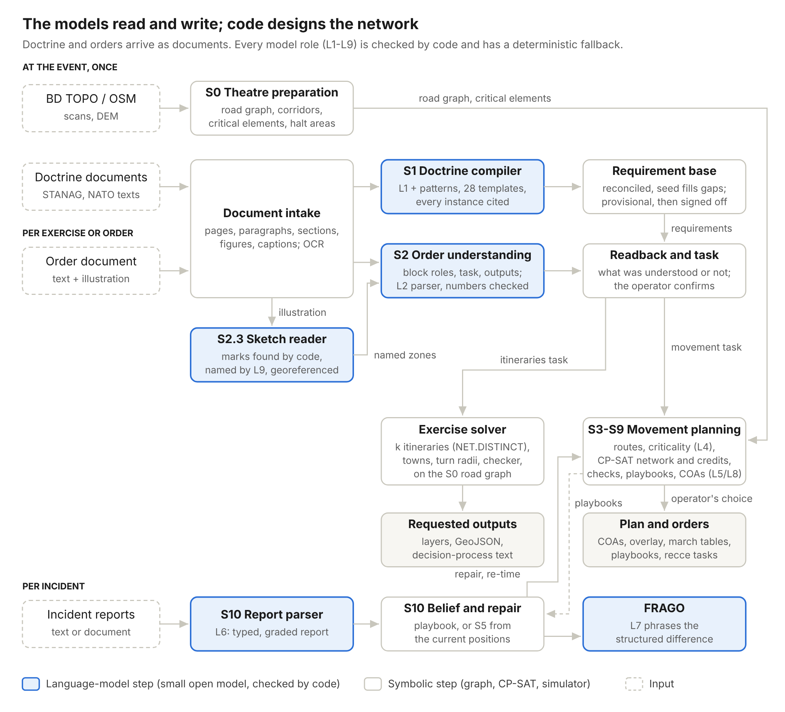
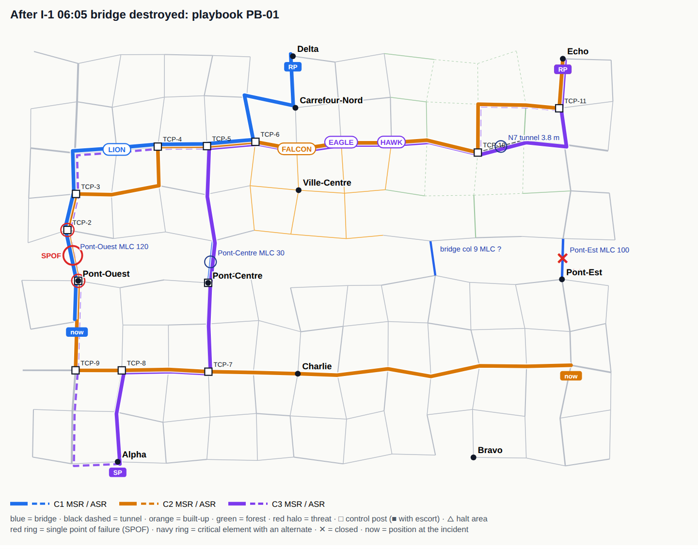

# CARTE — Constraint-Aware Routing with Trust Estimation

Convoy route planning on a scanned 1:100,000 map: one cost function and one solver for every constraint, the doubt of the
road reading priced in, and every decision explained. *Carte* is French for map. Built for the AMIAD hackathon
(Rennes, November 2026); the hackathon design (COA-Net) is kept below.

- **Routing core** (`src/coa_net/pdfexercises.py`, `interface/backend/`): hard constraints remove road sections (deployment
  area, zones to avoid, vehicle limits, earlier legs of the mission), soft ones price them (the U-Net's doubt, convoy
  deconfliction, turns); Dijkstra on a sparse graph, 0.14 s per route on one CPU core.
- **Explanation** (`src/coa_net/route_explain.py`, `interface/backend/route_chat.py`, `orders.py`, `order_links.py`): segment
  by segment, with the rejected alternative; NATO doctrine rules matched to each order (`RAG/`); one frozen local language
  model (Qwen3-VL-8B) with grammar-constrained decoding, checked; orders that amend orders; written orders
  (`text_order.py`).
- **Vision extension** (`scripts/prc_unet.py`, `src/coa_net/scanunet.py`): a fine-tuned Attention Res-U-Net reads the roads
  from the scan, with their probability, for when no road database exists.
- **Interface** (`interface/`, React + FastAPI): `interface/run.sh`, then http://localhost:8008. See `interface/README.md`.
- **Evidence**: `experiments/` (every run kept: config, environment, metrics, figures; `experiments/INDEX.md`),
  `docs/technical_overview.md`, the presentation in `docs/presentation/`.

## Data and models

| what | licence | how to get it |
|---|---|---|
| PRC U-Net code and pretrained weights | MIT | `python scripts/fetch_data.py --prc` (GitHub + Hugging Face) |
| BD TOPO roads of the sheet (IGN) | Licence Ouverte Etalab 2.0 | `python scripts/fetch_data.py --bdtopo` (Géoplateforme WFS, no key) |
| OpenStreetMap roads of the sheet | ODbL (© OpenStreetMap contributors) | `python scripts/fetch_data.py --osm` (Geofabrik) |
| Qwen3-VL-8B-Instruct (optional) | Apache 2.0 | `python scripts/fetch_data.py --llm` (Hugging Face, 17 GB) |
| Scanned IGN 1:100,000 sheet, exercise and order PDFs | handed out at the hackathon, not open | release archive, `examples/` |
| Our fine-tuned U-Net rasters, checkpoints, calibration and network caches | ours (derived from the sheet) | release archive, `outputs/` |

`fetch_data.py` writes the BD TOPO and OSM roads in the fields of the hackathon extracts, so the code reads them unchanged;
they are today's data, not the organisers' snapshot. Without the release archive the routing core still runs on BD TOPO or
OSM alone (« Sans modèle de segmentation » in the interface); the scan and the U-Net rasters are needed for the vision part.

```bash
python -m venv .venv && .venv/bin/pip install -e ".[dev]"        # Python 3.10+
.venv/bin/python scripts/fetch_data.py --all                      # open data and the PRC weights
# unzip the release archive at the repository root (examples/, outputs/), then:
interface/run.sh                                                  # http://localhost:8008 (Node.js 18+ builds the interface)
sbatch deploy/serve_llm.sbatch                                    # optional: the local language model (one GPU)
.venv/bin/python -m pytest -q                                     # 160 tests
```

---

## Background: COA-Net, the hackathon design


Prototype for the AMIAD hackathon (Rennes, 12-14 Nov 2026): design the maneuver road network for military logistic convoys from a map, doctrine, a logistic order and live incident reports, with language models of at most a few tens of billions of parameters.

**Core idea.** COA-Net plans the way a movement-control cell does. It first designates one shared network (main and alternate supply routes, route statuses, traffic control posts, halt areas) that keeps every convoy moving after the loss of any single bridge, tunnel or other critical element, wherever the road network allows it. It then gives every march unit a time slot on that network (movement credits), and presents the result as two to four courses of action (COAs) with their trade-offs. Small language models never draw a route: they turn the doctrine documents handed out at the event into typed, cited requirements, read each order document (text and illustration) into a task the operator confirms, turn the commander's intent into an order of priorities, and turn computed facts into a COA comparison and fragmentary orders (FRAGOs). CP-SAT models design the network and the schedule, a rule checker verifies every requirement, a simulator measures resilience, and contingency playbooks are briefed before departure. The full design, its rationale and the experimental plan are in [docs/COA-Net_methodology.md](docs/COA-Net_methodology.md); section 11 there describes this implementation and its measured results.



**Organisers' answer (3 Nov 2026).** The NATO doctrine is handed out during the hackathon as a set of textual documents, and orders are multimodal documents like the example exercise (text, an illustration with the zones drawn on a map crop, and the desired outputs). COA-Net therefore compiles the doctrine set at the event, with a citation (document, page, paragraph) on every requirement, a provisional base usable at once and a sign-off sheet for the instructors; it reads each order as a document, routes it to the right solver, and writes a readback of what it understood, what it cannot enforce and what it cannot produce. On the illustration, code finds the drawn zones and a vision-language model only names them. Methodology section 2.4 lists the changes; section 11.6 gives the measured results.

**Model deployment (3 Nov 2026).** Every model role runs on one open model deployed locally, on a machine the team controls (the organisers' H100 at the event, a team machine before it), never through a hosted API. The doctrine method does not change: the model is used as published, without fine-tuning and without doctrine examples in its prompts, since no doctrine is available before the event. See [Using a local language model](#using-a-local-language-model), [deploy/README.md](deploy/README.md) and methodology section 6.5.

**Image input (9 Nov 2026, branch `scan-roads`).** The brief says: "focusing on the image input and keeping the shapefiles for sanity checks is encouraged". On this branch the road network itself is read from the scanned IGN map: road symbols are classified by colour (blue expressway, red main road, orange departmental road, white road, dashed track), thinned to centre lines, joined at junctions and across the labels printed over them, and turned into the same road graph the rest of COA-Net uses. BD TOPO and OSM only check the result. Expressways are drawn as two wide bands, so their two lines are moved onto the median, where the real carriageways are. On Scenario 1 the 1:100 000 scan gives 22,250 km of road in about 75 seconds; 87.8 % of it lies within 25 m of a BD TOPO or OSM road, and exercise 1 solved on the image network alone passes its 19 checks. A learned corrector (`coa-net scan-learn`) uses the shapefiles as labels, never as plan input, to remove lines that are not roads, rank white roads and price doubtful links; it is scored only on map blocks it never saw. It adds the links the map cuts under expressways and railways and keeps a correction only if it brings routes closer to BD TOPO's on unseen blocks; town-pair routes go from 24% to 13% slower than BD TOPO's (ablation: docs/corrector_route_gate_ablation.md). Method, measured results and limits: [docs/image_input_method.md](docs/image_input_method.md).

```bash
coa-net scan-roads --data DATA --out outputs/scan_roads          # network from the 1:100k image + checks against the shapefiles
coa-net scan-learn --data DATA --out outputs/scan_learn          # learned corrector (shapefiles as labels, spatial cross-validation)
coa-net scan-unet --data DATA --out outputs/scan_unet            # optional U-Net (PyTorch); then scan-learn --unet outputs/scan_unet
coa-net exercise --data DATA --pdf exercise.pdf --corrector outputs/scan_learn --out outputs/ex1  # image network (--network bdtopo: as on main)
coa-net plan --order ORDER --scan "DATA/Scenario1 100K.tif" --corrector outputs/scan_learn --max-rank 5 --out outputs/plan_scan
coa-net pdf-exercises --data DATA --pdf exercises.pdf --network prc-alone --unet OUT/prc/T --out outputs/ex  # route exercises of a PDF (docs/prc_unet_and_pdf_exercises.md)
```

## Quick start

```bash
pip install -e ".[dev]"          # networkx, pydantic, requests, ortools, pytest
coa-net demo                     # synthetic theatre, order LOG-01, three incidents
pytest                           # 109 tests, about 40 s (document tests skip without the `docs` extra)
coa-net bench --seeds 20         # baselines B0-B1 against COA-Net, incident loop with and without playbooks
```

`coa-net demo` writes `outputs/demo/report.html` (maps before and after each incident, road movement graph, COA chart, mission and priorities, COA comparison, explanations, route network, march table, contingency annex, reconnaissance tasks, verification, FRAGOs), plus `panel_*.svg`, `network.geojson`, `facts.md`, `fragos.txt` and `metrics.json`. Everything runs on a laptop CPU without any model: each language-model role has a deterministic fallback, and `--no-cpsat` replaces the CP-SAT models with greedy versions. Python API: [examples/run_python_api.py](examples/run_python_api.py).

## What the demo shows

A synthetic theatre with a river with four bridges (Pont-Ouest MLC 120, Pont-Centre MLC 30, a bridge on column 9 of unknown class, Pont-Est MLC 100), the N7 tunnel (3.8 m), the built-up town of Ville-Centre. C1 (six heavy trucks, two fuel tankers) goes from Alpha to Delta, C2 (two tank transporters, MLC 100, 4.0 m) from Bravo to Echo, C3 (four medium trucks, one ambulance) from Alpha to Echo. The intent says "The enemy is likely to strike the crossings. Keep the tankers out of the towns.", so resilience comes first in the priority order.


**Before departure** (planning takes about 4 s on a 4-core CPU). C1 drives LION over Pont-Ouest; its alternate WOLF crosses Pont-Est (33.7 min, 1.69 times its best time, within the 1.8 detour guard), so no single strike stops C1. C2 can only cross at Pont-Est within the guard: COA-Net reports Pont-Est as an irreducible single point of failure (SPOF) and issues reconnaissance task RT-1 on bridge col 9, whose class decides whether C2 can get an alternate. C3 drives BEAR over Pont-Est with alternate EAGLE over Pont-Centre. The plan has 12 traffic control posts, 4 pre-verified playbooks, and movement credits: C1 06:00 to 06:20, C2 06:00 to 06:14, C3 06:11 to 06:31 (held 11 min to keep the time gap behind C1). The rule checker passes 325 checks; it reports C2's irreducible SPOF, three shortfalls of "should" requirements (the alternates WOLF and EAGLE cross about 3 km of built-up area each) and unknown road widths on three routes, priced as risk.

Without a designed alternate, one strike on Pont-Ouest stops C1. COA-Net's survivability rule gives it an alternate over Pont-Est:


**Incidents.**

| Time | Report | COA-Net response | Computed in |
| --- | --- | --- | --- |
| 06:05 | Pont-Est destroyed (graded A1) | Playbook PB-01, briefed before departure: C2 reroutes over Pont-Ouest on FALCON (arrives 06:50), C3 switches to EAGLE (departs 06:14, arrives 06:35) and gets a new alternate HAWK. Pont-Ouest is now an irreducible SPOF for C1 and C2, and the FRAGO lists the options: reconnoitre col 9 (with MLC 100 or more, C2's remaining route would drop from 42.5 to 17.0 min), protect Pont-Ouest, request a gap-crossing asset, or accept the risk. | 1.3 s with the FRAGO |
| 06:12 | Ambush confirmed near Ville-Centre (graded B1) | Repair from the columns' current positions: C2 on FOX (arrives 06:55), C3 on PUMA (arrives 06:39) with a new alternate LYNX; both main routes bypass Ville-Centre. | 1.2 s |
| 06:20 | C3 breaks down for 25 min | Movement credits re-solved, routes kept: C3 arrives 07:05. | 0.01 s |



The incident loop: beliefs first (graded reports, noisy-OR fusion), then a pre-verified playbook or a repair, re-timing, verification, redundancy restoration and a FRAGO that holds only what changed.


## Benchmark (synthetic, 100 random theatres and missions)

`coa-net bench --seeds 100 --reps 50`: same graphs, same travel times, same costs for every pipeline; each plan is replayed 50 times in the simulator under one uniformly drawn loss of a designated critical element (common random numbers). B0 and B1 plan the fastest route per convoy with no alternate: they are floors that show what a plan without designed redundancy loses. Full table: [docs/benchmark_100_seeds.md](docs/benchmark_100_seeds.md).


| pipeline | valid (all levels) | avoidable SPOF groups | resilience (veh.min, lower is better) | travel time (veh.min) | network km | reached a lost element (sim) | design time |
| --- | --- | --- | --- | --- | --- | --- | --- |
| B0 fastest route | 1 % | 95 % | 177.0 | 676 | 29.9 | 24.9 % | 0.05 s |
| B1 vehicle-aware | 1 % | 95 % | 175.3 | 670 | 29.0 | 23.7 % | 0.00 s |
| COA-Net, greedy design | 100 % | 0 % | 77.1 | 708 | 47.1 | 18.1 % | 0.00 s |
| **COA-Net, CP-SAT design** | **100 %** | **0 %** | **71.5** | 700 | 46.1 | **17.9 %** | 0.15 s |

Reading it: COA-Net removes every avoidable single point of failure (95 % of groups have one with the fastest routes), gives 99 % of groups an alternate at 1.16 times the main route's time, and, by the plan's own model, cuts the expected delay over loss scenarios from 175 to 72 vehicle·minutes, for 4.5 % more travel time and 59 % more designated network than the vehicle-aware fastest routes. The simulator shows a smaller gain, about 10 %, with overlapping intervals. Its plans meet every requirement level (halts, time gaps, control posts, survivability), and fewer columns drive into a lost element, partly because a loss covered by a playbook reaches the columns as a broadcast trigger instead of a new order. On-time probability is 100 % for every pipeline on these missions (deadlines are loose) and threat exposure is zero (the random missions carry no threat zones), so neither metric separates the pipelines yet. In the incident study (100 random incidents 10 minutes after the first departure), 48 incidents miss the designated network and are only logged; with playbooks, 28 of the other 52 get a playbook response and 24 a repair. Those 52 take about 0.5 s on average and about 3 s at most, without language models, and 85 % of the resulting plans are valid (81 % without playbooks). The other plans keep schedule or halt violations, and the order is still written; see methodology section 11.4.

## What is implemented

| Stage (methodology section 5) | Module | Status |
| --- | --- | --- |
| S0 theatre preparation | `graph.py`, `corridors.py`, `loaders.py`, `scenarios.py` | Road graph contracted into corridors between decision points (shortest paths stay exact); critical elements: bridges, tunnels, level crossings, fords, ferries, defiles, and per-group articulation points; OSM and BD TOPO loaders; synthetic theatre with planted constraints and halt areas. Missing attributes stay *unknown*. |
| S1 requirement base (L1) | `documents.py`, `doctrine.py`, `corpus.py`, `requirements.py` | 28 requirement templates (26 doctrinal, plus SEG.TOWN and NET.DISTINCT added for the organisers' exercise format) at five levels (road, route, network, schedule, protection) and four tiers. A set of doctrine documents (PDF, Word, text, scans) is read with page, paragraph and section, compiled in one pass (model instances checked for quote and numbers, united with the pattern compiler), reconciled across documents (precedence, then the stricter value; conflicts listed), and completed by the seed base; outputs a base usable at once with `--provisional`, a sign-off sheet and a corpus report with coverage per document. |
| S2 order understanding and intent (L2, L3, L9) | `documents.py`, `orderdoc.py`, `figures.py`, `parsing.py`, `mission.py`, `intent.py` | Order documents (PDF, Word, text, image): block roles, task routing (itineraries or movement), desired outputs mapped to writers, every number checked against the document, a readback with NOT ENFORCED and NOT PRODUCED items. Sketch reader: marks found by colour, georeferenced on the place names, named by the model (L9) or by the order's position words. Convoy groups and march units, intent mapped to a priority order with quotes and imperatives to confirm. |
| S3 candidate routes | `candidates.py` | Pareto routes, label-setting search for halts, crossings and range, turn-expanded search for long vehicles, replacement routes, cheapest element-disjoint pairs, articulation points. |
| S4 criticality (L4) | `criticality.py` | Exact structural impact of every loss, irreducible SPOFs, likelihood from the red-team model or a table by element type, fused with reported threats; loss scenarios. |
| S5 network design | `design.py` | Path-based model on CP-SAT: survivability, detour guard, objectives optimised one at a time in the priority order with tolerances (lateness first); COA archetypes; greedy fallback. |
| S6 refinement | `refine.py` | Road-level routes, halts, traffic control posts and escorts, route statuses, route names, GeoJSON overlay. |
| S7 movement credits | `schedule.py` | CP-SAT: time gaps at both ends of every shared segment, order between units as a decision, meetings on single-lane roads, junctions, halt-area capacity, time windows, deadlines; greedy fallback. |
| S8 verification and anticipation | `verify.py`, `anticipation.py`, `simulate.py` | Rule checker at five levels; contingency playbooks; reconnaissance tasks by value of information; discrete-event Monte Carlo with report and order delays and breakdowns. |
| S9 COAs and briefing (L5, L8) | `coa.py`, `explain.py` | Facts table, COA comparison whose numbers are checked against the facts, contrastive explanations. |
| S10 incident loop (L6, L7) | `belief.py`, `incidents.py`, `orders.py` | Admiralty-graded reports, belief update, playbook or repair from current positions, re-timing, verification, redundancy restoration, FRAGO from a structured plan difference. |
| Evaluation | `baselines.py`, `bench.py` | B0-B1, COA-Net greedy and CP-SAT, incident loop with and without playbooks. |
| Outputs | `render.py`, `pipeline.py`, `cli.py` | HTML report, SVG maps, road movement graph, COA chart, GeoJSON, optional Folium map (`render.render_folium`, Python API only: no command calls it); `COANet` session object; command line. |

**Not done yet:** the long-context and vision-language baselines (B2, B3), runs on other real map extracts (F2), checking SCH.VARY (needs several rotations), most ablations (only A5a greedy and A7 no playbooks are in the benchmark), and the human evaluation. The organisers' Scenario 1 (F3) now runs end to end: exercise 1 and a full plan with incidents on a test order ([docs/real_data_validation.md](docs/real_data_validation.md)). No language model was run for any of these numbers: they come from the deterministic fallbacks, so token budgets are not measured yet. The deviations from the methodology are listed in its section 11.4 and, for the real data, in the validation document.

## Using a local language model

Every model role runs on one open model, Mistral Small 3.2 24B (Apache 2.0, takes images), served on a machine the team controls through an OpenAI-compatible endpoint: vLLM in bf16 on the organisers' H100 (about 55 GB of GPU memory), or llama.cpp or Ollama with a 4-bit GGUF file (14.3 GB) on a 24 GB GPU or a 32 GB Mac. No hosted API is needed, and doctrine and orders stay on that machine. [deploy/README.md](deploy/README.md) gives the machines, the offline download and the commands for before and at the event.

```bash
deploy/serve_llamacpp.sh &       # llama.cpp on 127.0.0.1:8000, 4-bit model downloaded on the first run; deploy/serve_vllm.sh on the H100
coa-net llm-check                # the server's models, a schema-constrained JSON answer, an image, the generation rate

coa-net compile-doctrine path/to/doctrine/ --llm --out rules/     # drafts with citations, corpus report, sign-off sheet
coa-net demo --llm --requirements rules/requirements.json --provisional
coa-net exercise --data DATA --pdf exercise.pdf --llm --out outputs/ex1           # the sketch reader (L9) sends the numbered illustration
```

COA-Net calls `http://127.0.0.1:8000/v1` by default and takes the model the server lists. The settings, all optional (template: `deploy/coa-llm.env.example`):

| Variable | Default | Meaning |
| --- | --- | --- |
| `COA_LLM_BASE_URL` | `http://127.0.0.1:8000/v1` | the model server; Ollama listens on `http://127.0.0.1:11434/v1`. An address outside this machine and its private network is refused |
| `COA_LLM_ALLOW_REMOTE` | unset | `1` accepts a remote endpoint; the report then says the model was remote. Prefer an SSH tunnel to 127.0.0.1 |
| `COA_LLM_MODEL` | the first model the server lists | the model name, if the server serves several |
| `COA_LLM_JSON_SCHEMA` | `1` | `0` for a server without schema-constrained output (`llm-check` tells) |
| `COA_LLM_CONNECT_TIMEOUT`, `COA_LLM_TIMEOUT` | 5 and 120 seconds | after the first failure, the rest of the run uses the fallbacks at once |
| `COA_LLM_LOG` | unset | a file on this machine where every prompt and answer is appended (JSON lines, without image data) |
| `COA_LLM_API_KEY` | unset | only if the server asks for one |

`--llm` asks the server for its models before the run and stops with advice if none answers. Every model output is checked by code (shape against the schema, verbatim quotes, numbers stated by their quote or found in the order, identifiers that must appear in the computed facts, mark names taken from the order) and replaced by the deterministic fallback after one failed retry. If the server stops answering during a run, the later roles fall back at once, and the report says so. The model, where it ran and the token usage per stage go to `metrics.json`. The doctrine method is the same with or without a model: the model's instances are united with the pattern compiler's, then reconciled and signed off.

## Doctrine and orders as documents

```bash
pip install -e ".[docs]"         # pdfplumber, python-docx, pypdfium2, pypdf, pillow, rapidocr, scipy
coa-net compile-doctrine DOCTRINE_DIR --out outputs/base       # requirements.json (drafts + seed), corpus_report.md, signoff.csv, documents.json
coa-net signoff --base outputs/base/requirements.json --sheet outputs/base/signoff.csv --out outputs/base/approved.json --reviewer NAME
coa-net read-order exercise.pdf --out outputs/ex1/readback.md  # what was understood, not enforced, not produced; the command that solves it
coa-net exercise --data DATA --pdf exercise.pdf --requirements outputs/base/requirements.json --provisional --out outputs/ex1
coa-net plan --order order.docx --requirements outputs/base/approved.json --out outputs/plan
```

`--precedence` sets which documents win a conflict (default: the order, then movement standards such as STANAG or AMovP, then general doctrine such as AJP, then other documents), and `--no-seed` compiles the documents alone. A run with `--provisional` uses the drafts before sign-off and says PROVISIONAL in every output. Measured on the organisers' PDFs (methodology section 11.6): exercise 1 read and routed in under 0.5 s with nothing left unenforced or unproduced; a 12-page French PDF read in 1.3 s with its running heads dropped; a stand-in doctrine set of 16 pages compiled in 1.7 s.

## Real maps

```bash
pip install -e ".[osm]"
coa-net fetch-osm --place "Guer, France" --out cache/guer.graphml          # cache before the event
coa-net plan --graphml cache/guer.graphml --places examples/places_brittany.json \
    --order examples/order_brittany.txt --incident "22:20@bridge destroyed near Montfort" --out outputs/bzh

# IGN BD TOPO (Lambert-93 GeoPackage with a troncon_de_route layer); --dem adds slopes (needs rasterio)
coa-net plan --bdtopo BDTOPO_D035.gpkg --places places.json --order order.txt --out outputs/bdtopo
```

`--places` seeds the gazetteer (`{"name": [lon, lat]}`) so that orders and incidents can name places. OSM and BD TOPO carry no military load class, so bridges stay *unknown* until a reconnaissance file or the organisers' data provides it; COA-Net turns the unknowns that matter into reconnaissance tasks. The osmnx and BD TOPO GeoPackage loaders are unit-tested on parsing but have not been run against live data from this environment.

## Organisers' data (Scenario 1)

The organisers' Scenario 1 delivery (BD TOPO v2 and OSM shapefiles without `.prj`, IGN 1:100 000 and 1:250 000 scans, the preparation exercise as a PDF) runs end to end. What was found in the files, what changed in the method, the measured results and the remaining limitations are in [docs/real_data_validation.md](docs/real_data_validation.md).

```bash
pip install -e ".[real]"         # geopandas, pyogrio, shapely, pyproj, rasterio, scipy, pandas, matplotlib, pillow, rapidocr, pypdf
coa-net audit --data DATA        # files, CRS, encodings, OSM/BD TOPO agreement, scan alignment
coa-net exercise --data DATA --pdf exercise_for_preparation.pdf --out outputs/exercise1
coa-net plan --bdtopo DATA/Scenario1_BDTopo.shp --places examples/places_scenario1.json --order examples/order_scenario1.txt \
    --max-rank 4 --recce-max 6 --reps 20 --incident "06:40@Bridge destroyed near Ploermel, confirmed by the gendarmerie (A1)." \
    --out outputs/scenario1_plan
```

`exercise` reads the statement and the sketch from the PDF, the town populations and built-up areas from the 1:100 000 scan (OCR on CPU), georeferences the sketch's zones against the scan, compiles the constraints into requirements (NET.DISTINCT, SEG.TOWN on top of the seed base), searches the three separated itineraries with junction turns priced, checks them again from the geometry, and writes `itineraries.geojson` (with the difficult turns and their radii), `difficult_areas.geojson`, `zones.geojson`, `towns_over_threshold.geojson`, two map layers on the scan, `decision_process.txt` and `metrics.json`.


**Second routing engine.** `coa-net exercise ... --graphhopper` also solves the itineraries with a local GraphHopper server (Java 17+, `graphhopper-web-*.jar` in `COA_GH_HOME` or `../tools`) on the same roads and costs, and prints the comparison. `--gh-turns` adds a GraphHopper variant that prices junction turns like the turn-aware search. On exercise 1 both variants find the same best sets as the built-in router, more slowly (39 s and 184 s against 30 s and 45 s): [docs/graphhopper_comparison.md](docs/graphhopper_comparison.md).

## Layout

```
src/coa_net/
  graph.py         annotated road graph, gazetteer, geometry
  corridors.py     S0 corridor graph, critical elements, map card
  loaders.py       OSM, BD TOPO, DEM
  realdata.py      organisers' Scenario shapefiles (BD TOPO v2, OSM Geofabrik): CRS, encodings, attributes, graph
  scanmap.py       IGN scans: built-up tint, OCR of town names and populations, sketch georeferencing and zones
  scanroads.py     road network read from a scanned map (image input): symbol colours, centre lines, junctions, label gaps, bridges
  scancheck.py     sanity checks of the image network against BD TOPO and OSM (buffer, class, junction and route measures)
  scanlearn.py     learned corrector of the image network: shapefiles as labels, LightGBM, spatial cross-validation, gate
  scanroute.py     route gate of the corrector: fastest convoy routes on the corrected image network against BD TOPO, per fold
  scancnn.py       crop network (small CNN, PyTorch) for bridges and flyovers, on the same spatial folds
  scangeom.py      learned displacement of the image lines toward the roads (map generalisation)
  scanunet.py      U-Net on the scan (road, importance, bridge), out of fold; corrector features, or a network of its own
  exercise.py      exercise statements: parser, NET.DISTINCT solver, turn-aware router, turn radii, checks, difficult areas
  scenario.py      `coa-net exercise` pipeline and its outputs (layers, GeoJSON, decision text)
  audit.py         data audit: files, OSM/BD TOPO agreement, scan alignment, scan check of routes
  scenarios.py     synthetic theatre, random missions and incidents
  schemas.py       typed records passed between stages: locations, vehicle groups, convoys, mission, incidents
  vehicles.py      vehicle catalogue (illustrative values), binding profiles, march columns
  requirements.py  28 templates, tiers, seed requirement base
  documents.py     document intake: PDF, Word, text, images (OCR); blocks with page, paragraph, section; figures and captions
  doctrine.py      S1 doctrine compiler for one document (L1, united with the patterns)
  corpus.py        S1 doctrine set: reconciliation, seed fill-in, sign-off sheet, provisional base, corpus report
  orderdoc.py      S2 order documents: block roles, task routing, desired outputs, number checks, readback
  figures.py       S2 sketch reader: marks by colour, set-of-marks image, naming (L9 or position words), georeferencing
  parsing.py       order parser (L2), incident parser (L6)
  intent.py        S2 intent to priority order (L3)
  mission.py       S2 groups, march units, active requirements
  costing.py       per-group evaluation of roads and corridors
  candidates.py    S3 candidate routes
  criticality.py   S4 impact, likelihood (L4), loss scenarios
  design.py        S5 network design (CP-SAT), COA archetypes
  refine.py        S6 routes, halts, control posts, statuses, names
  schedule.py      S7 movement credits (CP-SAT)
  verify.py        S8 rule checker
  anticipation.py  S8 playbooks, reconnaissance tasks (value of information)
  simulate.py      S8 discrete-event simulation, Monte Carlo
  coa.py           S9 facts table and comparison (L5)
  explain.py       contrastive explanations (L8)
  belief.py        S10 belief model
  incidents.py     S10 incident loop
  orders.py        plan difference and FRAGO (L7)
  llm.py           client for the locally deployed model (OpenAI-compatible): local-only endpoint, fast failure, checks
  render.py        maps, road movement graph, COA chart, HTML report
  pipeline.py      COANet session object
  baselines.py     B0-B1
  bench.py         benchmark
  cli.py           command line (`coa-net templates` prints the requirement template catalogue)
  __main__.py      `python -m coa_net`, calls `cli.main()`
  data/            seed requirements, sample doctrine, order and incidents
deploy/            serving the model locally: vLLM (H100), llama.cpp (team machine), settings template
docs/              methodology, benchmark table, figures (PNG) and the script that draws them
examples/          Python API example, OSM order and gazetteer
tests/             pytest suite
```

The figures are regenerated with `python docs/figures/make_figures.py --bench docs/benchmark_100_seeds.md` (PNG output needs `pip install playwright && playwright install chromium`; without it, HTML pages are written).

## Contracts

Each code folder has a README that lists its public interface, the rules developers must keep (invariants) and its side effects, with every entry tied to a code symbol:

- [src/coa_net/README.md](src/coa_net/README.md): the planner, stage by stage (S0 to S10).
- [src/README.md](src/README.md): the source root.
- [examples/README.md](examples/README.md): the Python API example and the Brittany inputs.
- [docs/README.md](docs/README.md) and [docs/figures/README.md](docs/figures/README.md): the documents and the figure generator.
- [deploy/README.md](deploy/README.md): serving the model locally (vLLM, llama.cpp) and the `COA_LLM_*` settings template.

`tests/` holds the pytest suite and has no contract of its own. Run `pytest` from the repository root to check the system (`testpaths = ["tests"]` and `pythonpath = ["src"]` in [pyproject.toml](pyproject.toml)).

### Rules that hold across the system

- **No model draws a route.** Model outputs pass through `call_validated`, and generated prose is checked with `unsupported` against the computed facts. On any failure, the system uses the deterministic template or pattern path instead. [`llm.py:call_validated`, `llm.py:unsupported`]
- **Plan validity.** A plan is valid when no T0/T1 requirement is violated. Missing map data is reported as `unknown` and priced as risk, never counted as a violation. [`verify.py:VerificationReport.ok`]
- **Requirements must be approved before they apply.**
  - Only `approved` requirements are activated.
  - Requirements compiled from doctrine are `draft` until a person approves them (`coa-net signoff`). A run with `--provisional` uses them before sign-off and marks every output PROVISIONAL, with the drafts it used.
  - The bundled `data/seed_requirements.json` file is pre-approved, but its sources are not doctrine. 24 records are stand-in rules of common movement-control practice and 13 are template default values; all are to be confirmed with the instructors. 13 records are marked `assumption: true`.

  So "valid" in the demo means valid against this seed base. [`requirements.py:activate`, `doctrine.py:compile_doctrine`]
- **Reproducibility.** CP-SAT runs single-threaded with seed 0. The synthetic theatres, missions, incidents and simulations are seeded. Results can still vary when a solver time limit is reached, and recorded wall-clock timings always vary. [`design.py`, `schedule.py`, `simulate.py`]
- **Without OR-Tools, the guarantees are weaker.** `--no-cpsat` (or a missing OR-Tools install) switches to greedy design and scheduling, whose status is `heuristic`. These versions do not guarantee the T1 survivability, network-size or separation rules. [`design.py:greedy`, `schedule.py:_greedy`]

### Side effects

- **Outputs:** written under `outputs/`, which git ignores, unless `--out` is given:
  - `report.html`, `panel_*.svg`, `network.geojson`, `facts.md`, `fragos.txt`, `metrics.json`, `readback.md`
  - `bench.md`
  - `compile-doctrine`: `requirements.json`, `requirements_doctrine.json`, `corpus_report.md`, `signoff.csv`, `documents.json`
  - `exercise`: `itineraries.geojson`, `difficult_areas.geojson`, `zones.geojson`, `towns_over_threshold.geojson`, `map_itineraries.png`, `map_difficult_areas.png`, `decision_process.txt`, `metrics.json`; a cache folder (`OUT/cache` unless `--cache` is given) for built-up areas, OCR towns, zones and georeferencing
  - `exercise --pdf`: also `exercise.txt`, `blocks.json`, the extracted illustration `sketch.<ext>`, `sketch_marks.png`, `readback.md`
  - `audit`: `audit.json` (default `outputs/audit.json`)
  - `llm-check --out FILE`: the check report as JSON
- **Model server:** with `--llm` or `coa-net llm-check`, calls to a locally deployed OpenAI-compatible model server (`GET /models`, then `POST /chat/completions`), configured with the `COA_LLM_*` variables above; with `COA_LLM_LOG`, a local file of prompts and answers. The `deploy/` scripts download the model on their first run unless local files are given.
- **Map data:**
  - Optional OSM downloads through osmnx, cached as GraphML; `cache/` and `*.graphml` are git-ignored.
  - Optional local BD TOPO GeoPackage and DEM files.
- **Figures:** `docs/figures/make_figures.py` rewrites the figure HTML and PNG files in `docs/figures/`.

## Next steps before the event

1. Ask the ETLO for the PFM characteristics (weight, MLC, width, height, length) and any bridge classification, and calibrate the turn costs and difficult-turn thresholds with them (see [docs/real_data_validation.md](docs/real_data_validation.md), section 9).
2. Run the language-model roles with Mistral Small 3.2 24B on a local server: the 4-bit build on a team machine first, then bf16 on the H100; L1, L2 and L9 first; measure tokens, generation rates and the precision of the compiled requirements and readbacks. Copy the weights and the server software onto two disks for the event. Give `parse_exercise` a model path (same schema, verbatim quotes checked, patterns as the fallback).
3. Rehearse the first hours of the event (methodology section 12): a stand-in doctrine set of public NATO texts, and exercises written like exercise 1 with other colours, points instead of zones and a convoy movement.
4. Cross-check the OCR town populations with the INSEE populations joined on the BD TOPO commune codes.
5. Baselines B2 and B3 (whole map card or rendered map given to the model), to answer the brief's hypothesis on equal terms.
6. Pre-register parameters (detour guard, tolerances, likelihood table, belief thresholds, turn costs) before the event.
