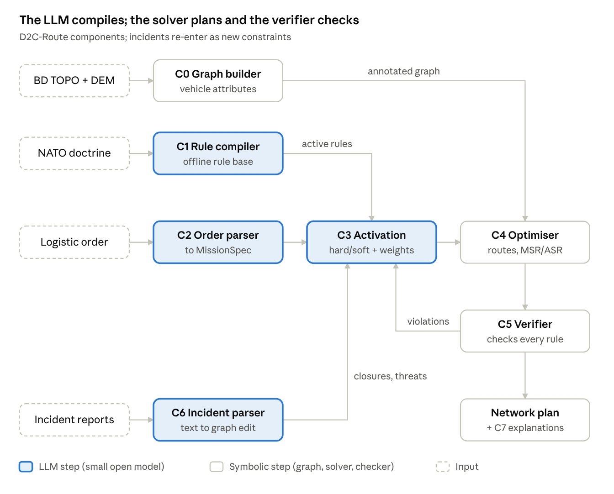

# D2C-Route: Doctrine-to-Constraint Routing

Prototype for the AMIAD hackathon (12-14 Nov 2026): build and adapt a maneuver road network for military logistic convoys from a map, NATO doctrine, a logistic order and live incidents, with language models of at most a few tens of billions of parameters.

**Core idea.** The language model never draws a route. Small LLMs compile doctrine, the order and incident reports into typed, machine-checkable constraints. A graph optimiser builds the main and alternate supply routes (MSR/ASR) for every convoy, a symbolic verifier checks every rule, and incidents trigger a local, stable repair. Every route segment can be traced to the rule that shaped it. The full rationale, literature review and experimental plan are in [docs/methodology_proposal.md](docs/methodology_proposal.md).



## Quick start

```bash
pip install -e ".[dev]"          # networkx, pydantic, requests, pytest
d2c-route demo                   # synthetic theatre, sample order, 3 incidents
pytest                           # 32 tests, about 3 s
d2c-route bench --seeds 20       # baselines, ablations, repair study
```

`d2c-route demo` writes `outputs/demo/report.html` (maps before and after each incident, plus explanations), `explanation.md`, `plan.json`, `constraints.json` and `metrics.json`. Everything runs on a laptop CPU without any model: each LLM step has a deterministic fallback.

## What is implemented

| Proposal component | Module | Status |
| --- | --- | --- |
| C0 annotated road graph | `graph.py`, `loaders.py`, `scenarios.py` | Synthetic theatre with planted constraints; OSM loader (osmnx); BD TOPO `troncon_de_route` loader; DEM slopes (rasterio). Missing attributes stay *unknown*. |
| C1 doctrine compiler | `parsing.compile_doctrine`, `expr.py` | LLM extraction into a typed rule DSL with schema-constrained JSON; every rule is validated (safe AST whitelist, known attributes) and de-duplicated. Pattern fallback for the bundled sample. |
| C2 order parser | `parsing.parse_order` | LLM to `MissionSpec`, unknown vehicle types and unclear items go to `ambiguities` instead of being guessed. Regex fallback (English and French). |
| C3 activation and weighting | `constraints.py` | Rules activated by scope (vehicle class, day/night, cargo); stricter value wins on conflicts; optional bounded LLM re-weighting of soft terms. The LLM can never drop a hard rule. |
| C4 network optimiser | `optimizer.py` | Hard filters, doctrine-weighted cost, k diverse routes by penalty method, MSR + ASR selection under overlap/detour rules, halts, prioritised time deconfliction with headway, ASR promotion when the MSR misses the time window. |
| C5 verifier and repair loop | `verifier.py` | Independent re-check of every active rule, unknown data, alternates, overlap, time windows and convoy conflicts. On infeasibility it names the blocking rules; only rules marked `relaxable` are turned soft (logged), anything physical goes to the operator. |
| C6 incident handler | `parsing.parse_incident`, `incidents.py` | Text to typed incident (bridge destroyed, road blocked, threat zone, weather, breakdown), gazetteer geolocation, graph edit, replanning of the affected convoys only, from their current position, with a stability bonus for the current route. `mode="full"` is the ablation. |
| C7 explanations | `explain.py` | Per convoy: binding vehicle profile, roads, residual exposure per rule, the doctrine-blind shortest path and the exact rules it breaks, alternates, delays, relaxations. |
| C8 VLM tool | not yet | See roadmap. |
| Evaluation (section 8) | `bench.py` | Baselines B1/B2, D2C with and without deconfliction, local vs full repair, over random synthetic scenarios. |

### Rule language

Rules live in a JSON rule base (`src/d2c_route/data/seed_rules.json` holds 23 stand-in rules). Predicates and features are small expressions over `edge.*` and `vehicle.*`:

```json
{"id": "H-BRIDGE-MLC", "type": "hard", "predicate": "not edge.bridge or edge.mlc >= vehicle.mlc", "on_unknown": "forbid"}
{"id": "S-HAZMAT-BUILTUP", "type": "soft", "scope": {"cargo": ["fuel", "ammunition"]}, "feature": "edge.built_up", "weight": 2.0}
{"id": "N-ALTERNATE", "type": "network", "params": {"min_alternates": 1, "max_overlap": 0.5, "max_detour": 1.8}}
{"id": "T-NIGHT", "type": "temporal", "scope": {"phases": ["night"]}, "params": {"speed_factor": 0.7}}
```

Evaluation uses three-valued logic: a missing map attribute makes a predicate *unknown*, which is priced as risk (default) or forbidden (`on_unknown: "forbid"`, used for unclassified bridges), and always reported by the verifier. The seed rules paraphrase common public movement-control principles; they are **not** quotations of NATO publications and must be replaced by rules compiled from the organisers' doctrine.

## Using a local LLM

Any OpenAI-compatible server works, so the choice of hardware is open (single GPU, CPU with llama.cpp, Apple silicon with Ollama):

```bash
# e.g. vLLM on one 24-48 GB GPU
vllm serve Qwen/Qwen3-14B-AWQ --port 8000
# or Ollama
ollama serve & ollama pull qwen3:14b

export D2C_LLM_BASE_URL=http://localhost:8000/v1     # Ollama: http://localhost:11434/v1
export D2C_LLM_MODEL=Qwen/Qwen3-14B-AWQ              # Ollama: qwen3:14b
export D2C_LLM_JSON_SCHEMA=1                          # 0 if the server lacks structured output

d2c-route compile-doctrine path/to/doctrine.txt --llm --out rules/compiled.json
d2c-route demo --llm --rules rules/compiled.json
```

Token usage per stage (doctrine, order, activation, incident, relaxation) is written to `metrics.json` for the frugality metrics. Compiled rule bases automatically get the operational rules (`H-CLOSED`, `H-THREAT`, `S-THREAT`, `S-WEATHER`) that make incident edits bite.

## Real maps

```bash
pip install -e ".[osm]"
d2c-route fetch-osm --place "Guer, France" --out cache/guer.graphml     # cache before the event
d2c-route plan --graphml cache/guer.graphml --places examples/places_brittany.json \
    --order examples/order_brittany.txt --incident "22:20@bridge destroyed near Montfort" --out outputs/bzh

# IGN BD TOPO (Lambert-93 GeoPackage), plus optional DEM for slopes
d2c-route plan --bdtopo BDTOPO_D035.gpkg --places places.json --order order.txt --out outputs/bdtopo
```

`--places` seeds the gazetteer (`{"name": [lon, lat]}`) so orders and incidents can refer to named places. OSM and BD TOPO carry no military load class, so bridges are unknown (and therefore forbidden by `H-BRIDGE-MLC`) until a recce file or the organisers' data provides MLCs: set `mlc` on those edges or relax `on_unknown` to `"risk"`. The OSM and BD TOPO loaders are unit-tested on parsing but have **not** been run against live data from this environment (no network access to OSM); BD TOPO field names follow v3 and may need a tweak in `loaders.BDTOPO_FIELDS`.

## First benchmark (synthetic, 20 scenarios)

`d2c-route bench --seeds 20`, every method verified against the full doctrine program:

| method | invalid convoys | conflicts | network violations | soft satisfaction | alternates |
|---|---|---|---|---|---|
| B1 fastest path, no doctrine | 37 % | 5.1 | 3.3 | 0.76 | 0 |
| B2 vehicle-aware, hard rules only | 0 % | 5.9 | 3.3 | 0.76 | 0 |
| D2C without deconfliction | 0 % | 5.7 | 0 | 0.79 | 1 |
| **D2C-Route** | **0 %** | **0** | **0** | **0.79** | **1** |

Incident repair: local repair replans 1.5 convoys on average instead of 4 and leaves 88 % of convoys untouched (82 % for a full re-plan), in about 10 ms on these small graphs. These numbers only show the pipeline works on planted constraints; the synthetic theatre is small (140 nodes) and the soft-satisfaction metric is coarse. The real evaluation needs the organisers' data, the LLM-in-the-loop ablations and expert ranking (proposal section 8).

## Layout

```
src/d2c_route/
  schemas.py      typed records (Rule, MissionSpec, ConstraintProgram, Incident, Plan, Violation)
  expr.py         safe three-valued expression language for rules
  vehicles.py     vehicle catalogue (illustrative values) and convoy profiles
  graph.py        canonical graph, gazetteer, geometry helpers
  loaders.py      OSM, BD TOPO, DEM
  constraints.py  rule base, activation, LLM re-weighting
  optimizer.py    costing, diverse routes, MSR/ASR, scheduling, deconfliction
  verifier.py     verifier, blocking-rule diagnosis, relaxation loop
  incidents.py    incident graph edits and local repair
  parsing.py      doctrine compiler, order parser, incident parser (LLM + fallbacks)
  explain.py      explanations
  render.py       SVG / HTML report, optional Folium map
  pipeline.py     D2CRoute session object
  bench.py        experiments
  cli.py          command line
  data/           seed rules, sample order, sample doctrine, sample incidents
docs/             methodology proposal and architecture figure
examples/         Python API example, OSM example order and gazetteer
tests/            pytest suite
```

## Roadmap before the hackathon

1. Run the OSM path on a cached extract of a plausible exercise area, and time it on a 30-50 km graph (costing is pure Python; compile predicates to closures if it is slow).
2. Compile public movement-control doctrine with a 14-32B model and build the 50-100 passage gold set for extraction precision/recall.
3. Baselines B (ReAct agent with graph tools) and C (long-context VLM with the map image, routes snapped to the graph) for the head-to-head comparison.
4. C8: small VLM as a narrow tool (reading a scanned overlay, final visual sanity check).
5. Deconfliction at crossings (node conflicts) and incident expiry (`duration_min`); CP-SAT for small instances.
6. A Leaflet/Folium operator view with rule weights the officer can adjust.
