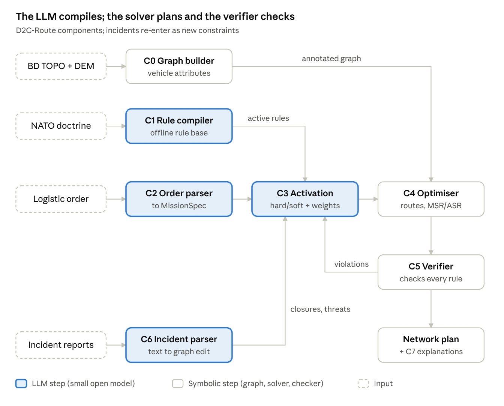

# AMIAD Hackathon: Methodology Proposal for Adaptive Military Logistics Route Networks

Oct 21, 2026 · @arezki bouzid

**Recommendation:** do not let a language model draw routes. The reference benchmarks show the best VLMs find the correct route on a map only about a third of the time. Instead, use small open models (7-32B) to **compile NATO doctrine, the logistic order and incidents into explicit constraints**, and let a graph optimiser build, verify and repair the maneuver network. This "D2C-Route" design is valid by construction, frugal with context, explainable rule by rule, and can be compared head-to-head with the brief's long-context multimodal hypothesis.

## 1. Challenge analysis

The task is not "find a shortest path": it is to produce a **doctrine-compliant maneuver road network** for several convoys, explain it, and **repair it quickly** when incidents arrive, using models of at most a few tens of billions of parameters.

**Core objective.** Given a map, NATO doctrine, a logistic order and live incidents, output a set of routes (main supply route, alternates, assembly and halt areas) that a logistics officer would accept, and adapt it during the exercise.

**Inputs and what each really contributes**

| Input | Format | What it encodes | Main difficulty |
| --- | --- | --- | --- |
| IGN BD TOPO map | OSM-style vector and/or rendered image | Road graph, road class, width, bridges and load classes, tunnels, slopes, land cover, built-up areas | Attribute completeness; bridging between vector graph and image views |
| NATO doctrine | Long text documents | Rules on route classification, convoy spacing, halts, speeds, MSR/ASR designation, force protection | Implicit, conditional, scattered rules; must become machine-checkable constraints |
| Logistic order | Military order (text, likely semi-structured) | Units, vehicle types and counts, loads, start and end points, time windows, priorities | Parsing domain jargon into a structured mission spec |
| Incidents | Messages during the exercise | Blocked roads, destroyed bridges, threats, weather, breakdowns | Must be geolocated, interpreted and turned into graph edits in near real time |

**Hard requirements (from the brief)**

- Automatic and evolutive: the network is regenerated or repaired from new information without a human redrawing it.
- Multi-convoy: the whole set of convoys must reach the objective, so deconfliction matters, not only per-convoy optimality.
- Doctrine-aware: as many NATO doctrine elements as possible should shape the result.
- Context-frugal: the representation of doctrine and constraints must not saturate the context window.
- Deployable: models of a few tens of billions of parameters at most, implying a single-GPU or edge setting.

**Key technical challenges**

1. **Grounding.** LLMs and VLMs are unreliable at precise spatial reasoning on maps (distances, topology, scale); the cited benchmarks show this clearly (section 2). Route geometry must come from the graph, not from generated text.
2. **Knowledge to constraints.** Turning doctrine prose and an order into hard constraints (vehicle class versus bridge class), soft preferences (avoid built-up areas) and multi-objective weights is the crux of the problem.
3. **Context budget.** Doctrine corpora run to hundreds of pages; a 30B model with a 128k window cannot read everything every time, so retrieval and compact constraint representations are needed.
4. **Dynamic replanning.** Incidents must trigger local, fast and explainable repairs rather than a full recomputation that could reshuffle every convoy.
5. **Multi-convoy coordination.** Time-space deconfliction on shared roads and crossings, and redundancy (alternate routes) are network-level properties.
6. **Verifiability and trust.** A military user needs to see why a route was chosen and which rule it satisfies; hallucinated routes are unacceptable.
7. **No data yet.** Ground truth (what an expert would choose) is not available, so evaluation must rely on constraint satisfaction, synthetic scenarios and expert review.

## 2. Critical review of the reference papers

The five references split into two families. Two are **planning** works that couple language with a route solver (IG-PRM, MobilityBench). Three are **map-understanding** benchmarks that measure how well vision-language models (VLMs) read maps (CartoMapQA, FRIEDA, VISQAM). Read together, they make one strong argument: VLMs should not draw the route themselves.

### 2.1 IG-PRM: Instruction-Guided Probabilistic Roadmaps (Bao and Yonetani, 2025)

**Principle.** A natural-language instruction ("aim for wider paths") is embedded with an off-the-shelf text-embedding model, reduced to 128 dimensions, and concatenated with an occupancy grid. A U-Net predicts an instruction-conditioned **cost map**. A PRM samples nodes inversely to cost and weights edges by length times cost; Dijkstra finds the path.

**Strengths.** Language only modulates costs, so the planner keeps its guarantees and stays modular ("drop-in replacement" for a global planner). The cost map is computed once per instruction and map, so it supports multi-query use. It runs on CPU in about 0.4 s per query.

**Weaknesses and limits.** Toy setting: 64 x 64 grids, three preference types (narrow, wide, shortest), indoor robots. It needs expert ground-truth cost maps for supervised training, which do not exist for military doctrine. The authors acknowledge it cannot reject irrelevant instructions (it "hallucinates" a cost map) and cannot handle contradictory instructions. A single embedding vector compresses the whole instruction, so composite rules ("tanks avoid bridges under class 70, and all convoys avoid built-up areas at night") are lost. No hard constraints, no time, no multi-agent.

**What to keep.** The idea that **language should shape the cost function, not the path**, and the multi-query cost map.

### 2.2 MobilityBench: route-planning agents on real queries (Song et al., 2026)

**Principle.** A benchmark of 100,000 real Amap queries across 350 cities. LLM agents (ReAct or Plan-and-Execute) call routing, POI, traffic and weather APIs in a **deterministic replay sandbox**. Evaluation is decomposed into intent detection, information extraction, task decomposition, tool selection, schema compliance, delivery rate and final pass rate, plus input and output tokens.

**Key findings.** Basic routing works, but **preference-constrained routing is where agents fail most**. The best final pass rate is about 69% (Gemini-3-Pro, ReAct). Open-weight mid-size models are close behind: Qwen3-30B-A3B and Qwen3-32B reach 66-67% FPR, versus 54% for Qwen3-4B. ReAct beats Plan-and-Execute on pass rate but costs about 35% more input tokens. Plan-and-Execute is better on the preference-constrained family. "Thinking" adds up to 6 points of pass rate at a large latency cost.

**Weaknesses and limits.** Civilian, single-traveller, point-to-point. Routing is a black-box commercial API, so the agent never reasons about the graph itself and constraints are limited to what the API exposes (avoid tolls, avoid a road). No doctrine, no fleet, no dynamic incidents mid-trip.

**What to keep.** The **agent-plus-tools** pattern, the evidence that **~30B open models are good enough as orchestrators**, the decomposed evaluation protocol, and the replay sandbox idea for reproducible incident scenarios.

### 2.3 CartoMapQA (Ung et al., 2025)

**Principle.** 2,251 questions on OpenStreetMap renderings, organised as a hierarchy: symbol semantics, feature presence, counting and name listing, route length estimation, marker localisation, and **shortest-route navigation (SRN)** with turn-by-turn output. Ground truth comes from OSMnx and NetworkX. 15 VLMs are evaluated zero-shot.

**Key findings.** On SRN, the best model (o3) matches the shortest route in **33.8%** of cases and even connects origin and destination in only 37.8%. Open-source models "rarely" match. Failures are dominated by OCR errors, marker localisation and scale reading, not hallucination. Higher zoom helps. Low-level skills are prerequisites for high-level ones.

**What to keep.** Hard evidence that **a VLM should not plan routes from an image**. Also its OSMnx-based ground-truth pipeline is directly reusable for our synthetic evaluation.

### 2.4 FRIEDA (Pyo et al., ICLR 2026)

**Principle.** Open-ended, multi-step questions on real maps from reports, covering topological, metric and directional relations, sometimes across several maps; a direct and a contextual (map retrieval) setting.

**Key findings.** Best models reach **38.2%** (Gemini-2.5-Pro) and 37.2% (GPT-5-Think) against **84.9%** for humans. The best open model (Ovis2.5-9B-Think) reaches 24%. Size does not predict performance. Top error causes: legend misreading (25.6%), cross-map alignment (23.8%), spatial-relation semantics (16.5%), scale (9.8%). Retrieval is not the bottleneck; reasoning is. Distance questions are the hardest.

**What to keep.** Its error taxonomy tells us exactly which perceptual steps to remove from the VLM and hand to GIS code (scale, distance, topology). Its "contextual" setting is analogous to retrieving the relevant doctrine or map sheet.

### 2.5 VISQAM (Koukouraki et al., GeoAI 2026)

**Principle.** 1,200 thematic maps with 4,594 QA pairs typed by structure and semantics, plus legend bounding boxes. A **Qwen3-VL-2B** is LoRA-fine-tuned on 1,140 samples.

**Key findings.** BERTScore-F1 rises from 0.43 to 0.72 and exact match from 0.00 to 0.24. Object questions are easiest; relation questions remain hardest.

**Weaknesses.** Small validation split (60 samples), thematic rather than topographic maps, no routing task.

**What to keep.** Proof that **a tiny VLM becomes useful after cheap domain fine-tuning**, which matters for the deployment constraint; and the idea of using legend boxes to ground symbology.

## 3. Structured comparison

No reference solves the challenge alone: the planning papers lack doctrine, fleets and dynamics, and the map benchmarks show VLMs cannot be trusted for geometry. The right design takes the **cost-shaping idea** from IG-PRM, the **tool-using agent** from MobilityBench, and uses VLMs only for the perceptual tasks where the benchmarks show they work.

**Paper by paper**

| Work | Task | Map input | Role of the language model | Best reported result | Main limit for us |
| --- | --- | --- | --- | --- | --- |
| IG-PRM | Instruction-guided path planning | 64 x 64 occupancy grid | Embeds the instruction to condition a learned cost map | Higher SPL, lower DTW than PRM; 0.4 s on CPU | Needs labelled cost maps; one instruction; no hard constraints |
| MobilityBench | Benchmark of LLM route agents | Commercial routing API | Orchestrates tools (ReAct / Plan-and-Execute) | 69% final pass rate; ~67% for 30B open models | Civilian, single trip, constraints limited to API options |
| CartoMapQA | Map VQA up to shortest-route navigation | Rendered OSM tiles | Answers from the image | Shortest route found in 33.8% (o3) | Shows VLM route planning is unreliable |
| FRIEDA | Multi-step cartographic reasoning | Real report maps, multi-map | Answers from the image | 38.2% vs 84.9% human | Legends, scale and distance are weak points |
| VISQAM | Thematic map VQA | Thematic maps | Fine-tuned 2B VLM | BERTScore 0.43 to 0.72 | Small, no routing; relations remain weak |

**Candidate paradigms for the challenge**

| Paradigm | Example | Doctrine use | Route validity | Explainability | Incident adaptation | Fit with <= 70B models |
| --- | --- | --- | --- | --- | --- | --- |
| A. End-to-end VLM on map image | CartoMapQA SRN setting | Whole text in context | Poor (33.8% best case) | Low; hallucination risk | Re-prompt everything | Poor: small VLMs are much worse |
| B. LLM agent + black-box router | MobilityBench | Limited to router options | Good for what the router models | Medium | Re-call the router | Good (30B suffices) |
| C. Learned language-conditioned cost map | IG-PRM | Only via training labels | Good (graph solver) | Low (opaque cost) | Recompute cost map | Good, but needs training data we lack |
| D. Neuro-symbolic: LLM compiles doctrine and order into explicit constraints for a graph optimiser | Proposed here | Retrieved rules turned into typed constraints | Guaranteed for encoded constraints | High: each cost term traces to a rule | Local graph edits + incremental repair | Good: LLM only parses and explains |

Paradigm D wins on the four criteria that the brief stresses most: validity, doctrine traceability, context frugality and small-model feasibility. Its risks are the quality of rule extraction and the coverage of map attributes, which the methodology below targets directly.

## 4. Open research questions

The central unresolved question is **how to turn long, implicit doctrine into a compact, verifiable optimisation problem with a small model**; every other question follows from it.

1. **RQ1: Doctrine compilation.** Can a <= 32B LLM extract operational rules from NATO doctrine and the logistic order into a typed constraint language (hard / soft / conditional) with high precision? None of the references addresses rule extraction; IG-PRM collapses an instruction into one vector, and MobilityBench limits constraints to API options.
2. **RQ2: Context-frugal representation.** Which representation of doctrine gives the best route quality per token: full text, retrieved passages, or a compiled rule base fed to the solver and not to the LLM? MobilityBench shows tokens grow fast in agent loops (12k to 26k input tokens per query).
3. **RQ3: Division of labour between symbolic and neural parts.** Which sub-tasks should a VLM do at all? CartoMapQA and FRIEDA suggest: symbol and label reading yes, distances, topology and route-finding no. Does a VLM add value on top of BD TOPO vectors, for example to read a hand-annotated situation map or overlay?
4. **RQ4: Network-level planning.** How to plan several convoys at once with time-space deconfliction, MSR/ASR redundancy and halt areas, rather than independent shortest paths? Not covered by any reference.
5. **RQ5: Incident-driven repair.** How to convert a free-text incident into a geolocated graph edit, and repair the plan **locally and stably** (minimal change to convoys not affected)? All references are static.
6. **RQ6: Evaluation without ground truth.** With no expert-labelled routes, how to measure "doctrine compliance" and "operational quality" credibly? Options: constraint-violation counts, synthetic scenarios with planted constraints, and blind expert ranking.
7. **RQ7: Trust and explainability.** Can each route segment be justified by citing the rule and the map attribute that made it preferable, so an officer can audit it in minutes?

**Gaps the references leave open:** military vehicle constraints (weight, width, height, bridge load classes), temporal constraints (time windows, night movement), multi-agent coordination, dynamic events, and adversarial context (threat avoidance).

## 5. Improvement opportunities and novel ideas

The biggest gains come from moving work **out of the model's context and into explicit structures**: a rule base, a typed constraint program and an annotated graph. The ideas below are ranked by expected impact for the hackathon.

| # | Idea | Improves on | Why it should help | Effort |
| --- | --- | --- | --- | --- |
| 1 | **Doctrine-to-Constraint compiler**: offline, an LLM extracts rules from NATO doctrine into a typed DSL (condition, scope, hard/soft, weight, citation); online, only the rules matching the order are activated | IG-PRM single embedding; MobilityBench fixed API options | Doctrine is read once, not per query; constraints are checkable; context drops from hundreds of pages to a few dozen rules | Medium |
| 2 | **Vehicle-aware annotated graph** from BD TOPO: road width, surface, bridge tonnage, tunnel height, slope, built-up areas, cover | All: none model military vehicles | Hard feasibility (a 60 t load cannot cross a 30 t bridge) becomes an edge filter, not a hope | Medium |
| 3 | **Explicit, composable cost function** instead of a learned cost map: weighted sum of interpretable terms, weights proposed by the LLM from doctrine priorities | IG-PRM opaque cost map that needs training labels | No training data needed; every term traces to a rule; weights can be tuned by the officer | Low |
| 4 | **Network design, not single paths**: k diverse paths per convoy, MSR plus ASR selection, then time-expanded deconfliction (convoys as agents with spacing and time windows) | All references are single-route | Answers the brief's "network" and "all convoys" requirements | Medium-high |
| 5 | **Incident-to-graph-edit agent** with incremental replanning (D\* Lite or re-solve from the current position, with a penalty for deviation from the current plan) | All references are static | Fast local repair; stable plans; MobilityBench-style tool calls | Medium |
| 6 | **Verifier-in-the-loop**: a symbolic checker validates every plan against active rules; violations go back to the LLM to relax or re-weight, with a cap on iterations | MobilityBench agents with no formal check | Turns "plausible" into "verified"; enables a self-correction loop | Low |
| 7 | **VLM as a narrow perception tool**, not a planner: read a scanned situation overlay, a hand-drawn sketch or legend symbols; verify the final route visually as a sanity check | CartoMapQA / FRIEDA end-to-end use | Uses VLMs only where benchmarks show competence; optional LoRA fine-tune of a small VLM, as VISQAM did | Medium |
| 8 | **Doctrine-grounded explanations**: each segment choice reported with the rule IDs and map attributes that drove it | None provide rationale | Builds operator trust, which is central to defence adoption | Low |
| 9 | **Learned cost refinement (stretch)**: once officers correct plans, learn weight adjustments (inverse optimisation) in the IG-PRM spirit | IG-PRM supervised cost learning | Uses expert feedback instead of unavailable labelled cost maps | High |

**Most innovative combination for a proposal:** ideas 1 + 3 + 6 form a **"doctrine compiler with a verifier"**, a neuro-symbolic loop that is new relative to the references. Ideas 4 and 5 make it a true dynamic maneuver network. Ideas 7 and 8 answer the brief's multimodal hypothesis while staying honest about VLM limits.

## 6. Proposed methodology: D2C-Route (Doctrine-to-Constraint Routing)

We propose a **neuro-symbolic pipeline in which small language models compile doctrine, orders and incidents into an explicit constraint program, and a graph optimiser builds and repairs the maneuver network**. The LLM never outputs coordinates; the solver never reads prose.



Language models only touch text (doctrine, order, incidents); the graph, the optimiser and the verifier guarantee the geometry. Violations and incidents both flow back into the constraint program rather than into a long prompt.

### 6.1 Components

**C0. Annotated military road graph (offline).** Build a directed graph from BD TOPO / OSM (OSMnx, NetworkX or pgRouting). Each edge carries: length, road class, width, surface, max weight and bridge load class, tunnel clearance, slope (from a DEM such as RGE ALTI), curvature, built-up area flag, cover (forest), and centrality as a chokepoint indicator. Missing attributes get explicit "unknown" values with a risk penalty rather than optimistic defaults.

**C1. Doctrine compiler (offline, once per corpus).** Chunk the NATO documents; a 14-32B LLM with schema-constrained decoding extracts each rule into a typed record:

```json
{"id": "R-017", "source": "<doc, section>", "applies_to": {"vehicle_class": ["heavy"], "phase": "night"},
 "type": "hard | soft | network | temporal", "predicate": "edge.bridge_load >= vehicle.mlc",
 "weight": null, "rationale": "..."}
```

Rules are deduplicated, embedded for retrieval, and spot-checked by a human. This is the step that makes doctrine **context-frugal**: hundreds of pages become a rule base read by code.

**C2. Mission parser (online).** The logistic order is parsed into a `MissionSpec`: convoys, vehicle types mapped to class profiles (weight, width, height, speed) from a vehicle catalogue, origins, destinations, time windows and priorities. Output is validated against a schema; ambiguities are flagged for the operator rather than guessed.

**C3. Constraint activation and weighting (online).** Retrieve rules whose scope matches the mission (vehicle classes, phase, terrain). The LLM sees only the MissionSpec plus the retrieved rules (a few thousand tokens) and emits a constraint program: hard edge filters, soft cost terms with weights, and network rules (number of alternate routes, convoy spacing, halt intervals).

**C4. Network optimiser.** Per convoy, apply hard filters, then minimise a doctrine-weighted cost:

```latex
c_v(e) = \frac{\ell(e)}{s_v(e)} \Big(1 + \sum_k w_k \, \phi_k(e)\Big), \quad e \in E_v^{\text{feasible}}
```

where each feature φk (built-up exposure, chokepoint centrality, slope, unknown attribute risk, threat proximity) is tied to a rule ID. Generate k diverse candidate routes per convoy, select the main supply route and alternates, then deconflict convoys in time (prioritised planning on a time-expanded graph, or CP-SAT for small instances) with spacing and halt constraints.

**C5. Verifier and repair loop.** A symbolic checker evaluates every active rule on the plan. Hard violations or infeasibility return to C3 with the blocking constraints named, so the LLM can propose a documented relaxation or ask the operator. The loop is capped (for example 3 iterations).

**C6. Incident handler (online, dynamic).** Free-text incidents are parsed into `{type, location, radius, severity, expected duration}`; locations are resolved by gazetteer (BD TOPO toponyms) or grid coordinates. The incident becomes a graph edit (remove edge, raise cost, threat polygon). Only affected convoys are replanned from their current positions, with a stability term that penalises unnecessary deviation from the current plan. An update message summarises the change.

**C7. Explanation layer.** Every route segment comes with the rules and map attributes that drove its selection, plus the rejected alternatives and why. This is the operator-facing trust layer.

**C8. Optional VLM tools.** A small VLM (2-8B, optionally LoRA-tuned as in VISQAM) is called as a tool only to (a) read raster inputs that have no vector equivalent, such as a scanned situation overlay or legend, and (b) perform a final visual sanity check on the rendered plan. It never computes distances or paths.

### 6.2 Variants to compare

| Variant | Description | Purpose |
| --- | --- | --- |
| **A. D2C-Route (main)** | Full pipeline above | Proposed solution |
| **B. Agentic router** | MobilityBench-style ReAct agent with graph tools (shortest path, avoid edge, query attributes) and doctrine retrieval, without compiled rules or verifier | Tests whether compilation and verification matter |
| **C. Long-context multimodal** | One VLM receives the map image, full doctrine excerpts, order and incidents, and outputs routes, which are snapped to the graph | Directly tests the brief's hypothesis |

### 6.3 Implementation requirements

- **Models:** one 7-14B instruct LLM for online parsing and incidents; optionally a 24-32B model for offline doctrine compilation; one 2-8B VLM. All open weights, 4-bit quantised; a single 24-48 GB GPU is enough, and the online path can run on smaller hardware.
- **Software:** OSMnx / NetworkX or pgRouting, GeoPandas, OR-Tools, a vector store, constrained JSON decoding (for example Outlines or vLLM guided decoding), a simple web map UI (Leaflet or Folium).
- **Data:** BD TOPO extract for the exercise area, a DEM, public NATO logistics and movement publications as stand-ins until the real corpus arrives, a vehicle catalogue (weights, dimensions), and synthetic orders and incidents.

### 6.4 Expected advantages

- Valid routes by construction for every encoded hard constraint, unlike approaches A and C in section 3.
- Context use bounded by the number of active rules, not the size of the doctrine.
- Works with small models because the LLM does parsing and weighting, the tasks where MobilityBench shows 30B-class models are already competitive (IE above 88%).
- Incident repair in seconds, since only graph edits and local re-solves are needed.
- Auditable output with rule citations.

### 6.5 Limitations and risks

- **Extraction quality** caps the system: a missed or wrong rule silently changes plans. Mitigation: human spot checks, rule-level tests, citations.
- **Map attribute gaps:** bridge load classes and clearances are often incomplete in open data. Mitigation: explicit unknown-risk penalty and operator flags.
- **Doctrine that is not formalisable** (judgment, "commander's intent") remains outside the constraint program; it can only be reflected through weights and explanation.
- **Multi-convoy scheduling** is NP-hard in general; prioritised planning is heuristic.
- Public doctrine may differ from the classified documents used in the exercise.

## 7. What matters most: criteria, metrics and trade-offs

**Feasibility and doctrine compliance come first, then adaptation speed, then efficiency of the route.** A slightly longer route that respects bridge classes and doctrine beats a short invalid one; a jury from the logistics school will judge on operational credibility before optimality.

| Priority | Criterion | Metric | Target (to calibrate) |
| --- | --- | --- | --- |
| 1 | Feasibility | Hard-constraint violations per plan (bridge class, clearance, width, closed roads) | 0 |
| 1 | Doctrine compliance | Weighted soft-rule satisfaction rate; rule extraction precision and recall against a hand-labelled sample | > 90% satisfaction; extraction precision > 0.85 |
| 2 | Mission success | Share of convoys reaching objective within time window (delivery rate, MobilityBench-style final pass rate) | 100% when feasible |
| 2 | Adaptation | Replanning latency after an incident; share of unaffected convoys whose plan is unchanged (stability) | < 30 s; > 90% unchanged |
| 2 | Network robustness | Number of disjoint alternates per convoy; travel-time increase when the main route is cut | >= 1 alternate; small increase |
| 3 | Route efficiency | Total convoy travel time and distance vs the best feasible plan | Within a few % |
| 3 | Deconfliction | Number of time-space conflicts on shared edges and nodes | 0 |
| 3 | Frugality | Input and output tokens per plan and per incident; model size; GPU memory; wall-clock time | Fit on one GPU |
| 3 | Explainability | Share of segments with a valid rule citation; expert rating of explanations (1-5) | > 95% cited |
| 4 | Expert acceptance | Blind ranking by logistics officers against alternatives | Preferred over baselines |

**Key trade-offs to make explicit in the proposal**

- **Model size vs latency vs quality:** use the biggest model offline (compilation) and the smallest one online (parsing, incidents).
- **Hard vs soft encoding:** more hard rules give guaranteed compliance but risk infeasibility; the verifier must explain relaxations.
- **Optimality vs stability:** after an incident, a globally better re-plan that reshuffles every convoy is worse operationally than a local repair.
- **Automation vs operator control:** propose, explain and let the officer adjust weights, rather than decide alone.
- **Context richness vs frugality:** the whole point of compilation is to replace long context with structure; Variant C measures what is lost or gained.

## 8. Experimental strategy

The experiments must show three things: D2C-Route produces **valid, doctrine-compliant networks** where VLM and agent baselines do not; compilation **saves context without losing quality**; and incident repair is **fast and stable**. Everything can be prepared before the hackathon on open data, then re-run on the organisers' data on day 1.

### 8.1 Test bed (prepare before 12 November)

- **Area:** a BD TOPO extract of 30-50 km around a plausible exercise zone, plus a DEM.
- **Scenario generator:** synthetic logistic orders (1-6 convoys, mixed vehicle classes, time windows) and incident scripts (bridge destroyed, road blocked, threat zone, breakdown, weather), replayed deterministically in the spirit of MobilityBench's sandbox.
- **Planted-constraint ground truth:** each scenario embeds known rules (for example a heavy convoy and a bridge below its class), so violations are measurable without expert labels; reference plans computed by an exact solver with the true constraints, reusing CartoMapQA's OSMnx approach.
- **Rule extraction gold set:** 50-100 doctrine passages labelled by hand with the rules they contain.

### 8.2 Baselines

1. **Shortest / fastest path** on the raw road graph (no doctrine).
2. **Vehicle-aware shortest path** (hard physical filters only, no doctrine weights).
3. **Variant B, agentic router** (ReAct with graph tools and doctrine retrieval).
4. **Variant C, long-context multimodal** (VLM with map image and doctrine text; routes snapped to graph).
5. **Oracle**: exact solver with the true planted constraints (upper bound).

### 8.3 Ablations

| Ablation | Question it answers |
| --- | --- |
| Remove the doctrine compiler; put retrieved raw passages in context instead | Does structured compilation beat RAG on quality and tokens? (RQ2) |
| Remove the verifier loop | How many violations does self-correction remove? |
| Remove k-diverse paths and deconfliction (independent shortest paths) | Value of network-level planning (RQ4) |
| Full replan instead of local repair after incidents | Stability and latency gains (RQ5) |
| Vary LLM size: 4B, 8B, 14B, 32B | Smallest model that keeps quality (deployment constraint) |
| With and without the VLM tool on raster-only inputs | Does multimodality add value where vectors are missing? (RQ3) |
| Learned weights vs LLM-proposed weights vs uniform weights | Is LLM weighting better than naive defaults? |

### 8.4 Evaluation protocol

- Run each scenario with 3 seeds; report mean and spread for every metric in section 7.
- Decompose failures like MobilityBench: parsing error, rule extraction error, activation error, solver infeasibility, incident geolocation error.
- Measure tokens, latency and GPU memory per stage.
- **Expert evaluation at the hackathon:** show 5-10 plans from D2C-Route and baselines, anonymised, to logistics officers for ranking and comments; this is the strongest evidence the jury can see.
- Live demo: inject an incident during the pitch and show the repaired network and its explanation.

### 8.5 Hackathon execution plan (12-14 November 2026)

1. **Before:** graph builder, solver, verifier, scenario generator and the rule compiler working on public doctrine; baselines 1-2 running.
2. **Day 1:** ingest the organisers' map, order and doctrine; compile rules; spot-check them with the instructors; first full plan.
3. **Day 2:** incident loop, multi-convoy deconfliction, explanation layer; run baselines B and C and the ablations that fit.
4. **Day 3:** expert review, results table, live demo rehearsal, pitch.

**Minimum viable demo if time runs short:** C0 + C2 + C3 + C4 for one convoy with incident repair, plus the verifier. Deconfliction and the VLM tool are the first items to cut.
