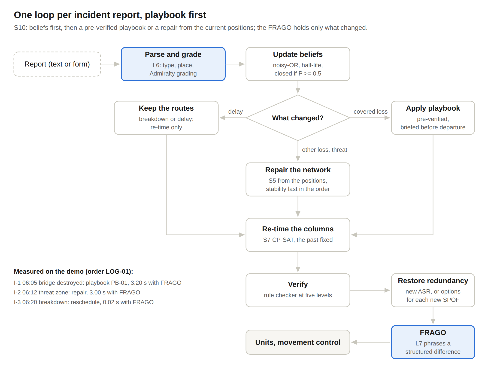
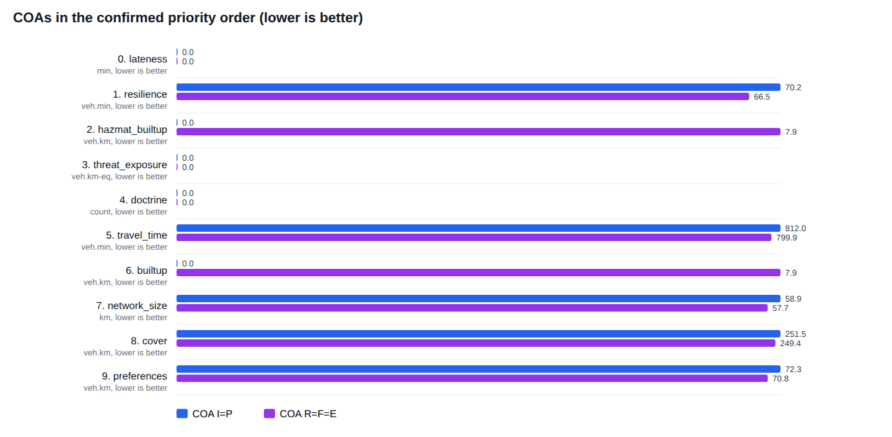

# COA-Net: network-first, threat-aware design of logistic convoy road networks

AMIAD hackathon (Rennes, 12-14 Nov 2026) · methodology · 2 Nov 2026

> **Implementation status (2 Nov 2026).** COA-Net is implemented in this repository (`src/coa_net`, 48 tests). Section 7 gives the worked example as computed by the code; section 11 maps every stage to its module, gives the measured results on 100 synthetic scenarios, and lists the known deviations from this specification. Several safety controls are specified here but not yet built; section 11.4 lists them. Where other sections say "estimate", section 11 has a measured value only for what it covers: tokens, real-data loading and model quality are still unmeasured.

## At a glance

**COA-Net designs the maneuver road network the way a movement-control cell does: it first designates one shared network (main and alternate routes, critical points, traffic control posts, halt areas, route status) that keeps working when any single bridge or tunnel is lost (defiles are specified but not detected yet), then gives every convoy a time slot on it (movement credits), and presents the result as two to four courses of action (COAs) with their trade-offs.** Small language models (8 to 32 billion parameters, written 8-32B) never draw routes. They turn doctrine into typed requirements at five levels (road, route, network, schedule, protection), turn the commander's intent into an order of priorities, rank the points an adversary is most likely to strike, write the COA comparison and the fragmentary orders (FRAGOs), and parse incident reports. CP-SAT models design the network and the schedule, a rule checker verifies every requirement, and a discrete-event simulator measures resilience.

**Results so far** (implementation, synthetic data, every language-model role on its deterministic fallback):

- **Demo** (section 7): three convoys, four bridges and a tunnel on a synthetic theatre. Every convoy that can keep a designated route after the loss of any single bridge or tunnel gets one. The convoy that cannot (C2, tank transporters, whose only crossing within the detour guard is Pont-Est) is reported as an irreducible single point of failure, with a reconnaissance task whose answer could remove it. 325 rule checks pass, four contingency playbooks are briefed before departure, and planning takes about 4 s on a 4-core CPU.
- **100 random theatres and missions** (section 11.3): the share of convoy groups left with an avoidable single point of failure falls from 95 % with vehicle-aware fastest routes to 0 %, for 4.5 % more travel time and 59 % more designated network (29.0 to 46.1 km). By the plan's own model, with assumed probabilities and penalties, the expected delay over loss scenarios falls from 175 to 72 vehicle·minutes. In the simulator, the weighted delay falls about 10 %, from 43.0 to 38.5, and the confidence intervals overlap.
- **Incident loop** (section 11.3): a playbook or a repair, FRAGO included, in about 0.5 s on average and about 3 s at most, without language models. 85 % of the plans handled this way pass verification afterwards; the others keep schedule or halt violations, and the order is still written (section 11.4).

## Contents

1. The problem and design goals
2. COA-Net in one page
3. Data model
4. Doctrine as prioritised requirements
5. The pipeline, stage by stage
6. The language-model layer
7. Worked example on the demo theatre
8. What matters most: criteria, metrics, trade-offs
9. Experimental strategy
10. Risks, limitations and mitigations
11. Implementation and measured results
12. Remaining work to 12 November
13. Questions for the organisers

Appendices: A. requirement template catalogue · B. formal models · C. card and message formats · D. glossary

## 1. The problem and design goals

### 1.1 What the brief asks

The brief asks for a solution that determines a *réseau routier de manœuvre* for military logistic transport automatically, and adapts it to incidents reported during the maneuver. The inputs are an IGN BD TOPO map in OpenStreetMap format and/or a vectorised image of the map, NATO doctrine, a logistic order written by the École du train et de la logistique, and incident reports. The models must stay small ("quelques dizaines de milliards de paramètres au plus": a few tens of billions of parameters at most) and the representation of doctrine must not overload the context window.

The brief's hypothesis is that multimodal models with very large context windows (several hundred thousand tokens) could take doctrine, vehicle composition, timing and incidents into account on top of the map. It also allows the other option, extracting constraints with language processing and giving them to a path-finding algorithm. COA-Net takes that second option and tests the first through baselines B2 and B3 (hypothesis H7).

### 1.2 Principles

The reference benchmarks show that vision-language models are unreliable at route-finding on maps: on CartoMapQA the best model connects origin and destination in only 37.8 % of cases, and on FRIEDA the best model reaches 38.2 % against 84.9 % for humans. COA-Net therefore follows five principles:

- The language model never outputs coordinates or routes. Every model output is a typed record that code validates.
- Missing map attributes are unknown, not optimistic (three-valued logic).
- A rule checker re-checks every requirement on the final plan, and every road choice can be traced to a requirement.
- Doctrine is compiled once into requirements, so the context stays small.
- Incidents trigger a local and stable repair, not a new plan from scratch.

### 1.3 What a movement-control planner needs

**N1. A network designated first.** Movement control does not route convoys one by one: it designates the network first, then allocates road space and time to units. Routes planned convoy by convoy give no shared designation, no route status (open, supervised, dispatch, reserved, prohibited), no traffic control posts and no halt areas, and three convoys from the same base can end up with six different routes to reconnoitre, mark and protect.

**N2. Redundancy measured by what can fail.** An alternate that shares only a bridge with the main route may share little of its length, yet one strike on the bridge cuts both. Redundancy has to be stated per critical element: every convoy should keep a designated route after the loss of any single bridge, tunnel or defile, wherever the road network allows it. The implementation covers bridges and tunnels so far (section 11.4).


*Figure 1. Convoy C1 on the demo theatre, drawn by the implementation (section 7). Left: the fastest route with no designed alternate, so one strike on Pont-Ouest stops it. Right: COA-Net's survivability rule designates an alternate over Pont-Est.*

**N3. Doctrine at several levels, with priorities.** Rules on single road edges cannot state route-level requirements ("a halt area every two hours", "dangerous goods cross at most one town", "no sharp turns for tank transporters"), network-level requirements ("separate outbound and return routes", "lateral links between main supply routes (MSRs)") or schedule-level requirements ("no transit of towns between 07:30 and 09:00", "vary routes between rotations"). A weighted sum of penalties turns "avoid built-up areas wherever an alternative exists", a conditional priority, into a number that nothing in doctrine fixes, yet that number decides the routes.

**N4. Joint time deconfliction.** Scheduling convoys one at a time in priority order, where a later convoy can only delay its departure, holds convoys that could go first without conflict. Reserving a road in both directions forbids two columns from meeting even on a two-lane road. Halts belong at halt areas, not wherever a driving limit happens to be reached, and crossings at junctions must be checked.

**N5. Anticipation.** The plan should know which elements an adversary is likely to strike and prepare for their loss, restore redundancy after a loss, and turn the unknowns that would change the plan into reconnaissance requests. In the field, the delay that matters is the time for a report to reach the planner and for new orders to reach the column, not the computation.

**N6. Visible trade-offs.** The brief's own words are "assister les opérationnels dans leur décision": decision support, which in military staff work means comparing courses of action. The cost of safety in minutes, or of speed in exposure, must be visible rather than hidden in weights.

### 1.4 Design goals

| Goal | Requirement | Answers |
| --- | --- | --- |
| G1 | Produce a network in doctrinal form: named main and alternate supply routes (MSR/ASR), route status, critical points, control posts, halt areas, movement credits, march tables | N1 |
| G2 | Survive the loss of any single critical element where the road network allows it; name and price the rest by threat | N2, N5 |
| G3 | Express doctrine at road, route, network, schedule and protection level, with priority semantics instead of numeric weights | N3 |
| G4 | Schedule all convoys jointly, with direction-aware headways and halts at real halt areas | N4 |
| G5 | Anticipate: contingency playbooks, redundancy restoration, reconnaissance of decision-relevant unknowns | N5 |
| G6 | Show two to four COAs with their trade-offs, and select a default automatically from the commander's intent | N6 |
| G7 | Stay within the brief's size limit (at most a few tens of billions of parameters) and our own frugality targets: models of 8-32B, one 24-48 GB GPU, under 20k tokens per plan (unmeasured), no route ever written by a model | brief, own targets |

### 1.5 Non-goals

- Replacing the operator: COA-Net proposes and explains, and a person decides.
- Protecting against two simultaneous strikes: survivability covers single losses, and chosen pairs only in the worst-case variant.
- Tracking vehicles live: positions are estimated from the schedule until position reports exist.
- Reading maps supplied only as images: S0 needs vector data (risk R17).
- Tactical manoeuvre, combat routing or anything beyond logistic road movement.

### 1.6 Alternatives considered

These are design reasons, not measurements, except where a section is cited.

| Alternative | Why COA-Net does not use it |
| --- | --- |
| One long-context or vision model plans everything (the brief's hypothesis) | Vision benchmarks show weak route-finding (section 1.2), and those benchmarks do not cover long-context text. Baselines B2 and B3 are the fair test and are not built yet, so this remains open |
| Route each convoy, then merge | Gives no shared designation (N1) |
| Weighted sum of penalties | Nothing in doctrine sets the weights (section 4.4) |
| Network design on arcs instead of whole routes | Route-level rules such as halts and crossing limits are harder to state on arcs; whole routes make them easy to check |
| A mixed-integer solver for design and CP-SAT for scheduling | One solver for both keeps the stack smaller, and OR-Tools carries a free licence (R13) |
| Retrieve doctrine at planning time (RAG) | Compiling once into typed rules keeps the context small and makes every rule checkable |
| Several model agents negotiating a plan | More tokens and harder checks; typed roles with validators keep each output testable |

## 2. COA-Net in one page

### 2.1 The idea

Movement control does not route convoys one by one. It designates a small network of routes that can carry the whole maneuver, classifies each route, places control measures, then hands out road space and time to units. COA-Net automates exactly that sequence, and adds two things a staff rarely has time to do by hand: it computes how the network behaves when each critical point is lost, and it prepares the response in advance.

Three abstractions make this tractable with small models and modest hardware:

1. **A corridor graph.** The road graph is contracted between decision points (junctions of the main network, bridges, tunnels, town entries, origins and destinations, halt areas). Each corridor carries a route classification (width, route type, lowest load class, obstructions), its critical elements and its halt opportunities. A theatre of 50 × 50 km becomes on the order of a thousand corridors, and the 100 to 200 relevant to a mission fit in a text "map card" of roughly 4k to 12k tokens (section 3.2).
2. **Typed requirements with priorities.** Doctrine becomes requirement instances from a closed catalogue of 26 templates, each with a tier (physical safety, "shall", "should", efficiency). Ties between "should" objectives are broken by an ordered list that the commander's intent sets, not by weights.
3. **Paths as building blocks.** For each convoy group the planner generates a rich set of candidate routes (Pareto-optimal, halt-feasible, and replacement routes around each critical element). Network design then chooses among whole routes, so any route-level rule is easy to check.

### 2.2 Pipeline

```
OFFLINE (once per theatre and doctrine corpus)
  BD TOPO / OSM, DEM, places ----> S0  road graph -> corridor graph, critical elements, halt and control-post candidates
  NATO / national doctrine  -----> S1  requirement base (LLM fills templates; evidence quotes; human sign-off)

ONLINE (per logistic order)
  logistic order ----------------> S2  mission spec + priority order from intent (LLM; operator confirms one line)
                                   S3  candidate routes per convoy group (Pareto, halt-feasible, replacement routes)
  threat reports ----------------> S4  criticality: structural impact x likelihood (LLM red team) -> loss scenarios
                                   S5  robust network design (CP-SAT), solved once per priority order -> 2-4 COAs
                                   S6  refinement: road-level routes, halts, control posts, route status, names
                                   S7  movement credits (CP-SAT): departures, waits, halts, headways -> march tables
                                   S8  verification: rule checker + simulator; recce tasks; contingency playbooks
                                   S9  COA briefing (LLM critic, checked) -> operator choice or automatic default

ONLINE (per incident)
  incident report ---------------> S10 parse (LLM) -> belief update -> playbook match?
                                         yes: apply pre-briefed response
                                         no : network repair (CP-SAT with stability)
                                       -> reschedule (minimal change) -> verify -> restore redundancy -> FRAGO (LLM)
```


*Figure 2. The stages as implemented. Blue boxes are language-model roles (L1-L8), each checked by code and backed by a deterministic fallback; grey boxes are symbolic steps; dashed boxes are inputs.*

### 2.3 Who does what

| Actor | Does | Never does |
| --- | --- | --- |
| Language models (8-32B) | Fill requirement templates from doctrine, parse orders and incidents, map intent to a priority order, rank likely targets from a given list, write the COA comparison and FRAGOs from computed facts | Output a route, a coordinate, a number not present in the input, or a final decision |
| Graph algorithms | Build corridors, generate candidate routes, compute impact of each loss, contingency trees | Interpret prose |
| CP-SAT solvers | Choose the network, select alternates, schedule movement credits, repair after incidents | Relax a physical or "shall" requirement without an approved waiver (intended; waivers are applied automatically today, section 11.4) |
| Simulator | Replay plans with column lengths, headways, halts, incidents and communication delays; estimate on-time probability | Change the plan |
| Operator | Confirms the priority line and any T1 candidate from the intent, picks a COA (or accepts the default), approves waivers, recce tasks and FRAGOs with model-written text (these steps are intended; section 11.4) | Has to edit weights |

## 3. Data model

### 3.1 Road graph

COA-Net starts from a directed road graph G = (V, E) built from BD TOPO or OSM, with attributes for length, class, speed, width, lanes, paving, weight limit, load class, bridge, tunnel, clearance, slope, built-up and forest, and a three-valued convention: a missing value stays unknown. It adds:

| Attribute | Source | Used by |
| --- | --- | --- |
| `level_crossing`, `ford`, `ferry` | OSM `railway=level_crossing`, `ford=yes`, `route=ferry`; BD TOPO equivalents to confirm | critical elements, route classification |
| `oneway` | OSM `oneway`, BD TOPO `sens_de_circulation` | corridor direction |
| turn angle at each node pair, `roundabout` | edge geometry, `junction=roundabout` | turn feasibility for long vehicles (RTE.TURN) |
| `surface_class` X / Y / Z | paving and track type | route type in the classification string |
| `lit` | OSM `lit` | night requirements |
| `defile` (not implemented yet) | computed: stretch of at least 1 km with no side junction, inside forest or with side slopes ≥ 15 % on both sides (DEM) | critical elements, red team |
| halt-area candidates with capacity | OSM `amenity=parking`, `highway=rest_area`, large paved or open areas next to the road; capacity ≈ usable area / (2 × vehicle footprint) | halts (RTE.GAP_MAX, SCH.HALT) |
| control-post candidates | junctions of main roads, both ends of each critical element | NET.CONTROL |

All thresholds above are parameters to calibrate with the instructors.

### 3.2 Corridor graph

**Construction.**

1. *Backbone.* Keep roads of importance 1-4 in BD TOPO (or OSM `motorway` to `tertiary`), every critical element on roads of importance 5, and access connectors: for each origin and destination, the best feasible path per vehicle profile to its three nearest backbone nodes, computed on the full graph. Where the backbone is not two-edge-connected around a needed area, add the shortest minor-road links that restore it (so that alternates can exist).
2. *Decision points* D: origins and destinations, backbone nodes of degree 3 or more, both ends of every critical element, entry and exit of each built-up area, halt-area access nodes, named places of the gazetteer.
3. *Corridors* A: maximal backbone paths between two decision points that contain no other decision point. Each corridor a keeps its road elements E(a), and a reverse corridor exists unless the road is one-way.

Because every branching node of the backbone is a decision point, every backbone path is a concatenation of whole corridors: shortest paths on the corridor graph H = (D, A) equal shortest paths on the backbone. The only loss is the roads left out of the backbone, which the connectivity patch covers. A full-graph fallback in repair is specified but not implemented.

**Aggregated attributes.** For corridor a and vehicle profile p, with per-edge travel time t_p(e):

$$\ell(a)=\sum_{e\in E(a)}\ell(e),\qquad \tau_p(a)=\sum_{e\in E(a)}t_p(e)$$

$$\mathrm{mlc}(a)=\min_{e\in E(a),\ \mathrm{bridge}(e)}\mathrm{mlc}(e),\quad \mathrm{wid}(a)=\min_{e\in E(a)}\mathrm{width}(e),\quad \mathrm{clr}(a)=\min_{e\in E(a),\ \mathrm{covered}(e)}\mathrm{clearance}(e),\quad \mathrm{slope}(a)=\max_{e\in E(a)}\mathrm{slope}(e)$$

$$X(a)=\sum_{e\in E(a)}\ell(e)\,\mathrm{thr}(e)\ \ [\text{km-equivalent}],\qquad B(a)=\#\{\text{maximal built-up runs in }E(a)\},\qquad b(a)=\sum_{e\in E(a)}\ell(e)\,\mathrm{builtup}(e)$$

An aggregate over values that include an unknown keeps two parts: the bound over known values and an unknown flag (for example "MLC ≥ 40 known, one bridge unclassified"). Feasibility for profile p is decided per element with the three-valued rules, so no information is lost by aggregation. The corridor also stores its ordered critical elements with their chainage, its halt opportunities (chainage, capacity), its number of side junctions, its forest cover share, and its defile length.

**Route classification string.** Each corridor gets the classification used in NATO and US engineer route reconnaissance, which instructors read at a glance:

`wid(a) / type / mlc(a) / OB`, for example `6.5 m / X / 40 / OB`

with type X (all-weather), Y (limited all-weather) or Z (fair-weather) from the worst surface, and OB when an obstruction exists (for example overhead clearance under 4.3 m, a width constriction, a slope above 7 %, a tight curve, a ford or a ferry; thresholds to confirm with the organisers' doctrine). A route's classification is the worst of its corridors.

**Map card.** The language models never see the graph. The red team receives element cards and the COA writer a facts table, not the map. Only the long-context baseline B2 receives the map card: the corridors that appear in some candidate route, one line each. Lines average about 110 characters on the demo theatre, which suggests 40 to 60 tokens each (no tokenizer has been run yet):

```
K12 | J4>J9 | D177 | 12.4 km | 6.5m/X/40/OB(clr 3.9 m) | towns 1 (Guichen 0.8 km) | crit B3 bridge MLC40 | halts H2 (12 veh) | forest 35% | threat 0.0
```

A mission typically involves 100-200 such corridors, so the whole map fits in roughly 4k to 12k tokens.

### 3.3 Critical elements

A critical element c ∈ 𝒞 is a place whose loss can cut or degrade a route: bridges, tunnels and underpasses, level crossings, fords and ferries, defiles, and, per vehicle profile, the articulation points of the feasible corridor graph between an origin and a destination (computed in linear time with Tarjan's algorithm). Each element carries its type, location, the corridors it belongs to, descriptors for the red team (surroundings, cover, distance to reported threats, nearest alternative crossing), and its structural impact (section 5, S4).

A critical element whose loss leaves a convoy group without any feasible route within the detour guard is an **irreducible SPOF** for that group. No route within the guard avoids it; a longer one may exist, and the playbook then uses it. Only engineering (a gap-crossing asset), reconnaissance (classifying an unknown alternative) or accepting the risk can. COA-Net reports these separately, because they call for a different decision.

### 3.4 Vehicles, convoys and columns

The binding profile of a convoy is the maximum load class, weight, width and height and the minimum top speed and climbing ability over its vehicles. COA-Net makes the column explicit:

$$L_k=\sum_{i=1}^{n_k}\mathrm{len}_i+(n_k-1)\,d_k,\qquad \mathrm{pass}_k(s)=\frac{60\,L_k}{1000\,s}\ \text{min}$$

where d_k is the vehicle interval set by requirement SCH.MARCH (for example by day, by night, in a threat area) and pass_k(s) the time the column needs to pass a point at speed s. A convoy longer than a configured number of vehicles is split into march units separated by a gap, each scheduled as its own column.

### 3.5 Mission specification

The mission specification holds the convoys, vehicles, origin, destination, earliest departure, latest arrival, priority, cargo and phase, plus: rotations and return legs; the commander's intent, copied verbatim from the order; control measures imposed by the order (start and release points, imposed or prohibited routes and areas, assembly areas); and movement windows (for example night only).

### 3.6 Dynamic state and belief

Each element carries a closure probability and a threat level instead of a hard flag. A report r about element e is graded with NATO's source-reliability and information-credibility scale (A-F and 1-6, the "Admiralty code"), which a lookup table turns into a probability q_r that the report is true (to calibrate; for example A1 → 0.95, B2 → 0.8, C3 → 0.5, unknown → 0.5; in the code, a report with no grading words defaults to B2). Independent reports are fused with a noisy-OR, and unconfirmed reports decay one by one with a half-life:

$$P_e(t)=1-\prod_{r}\big(1-q_r(t)\big),\qquad q_r(t)=q_r\,2^{-(t-t_r)/T_{1/2}}\ \ \text{(unconfirmed reports only)}$$

Decision rule (tier 0): an element is closed if P_e ≥ 0.5; it is *suspect* if 0.2 ≤ P_e < 0.5, which keeps it usable with an exposure penalty and issues a confirmation request; below 0.2 the report is logged only. The threat level of an element is its assessed severity times P_e. Confirmed events stay until cleared or until their stated duration expires. A report is confirmed when its credibility grade is 1.

Today a single report with q = 0.5 closes an element at tier 0, including any report worded "reported" or "possible" (graded B3). Repeats of one report count as independent, and destruction reports decay like any other. The intended rule is that closure needs q above 0.5 or two sources, and that physical destruction has no half-life (section 11.4, R14).

### 3.7 Notation

| Symbol | Meaning |
| --- | --- |
| g, n_g, w_g | convoy group (convoys sharing origin and destination areas, profile class and compatible windows; defined in S2), its vehicles, its priority factor |
| 𝒫_g, P | candidate routes of g, one route |
| P_g^ω | the route g drives in loss scenario ω; P_g^{ω₀} is the MSR |
| T(P), X(P), b(P), C(P) | a route's travel time, threat, built-up length and critical elements |
| T*_g | g's best travel time with no loss, used by the detour guard and by resilience |
| thr(e), km-equivalent | threat level of a road element; kilometres weighted by that level |
| covered(e) | the road element passes under a structure |
| ℓ_open(P) | length of a route in open ground, without forest cover |
| 𝒢_DG | groups carrying dangerous goods |
| 𝒞, 𝒞_g | all critical elements; those on g's candidate routes |
| y_a, x_gP, z_gP, u_gc | corridor designated; P is g's MSR; P is an ASR of g; g accepts c as a single point of failure |
| a_k, ā_k | arrival time and deadline of march unit k |
| Δ_g(c), Δ_max, F | delay to g from losing c, its cap, and the fixed penalty for a group left with no route |
| π_c, π_min, p_ω, p_min | likelihood of losing c, the threshold for keeping its scenario (0.05), a scenario's probability, the threshold for a playbook (0.05) |
| q_u, J_0, J_1, (·)^+ | probability that unknown u turns out usable; the objective vector without and with u; the part above zero, read on the first objective that differs |

## 4. Doctrine as prioritised requirements

### 4.1 From edge rules to requirements at five levels

A requirement is an *instance* of a template from a closed catalogue of 26 templates (Appendix A). Each template belongs to one of five levels, which decides where it is enforced:

| Level | Checked on | Examples | Enforced in |
| --- | --- | --- | --- |
| SEG (road element) | each road edge or corridor | load class, clearance, dangerous goods in tunnels, prefer major roads | feasibility masks (S3), re-checked by the rule checker (S8) |
| RTE (route) | one whole path | a halt area at least every 2 h of driving; dangerous goods cross at most one town; no turn tighter than a tank transporter can take | resource-constrained path search (S3) |
| NET (network) | the set of designated routes | survive any single loss; separate outbound and return flows; lateral links between MSRs; a control post at every bridge | network design MIP (S5), control measures (S6) |
| SCH (schedule) | the timetable | headway, vehicle interval and march speed, no town transit between 07:30 and 09:00, halts, vary routes between rotations | CP-SAT scheduler (S7) |
| PRO (protection) | exposure and critical points | maximum threat level; no halt or wait near a bridge; control post at likely targets | masks (S3), objectives (S5), placement (S6), forbidden waits (S7) |

### 4.2 The requirement record

Every instance is a typed record. Nothing in it is free text except the quote and the one-line explanation, and both are checked.

| Field | Content | Example (a route-level instance) |
| --- | --- | --- |
| id | unique identifier | R-14 |
| template | catalogue identifier | RTE.GAP_MAX |
| tier | T0 to T3 (section 4.3) | T1 |
| parameters | typed values with units | maximum driving 120 min; halt 15 min; halt only at a halt area |
| scope | convoys, cargo, vehicle classes, phases, areas, time windows it applies to | all convoys, day and night |
| unknown policy | forbid, risk or recce (section 4.5) | risk |
| source | document, paragraph, verbatim quote | corpus document, paragraph number, quoted sentence |
| trigger words | the phrase that sets the tier | "shall" |
| explanation | one line reused in briefings | "A halt is needed at least every two hours of driving." |
| status | draft, approved or rejected; approver; date | approved |

Two checks gate every instance compiled from the corpus, whatever the model's confidence: the quote must appear verbatim in the corpus (a string match), and the tier must agree with the trigger words (section 4.3). Instances that fail are never used.

### 4.3 Tiers

| Tier | Meaning | Comes from | Used as | Can be relaxed |
| --- | --- | --- | --- | --- |
| T0 physical | the vehicle cannot pass, or the element is closed | vehicle catalogue, map, belief model (P_e ≥ 0.5) | filter | never |
| T1 shall | mandatory by doctrine or by the order | "shall", "must", "is to", "is prohibited", imperative mood in orders; French "doit", "interdit", "impératif" | constraint | only by an explicit, logged waiver, proposed with its price |
| T2 should | recommended | "should", "as far as possible", "preferably", "normally"; French "de préférence", "dans la mesure du possible" | objective, in priority order | traded only in priority order, within tolerances |
| T3 efficiency | good practice, not doctrine | travel time, network size, cover | objective, ranked by the priority order | freely |

Tiers set a requirement's force. The priority order ranks objectives, and may place a T3 objective above a T2 one. T2 requirements with no objective of their own count in the *doctrine* objective.

If the T1 instances make the problem infeasible, the intended behaviour is to price each possible waiver (what it buys in the first objective that changes) and hold the plan until the operator approves. Today the code computes a smallest set of NET.SURVIVE waivers with a dedicated model, applies them, and records them in the plan as proposals; waived plans still count as valid, and other T1 instances are not covered (section 11.4).

### 4.4 Priorities instead of weights

**Objective menu.** Notation from section 3. P_g^ω is the route that group g drives in loss scenario ω (scenario ω₀ is "no loss", so P_g^{ω₀} is the MSR), p_ω its probability, w_g the convoy-priority factor from the order and n_g the number of vehicles.

| Objective | Definition | Unit |
| --- | --- | --- |
| threat_exposure | $f_X=\sum_{\omega}p_\omega\sum_g w_g\,n_g\,X(P_g^\omega)$ | vehicle·km-equivalent |
| resilience | $f_R=\sum_{\omega\ne\omega_0}p_\omega D_\omega$, with $D_\omega=\sum_g w_g\,n_g\,\big(T(P_g^\omega)-T_g^{*}\big)$; when no designated route survives ω, T(P_g^ω) is the fallback time T_g^fb (best undesignated route, or a failure constant F_g if none) | vehicle·min |
| hazmat_builtup | $f_H=\sum_{g\in\mathcal G_{DG}}n_g\,b(P_g^{\omega_0})$ over groups carrying dangerous goods | vehicle·km |
| builtup | $f_B=\sum_g n_g\,b(P_g^{\omega_0})$ | vehicle·km |
| travel_time | $f_T=\sum_g w_g\,n_g\,T(P_g^{\omega_0})$ | vehicle·min |
| network_size | $f_N=\sum_a \ell(a)\,y_a$ over designated corridors | km |
| cover | $f_C=\sum_g n_g\,\ell_{\text{open}}(P_g^{\omega_0})$, by day only | vehicle·km |
| doctrine | number of T2 route and network requirements not met | count |
| preferences | vehicle·km on roads that a T3 preference advises against or whose attributes are unknown | vehicle·km |
| stability (repair only) | number of designations, assignments and start-point times changed, units already briefed or moving counting double | count |

w_g is the only weight left in the objectives (by default it doubles per priority level of the order), and it is displayed.

**ε-lexicographic optimisation.** Let σ be the priority order and 𝒳 the plans that satisfy every T0 and T1 instance. COA-Net solves one problem per level, each constrained by the optima already found:

$$f_{\sigma(k)}^{*}=\min\Big\{f_{\sigma(k)}(x)\ :\ x\in\mathcal X,\ \ f_{\sigma(j)}(x)\le f_{\sigma(j)}^{*}+\delta_{\sigma(j)}\ \ \forall j<k\Big\},\qquad \delta_j=\varepsilon_j\,|f_j^{*}|+\eta_j$$

ε_j is a relative tolerance (0 by default, 10 % for resilience and travel time) and η_j a small absolute slack (for example 1 vehicle·min) that avoids numerical ties. Each level is warm-started from the previous solution.

**Guards.** Some T1 instances bound lower priorities whatever the order: RTE.DETOUR (an ASR may take at most ρ = 1.8 times T*_g, the group's best time), deadlines and time windows. Lateness against deadlines, $f_L=\sum_k w_k\max(0,\ a_k-\bar a_k)$ over march units k, is not on the menu: it is optimised first, before every priority order (exact in S7; S5 uses route times against windows). If a deadline cannot be met, the design keeps the smallest lateness reached.

**Default order and COA archetypes.** The default order is a proposal to validate with the instructors:

1. threat_exposure, 2. resilience (ε = 10 %), 3. doctrine, 4. hazmat_builtup, 5. travel_time (ε = 10 %), 6. builtup, 7. network_size, 8. cover, 9. preferences.

Courses of action come from a few archetype orders, plus the order confirmed from the intent:

| COA | Order (first three) | Intent it represents |
| --- | --- | --- |
| P, protected | threat_exposure, resilience, doctrine | contested area, default |
| R, resilient | resilience, threat_exposure, travel_time | likely strikes on crossings, long operation |
| F, fast | travel_time (ε = 0), threat_exposure, resilience | urgent delivery, low threat |
| E, economical | network_size, threat_exposure, resilience | few assets to reconnoitre, mark and control routes |
| I, intent | from the order (S2) | usually equal to one of the above; duplicates are merged |

**From intent to order.** The language model reads the commander's intent and returns a permutation of the menu with tolerances, and for each of the top three priorities the words of the intent that justify it. Example: the intent "Deliver the fuel to Delta before 08:30. The enemy is likely to strike the crossings. Keep the tankers out of the towns." gives "resilience ← 'likely to strike the crossings'; hazmat_builtup ← 'keep the tankers out of the towns'", and "before 08:30" sets a deadline, which is a guard. Code checks that it is a permutation and that every quoted phrase is in the intent; the operator confirms the order as one line. When the intent contains an imperative ("do not cross Ville-Centre"), the parser also creates a candidate T1 instance for the operator to confirm.

**Why not weights.**

1. Doctrine and intent state priorities in words; nothing in them gives a weight of 0.3 or 3.0.
2. The weights drive the result, although nothing in doctrine fixes their values.
3. A lexicographic choice explains itself: the first objective on which two options differ is the reason (section 4.6).
4. The cost of a priority becomes explicit: comparing COAs gives, for example, the minutes that protection costs.

The known weakness of lexicographic orders is that a tiny gain on a high priority can justify a large loss on a lower one. The tolerances, the guards and the COA comparison (which shows exactly what each priority costs) are the mitigations. The tolerances are numbers too, but there are few of them, they read as plain statements ("accept up to 10 % more travel time"), and they are displayed.

### 4.5 Unknown values

Each instance carries one of three policies for missing attributes:

- **forbid**: an unknown counts as a violation. This is the default for T0 attributes on critical elements (load class of a bridge, clearance of a tunnel). With no load classes in the data, it blocks every bridge (see below).
- **risk**: the element may be used, but it becomes a critical element whose failure probability is the prior probability that the unknown value violates the requirement (for example P(MLC < 100) for a bridge on a tertiary road, estimated from the bridges of the same road class in the theatre whose class is known, or 0.5 by default). The network then needs an alternate around it like around any other critical element. Default for widths and slopes on non-critical roads.
- **recce**: the element is usable only once reconnoitred. S8 computes the value of the information and requests a reconnaissance when the value is high and the answer can arrive before the decision it changes. Offered automatically for every unknown element that could remove an irreducible SPOF.

Military load class is generally absent from civilian data (OSM and BD TOPO carry posted weight limits at best), so unknown bridge classes will be common on real data. That is why the recce policy matters.

It also means the default rule can stop the planner. BD TOPO supplies no load class, and with every class removed from the synthetic theatres, 0 of 105 groups keep a route (30 seeds; these theatres have a river that a route must cross). The intended degraded mode applies when a theatre has no load classes: unknown bridges become usable at `risk`, each crossing used goes on a mandatory reconnaissance list, and the plan is marked provisional. It is not implemented yet (R5).

Two exceptions to "unknown, not optimistic" remain in the code. Boolean attributes such as `bridge`, `tunnel` and `built_up` default to false, and the OSM loader uses a posted weight limit in tonnes as a stand-in for a load class. A vehicle can therefore be approved on a number that means something else (section 11.4).

### 4.6 Contrastive explanations

For each decision (the MSR of a group, an ASR, a corridor kept or dropped, the order between two convoys, a wait), COA-Net finds the best plan that differs on that decision, either from the candidate pool or by re-solving with the decision forbidden. It then compares the two in tier and priority order:

1. A T0 or T1 violation by the alternative is the reason. Measured example from the demo: "C1 does not take the direct road over Pont-Centre: the bridge's load class is 30 and the column's is 35 (SEG.LOAD, T0)."
2. Otherwise the first objective that differs beyond its tolerance is the reason: "same threat exposure (priority 1), but the alternative leaves C2 without a route if Pont-Est is lost (resilience, priority 2)".

Because the comparison uses the same ordered vector as the optimiser, the explanation is exact by construction. No language model is needed to produce the reason; the model only phrases it (section 6).

### 4.7 Doctrine coverage

COA-Net measures how much of the doctrine it actually uses:

- N is the number of normative statements in the corpus: sentences with a modal of obligation or recommendation, detected by a pattern list (English and French) and by the language model as a second detector, union of both, with a human check on a sample. The union is not implemented yet: with a model configured, the patterns do not run on the sentences it returned.
- Each statement is labelled *mapped* (to at least one approved instance), *out of scope* (with a reason: communications, administration, medical, and so on), *inexpressible* (relevant to routes or timing, but no template fits) or *not reviewed*.
- Coverage = (mapped + out of scope) / N. Expressiveness = mapped / (mapped + inexpressible).

Inexpressible statements are the backlog for new templates (hypothesis H5, section 9).

### 4.8 Seed requirement base

Until the organisers' doctrine is compiled and signed off, COA-Net runs on a seed base of 37 stand-in instances, approved for testing only (`src/coa_net/data/seed_requirements.json`):

- 24 stand-in rules of common movement-control practice, over 14 templates: SEG.LOAD, SEG.GAUGE, SEG.GRADE, SEG.SURFACE, SEG.STATUS, SEG.CARGO, SEG.AVOID, RTE.GAP_MAX, RTE.DETOUR, NET.SURVIVE, SCH.HEADWAY, SCH.MARCH, SCH.HALT and PRO.EXPOSURE (load class and weight on bridges, clearance and width, slope, unpaved roads for heavy vehicles, closures, threat limits, dangerous goods, detour guard, survivability, headway, march speeds, night factor, halts).
- 13 default values for the templates no stand-in rule covers (RTE.TURN, RTE.CROSSINGS_MAX, RTE.ACCESS, RTE.RANGE, NET.SEPARATE, NET.LATERAL, NET.CONTROL, NET.SIZE, NET.STATUS, SCH.WINDOW, SCH.VARY, PRO.CRITPOINT) and one SCH.MARCH parameter, each flagged `assumption: true`.

None of them quotes a NATO publication; all of them are to be confirmed with the instructors. "Valid" in sections 7 and 11 means valid against this seed base.

## 5. The pipeline, stage by stage

Each stage below gives its method, output, expected cost and fallback. Costs are estimates to be measured, except where marked as measured.

### S0. Theatre preparation (offline, once per theatre)

**Method.**

1. Load the road graph (OSM or BD TOPO loaders) and add the attributes of section 3.1.
2. Detect critical elements from attributes (bridges, tunnels, level crossings, fords, ferries) and from the DEM and forest layer (defiles; not implemented yet). Articulation points depend on the vehicle profile and on the origin and destination, so they are computed per mission in S3.
3. List halt-area and control-post candidates (section 3.1).
4. Build the corridor graph (section 3.2) and aggregate attributes for each profile class of the vehicle catalogue (light, medium, heavy, tank transporter, tracked, dangerous goods), with the route classification string.
5. Pre-compute, per profile class, a three-valued feasibility mask over corridors and the travel time of each corridor.

**Output.** Corridor graph H, critical elements 𝒞, candidates, masks, map-card generator.

**Cost.** Linear in the size of the road graph: seconds to a few minutes for a département-sized extract (estimate; the real-data loaders have not yet been run on live data).

**Fallback.** The corridor graph is an accelerator, not a requirement: every later stage could run on the full road graph with the same logic, only slower. This path is not implemented yet.

### S1. Requirement base (offline, once per doctrine corpus)

**Method.**

1. Split the corpus into passages and index them with bge-m3 (the code uses a lexical stand-in for now).
2. For each template, retrieve the best passages using the template's description and seed phrases in English and French.
3. The language model fills zero or more instances per passage (parameters, scope, tier, trigger words, unknown policy, verbatim quote), with schema-constrained output.
4. Validators: schema and units; quote found verbatim; tier consistent with trigger words; parameters in plausible ranges (for example a headway between 1 and 60 min); duplicates merged; conflicts (same template and scope, different values) flagged, keeping the stricter value for T1 and showing both.
5. Human sign-off: a reviewer accepts or edits each instance in a list that shows the quote next to the parsed parameters. Expect 60 to 120 instances at about 15 s each (estimate).
6. Coverage report (section 4.7).

**Output.** A versioned, approved requirement base.

**Fallback.** The pattern compiler, then the seed base (section 4.8).

### S2. Mission and priorities (online, per order)

**Method.**

1. Parse the order into the mission specification of section 3.5.
2. Resolve places on the graph, check reachability per profile, and split long convoys into march units (section 3.4).
3. Group convoys that share origin and destination areas, profile class and compatible windows into groups g of n_g vehicles. Groups keep S3 to S5 small; S7 still schedules every march unit.
4. Activate requirement instances by scope (cargo, vehicle class, phase, area, time).
5. Map the intent to a priority order (section 4.4) and have the operator confirm it.

**Output.** Mission specification, groups, active requirements, confirmed priority order.

**Fallback.** Without a model, a pattern parser and the default order.

### S3. Candidate routes per group

**Method**, for each group g on H with g's feasibility mask:

1. *Supported Pareto routes.* Dijkstra on a small grid of weightings of the normalised criteria (travel time, threat, built-up, dangerous goods in built-up areas, open ground). Weightings only generate candidates here; they never decide.
2. *Route-level requirements.* Resource-constrained shortest paths, by label setting with dominance: RTE.GAP_MAX with the resource "driving time since the last halt area", reset at halt-area nodes; RTE.CROSSINGS_MAX with the number of built-up crossings; RTE.RANGE with the distance since the last fuel point. RTE.TURN by expanding decision nodes into turn nodes for long-vehicle profiles. RTE.ACCESS by forcing via-points and removing prohibited areas.
3. *Replacement routes.* For each critical element c on the best routes, the best route that avoids c. Plus the cheapest *pair* of routes that share no critical element: a minimum-cost flow of two units from origin to destination in which each critical element has capacity 1 and every other corridor capacity 2 (Suurballe's construction, adapted so that only critical elements must be disjoint).
4. *Articulation points* of the feasible graph between g's origin and destination (Tarjan's algorithm, linear time). They are irreducible SPOFs for g and join 𝒞.
5. *Pool.* Remove duplicates and keep at most 30 routes per group, making sure that each cheap critical-element signature (the set C(P) of elements a route crosses) keeps at least one representative.

**Output.** Candidate set 𝒫_g with, for each route P: T(P), X(P), b(P), B(P), C(P), ℓ(P) and a feasible halt plan.

**Cost.** A few dozen shortest-path or label-setting runs on about a thousand nodes per group: under a second (estimate).

**Fallback.** Diverse routes by the penalty method (cost multiplied on the corridors already used) plus the replacement routes of step 3.

### S4. Criticality and loss scenarios

**Method.**

1. *Structural impact* (exact, no model). For each c ∈ 𝒞 and each group g that may use it, the delay its loss causes:

$$\Delta_g(c)=T^{*}\big(g;\,H\setminus c\big)-T^{*}(g;\,H)\quad(+\infty\ \text{if no route within the guard}),\qquad I(c)=\sum_g w_g\,n_g\,\min\big(\Delta_g(c),\Delta_{\max}\big)+F\cdot\big|\{g:\Delta_g(c)=+\infty\}\big|$$

2. *Likelihood* (language-model red team, section 6). The model receives the cards (Appendix C) of the 20 to 40 elements with the highest impact plus every element near a reported threat, and sorts them into likelihood classes (high, medium, low) for the mission window, each with a reason that cites card fields. Two samples are merged by rank aggregation (Borda count). A calibration table turns classes into probabilities (for example 0.30, 0.10, 0.02, to set with the instructors), which are fused with reported threats: π_c ← 1 − (1 − π_c)(1 − P_c).
3. *Scenarios* Ω: ω₀ (no loss), the single loss of every element with π_c ≥ π_min or with an impact in the top decile, and optionally the pairs among the red team's top five for a worst-case variant. For small π, p_ω ≈ π_c and p_{ω₀} = 1 − Σ p_ω.

**Output.** Impact table, probabilities π, scenario set Ω, and the irreducible SPOFs of each group (Δ = +∞).

**Fallback.** Without a model, π_c from a fixed table by element type (bridges and tunnels 0.10, defiles 0.05, others 0.02) fused with reported threats.

### S5. Robust network design

**Method.** A path-based integer program, solved with CP-SAT (full model in Appendix B), chooses for each group one MSR x_gP and zero or more ASRs z_gP among its candidates, designates the corridors y_a they use, and evaluates each loss scenario through recourse variables r_gωP (which designated route g drives in ω) and φ_gω (g has no designated route left). The two constraints that carry the design are:

$$\text{survivability (NET.SURVIVE):}\quad\sum_{P\in\mathcal P_g:\ c\notin C(P)}\big(x_{gP}+z_{gP}\big)\ \ge\ 1-u_{gc}\qquad\forall g,\ \forall c\in\mathcal C_g$$

$$\text{detour guard (RTE.DETOUR):}\quad T(P)\,z_{gP}\ \le\ \rho\,T_g^{*}\qquad\forall g,\ \forall P\in\mathcal P_g$$

u_gc = 1 means that g accepts c as a single point of failure: it is fixed to 1 for irreducible SPOFs, fixed to 0 for the others when NET.SURVIVE is T1, and left free but penalised through the resilience objective when NET.SURVIVE is T2. The model is solved ε-lexicographically in the confirmed order (section 4.4), then once per archetype order. Networks that are identical, or that differ by less than a few percent of designated length, are merged, leaving up to four COAs (usually two or more; one if every design merges).

**Output.** For each COA: designated corridors, MSR and ASRs per group, accepted SPOFs, and the route each group takes in each loss scenario.

**Cost.** At the upper end (10 groups, 30 candidates per group, 40 scenarios) the model has about 14,300 Boolean variables, most of them recourse variables. That should take seconds per lexicographic level (estimate, not exercised at this size; measured times in section 11 stop at 140 nodes and 6 convoys), with a time limit per solve (for example 10 s) that keeps the best solution found. One design makes about 12 to 15 solves, so the worst case is about 2 minutes per design.

**Fallback.** A greedy design: MSR = lexicographically best candidate; ASR = partner in the cheapest critical-element-disjoint pair (S3 step 3) if it meets the guard; network = union. The greedy design does not enforce T1 network or threat rules; its status is `heuristic` and the verifier reports what it breaks.

### S6. Refinement and control measures

**Method.**

1. Expand corridors into road edges and re-check every SEG instance at road level (three-valued).
2. *Halts.* Choose halt areas along each route so that RTE.GAP_MAX holds with as few halts as possible (a shortest path over the halt-area candidates of the route). Capacity conflicts between groups are left to S7.
3. *Traffic control posts* (NET.CONTROL): at each critical element of a designated route, at each junction where designated routes split or merge, and then wherever the spacing along a route would exceed the maximum (greedy cover). Elements with high π_c come first if posts are limited.
4. *Route status* (NET.STATUS): for example, routes used by heavy or dangerous-goods groups during their windows become dispatch routes (movement credit required for every move); other designated routes are supervised; ASRs not in use stay open but are reserved for re-routing; closed elements are prohibited. These rules are to be confirmed with the instructors.
5. *Names and overlay.* Route names from a list, start and release points per group, the decision points where ASRs branch off, and a GeoJSON overlay with statuses and control points.

**Output.** Road-level network overlay, control-post list, halts, route statuses.

### S7. Movement credits

**Method.** A CP-SAT model (Appendix B) schedules every march unit on its MSR. Each route is cut into segments between consecutive control points, junctions and halt areas. Variables are the head's entry time into each segment, the waits (allowed only at start points, halt areas and waiting areas) and the halts. The order between two march units on a shared segment is a decision variable. Constraints:

- *Same-direction headway (SCH.HEADWAY).* If march unit k precedes k' on segment s, the head of k' may not reach any point of s less than h minutes after the tail of k has passed it. With constant speeds on a segment, the gap is an affine function of the position along it, so checking the two ends is enough:

$$t'_{\text{in}}\ \ge\ t_{\text{in}}+\mathrm{pass}_k(s)+h\qquad\text{and}\qquad t'_{\text{in}}+\tau'_s\ \ge\ t_{\text{in}}+\tau_s+\mathrm{pass}_k(s)+h$$

  where τ_s and τ'_s are the head travel times of k and k' on s. The second inequality matters when k' is faster than k.
- *Opposite directions.* Two columns may meet on a two-lane segment; on a single-lane segment (one lane, or width below twice the vehicle width plus a margin) their occupation intervals may not overlap.
- *Junctions.* Columns crossing or merging at the same decision point may not pass it at the same time (no-overlap of their passage intervals plus a clearance time).
- *Halts* at halt areas, with the number of vehicles present at any time within the area's capacity.
- *Windows* (SCH.WINDOW): forbidden intervals for given segments, for example built-up areas between 07:30 and 09:00.
- *Deadlines* and earliest departures.

The objective is lexicographic: weighted lateness, then weighted delay against the unconstrained arrival, then the number and length of waits outside start points, then (in repair only) changes to start-point times.

**Output.** Movement credits (route, start-point time, control-point times, release-point time per march unit), the march table, and the road movement graph (a time-distance diagram of every column).

**Cost.** For 5 to 30 march units, a few hundred interval variables: seconds (estimate).

**Fallback.** Greedy priority-order scheduling with the time-gap rule above: units are taken in priority order and a later unit can only delay its departure.

### S8. Verification and anticipation

**Method.**

1. *Rule checker.* Every active instance is re-checked on the final plan at all five levels, three-valued. T0 and T1 violations must be zero or covered by a waiver; T2 shortfalls are reported. The checker reports these and blocks nothing yet: when a check fails during an incident, the intended behaviour is to mark the FRAGO "NOT VERIFIED" and escalate to the operator (section 11.4).
2. *Discrete-event simulation* (Appendix B). Columns are replayed with their lengths, headways, halts and control points, first deterministically, then by Monte Carlo with random speeds, breakdowns, incidents from the script, and delays between an incident, its report to the planner, and the new orders reaching the column. The same random numbers are used for every COA and every pipeline being compared. Metrics: probability of arriving on time per group, expected delay, probability of completing the mission, vehicle·minutes in threat areas, queues at critical points.
3. *Reconnaissance tasks.* For each unknown element u under the recce policy, the value of information compares the plan made without knowing u with the plans made after each possible answer o (probability q_o):

$$\mathrm{VOI}(u)=\sum_{o}q_o\,\big(J(x_0^{*}\mid o)-J(x_o^{*}\mid o)\big)$$

   For a binary answer under the forbid policy this reduces to VOI(u) = q_u (J_0 − J_1)^+, since the plan only changes when u turns out usable. J is the lexicographic vector, so the value is reported on the highest-priority objective that changes, with the others listed. A task is issued only if the answer can arrive before the decision it changes (the time the first affected group reaches the decision point).
4. *Contingency playbooks.* For each scenario in Ω with p_ω ≥ p_min or a high impact, COA-Net pre-computes the response: for each affected group, a shortest-path tree towards its destination on H minus the lost element, which gives the next corridor from every node, so the response holds wherever the column is when it learns of the loss; the decision points where the response leaves the plan; re-solved movement credits for the scenario; and a pre-drafted FRAGO.

**Output.** Verification report, simulated metrics per COA, ranked reconnaissance tasks, contingency annex.

**Fallback.** If time is short, the deterministic replay only, and playbooks for the five most likely losses.

### S9. COA briefing and choice

**Method.** Code computes a facts table per COA (Appendix C): priority order, routes, designated length, travel times, exposure, SPOFs (irreducible and accepted), on-time probability, reconnaissance needs, and what the COA gains and costs against the others. The language model writes a comparison of at most 250 words and a list of concerns. Every number, time and upper-case identifier must appear in the facts; otherwise the text is regenerated once, then replaced by a templated comparison. The check does not tie a value to its unit, and does not read place names.

**Choice.** The operator picks a COA. Without an answer, the default is the COA built from the confirmed intent order.

### S10. Incident loop

**Method**, for each incident report:

1. *Parse* the report into a typed incident with its source grading.
2. *Update beliefs* (section 3.6): closure probabilities, threat levels, statuses.
3. *Match a playbook.* If the change corresponds to a pre-computed scenario, apply its response (routes and turn-back points); S5 and S7 still re-solve, and the response is verified at step 6, not when it is built. The value of a playbook is that it is briefed in advance, not that it is faster to compute.
4. *Otherwise repair the network*: the S5 model restricted to the affected groups, with their positions as estimated from the schedule as origins, the current designations as starting point, and stability appended to the priority order (or placed first if the operator prefers stable orders). If the model misses its time limit, the best design found so far is kept; if none is feasible, the greedy design of S5 is used, which does not enforce T1 network or threat rules.
5. *Reschedule* with S7, the past fixed and stability in the objective.
6. *Verify* with the rule checker and a short Monte Carlo run (the Monte Carlo run is not implemented yet, and a failed check does not stop the FRAGO).
7. *Restore redundancy.* Recompute survivability for every group. Where a group now has a reducible SPOF, designate a new ASR (S5 with current designations fixed, additions allowed). Where it is irreducible, propose the options to the operator: reconnoitre an unknown alternative (ranked by value of information), protect the element (control post, escort, no halts nearby: PRO.CRITPOINT), request a gap-crossing asset, or accept the risk.
8. *Write the FRAGO* from a structured difference between the old and new plans, only for the units affected (section 6).

**Targets.** Under 5 s of solver and code time when a playbook applies and under 60 s for a repair, templated FRAGO included (estimates). Language models add about 10 to 15 s or more (section 6.3). The time limit applies per solve, so a repair has no overall deadline yet and can pass 60 s in the worst case. In the field, transmission delays will dominate these times, which is why the playbooks are briefed before departure.



*Figure 3. The incident loop as implemented, with the computation times measured on the demo when the figure was drawn; they vary with the machine (section 7 gives another run).*

## 6. The language-model layer

### 6.1 Roles

Models: Mistral Small 3.2 24B by default, Qwen3-32B to compare, Qwen3-8B for fast steps, bge-m3 for retrieval, all open-weight and served locally through an OpenAI-compatible server with schema-constrained decoding.

| # | Role | Stage | Input | Typed output | Default model | Checks | Fallback |
| --- | --- | --- | --- | --- | --- | --- | --- |
| L1 | Doctrine compiler | S1 | template card and 5-8 retrieved passages | requirement instances (section 4.2) | Qwen3-32B (offline, quality first) | schema, verbatim quote, tier against trigger words, ranges, human sign-off | pattern compiler, then seed base |
| L2 | Order parser | S2 | order text and gazetteer names | mission specification | Mistral Small 3.2 24B | schema, names resolve on the graph, times consistent | pattern parser |
| L3 | Intent mapper | S2 | intent text and objective menu | priority order, tolerances, quotes, T1 candidates | Qwen3-8B | is a permutation, quotes found in the intent | default order |
| L4 | Red team | S4 | critical-element cards and threat summary | likelihood class and reason per element | Mistral Small 3.2 24B or Qwen3-32B | identifiers exist, reasons cite card fields (a word match) | table by element type |
| L5 | COA writer and critic | S9 | facts table | comparison of at most 250 words, list of concerns | Mistral Small 3.2 24B | every number and identifier matches the facts | templated comparison |
| L6 | Incident parser | S10 | report text | incident record with source grading | Qwen3-8B | schema, location resolves, grading valid | pattern parser |
| L7 | FRAGO writer | S10 | structured plan difference | FRAGO in five paragraphs | Qwen3-8B | every number, time and upper-case identifier appears in the difference; values are not tied to units, and place names are not read | templated FRAGO |
| L8 | Explanation phrasing | S5-S9 | contrastive record (decision, alternative, deciding objective, values) | one sentence | Qwen3-8B | numbers match | template sentence |

Mistral Small 3.2 accepts images, but no stage of the main pipeline needs them; image input is used only by baseline B3 (section 9).

The models do what the reference papers show small models do well (reading text, mapping words to closed sets, writing from given facts) and nothing that needs geometric reasoning on a map. The red team is the most judgemental role. Its output is therefore only a ranking over a list it is given, it is combined with the exact structural impact, and the evaluation uses incident scripts that do not come from it (section 9), so that a poor red team shows up in the results instead of hiding in them. One gap remains: an element the model leaves out counts as low likelihood (0.02), below the table prior, and can lose its scenario and playbook (section 11.4).

### 6.2 Prompt outlines

**L1, doctrine compiler.** Role: extract requirements for military road movement from doctrine by filling one template; never invent values. Input: the template card (identifier, level, parameters with units and allowed ranges, definition, three seed phrases) and passages with identifiers. Rules: one instance per distinct requirement; copy the quote verbatim; set the tier from the modal verb using the table of section 4.3; leave a parameter empty when the text does not state it; take the scope only from the text. Output: a list of instance records, possibly empty.

**L3, intent mapper.** Input: the intent paragraph, the objective menu with one-line definitions, the allowed tolerances. Rules: return every objective exactly once, in order; justify the top three with exact quotes; turn imperatives into T1 candidates; keep the default relative order for objectives the intent does not mention. Output: order, tolerances, quotes, T1 candidates.

**L4, red team.** Role: an intelligence analyst assessing likely enemy action against friendly logistics during the mission window. Input: element cards (identifier, type, surroundings, approaches and cover, distance to reported threats, nearest alternative, groups that depend on it, impact class) and a threat summary. Rules: rank only the listed identifiers; use the classes high, medium, low, with at most five "high"; give each reason by citing card fields; never output probabilities, places or coordinates. Output: a list of (identifier, class, reason).

**L5, COA writer and critic.** Input: the facts tables of two to four COAs and the confirmed priority order. Rules: compare in priority order; use only numbers from the tables; state each trade-off as "COA R gains X on resilience for Y minutes of travel"; every concern cites an element or corridor identifier from the facts; do not recommend beyond saying which COA follows the confirmed order. Output: comparison and concerns.

**L7, FRAGO writer.** Input: the structured difference (units affected, old and new routes by name and key points, new times at start, control and release points, new statuses and control posts, the triggering incident with its grading). Rules: five-paragraph structure (situation, mission, execution, sustainment, command and signal); only the items that changed; copy names and times; add no instruction that is not in the difference (a prompt rule, which no code checks). Output: FRAGO text.

### 6.3 Token budget (estimates)

| Call | Input tokens | Output tokens | Calls | Total |
| --- | --- | --- | --- | --- |
| L2 order | 2,000 | 500 | 1 | 2,500 |
| L3 intent | 900 | 300 | 1 | 1,200 |
| L4 red team | 3,500 (about 40 cards of 60 tokens, plus instructions) | 800 | 1 or 2 | 4,300 or 8,600 |
| L5 COA briefing | 3,000 | 600 | 1 | 3,600 |
| L8 explanations, for every COA | 150 | 50 | about 10 | 2,000 |
| **Per plan** | | | | **about 12k to 18k** |
| L6 incident | 600 | 300 | 1 | 900 |
| L7 FRAGO | 1,200 | 600 | 1 | 1,800 |
| **Per incident** | | | | **about 3k** (plus 4k if the threat picture changes enough to re-run the red team on the affected elements) |
| L1 doctrine, offline | about 3,000 per template | 500 | 26 | about 90k once per corpus |

No single call exceeds about 4.5k tokens, so an 8k context window is enough. The two red-team samples share their prompt, so with prefix caching the second costs little more than its output. Generation is the slow part: about 3k output tokens per plan, which at 20 to 40 tokens per second for a 24B model on one GPU (estimate) means one to two and a half minutes of model time per plan. Incident handling uses the 8B model, so its model time stays around ten to fifteen seconds (estimate, with an 8B output rate we have not measured).

Retries are not in the table. A retry of the red team and the briefing adds up to about 12k tokens, so the worst case is about 30k per plan, above the 20k target. The table should be redone from measured tokens at the first real model run.

### 6.4 Guardrails

- No model ever outputs a route, a coordinate, or an identifier that is not in its input.
- Every output is schema-constrained, then validated by code; a failed validation triggers one retry, then the deterministic fallback.
- Parser checks cover schema, catalogue, places and times. They do not compare numbers with the source text, so a changed deadline or vehicle count passes L2. L6 takes the nearest bridge with no distance limit, and a report with no location ends as `logged` (R18).
- Every number, time and upper-case identifier in generated prose must appear in the facts it was given (normalised string match); every quote must appear in its source. This does not catch swapped values or wrong place names.
- The solvers decide. The operator is meant to confirm the priority order, the COA, every waiver, every reconnaissance task and every FRAGO containing model-written text. These steps are not built yet: nothing in the code pauses for confirmation (section 11.4).
- Prompts, outputs and validation results are to be logged for after-action review. Today only token counts and times are recorded.
- Everything is meant to run offline, so that doctrine and orders never leave the machine. This depends on configuration: `COA_LLM_BASE_URL` accepts any host.

Every role has a deterministic fallback, so the whole pipeline also runs without any model. This is ablation A12 in section 9, and the safety net during the event.

## 7. Worked example on the demo theatre

Order LOG-01 on the synthetic demo theatre (seed 0), default requirement base (section 4.8), no language model, as computed by the implementation.

### 7.1 Setting

**Theatre.** A synthetic road grid crossed by a river with four bridges: Pont-Ouest on the N1 (load class MLC 120), Pont-Centre (MLC 30), an unnamed bridge on column 9 (class unknown) and Pont-Est on the D12 (MLC 100). Planted constraints include the N7 tunnel (clearance 3.8 m), the built-up town of Ville-Centre on the direct axis, a road limited to 12 t and unpaved forest tracks.

**Order LOG-01 (day).** C1, priority 1: six heavy trucks and two fuel tankers, Alpha to Delta, binding class MLC 35, deadline 08:30. C2, priority 2: two tank transporters, Bravo to Echo, MLC 100, 4.0 m high, deadline 09:00. C3, priority 3: four medium trucks and an ambulance, Alpha to Echo, MLC 16. Departures from 06:00.

**Incidents.** I-1 at 06:05, Pont-Est destroyed by artillery. I-2 at 06:12, ambush confirmed near Ville-Centre (radius 1.5 km, threat 0.9). I-3 at 06:20, C3 breaks down for 25 minutes.

### 7.2 Priority order and courses of action

**Priority order.** The intent ("The enemy is likely to strike the crossings. Keep the tankers out of the towns.") gives: resilience (10 % tolerance), dangerous goods in built-up areas, threat exposure, doctrine shortfalls, travel time (10 %), built-up areas, network size, cover, preferences. "Keep the tankers out of the towns" is also a candidate T1 constraint for the operator. The demo runs without an operator, so the candidate is not applied, and WOLF stays a T2 shortfall below.

**COAs.** The confirmed intent order gives the same design as the "protected" archetype (COA I=P, the default). The resilient, fast and economical archetypes give one other design (COA R=F=E): C1's main route is 0.4 min faster and slightly more resilient (3.6 vehicle·minutes, inside the 10 % tolerance), but puts the fuel tankers through 7.9 vehicle·km of built-up area. The intent ranks that second, so COA I=P stays the default, and the briefing states the trade-off in those terms.


*Figure 4. COA I=P before departure. Thick lines are main routes, dashed lines alternates; red ring: single point of failure; navy ring: critical element covered by an alternate; squares: traffic control posts.*

### 7.3 Before departure

| Group | Main route | Alternate | Single points of failure |
| --- | --- | --- | --- |
| C1 (priority 1, MLC 35, fuel) | LION, 16.1 km, 20.4 min, over Pont-Ouest | WOLF, 26.0 km, 33.7 min (1.69 × the best time T*_g), over Pont-Est | none |
| C2 (priority 2, MLC 100, 4.0 m) | TIGER, 11.5 km, 14.5 min, over Pont-Est | none: the best route avoiding Pont-Est takes 39.8 min, 2.74 × the best time, beyond the 1.8 guard | Pont-Est, irreducible; reconnaissance task RT-1 |
| C3 (priority 3, MLC 16) | BEAR, 20.0 km, 20.6 min, over Pont-Est | EAGLE, 20.0 km, 21.6 min, over Pont-Centre and the N7 tunnel | none |

- **Control measures.** 12 traffic control posts (critical elements, splits and merges, spacing), route statuses (dispatch for C1 and C2, supervised for C3, reserved for alternates).
- **Movement credits.** C1 06:00 to 06:20 (deadline 08:30), C2 06:00 to 06:14 (deadline 09:00), C3 06:11 to 06:31. C3 holds 11 min at Alpha to stay 10 min behind C1 on the road they share; the explanation says so and cites the headway requirement.
- **Verification.** 325 checks pass. The checker reports C2's irreducible SPOF, three shortfalls of "should" requirements (the alternates WOLF and EAGLE cross about 3 km of built-up area, WOLF with dangerous goods) and unknown road widths on three routes, priced as risk.
- **Contingency annex.** Four playbooks, one per critical element of the network: PB-01 Pont-Est (C3 switches to EAGLE at J26; C2 has only an unprepared fallback over Pont-Ouest, 39.8 min), PB-02 Pont-Ouest (C1 switches to WOLF at J27), PB-03 Pont-Centre and PB-04 N7 tunnel (alternates only). Each gives the branch point, the turn to take from every decision point already passed, and the control measures to reinforce.
- **Reconnaissance.** RT-1, classify bridge col 9 before 06:00. With MLC 100 or more, C2 gets an alternate of 13.4 km and 17.3 min and loses its irreducible SPOF (prior probability 20 %); with MLC 35 or more, C1 gets a second alternate of 19.3 km and 25.6 min.
- **Simulation** (100 replications, one uniformly drawn loss of a designated element in the first 30 minutes): every convoy on time; mean delays C1 10.0 min, C2 5.5 min, C3 3.2 min; a column reaches a lost element before knowing of the loss in 23 % of replications.
- **Computation.** About 3.8 s on a 4-core CPU: candidates 0.13 s, network design for all COAs 0.78 s, movement credits 0.04 s, verification, playbooks and reconnaissance 1.9 s, simulation 0.44 s, explanations 0.42 s.


*Figure 5. Road movement graph along BEAR before departure: one band per column (head and tail), control posts as dotted lines.*



*Figure 6. The two COAs objective by objective, in the confirmed priority order.*

### 7.4 Incidents

| Time | Report | Response | Computed in |
| --- | --- | --- | --- |
| 06:05 | Pont-Est destroyed by artillery, graded A1 | Playbook PB-01. C2 reroutes over Pont-Ouest on FALCON and arrives 06:50; C3 takes EAGLE, departs 06:14 and arrives 06:35, with a new alternate HAWK. Pont-Ouest becomes an irreducible SPOF for C1 and C2, and the FRAGO lists the options: reconnoitre col 9 (with MLC 100 or more, C2's remaining route drops from 42.5 to 17.0 min; with MLC 35 or more, C1 gets an alternate of 25.4 min), protect Pont-Ouest (control post, escort, no halts within 800 m), request a gap-crossing asset, or accept the risk. | 1.3 s with the FRAGO |
| 06:12 | Ambush confirmed near Ville-Centre, radius 1.5 km, graded B1 | Repair from the current positions: C2 on FOX (arrives 06:55), C3 on PUMA (departs 06:12, arrives 06:39) with a new alternate LYNX; C1 unchanged. | 1.2 s |
| 06:20 | C3 breaks down for 25 minutes | Movement credits re-solved with the past fixed: C3 arrives 07:05, the others unchanged. | 0.01 s |


*Figure 7. After I-1: Pont-Est closed (cross), C1 and C2 now depend on Pont-Ouest (red rings), "now" marks the columns' positions at 06:05.*


*Figure 8. After I-2: the threat zone around Ville-Centre and the repaired network.*

After I-1, C3's new main route (EAGLE) shares the N7 with C1's: C3 holds 14 min at Alpha to stay 10 min behind C1, and C2 waits 5 min at halt area HA-3 to stay behind C3, as the explanations state. The joint order lets C3 (priority 3) go ahead of C2 (priority 2) at a cost of 5 min for C2, a trade-off the priority order decides. Before departure only C2 keeps a single point of failure, irreducible within the guard and tied to a reconnaissance task; after I-1, C1 and C2 are irreducible on Pont-Ouest and the options are briefed; C3 always keeps a designated alternate.

## 8. What matters most: criteria, metrics, trade-offs

The brief names no scoring grid. The criteria below follow its text (a maneuver road network that matches the operational objectives, built automatically, adapted to incidents, using as much NATO doctrine as possible, without overloading the context, with models of a few tens of billions of parameters at most, to assist the operators' decision), ordered by what we think matters most to instructors of a logistics school.

| # | Criterion | Metric | Proposed target | How measured |
| --- | --- | --- | --- | --- |
| 1 | Validity | T0 and T1 violations in final plans | 0 (or waived) | rule checker on every plan of the benchmark |
| 2 | Resilience | share of (group, critical element) pairs whose loss leaves the group without a designated route | no more than the irreducible share | exact, by enumeration |
| 2 | | probability of completing the mission, on-time probability, expected delay under incident scripts | better than the baselines on every script family | Monte Carlo, paired by common random numbers |
| 3 | Adaptation | time from report to a verified new plan (computation) | under 5 s with a playbook, under 60 s otherwise | timers |
| 3 | | time from incident to the column acting on it, transmission delays included; columns that reach a lost element before learning of it | lower than the baselines | simulation |
| 3 | | stability: share of units whose orders do not change | reported | plan difference |
| 4 | Doctrine fit | coverage and expressiveness (section 4.7) | each at least 80 % | labelled corpus |
| 4 | | instructors' blind pairwise preference between COA-Net plans and plans drawn by hand or by baseline B1 | COA-Net preferred in at least 60 % of pairs | panel, section 9 |
| 5 | Frugality | tokens per plan and per incident; largest context; model size; GPU memory | under 20k and 7k; under 8k; at most 32B; one 24-48 GB GPU (all unmeasured) | logs |
| 6 | Decision support | COAs that differ meaningfully; explanations whose numbers check; FRAGO correctness | 100 % of numbers checked; FRAGOs judged usable by instructors | checks and panel |
| 7 | Efficiency | vehicle·minutes, designated kilometres, control posts | reported, compared at equal resilience | plan metrics |

**Trade-offs the operator should see** (and that COAs make visible):

- *Resilience against time.* On the synthetic benchmark, COA-Net's main routes cost 4.5 % more travel time than B1 even with no loss. Its alternates take on average 1.16 times the main route's travel time, a further price paid only when an alternate is used.
- *Network size against redundancy.* Each extra designated route has to be reconnoitred, marked and controlled.
- *Joint order against priority.* Letting a lower-priority convoy go first can save it time at no cost, or move a delay or breakdown risk onto a higher-priority convoy (section 7.4: after I-1, C3 goes ahead of C2, which costs C2 5 min).
- *Stability against optimality* in repairs: a slightly worse plan that changes fewer orders is often the better order to send.
- *Computation against optimality.* Solver time limits keep the best solution found and report its status (the optimality gap is not reported yet).
- *Reconnaissance against assets.* A recce delays nothing if it is done before departure, but it uses a scarce asset; the value of information ranks the requests.

## 9. Experimental strategy

### 9.1 Hypotheses

| # | Hypothesis | Primary metric |
| --- | --- | --- |
| H1 | Survivability-based design cuts the share of groups left with an avoidable single point of failure, compared with vehicle-aware fastest routes (B1), for at most 10 % more travel time | share of (group, element) pairs whose loss isolates the group; travel time |
| H2 | Joint scheduling (time gaps, order as a decision, halt areas) reduces weighted delay without increasing lateness | weighted delay, lateness |
| H3 | Pre-briefed playbooks reduce the delay caused by incidents when reports and orders take time to travel | delay after the incident; columns that reach a lost element before learning of it |
| H4 | Priority orders give plans that are more stable under input perturbations than a weighted sum (ablation A4), and closer to the stated intent according to instructors | share of MSRs that change under perturbation; instructor rating |
| H5 | The 26-template catalogue expresses at least 80 % of the in-scope doctrine statements | expressiveness on a labelled corpus (section 4.7) |
| H6 | Models of 8-32B fill templates with at least 90 % precision after validation, and at a recall reported per template, and the red team's ranking agrees with the instructors' (Kendall τ ≥ 0.5) | precision, recall of normative sentences; τ |
| H7 | The brief's hypothesis, tested on equal terms: a long-context model given the whole map card (B2) or the map image (B3) produces valid and resilient networks less often than COA-Net with the same models | validity rate, resilience, tokens |

For H4 the comparison must be fair: the priority order is perturbed through its tolerances (for example 10 % becoming 5 % or 15 %) and through the inputs (travel times ±10 %), exactly as the weights are perturbed for the weighted-sum variant.

### 9.2 Benchmark families

- **F1, synthetic.** A synthetic theatre generator (random bridge positions and classes, missions of 1 to 6 convoys, random incidents), 100 seeds, with halt-area candidates; level crossings and defiles are not generated yet. Cheap, many seeds, known ground truth.
- **F2, real extracts.** Three areas of about 30 × 30 km from BD TOPO or OSM (one near the event, one with a major river and few bridges, one hilly), three to five hand-written orders each, and planted unknowns (bridges whose class is removed). Tests the corridor graph and the handling of missing data.
- **F3, the organisers' scenario.** The school's order and the exercise incidents, as soon as they are available. It is the final test, with no tuning on it.

### 9.3 Incident scripts

If incidents were drawn from COA-Net's own red team, COA-Net would be graded on the threats it prepared for. Every scenario is therefore run under three script families:

- **S-RT**, red-team-consistent, but produced independently: by a different model, or from the instructors' ranking, never by COA-Net's red team.
- **S-U**, uniform over the critical elements of the designated network, with no adversary knowledge.
- **S-ADV**, adaptive adversary: after the plan is fixed, it strikes the element whose loss does the most damage to that plan (exhaustive search). This is the worst case.

All three add non-adversarial events: breakdowns (a rate per vehicle·km), accidents that block a road, and weather that degrades surfaces. Incidents fall at random times in the movement window. Reports take d_r minutes to reach the planner and new orders d_o minutes to reach the column (for example 2-15 and 2-10 minutes, ranges to agree with the instructors).

### 9.4 Baselines

| # | Baseline | What it tests |
| --- | --- | --- |
| B0 | Fastest path per convoy, physical constraints only | the floor |
| B1 | Vehicle-aware shortest path (T0 and T1 road-level rules) | the value of doctrine beyond physics |
| B2 | Long-context model: the whole map card, the retrieved doctrine and the order in context (10k to 30k tokens); it outputs corridor sequences for each convoy, which code validates without repairing them | the brief's hypothesis, in text form |
| B3 | Vision-language model with Set-of-Mark prompting: a rendered map with numbered corridors and critical points; it chooses among candidate routes or composes corridor sequences | the brief's hypothesis, in image form |
| Oracle | COA-Net knowing the incident script in advance | the upper bound for adaptation |

B2, B3 and COA-Net use the same models (Mistral Small 3.2 24B; Qwen3-32B for the text-only B2).

### 9.5 Ablations

| # | Removed or replaced | Question |
| --- | --- | --- |
| A1 | corridor graph → full road graph | does contraction lose quality, and what does it save? |
| A2 | survivability → overlap test (an alternate is accepted if it shares at most 50 % of its length with the MSR) | value of NET.SURVIVE |
| A3 | red team → uniform likelihood | value of the likelihood ranking, under each script family |
| A4 | priority order → weighted sum | stability and instructor preference (H4) |
| A5a | CP-SAT network design → greedy design | value of the design model |
| A5b | CP-SAT → greedy priority-order scheduling | value of joint scheduling (H2) |
| A6 | time-gap headway → occupancy rule (a road blocked in both directions from head entry to tail exit plus headway) | value of the headway model alone |
| A7 | no playbooks, reactive repair only | value of anticipation (H3) |
| A8 | no redundancy restoration | value of restoring alternates after a first loss |
| A9 | no reconnaissance tasks (unknowns forbidden) | value of information |
| A10 | belief model → every report taken as true | value of grading and fusion (scripts include false reports) |
| A11 | model size per role: 8B, 24B, 32B | the smallest adequate model for each role |
| A12 | no language model at all (deterministic fallbacks) | what the models add |
| A13 | one plan instead of COAs | value of COAs for decision support (panel only) |

### 9.6 Statistics

- Paired design: every pipeline runs on the same scenarios, incident scripts and random numbers.
- Binary outcomes (mission completed, convoy isolated) are compared with McNemar's test, continuous ones (delay, exposure) with the Wilcoxon signed-rank test, with 95 % bootstrap confidence intervals on the differences and effect sizes, not only p-values.
- Holm correction across H1 to H7.
- Sizes: F1 with 100 seeds × 3 script families × 200 Monte Carlo replications per plan; F2 with 3 areas × 3 to 5 orders × 3 script families.
- Every metric is reported for every baseline, including those where COA-Net loses (computation time, tokens).

### 9.7 Human evaluation

- **Panel.** Three to five instructors of the logistics school, or officers with movement-control experience.
- **Blind pairwise comparison.** For 10 to 15 scenarios, two plans (COA-Net and a hand-made or B1 plan, in random order, same rendering) rated on doctrinal soundness, resilience, clarity and usability, plus "which would you send?".
- **COA briefing.** Time needed to understand the trade-off, and a rating of usefulness.
- **FRAGOs.** Correct and usable, usable after correction, or not usable.
- **Red team.** Each rater ranks the ten most likely targets; Kendall τ against the model's ranking (H6).
- Agreement between raters is reported (Krippendorff's α).

### 9.8 Pre-registration

Before running F2 and F3 (by 5 November), commit to the repository the hypotheses, metrics, script families, baselines, analysis plan and every parameter value (ρ, tolerances, likelihood table, belief thresholds). Any later change is logged with its reason. This keeps tuning away from the test scenarios and makes the results credible to a jury.

## 10. Risks, limitations and mitigations

| # | Risk | Likelihood | Impact | Mitigation |
| --- | --- | --- | --- | --- |
| R1 | The network design model is too slow with many scenarios | medium | high | candidate caps, time limit per solve, greedy fallback; lazy scenarios (adding only those the current solution fails) are not implemented; a scaling test is planned |
| R2 | Corridor contraction drops a minor road that matters | medium | medium | connectivity patch, early tests on F2; the full-graph fallback is not implemented |
| R3 | The doctrine corpus gives few numbers (halt interval, headway, vehicle interval) | high | medium | defaults flagged as assumptions and confirmed by the operator; the coverage report shows the gaps |
| R4 | The red team is badly calibrated | medium | medium | ranking only, fused with the exact impact; three script families; instructor review; ablation A3 |
| R5 | Real data lack load classes, clearances and widths | high | high | unknown policies and reconnaissance by value of information; degraded mode when a theatre has no load classes: unknown bridges become usable at `risk`, each crossing used goes on a mandatory reconnaissance list, and the plan is marked provisional (not implemented yet); report the share of unknowns |
| R6 | Too much output for the operator | medium | medium | at most four COAs, a one-page comparison, a default choice, detail on demand |
| R7 | Not enough time for the remaining work | high | high | cut list (section 12), deterministic fallbacks for every model role and solver |
| R8 | The jury expects a demo centred on a vision-language model (the brief's hypothesis) | medium | medium | baselines B2 and B3 answer the hypothesis directly (not built yet); show the rendered map with numbered marks |
| R9 | Self-fulfilling evaluation | medium | high | independent incident scripts (section 9.3) and pre-registration |
| R10 | Tight joint schedules are brittle | medium | medium | Monte Carlo verification, minimum slack, robust headway |
| R11 | Wrong or invented content in briefings or FRAGOs | unmeasured | high | number and identifier checks, templated fallback; the templated FRAGO stays the authoritative order and the model only rephrases it (intended; section 11.4) |
| R12 | Doctrine documents are restricted | medium | high | local models, no external API, local logs kept with the same protection as the documents; offline operation depends on configuration |
| R13 | Solver availability or licences | low | medium | OR-Tools CP-SAT (Apache 2.0) only |
| R14 | A spoofed, careless or repeated report closes an element | medium | high | confirmation before closure on low grades, source identity on reports (intended; section 3.6) |
| R15 | Prompt injection through orders, doctrine or reports | low | high | typed outputs and code checks limit the effect; not tested yet |
| R16 | The model server hangs (about 8 minutes per role before fallback) | medium | high | one wall-clock deadline per incident and a fast-fail health check (intended) |
| R17 | The organisers supply the map only as an image | low | high | ask early (section 13); S0 has no route from an image |
| R18 | A parser error goes unnoticed (wrong count or deadline, wrong bridge) | medium | high | numeric checks against the source text, a distance limit, an explicit "unlocated" escalation (intended) |
| R19 | Convoy positions are estimated from the schedule, so a late column or late report gives a wrong turn-back | high | medium | a position-report input (intended; section 13) |
| R20 | Fallback parsers are tuned to the sample phrasing and fail on the organisers' real documents | medium | high | test on the real order as soon as it arrives; keep the operator's check |

**Limitations that remain.** All results so far come from one synthetic generator, on a 14 × 10 grid (140 nodes) with at most 6 convoys, not the thousand corridors of a real theatre. The likelihood table and the belief thresholds need calibration that only the instructors can provide. Single-loss survivability does not protect against two simultaneous strikes; the worst-case variant covers chosen pairs only.

## 11. Implementation and measured results

COA-Net is implemented in this repository: `src/coa_net` (about 10,400 lines of Python), 48 tests, a command line (`coa-net`) and a Python session object (`COANet`). This section maps the stages to the code, gives what the code measures on 100 synthetic scenarios (the demo is section 7), and lists the known places where the code departs from sections 1 to 10 and the appendices. Where earlier sections say "estimate", the numbers below replace them for what they cover. No language model was run for these numbers: every model role used its deterministic fallback, so token budgets and model precision are still unmeasured.

### 11.1 Module map

| Stage | Module | Model role, and what replaces it without a model |
| --- | --- | --- |
| S0 theatre preparation | `graph.py`, `corridors.py`, `loaders.py`, `scenarios.py` | none |
| S1 requirement base | `requirements.py` (26 templates, seed base), `doctrine.py` | L1 fills templates (schema, verbatim quote, tier and range checks); fallback: pattern compiler, then seed base |
| S2 order and intent | `parsing.py`, `mission.py`, `intent.py` | L2 order parser, fallback regex; L3 intent mapper, fallback keyword mapper |
| S3 candidate routes | `candidates.py` | none |
| S4 criticality | `criticality.py` | L4 red team ranks elements; fallback: likelihood table by element type |
| S5 network design | `design.py` | none (CP-SAT; greedy fallback without OR-Tools) |
| S6 refinement | `refine.py` | none |
| S7 movement credits | `schedule.py` | none (CP-SAT; greedy fallback) |
| S8 verification and anticipation | `verify.py`, `anticipation.py`, `simulate.py` | none |
| S9 COAs and briefing | `coa.py`, `explain.py` | L5 comparison and L8 explanations, numbers checked against the facts; fallback: templates |
| S10 incident loop | `belief.py`, `incidents.py`, `orders.py`, `parsing.py` | L6 report parser, fallback patterns; L7 FRAGO phrasing, fallback template |
| Evaluation | `baselines.py`, `bench.py` | none |
| Outputs | `render.py`, `pipeline.py`, `cli.py` | none |

CP-SAT (OR-Tools) solves both the network design (S5) and the movement credits (S7), on integer-scaled coefficients.

All 26 templates of Appendix A are compiled and enforced, with two exceptions. SCH.VARY is compiled but not checked (it needs several rotations, which the mission model does not have yet). NET.LATERAL is reported as a shortfall by the checker but not enforced by the design.

### 11.2 Running it

```bash
pip install -e ".[dev]"
coa-net demo                       # order LOG-01 on the demo theatre, three incidents -> outputs/demo/report.html
pytest                             # 48 tests
coa-net bench --seeds 100 --reps 50 --out outputs/bench.md
python docs/figures/make_figures.py --bench outputs/bench.md      # the figures of this document
```

### 11.3 Benchmark on the synthetic family F1

`coa-net bench --seeds 100 --reps 50` (full output in `docs/benchmark_100_seeds.md`). For every seed: a synthetic theatre and a random mission (1 to 6 convoys), then B0, B1, COA-Net with the greedy design and COA-Net with CP-SAT, all under the default priority order and on the same corridor graph, travel times and costs. Every plan gets the same movement-credit scheduler, the same rule checker and the same Monte Carlo script (one loss, uniform over the critical elements designated by any pipeline of that seed, common random numbers, 50 replications). COA-Net plans carry their playbooks; the baselines only react. B0 and B1 have no alternate routes: they are floors that show what a plan without designed redundancy loses, not competing methods.


*Figure 9. Three of the metrics below; COA-Net in blue.*

| pipeline | road-valid | valid (all levels) | SPOF groups | avoidable SPOF groups | groups with ASR | ASR/MSR time | resilience (veh.min) | travel time (veh.min) | network km | weighted delay (sim) | reached lost element (sim) | design s |
| --- | --- | --- | --- | --- | --- | --- | --- | --- | --- | --- | --- | --- |
| B0 fastest route | 95 % | 1 % | 100 % | 95 % | 0 % | - | 177.0 | 676 | 29.9 | 42.8 | 24.9 % | 0.05 |
| B1 vehicle-aware | 100 % | 1 % | 100 % | 95 % | 0 % | - | 175.3 | 670 | 29.0 | 43.0 | 23.7 % | 0.00 |
| COA-Net, greedy | 100 % | 100 % | 4 % | 0 % | 96 % | 1.14 | 77.1 | 708 | 47.1 | 39.6 | 18.1 % | 0.00 |
| COA-Net, CP-SAT | 100 % | 100 % | 1 % | 0 % | 99 % | 1.16 | 71.5 | 700 | 46.1 | 38.5 | 17.9 % | 0.15 |

Road-valid: no T0/T1 violation on the road and route levels; valid: none at any level. SPOF groups: groups whose main route crosses a bridge or tunnel that every alternate also crosses (a group with no alternate counts as soon as its main route crosses one); avoidable: the same, counting only elements that are not irreducible. Resilience: expected delay over the loss scenarios against each group's best time, weighted by priority and vehicles (lower is better). 95 % bootstrap intervals over seeds: avoidable SPOF groups B1 [0.92, 0.98], COA-Net [0.00, 0.00]; resilience B1 [148.9, 207.4], COA-Net [51.4, 93.5]; weighted delay B1 [36.6, 50.7], COA-Net [32.7, 45.4]. On-time probability is 100 % for every pipeline and threat exposure is zero (the random missions have loose deadlines and no threat zones), so those two metrics do not separate the pipelines on F1.

Incident loop (100 seeds, one random incident 10 minutes after the first departure: a bridge destroyed, a road blocked or a threat zone):

| variant | modes | mean s, all 100 | mean s, handled | max s | valid, all 100 | valid, handled only |
| --- | --- | --- | --- | --- | --- | --- |
| with playbooks | logged 48, playbook 28, repair 24 | 0.26 | 0.50 | 3.01 | 92 % | 85 % |
| without playbooks (ablation A7) | logged 48, repair 52 | 0.26 | 0.49 | 2.64 | 90 % | 81 % |

"Logged" incidents miss the designated network, take about 2 ms and count as valid, so the handled columns are the ones to read. Handled incidents averaged 0.35 to 0.67 s across runs, depending on machine load. Failures come from the repair schedule, mostly time gaps of about 9 min against the 10 min rule (SCH), and one halt inside the protection radius of a bridge (PRO). The FRAGO is written regardless; there is no failed-verification path yet.

**What this says about the hypotheses of section 9.1.**

- **H1, survivability.** Constraint met at a measured cost; the comparative test is still to run. The 0 % is close to true by construction, since the design enforces the rule this metric measures. It counts groups rather than the (group, element) pairs of section 9.1, for bridges and tunnels only, with the uniform script family, 50 replications and no significance tests. Groups left with an avoidable single point of failure: 95 % with vehicle-aware fastest routes (B1), 0 % with COA-Net, which gives 99 % of groups an alternate at 1.16 times the main route's time. The price is 4.5 % more travel time than B1 (700 against 670 vehicle·minutes) and 59 % more designated network (46.1 against 29.0 km). Expected delay over loss scenarios falls from 175.3 to 71.5 vehicle·minutes by the plan's own model, which assumes the likelihood table and the penalties of item 6 of section 11.4, so an alternate-less plan pays for those assumptions. The simulator shows a smaller gain: 38.5 against 43.0, with overlapping intervals. The greedy design already removes every avoidable SPOF; CP-SAT adds fewer remaining SPOF groups (1 % against 4 %), better resilience (71.5 against 77.1), 1 % less travel time and a slightly smaller network.
- **H2, joint scheduling.** Not tested by this benchmark: every pipeline gets the same CP-SAT movement credits. The demo shows the mechanism (the order between units is a decision and holds are explained).
- **H3, playbooks.** Suggested, not isolated. Columns reach a lost element before knowing of it in 17.9 % of replications with COA-Net against 23.7 % for B1, and the weighted delay is lower (38.5 against 43.0), but COA-Net's routes also differ from the baselines'. The simulator also gives a loss covered by a playbook a broadcast delay of 1 to 3 min, and any other loss 1 min of computing plus 2 to 10 min of orders, so part of this gap follows from that assumption (R9). The clean test is COA-Net with and without playbooks in the simulator, under the three script families of section 9.3.
- **H4 to H7** need the language models, real data and the instructors; they are not tested yet.

### 11.4 Deviations from the specification

Items 1 to 5 record rule changes made during implementation; sections 4 and 5 and Appendix B now state the implemented rule. Items 8 onward list where the code or the evaluation does not yet do what this document specifies. Items 10 to 13 matter most for safety.

1. **Resilience reference.** Delays in loss scenarios are measured against T*_g, the group's best time without any loss, not against the chosen main route's own time, as first specified. Against its own time, a slow main route that avoids every critical element would look perfectly resilient. The side effect: with resilience first in the order, the design can still choose a slower main route when the fast one crosses a likely target with no usable alternate (in one of 40 inspected seeds, a main route of 24.3 min for a best time of 11.9 min). The detour guard bounds alternates only; a cap on main routes is a one-line change if the instructors want one.
2. **Detour guard reference.** Alternates must take at most ρ × T*_g, not ρ × the main route's time, as first specified. Against the main route's time, a design could pick a slower main route only to admit an alternate. T*_g is also the reference S4 uses to call an element irreducible, so the two stay consistent. The rule checker has not followed yet (item 19).
3. **Travel-time tolerance per group.** When the travel-time level is optimised, its 10 % tolerance also holds group by group (each group's main route at most 1.1 × T*_g, or its time in the level's optimum if larger), so that the tolerance is not spent on a single convoy.
4. **Objectives.** Two objectives were added to the menu of section 4.4, and lateness was taken out: *doctrine* (number of T2 route and network requirements not met) and *preferences* (vehicle·km on roads that a T3 preference advises against or whose attributes are unknown). Lateness against deadlines is optimised before every order.
5. **Tolerances.** Only resilience and travel time have a tolerance by default (10 %); every other level is exact up to a small absolute margin. A relative tolerance lets later levels trade up to 10 % of resilience, so a design can end a few percent above the best resilience reachable.
6. **Fallback times.** A group that loses all its designated routes falls back on the best remaining route plus 30 minutes for an unprepared reroute (`UNPREPARED_DELAY_MIN`), and a group with no route at all counts 600 minutes (`FAILURE_TIME_MIN`). Both values are assumptions to calibrate with the instructors.
7. **Simulator.** Threat reports do not reroute columns in the simulator (the incident loop does that); exposure counts vehicle·minutes on roads with threat level 0.3 or more.
8. **Benchmark scripts and baselines.** The benchmark uses the uniform script family (S-U) only, 50 replications against the 200 of section 9.6, and none of the tests of that section; the red-team-consistent and adversarial generators exist (`script_weighted`, `script_adversary` in `simulate.py`) but are not yet in the harness. Baselines B2, B3 and the oracle are not implemented. Of the ablations, only A5a (greedy design) and A7 (no playbooks) are in the benchmark, so H2 has no A5b result.
9. **Language models.** The model paths of L1 to L8 are implemented with the checks of section 6.4 and tested with a scripted client; they have not been run against a real model in this environment. `llm.py:from_env` builds one client for one model, so the per-role table of section 6.1 and ablation A11 need code changes.
10. **Waivers.** `design.py` applies NET.SURVIVE waivers with no approval step and no price, and nothing outside that file reads them. Waived plans count as valid. A solver timeout is treated as infeasibility and can trigger a waiver. Other T1 infeasibility falls to the greedy design.
11. **Verification gates nothing.** `incidents.py:handle_incident` writes the FRAGO whatever `verify` returns, and S10 step 6 has no Monte Carlo run. `bench.py` counts logged incidents as valid.
12. **Prose check.** `llm.py:unsupported` tests only that each number and upper-case identifier appears somewhere in the facts. A text that swaps two units' routes passes, and mixed-case names such as Pont-Centre are not read. The intended fix is per-unit field binding, with the templated FRAGO as the authoritative order.
13. **Operator steps and logs.** Nothing in the package pauses for confirmation. `llm.py` records only token counts and times, not prompts or outputs.
14. **Belief.** A single report at q = 0.5 closes an element. Reports have no source field, so a repeat raises the probability. Destruction reports decay. Decay takes effect only at the next incident, and a reopening triggers no replan.
15. **Playbooks.** `build_playbooks` runs no verification. At run time the loop uses the next-corridor tree and re-solves S5 and S7, so times are the same with and without playbooks, and the pre-drafted schedule and FRAGO are not reused. Playbook refresh falls outside the reported incident time.
16. **Red team.** Temperature is 0, so the two samples are nearly identical. Elements near reported threats are not added to the cards. An omitted element counts as low (0.02), which replaces the 0.10 table prior.
17. **Doctrine compiler.** Retrieval is a lexical stand-in for bge-m3. With a model configured, a missed sentence is labelled `inexpressible`, so a model failure looks like a catalogue gap, and partial rejections are dropped silently. `CompileReport.coverage` computes the expressiveness formula of section 4.7.
18. **Road data.** Defile detection, level crossings on the synthetic theatres, the full-graph fallback, lazy scenarios and the solver gap are not implemented.
19. **Rule checker.** `verify.py` still tests RTE.DETOUR against the main route's time, not T*_g. `_check_network` trusts the planner's own lists of irreducible and waived pairs, so the checker is not fully independent yet.
20. **Restoration.** S10 step 7 only reports; `_restore` designates nothing, and new alternates come from the repair step.
21. **Positions.** `incidents.py:positions` derives positions from the schedule at the report's own timestamp. There is no position input.
22. **Tokens.** L8 runs for every COA during planning, not on demand, and the budget of section 6.3 is unmeasured.

### 11.5 Limitations and next steps

- Everything above runs on synthetic theatres. The OSM and BD TOPO loaders are unit-tested on parsing but were not run on live data here; real extracts (F2) are the next test, with planted unknown bridge classes. Section 12 gives the dates.
- The likelihood table, belief thresholds, fallback times and route-status rules are placeholders to calibrate with the instructors, and to pre-register before F2 and F3 (section 9.8).
- Run L1 to L8 with Mistral Small 3.2 24B and Qwen3-32B, and measure tokens, template precision (H6) and the red team's agreement with the instructors.
- Add the S-RT and S-ADV scripts and the playbook ablation to the simulator benchmark (H3), and the B2 and B3 baselines (H7).
- Rotations, so that SCH.VARY can be checked.

## 12. Remaining work to 12 November

### 12.1 Calendar

COA-Net exists (section 11). What remains is the safety code behind section 11.4, the first real model run and the evaluation. The organisers' data have not arrived, so the work below is built to hold whichever data they supply.

| Dates | Work | Result |
| --- | --- | --- |
| Mon 2 - Tue 3 Nov | Hold waived plans for approval; mark failed FRAGOs "NOT VERIFIED" and escalate; closure rule and non-decaying destruction; degraded mode for unknown bridges; fix the repair's schedule gaps and halts; report validity over handled incidents | the promises of sections 4 to 6 hold |
| Wed 4 Nov | First real model run (Mistral Small 3.2 24B, Qwen3-32B): prompt and output logs, measured tokens, redo section 6.3; per-unit binding in the prose check | first model evidence; the biggest schedule risk closed |
| Thu 5 Nov | Pre-registration (section 9.8); wall-clock deadline for incidents and fast-fail on the model server | parameters frozen |
| Thu 5 - Fri 6 Nov | Public OSM and BD TOPO extracts (F2); 0 %, 50 % and 100 % of bridges unknown; scaling test at the upper size of S5 | loaders proven on real data; a stated size ceiling |
| Sat 7 - Mon 9 Nov | Baselines B2 and B3; S-RT and S-ADV scripts; playbook ablation with equal delays; sensitivity on the assumed probabilities and penalties | H1, H3 and H7 tested |
| Tue 10 Nov | Results tables, figures, report | results |
| Wed 11 Nov | Freeze, dry run of the demo, deterministic fallbacks checked | ready |
| Thu 12 Nov (event) | Load the organisers' map, doctrine and order; S0 and S1 on them; sign-off of requirements with instructors; start the panel of section 9.7 if they agree | requirement base for F3 |
| Fri 13 Nov | Run the order and the incidents; F3 results with the pre-registered parameters | results |
| Sat 14 Nov | Demo and presentation | |

### 12.2 What to cut, in this order

1. Baseline B3, then B2 (R8 then rests on the published benchmarks, not on our own evidence).
2. The S-RT and S-ADV scripts.
3. Sensitivity runs beyond the two main assumptions.
4. The per-role model map (one model for all roles).
5. The scaling test (state the tested size instead).

Never cut: the safety code of 2-3 November, the first real model run, the rule checker, survivability, the order between convoys as a decision, the playbook for the highest-impact loss, and the deterministic fallbacks.

## 13. Questions for the organisers

1. Which doctrine documents will be provided (NATO publications, national texts, school material), in which language, and may they be processed by local models only?
2. Which map extent and format: BD TOPO version and layers, an OSM extract, or a vector image? Will bridge load classes, tunnel clearances or route reconnaissance results be provided? Without load classes the default rule blocks every bridge (section 10, R5). Could the map come only as an image (R17)?
3. What does a logistic order look like (a sample would help), and how many convoys, rotations and hours does it cover?
4. How will incidents arrive (free text, structured messages, timing, source grading), and is response time evaluated?
5. Which outputs are expected: a map overlay, march tables, FRAGOs, one plan or several courses of action?
6. What threat information will be available (enemy positions, threat areas), and is an assessment of likely targets welcome?
7. Which movement-control conventions does the school use: route statuses, route names, control posts, halt rules, headways, vehicle intervals?
8. May an operator stay in the loop during the exercise (confirming priorities, choosing a course of action)?
9. What hardware will be available on site (GPU model and memory, internet access), and are there restrictions on models or licences?
10. How will solutions be judged, and by whom?
11. Will convoy positions be reported during the exercise, or must they be estimated from the schedule (R19)?
12. Which values does the school use for the assumptions of this document: report grades and closure thresholds, the detour guard, likelihoods of loss, and the delay penalties?

## Appendix A. Requirement template catalogue

| Template | Level | Typical tier | Parameters | Enforced by | Default for unknowns |
| --- | --- | --- | --- | --- | --- |
| SEG.LOAD | SEG | T0 | column MLC or weight against the element's class or posted limit; margin | mask (S3), checker (S8) | forbid on bridges, risk elsewhere |
| SEG.GAUGE | SEG | T0 | width and height with margins; length in tight places | mask | forbid in tunnels and underpasses, risk for widths |
| SEG.GRADE | SEG | T0 (limit), T3 (preference) | maximum slope per profile; preference scale | mask; objective | risk |
| SEG.SURFACE | SEG | T0 or T1; T2 for weather | surfaces allowed per profile; route type X, Y, Z by weather | mask; objective | risk |
| SEG.STATUS | SEG | T0 | closure threshold (0.5), suspect threshold (0.2), half-life | mask from the belief model | not applicable |
| SEG.CARGO | SEG | T1 (tunnels), T2 (built-up) | cargo classes; element classes forbidden or avoided | mask; objective hazmat_builtup | forbid in tunnels |
| SEG.AVOID | SEG | T1 to T3 | attribute or area to avoid or prefer (built-up, forest, open ground, road class, lighting), by phase | mask (T1); objectives | risk |
| RTE.GAP_MAX | RTE | T1 | maximum driving time between halts; kind of halt place | path resource (S3) | risk (unknown capacity) |
| RTE.TURN | RTE | T0 or T1 | minimum turning radius or maximum turn angle per profile; roundabouts allowed or not | turn-expanded nodes (S3) | risk |
| RTE.CROSSINGS_MAX | RTE | T1 or T2 | maximum number of crossings of an element class (towns, level crossings) per route, by cargo | path resource (S3) | risk |
| RTE.DETOUR | RTE | T1 | ρ, maximum ratio of ASR to MSR travel time | design model (S5) | not applicable |
| RTE.ACCESS | RTE | T1 | start and release points, imposed via-points, prohibited areas, imposed routes, from the order | forcing and removal (S3) | not applicable |
| RTE.RANGE | RTE | T1 | maximum distance between fuel or maintenance points | path resource (S3) | risk |
| NET.SURVIVE | NET | T1 (or T2) | k (default 1), element classes counted, detour guard | design model (S5) | elements of unknown status count as critical |
| NET.SEPARATE | NET | T2 | separate opposite flows on narrow roads; outbound and return circuits; incompatible cargoes | design model (S5) | not applicable |
| NET.LATERAL | NET | T2 | a lateral link at least every D km between parallel MSRs | design model (S5) | not applicable |
| NET.CONTROL | NET | T2 | control post at critical elements, at splits and merges, maximum spacing | placement (S6) | not applicable |
| NET.SIZE | NET | T3, or T1 as a cap | maximum designated length or number of routes | objective or constraint (S5) | not applicable |
| NET.STATUS | NET | T2 | status rules by route use (dispatch, supervised, reserved, open, prohibited) | S6 | not applicable |
| SCH.HEADWAY | SCH | T1 | time gap h by direction and lane count; meeting rules | CP-SAT (S7) | not applicable |
| SCH.MARCH | SCH | T1 | march speed per profile, vehicle interval by phase and threat, night factor, maximum march-unit size | column model, CP-SAT | not applicable |
| SCH.WINDOW | SCH | T1 or T2 | forbidden or allowed time windows for areas or routes (towns at rush hour, night only) | CP-SAT | not applicable |
| SCH.HALT | SCH | T1 | halt duration, halt areas only, capacity | CP-SAT (cumulative) | risk (unknown capacity) |
| SCH.VARY | SCH | T2 | minimum share of route or timing changed between rotations | design model over rotations, CP-SAT | not applicable |
| PRO.EXPOSURE | PRO | T1 (limit), T2 (objective) | maximum threat level per segment; exposure objective | mask; objective | risk |
| PRO.CRITPOINT | PRO | T1 or T2 | no halt or wait within d of a critical element; control post or escort where π_c exceeds a threshold; maximum dwell time | forbidden waits (S7), placement (S6) | not applicable |

## Appendix B. Formal models

### B.1 Network design (S5)

**Sets and data.** Groups g ∈ 𝒢 with n_g vehicles and priority factor w_g. Candidate routes P ∈ 𝒫_g, each with travel time T(P), threat X(P), built-up length b(P), critical elements C(P) ⊆ 𝒞 and corridors A(P). Relevant elements 𝒞_g = ∪ C(P) over 𝒫_g, of which 𝒞_g^irr are irreducible. Scenarios ω ∈ Ω with probability p_ω and lost elements L_ω (L_{ω₀} = ∅); surviving candidates 𝒫_g^ω = {P ∈ 𝒫_g : C(P) ∩ L_ω = ∅}. Fallback time T_g^fb(ω). Parameters ρ, K_max (maximum ASRs per group), cap_a, L_max.

**Variables.** y_a ∈ {0,1} (corridor designated), x_gP ∈ {0,1} (MSR), z_gP ∈ {0,1} (ASR), u_gc ∈ {0,1} (accepted single point of failure), r_gωP ∈ {0,1} (route driven in ω), φ_gω ∈ {0,1} (no designated route left in ω).

**Constraints.**

$$\textstyle\sum_{P}x_{gP}=1\quad\forall g \tag{B1}$$

$$x_{gP}+z_{gP}\le 1\quad\forall g,P;\qquad \textstyle\sum_{P}z_{gP}\le K_{\max}\quad\forall g \tag{B2}$$

$$x_{gP}+z_{gP}\le y_a\quad\forall g,\ P,\ a\in A(P) \tag{B3}$$

$$\textstyle\sum_{P:\,c\notin C(P)}\big(x_{gP}+z_{gP}\big)\ \ge\ 1-u_{gc}\quad\forall g,\ c\in\mathcal C_g;\qquad u_{gc}=1\ \text{if}\ c\in\mathcal C_g^{\text{irr}};\quad u_{gc}=0\ \text{otherwise when NET.SURVIVE is T1} \tag{B4}$$

$$T(P)\,z_{gP}\ \le\ \rho\,T_g^{*}\quad\forall g,P \tag{B5}$$

$$\textstyle\sum_{P\in\mathcal P_g^\omega}r_{g\omega P}+\varphi_{g\omega}=1;\quad r_{g\omega P}\le x_{gP}+z_{gP};\quad r_{g\omega P}\ge x_{gP}\ (P\in\mathcal P_g^\omega);\quad \varphi_{g\omega}\le 1-x_{gP}-z_{gP}\ (P\in\mathcal P_g^\omega)\quad\forall g,\omega \tag{B6}$$

$$\textstyle\sum_g n_g\sum_{P\ni a}r_{g\omega P}\ \le\ \mathrm{cap}_a\,H_\omega\quad\forall a,\omega\quad\text{(optional, coarse capacity)} \tag{B7}$$

$$\textstyle\sum_a \ell(a)\,y_a\le L_{\max}\quad\text{(NET.SIZE as a cap)} \tag{B8}$$

(B6) says that in each scenario a group drives its MSR if the MSR survives, otherwise one of its surviving designated routes, and is counted as stranded (φ = 1) only if none survives. In ω₀ it forces r = x. For fixed designations the recourse is integral, so r and φ can stay continuous.

**Network-level templates.** NET.SEPARATE on a narrow corridor pair (a, ā): a direction variable s_a ∈ {0,1} with Σ_g Σ_{P∋a} x_gP ≤ M(1 − s_a) and Σ_g Σ_{P∋ā} x_gP ≤ M s_a. NET.LATERAL for MSR pairs flagged as parallel: Σ_{a∈𝓛(P,P')} y_a ≥ m (x_gP + x_g'P' − 1), with 𝓛 the pre-computed connector corridors between the two routes. SCH.VARY across rotations: a minimum Hamming distance between the route choices of successive rotations.

**Objectives** (section 4.4), written in the variables:

$$f_X=\textstyle\sum_\omega p_\omega\sum_g w_g n_g\Big(\sum_P X(P)\,r_{g\omega P}+X_g^{\text{fb}}(\omega)\,\varphi_{g\omega}\Big),\qquad f_R=\sum_{\omega\ne\omega_0}p_\omega D_\omega$$

$$D_\omega=\textstyle\sum_g w_g n_g\Big(\sum_P T(P)\,r_{g\omega P}+T_g^{\text{fb}}(\omega)\,\varphi_{g\omega}-T_g^{*}\Big)$$

with the worst-case variant min η subject to η ≥ D_ω for all ω, and f_T, f_B, f_H, f_C linear in x and f_N linear in y.

**Optional cuts from scheduling.** If S7 finds that an MSR assignment x̂ forces lateness because of a conflict set S of (group, route) pairs, the cut Σ_{(g,P)∈S} x_gP ≤ |S| − 1 is added and S5 re-solved (logic-based Benders decomposition).

**Size.** 10 groups × 30 candidates × 41 scenarios give about 12,300 recourse variables, 600 route binaries, up to 300 corridor binaries and up to 400 acceptance binaries; constraints (B3) number about 6,000.

### B.2 Movement credits (S7)

**Data.** March units k ∈ 𝒦 with route R_k = (s_1, …, s_m); for each segment, head travel time τ_ks and column passage time pass_ks = 60 L_k / (1000 v_ks); earliest departure e_k; deadline ā_k; headway h; windows; the segments before which waiting is allowed; the halt plan from S6.

**Variables** (integers, half-minute resolution). t_ks entry time of the head into s; w_ks ≥ 0 wait before s (zero where waiting is not allowed); halt intervals of fixed duration; arrival a_k; lateness λ_k ≥ 0; order booleans o_kk's for pairs sharing s in the same direction.

**Constraints.**

- (C1) Travel: t_{k,s_1} ≥ e_k; t_{k,s+1} = t_ks + τ_ks + w_{k,s+1} + (halt duration if a halt falls between s and s+1); a_k = t_{k,s_m} + τ_{k,s_m}.
- (C2) Same-direction gap, reified on the order: o_kk's ⇒ (t_k's ≥ t_ks + pass_ks + h) ∧ (t_k's + τ_k's ≥ t_ks + τ_ks + pass_ks + h), and symmetrically when ¬o_kk's.
- (C3) No overtaking between consecutive shared segments unless a passing place lies between them: o_kk's = o_kk's'.
- (C4) Single-lane segments in opposite directions: no-overlap of [t_ks, t_ks + τ_ks + pass_ks) and the corresponding interval of k'.
- (C5) Junctions: for each decision point v, no-overlap of the passage intervals [t_kv, t_kv + pass_kv + c_v) of units with conflicting movements (crossing or merging).
- (C6) Halt areas: cumulative constraint, the vehicles present never exceeding the capacity κ_j.
- (C7) Windows: a segment's occupation interval does not overlap its forbidden windows (fixed intervals in the no-overlap).
- (C8) Lateness: λ_k ≥ a_k − ā_k.

**Objectives, in order.** Σ w_k λ_k; then Σ w_k (a_k − a_k⁰), with a_k⁰ the unconstrained arrival; then waits outside start points; then, in repair only, Σ |t_k^SP − t̂_k^SP|.

**Why two ends suffice in (C2).** On segment s, with constant speeds, the head of k reaches position x at t_ks + τ_ks·x/ℓ_s and its tail passes x pass_ks later; the head of k' reaches x at t_k's + τ_k's·x/ℓ_s. The gap between the two is affine in x, so its minimum over the segment is at one of the two ends.

### B.3 Discrete-event simulation (S8)

- **State per march unit:** head position (segment, offset), speed, column length, status (moving, waiting, halted, broken down, re-routing), knowledge (which incidents and playbooks it knows).
- **Events:** departure; head and tail entering and leaving segments; halt and wait start and end; breakdown start and end; incident; report reaching the planner (after d_r); orders reaching the unit (after d_o); unit reaching a decision point.
- **Dynamics:** segment speed v_ks multiplied by a lognormal factor (for example σ = 0.1, illustrative); a column cannot close within the headway of the column ahead and slows down instead; a broken-down vehicle leaves the column where the road has two lanes or a shoulder, otherwise the column stops for the repair time; a unit learns of an incident either by order (after d_r, computation and d_o) or by reaching the affected element, where it turns back or waits.
- **Playbooks:** a unit that holds the playbook and receives the trigger message (a broadcast, delay d_b shorter than d_r + d_o) takes the branch at its next decision point without waiting for new orders.
- **Outputs per replication:** arrival times, lateness, mission completion, vehicle·minutes in threat areas, units that reached a closed element, queues and waits at critical points, headway violations (zero in the deterministic replay).
- **Common random numbers:** one random stream per (replication, source of randomness), shared by every pipeline and COA compared.
- **Replications:** 200 per plan and script, which puts the standard error of an on-time probability near 0.9 at about 0.02.

### B.4 Value of information (S8)

$$\mathrm{VOI}(u)=\sum_{o}q_o\big(J(x_0^{*}\mid o)-J(x_o^{*}\mid o)\big)$$

J is the lexicographic objective vector, and the difference is read on the highest-priority component that changes. A task for u is issued only if now + D_u ≤ t_u, where D_u is the reconnaissance time (from the distance of the available asset) and t_u the earliest time a group depending on u reaches the decision point where its routes with and without u diverge. With several unknowns, tasks are ranked greedily, one at a time (a myopic approximation).

## Appendix C. Card and message formats

**C.1 Map card line** (section 3.2). Corridor identifier, end decision points, road names, length, classification string, built-up crossings, critical elements, halt places with capacity, forest share, threat level:

```
K12 | J4>J9 | D177 | 12.4 km | 6.5m/X/40/OB(clr 3.9 m) | towns 1 (Guichen 0.8 km) | crit B3 bridge MLC40 | halts H2 (12 veh) | forest 35% | threat 0.0
```

**C.2 Critical-element card** (red team; descriptors illustrative):

```
E-12 | bridge | Pont-Est | D12 over the river | MLC 100 | approaches: open ground on both banks, no cover
nearest alternative crossing: bridge col 9, class unknown | reported threats within 5 km: none
carries: C2 MSR, C3 MSR | impact: C2 no route within the guard; C3 +2.0 min
```

**C.3 COA facts table.** One column per COA. Rows: priority order; for each group, MSR and ASR (name, km, min); designated km; control posts; single points of failure (irreducible, accepted); vehicle·km in threat areas; vehicle·km of dangerous goods in built-up areas; simulated on-time probability per group; reconnaissance tasks; for each objective, the gain or cost against each other COA.

**C.4 Playbook entry** (from the demo, section 7):

```
PB-01 | Trigger: Pont-Est closed (closure probability >= 0.5) | Affected: C2, C3
C2: no designated alternate (irreducible single point of failure). Unprepared fallback over Pont-Ouest on FALCON,
    39.8 min; arrival 06:50 (deadline 09:00).
C3: switch to its ASR EAGLE at J26; depart 06:14, 10 min behind C1 on the N7; arrival 06:35. Movement credits: annex PB-01-MC.
Control: reinforce the control post at Pont-Ouest; no halts within 800 m of it. FRAGO draft: PB-01-F.
```

**C.5 Reconnaissance task:**

```
RT-1 | Classify bridge col 9: load class, condition, clearance, approaches | Report before C2 departs (06:00)
Why: if MLC >= 100, C2 gains an alternate to Pont-Est (17.3 min instead of 39.8 min) and loses its only
irreducible single point of failure; if MLC 35-99, C1 keeps an alternate to Pont-Ouest after a loss of Pont-Est.
Priority 1.
```

**C.6 FRAGO skeleton** (five paragraphs, only what changes):

```
FRAGO 01 to LOG-01
1. Situation. Pont-Est destroyed at 06:05 (report graded A1).
2. Mission. No change.
3. Execution. a. C2: reroute over Pont-Ouest on FALCON; arrival 06:50. b. C3: take ASR EAGLE, depart 06:14 behind C1; arrival 06:35.
   c. Coordinating instructions: new movement credits in annex; TCP-1 at Pont-Ouest reinforced; no halts on the approaches of Pont-Ouest.
4. Sustainment. No change.
5. Command and signal. Report crossing of Pont-Ouest to movement control.
```

## Appendix D. Glossary

French terms are given where they are standard; check them with the instructors.

| Term | Meaning |
| --- | --- |
| Admiralty code | NATO grading of reports: source reliability A-F, information credibility 1-6 |
| Articulation point | a node whose removal disconnects the graph |
| ASR, alternate supply route | designated route used when the MSR cannot be |
| COA, course of action (mode d'action) | one complete way to accomplish the mission, compared with others before a decision |
| Corridor | maximal stretch of the backbone road network between two decision points |
| CP-SAT | the constraint-programming solver of Google OR-Tools |
| Critical element | a place whose loss can cut or degrade a route: bridge, tunnel, level crossing, ford, ferry, defile, articulation point |
| Decision point | a node where a route can change: junction, end of a critical element, town entry, halt area, origin, destination |
| DES | discrete-event simulation |
| Detour guard | rule RTE.DETOUR: an alternate may take at most ρ times the group's best time |
| ε-lexicographic optimisation | optimising objectives one at a time in priority order, each within a tolerance of the optima already reached |
| FRAGO, fragmentary order | an order that modifies an existing order and gives only what changes |
| Irreducible SPOF | a critical element whose loss leaves a group without any route within the detour guard; only engineering, reconnaissance or accepting the risk can address it |
| March unit | a column that moves as one under one commander |
| March table (tableau de marche) | the timetable of a movement: start, control and release points with times |
| MLC, military load class | the NATO classification of vehicles and bridges by load |
| Movement credit (crédit de mouvement) | road space and time allocated to a unit on a controlled route |
| MSR, main supply route | the designated main route of a convoy group |
| Noisy-OR | fusion of independent reports: the probability that at least one is true |
| Playbook | a pre-computed and pre-briefed response to a likely loss |
| RCSP | resource-constrained shortest path |
| Réseau routier de manœuvre | the brief's term: the maneuver road network |
| Road movement graph (graphique de marche) | time-distance diagram of all columns |
| Route classification | width / route type (X, Y, Z) / load class / obstructions |
| Route status | open, supervised, dispatch, reserved or prohibited |
| SP, RP | start point, release point of a movement |
| SPOF | single point of failure |
| TCP | traffic control post |
| VOI | value of information |
