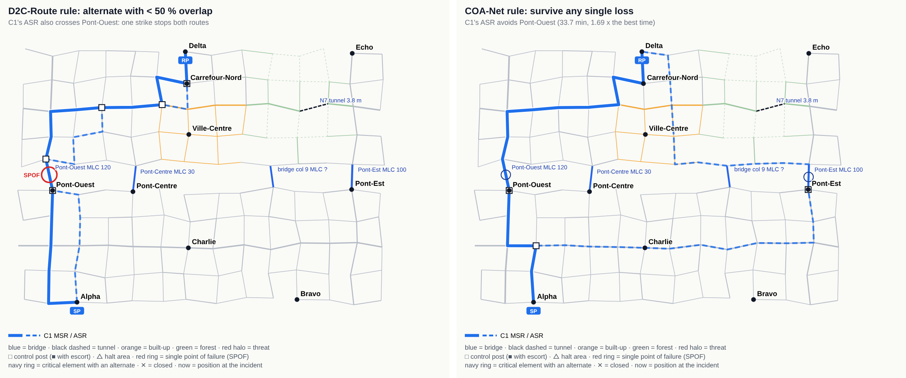
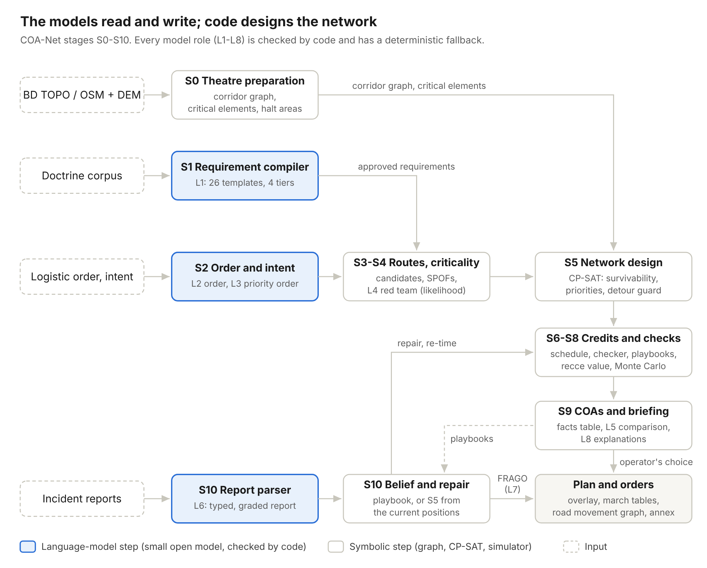
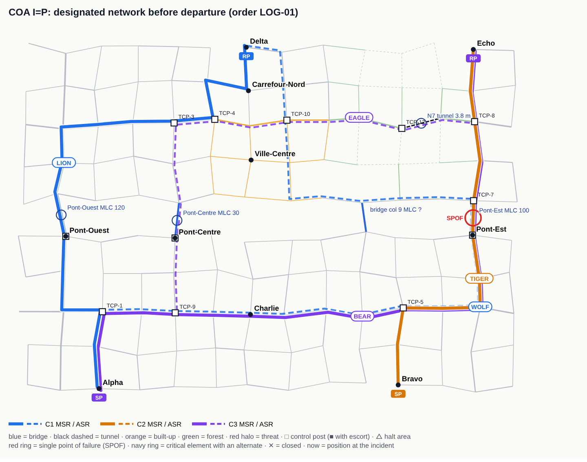
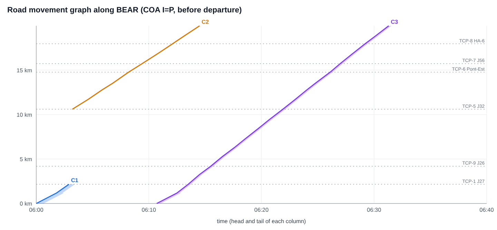
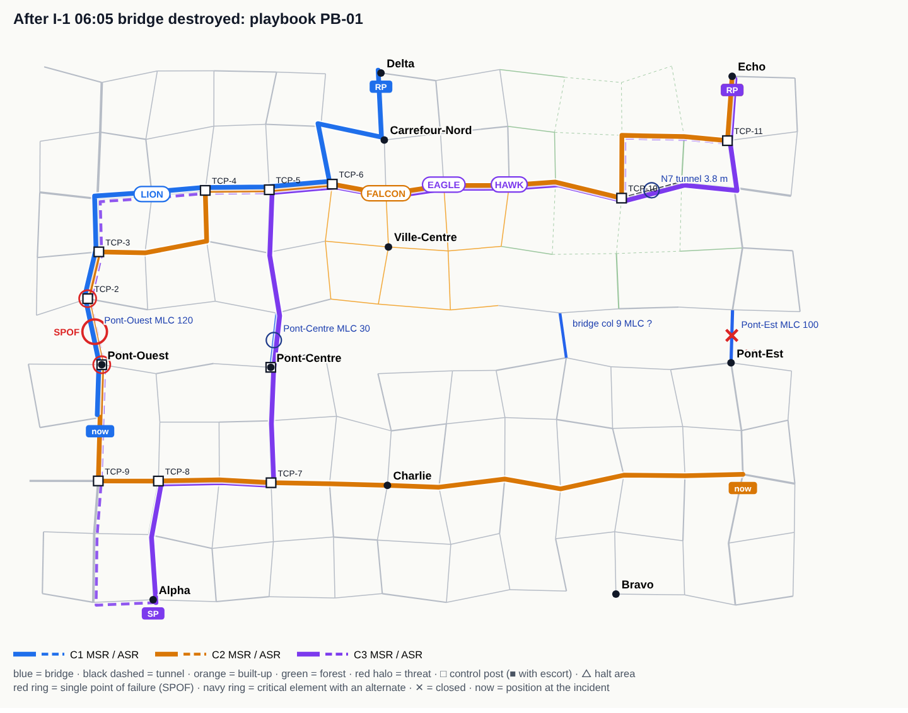
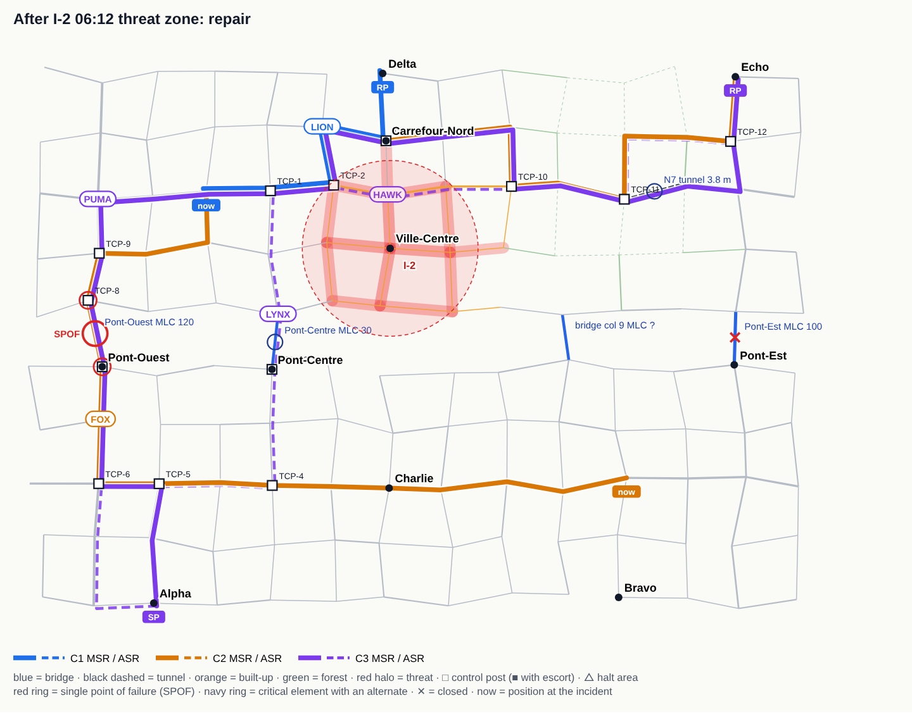
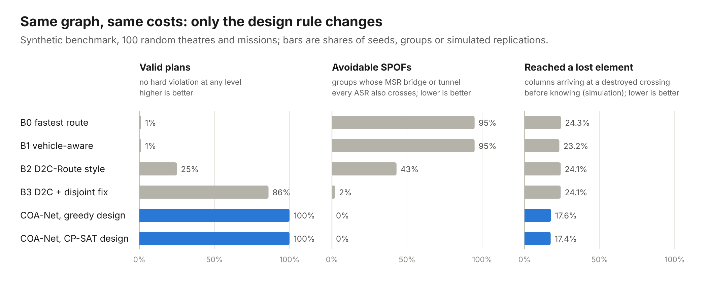

# COA-Net: a network-first, threat-aware alternative to D2C-Route

AMIAD hackathon (Rennes, 12-14 Nov 2026) · alternative methodology to D2C-Route · 28 Oct 2026

> **Implementation status (29 Oct 2026).** This document was written before the code. COA-Net is now implemented in this repository (`src/coa_net`, 48 tests). Section 14 maps every stage to its module, gives the measured results on the demo and on 100 synthetic scenarios, and lists every deviation from this specification. Where sections 7, 8, 11 and 12 say "estimate", "design only" or "does not exist yet", section 14 has the measured values. D2C-Route's code, which the pilot measurements refer to (folder `d2c-route-src`, commit 54bfeb6), is no longer on the main branch and stays in the git history.

## At a glance

**COA-Net designs the maneuver road network the way a movement-control cell does: it first designates one shared network (main and alternate routes, critical points, traffic control posts, halt areas, route status) that keeps working when any single bridge, tunnel or defile is lost, then gives every convoy a time slot on it (movement credits), and presents the result as two to four courses of action (COAs) with their trade-offs.** Small language models (8-32B) never draw routes. They turn doctrine into typed requirements at four levels (road, route, network, schedule), turn the commander's intent into an order of priorities, rank the points an adversary is most likely to strike, write the COA comparison and the fragmentary orders (FRAGOs), and parse incident reports. Optimisation (a mixed-integer model and a CP-SAT scheduler) and a discrete-event simulator guarantee validity and measure resilience.

**What changes compared with D2C-Route**

| | D2C-Route | COA-Net |
| --- | --- | --- |
| Unit of planning | One route per convoy, planned one convoy at a time | One shared network for all convoys, then time slots on it |
| Redundancy | At least one alternate route with at most 50 % shared length | Every convoy keeps a designated route after the loss of any single critical element; residual single points of failure are named and priced by threat |
| Doctrine | Edge rules (hard filters, soft penalties with numeric weights) | 26 requirement templates at road, route, network, schedule and protection level, ranked by priority (doctrine wording plus commander's intent) |
| Time | Later convoys delay their departure; a road is blocked from head entry to tail exit plus headway, in both directions | Joint schedule: order between convoys is a decision, headway is a time gap, opposite convoys may meet on two-lane roads, halts only at halt areas |
| Incidents | Re-plan after the fact (local repair) | Pre-briefed contingency playbooks for likely losses, redundancy restoration, reconnaissance requests for the unknowns that matter |
| Output | A plan per convoy with explanations | COAs, route network overlay with statuses, movement credits, march tables, road movement graph, contingency annex, recce tasks |

**Evidence from the D2C-Route prototype** (repository folder `d2c-route-src`, commit 54bfeb6, its own synthetic theatres, seed rules and default parameters; method in Appendix D):

- On the 20 scenarios of the prototype's benchmark (65 convoys), the alternate supply route (ASR) shares at least one bridge or tunnel with the main supply route (MSR) for **30 convoys (46 %)**: one strike cuts both. For 28 of them a bridge- and tunnel-disjoint alternate existed within the same 1.8× detour limit, and for 17 it also met D2C's own 50 % overlap limit. Choosing the cheapest disjoint alternate instead leaves **2 of 65 (3 %)**. On 100 scenarios: 166 of 334 convoys (50 %) fall to 19 (6 %), for about 5 points of extra alternate travel time (ASR/MSR time ratio 1.15 to 1.20).
- In the demo plan, convoy C2's MSR and ASR both cross **Pont-Est, the bridge destroyed by the first scripted incident** at 06:05. After the repair, all three MSRs cross Pont-Ouest, two convoys have no route that avoids it, and D2C-Route still reports every convoy as "ok".
- After that incident, D2C-Route holds C3 for 28.7 min so that it follows the slower C2, because convoys are scheduled one at a time in priority order. Letting C3 go first creates no conflict under a time-gap headway: **C3 arrives at 06:28 instead of 06:56**, and C2 is unchanged (section 7.7 shows the risk this order moves onto C2 if C3 later breaks down).
- With ±50 % random noise on the soft-rule weights, the MSR changes for **41 % of convoys** (100 scenarios, 10 draws each), and a changed MSR shares only about half its roads with the original. The weights decide the routes, but nothing in doctrine fixes their values.

**How to use this document.** Build COA-Net's minimum version on top of D2C-Route's plumbing (graph loaders, vehicle catalogue, order and incident parsers, LLM client), keep D2C-Route as the main baseline and as a fast fallback, and port one cheap fix into D2C-Route now whatever you pitch: select alternates that avoid the MSR's bridges and tunnels (section 8.3).

## Contents

1. Why a second pipeline
2. COA-Net in one page
3. Data model
4. Doctrine as prioritised requirements
5. The pipeline, stage by stage (S0 to S10)
6. The language-model layer
7. Worked example on the D2C-Route demo theatre
8. Head-to-head comparison with D2C-Route
9. What matters most: criteria, metrics, trade-offs
10. Experimental strategy
11. Risks, limitations and mitigations
12. Build plan to 12 November
13. Questions for the organisers
14. Implementation status and measured results

Appendices: A. requirement template catalogue · B. formal models · C. card and message formats · D. how the pilot measurements were made · E. glossary

## 1. Why a second pipeline

### 1.1 What D2C-Route gets right, and COA-Net keeps

D2C-Route already applies the lessons of the reference papers. The language model never outputs coordinates or routes (CartoMapQA's best model connects origin and destination in only 37.8 % of cases; FRIEDA's best reaches 38.2 % against 84.9 % for humans). Every model output is a typed record that code validates. Missing map attributes are unknown, not optimistic (three-valued logic). A verifier re-checks every rule, incidents trigger a local and stable repair, and every road choice can be traced to a rule. Doctrine is compiled once, so the context stays small. COA-Net keeps all of these principles and reuses the same data loaders, vehicle catalogue and parsers. What it changes is the decomposition of the problem.

### 1.2 Six structural limits of D2C-Route

**L1. The network is a by-product.** Each convoy gets its own MSR and ASR, and the "network" is their union. There is no shared designation, no route status (open, supervised, dispatch, reserved, prohibited), no traffic control posts and no halt areas. The brief asks for a *réseau routier de manœuvre*, and in doctrine movement control designates the network first and then allocates road space and time to units. Three convoys from the same base can end up with six different routes to reconnoitre, mark and protect.

**L2. Redundancy is measured by shared length, not by what can fail.** An ASR is accepted if it shares at most 50 % of its length with the MSR. A route that shares only the bridge passes the test, yet one strike on the bridge cuts both. The penalty method that generates candidates (multiply the cost of used roads by 2, then by 6) penalises the bridge no more than any other road, so alternates diverge where it is cheap, not where it matters. Measured: 46 % of convoys have this single point of failure (SPOF), and in 28 of 30 cases a disjoint alternate was available. Overlap and resilience even pull in opposite directions: the disjoint alternates overlap the MSR more by length (30 % against 15 % on average).



*Figure 1. Convoy C1 on the demo theatre, drawn by the implementation (section 14). Left: D2C-Route's alternate rule (baseline B2) accepts an alternate that crosses Pont-Ouest again, so one strike stops both routes. Right: COA-Net's survivability rule designates an alternate over Pont-Est.*

**L3. Doctrine is flattened to edge rules and weights.** A rule can only test the attributes of one road edge, plus a few hard-coded plan parameters (number of alternates, headway, halts). Route-level rules ("a halt area every two hours", "dangerous goods cross at most one town", "no sharp turns for tank transporters"), network-level rules ("separate outbound and return routes", "lateral links between MSRs") and schedule-level rules ("no transit of towns between 07:30 and 09:00", "vary routes between rotations") cannot be written. Soft rules become a weighted sum of penalties that multiplies travel time, with weights between 0 and 10. "Avoid built-up areas wherever an alternative exists" is a conditional priority, not a weight, and the measured sensitivity (41 % of MSRs change under ±50 % weight noise) shows that the unjustifiable numbers drive the result.

**L4. Time deconfliction is greedy and conservative.** Convoys are planned in priority order and a later convoy can only delay its departure. A road edge is reserved from the leader's head entry to its tail exit plus headway, so the gap grows with edge length: on a simplified real graph with 5-10 km edges, that is 5-10 extra minutes per shared edge. Reservations ignore direction, so two convoys cannot meet even on a two-lane road. Halts are inserted at whatever node is reached after 120 minutes, and crossings at junctions are not modelled (acknowledged in the formulation document). In the demo, these rules hold C3 for 28.7 minutes, although letting it go first conflicts with no other convoy (section 7.5).

**L5. Adaptation is reactive.** The plan does not know which elements an adversary is likely to strike, so it does not prepare for their loss. After an incident consumes an ASR, nothing restores redundancy. Unknown attributes are either forbidden or priced, never turned into a reconnaissance request, even when knowing them would change the plan (bridge col 9 in section 7). D2C's repair is fast (3-15 ms on the demo), but in the field the delay that matters is the time for a report to reach the planner and for new orders to reach the convoy.

**L6. One answer, no trade-off.** The officer receives one plan. The cost of safety in minutes, or of speed in exposure, stays hidden inside the weights. The brief's own words are "assister les opérationnels dans leur décision": decision support, which in military staff work means comparing courses of action.

### 1.3 Design goals

| Goal | Requirement | Answers |
| --- | --- | --- |
| G1 | Produce a network in doctrinal form: named MSR/ASR, route status, critical points, control posts, halt areas, movement credits, march tables | L1 |
| G2 | Survive the loss of any single critical element where the road network allows it; name and price the rest by threat | L2, L5 |
| G3 | Express doctrine at road, route, network and schedule level, with priority semantics instead of numeric weights | L3 |
| G4 | Schedule all convoys jointly, with direction-aware headways and halts at real halt areas | L4 |
| G5 | Anticipate: contingency playbooks, redundancy restoration, reconnaissance of decision-relevant unknowns | L5 |
| G6 | Show two to four COAs with their trade-offs, and select a default automatically from the commander's intent | L6 |
| G7 | Stay within the brief's frugality envelope: models of 8-32B, one 24-48 GB GPU, under 20k tokens per plan, no route ever written by a model | brief |

## 2. COA-Net in one page

### 2.1 The idea

Movement control does not route convoys one by one. It designates a small network of routes that can carry the whole maneuver, classifies each route, places control measures, then hands out road space and time to units. COA-Net automates exactly that sequence, and adds two things a staff rarely has time to do by hand: it computes how the network behaves when each critical point is lost, and it prepares the response in advance.

Three abstractions make this tractable with small models and modest hardware:

1. **A corridor graph.** The road graph is contracted between decision points (junctions of the main network, bridges, tunnels, town entries, origins and destinations, halt areas). Each corridor carries a route classification (width, route type, lowest load class, obstructions), its critical elements and its halt opportunities. A theatre of 50 × 50 km becomes on the order of a thousand corridors, and the 100 to 200 relevant to a mission fit in a text "map card" of 4k to 7k tokens.
2. **Typed requirements with priorities.** Doctrine becomes requirement instances from a closed catalogue of 26 templates, each with a tier (physical safety, "shall", "should", efficiency). Ties between "should" objectives are broken by an ordered list that the commander's intent sets, not by weights.
3. **Paths as building blocks.** For each convoy group the planner generates a rich set of candidate routes (Pareto-optimal, halt-feasible, and replacement routes around each critical element). Network design then chooses among whole routes, so any route-level rule is easy to check.

### 2.2 Pipeline

```
OFFLINE (once per theatre and doctrine corpus)
  BD TOPO / OSM, DEM, places ----> S0  road graph -> corridor graph, critical elements, halt and control-post candidates
  NATO / national doctrine  -----> S1  requirement base (LLM fills templates; evidence quotes; human sign-off)

ONLINE (per logistic order)
  logistic order ----------------> S2  mission spec + priority order from intent (LLM; operator confirms one line)
                                   S3  candidate routes per convoy group (Pareto, halt-feasible, replacement routes)
  threat reports ----------------> S4  criticality: structural impact x likelihood (LLM red team) -> loss scenarios
                                   S5  robust network design (MIP), solved once per priority order -> 2-4 COAs
                                   S6  refinement: road-level routes, halts, control posts, route status, names
                                   S7  movement credits (CP-SAT): departures, waits, halts, headways -> march tables
                                   S8  verification: rule checker + simulator; recce tasks; contingency playbooks
                                   S9  COA briefing (LLM critic, checked) -> operator choice or automatic default

ONLINE (per incident)
  incident report ---------------> S10 parse (LLM) -> belief update -> playbook match?
                                         yes: apply pre-briefed response
                                         no : network repair (MIP with stability)
                                       -> reschedule (minimal change) -> verify -> restore redundancy -> FRAGO (LLM)
```



*Figure 2. The stages as implemented. Blue boxes are language-model roles (L1-L8), each checked by code and backed by a deterministic fallback; grey boxes are symbolic steps; dashed boxes are inputs.*

### 2.3 Who does what

| Actor | Does | Never does |
| --- | --- | --- |
| Language models (8-32B) | Fill requirement templates from doctrine, parse orders and incidents, map intent to a priority order, rank likely targets from a given list, write the COA comparison and FRAGOs from computed facts | Output a route, a coordinate, a number not present in the input, or a final decision |
| Graph algorithms | Build corridors, generate candidate routes, compute impact of each loss, contingency trees | Interpret prose |
| MIP and CP-SAT solvers | Choose the network, select alternates, schedule movement credits, repair after incidents | Relax a physical or "shall" requirement without an explicit waiver |
| Simulator | Replay plans with column lengths, headways, halts, incidents and communication delays; estimate on-time probability | Change the plan |
| Operator | Confirms the priority line, picks a COA (or accepts the default), approves waivers and recce tasks | Has to edit weights |

## 3. Data model

### 3.1 Road graph (reused from D2C-Route C0, with additions)

COA-Net starts from D2C-Route's directed road graph G = (V, E) built from BD TOPO or OSM, with the same attributes (length, class, speed, width, lanes, paving, weight limit, load class, bridge, tunnel, clearance, slope, built-up, forest) and the same three-valued convention: a missing value stays unknown. It adds:

| Attribute | Source | Used by |
| --- | --- | --- |
| `level_crossing`, `ford`, `ferry` | OSM `railway=level_crossing`, `ford=yes`, `route=ferry`; BD TOPO equivalents to confirm | critical elements, route classification |
| `oneway` | OSM `oneway`, BD TOPO `sens_de_circulation` | corridor direction |
| turn angle at each node pair, `roundabout` | edge geometry, `junction=roundabout` | turn feasibility for long vehicles (RTE.TURN) |
| `surface_class` X / Y / Z | paving and track type | route type in the classification string |
| `lit` | OSM `lit` | night requirements |
| `defile` | computed: stretch of at least 1 km with no side junction, inside forest or with side slopes ≥ 15 % on both sides (DEM) | critical elements, red team |
| halt-area candidates with capacity | OSM `amenity=parking`, `highway=rest_area`, large paved or open areas next to the road; capacity ≈ usable area / (2 × vehicle footprint) | halts (RTE.GAP_MAX, SCH.HALT) |
| control-post candidates | junctions of main roads, both ends of each critical element | NET.CONTROL |

All thresholds above are parameters to calibrate with the instructors.

### 3.2 Corridor graph

**Construction.**

1. *Backbone.* Keep roads of importance 1-4 in BD TOPO (or OSM `motorway` to `tertiary`), every critical element on roads of importance 5, and access connectors: for each origin and destination, the best feasible path per vehicle profile to its three nearest backbone nodes, computed on the full graph. Where the backbone is not two-edge-connected around a needed area, add the shortest minor-road links that restore it (so that alternates can exist).
2. *Decision points* D: origins and destinations, backbone nodes of degree 3 or more, both ends of every critical element, entry and exit of each built-up area, halt-area access nodes, named places of the gazetteer.
3. *Corridors* A: maximal backbone paths between two decision points that contain no other decision point. Each corridor a keeps its road elements E(a), and a reverse corridor exists unless the road is one-way.

Because every branching node of the backbone is a decision point, every backbone path is a concatenation of whole corridors: shortest paths on the corridor graph H = (D, A) equal shortest paths on the backbone. The only loss is the roads left out of the backbone, which the connectivity patch and the full-graph fallback in repair cover.

**Aggregated attributes.** For corridor a and vehicle profile p, with D2C-Route's per-edge travel time t_p(e):

$$\ell(a)=\sum_{e\in E(a)}\ell(e),\qquad \tau_p(a)=\sum_{e\in E(a)}t_p(e)$$

$$\mathrm{mlc}(a)=\min_{e\in E(a),\ \mathrm{bridge}(e)}\mathrm{mlc}(e),\quad \mathrm{wid}(a)=\min_{e\in E(a)}\mathrm{width}(e),\quad \mathrm{clr}(a)=\min_{e\in E(a),\ \mathrm{covered}(e)}\mathrm{clearance}(e),\quad \mathrm{slope}(a)=\max_{e\in E(a)}\mathrm{slope}(e)$$

$$X(a)=\sum_{e\in E(a)}\ell(e)\,\mathrm{thr}(e)\ \ [\text{km-equivalent}],\qquad B(a)=\#\{\text{maximal built-up runs in }E(a)\},\qquad b(a)=\sum_{e\in E(a)}\ell(e)\,\mathrm{builtup}(e)$$

An aggregate over values that include an unknown keeps two parts: the bound over known values and an unknown flag (for example "MLC ≥ 40 known, one bridge unclassified"). Feasibility for profile p is decided per element with the three-valued rules of D2C-Route, so no information is lost by aggregation. The corridor also stores its ordered critical elements with their chainage, its halt opportunities (chainage, capacity), its number of side junctions, its forest cover share, and its defile length.

**Route classification string.** Each corridor gets the classification used in NATO and US engineer route reconnaissance, which instructors read at a glance:

`wid(a) / type / mlc(a) / OB`, for example `6.5 m / X / 40 / OB`

with type X (all-weather), Y (limited all-weather) or Z (fair-weather) from the worst surface, and OB when an obstruction exists (for example overhead clearance under 4.3 m, a width constriction, a slope above 7 %, a tight curve, a ford or a ferry; thresholds to confirm with the organisers' doctrine). A route's classification is the worst of its corridors.

**Map card.** The language models never see the graph. When a stage needs the map in context (red team, COA critic, the long-context baseline), it receives only the corridors that appear in some candidate route, one line each, about 35 tokens per line:

```
K12 | J4>J9 | D177 | 12.4 km | 6.5m/X/40/OB(clr 3.9 m) | towns 1 (Guichen 0.8 km) | crit B3 bridge MLC40 | halts H2 (12 veh) | forest 35% | threat 0.0
```

A mission typically involves 100-200 such corridors, so the whole map fits in 4-7k tokens.

### 3.3 Critical elements

A critical element c ∈ 𝒞 is a place whose loss can cut or degrade a route: bridges, tunnels and underpasses, level crossings, fords and ferries, defiles, and, per vehicle profile, the articulation points of the feasible corridor graph between an origin and a destination (computed in linear time with Tarjan's algorithm). Each element carries its type, location, the corridors it belongs to, descriptors for the red team (surroundings, cover, distance to reported threats, nearest alternative crossing), and its structural impact (section 5, S4).

A critical element whose loss leaves a convoy group without any feasible route within the detour guard is an **irreducible SPOF** for that group. No routing can remove it; only engineering (a gap-crossing asset), reconnaissance (classifying an unknown alternative) or accepting the risk can. COA-Net reports these separately, because they call for a different decision.

### 3.4 Vehicles, convoys and columns

The binding profile of a convoy is D2C-Route's: the maximum load class, weight, width and height and the minimum top speed and climbing ability over its vehicles. COA-Net makes the column explicit:

$$L_k=\sum_{i=1}^{n_k}\mathrm{len}_i+(n_k-1)\,d_k,\qquad \mathrm{pass}_k(s)=\frac{60\,L_k}{1000\,s}\ \text{min}$$

where d_k is the vehicle interval set by requirement SCH.MARCH (for example by day, by night, in a threat area) and pass_k(s) the time the column needs to pass a point at speed s. A convoy longer than a configured number of vehicles is split into march units separated by a gap, each scheduled as its own column.

### 3.5 Mission specification

D2C-Route's MissionSpec (convoys, vehicles, origin, destination, earliest departure, latest arrival, priority, cargo, phase) is extended with: rotations and return legs; the commander's intent, copied verbatim from the order; control measures imposed by the order (start and release points, imposed or prohibited routes and areas, assembly areas); and movement windows (for example night only).

### 3.6 Dynamic state and belief

Each element carries a closure probability and a threat level instead of a hard flag. A report r about element e is graded with NATO's source-reliability and information-credibility scale (A-F and 1-6, the "Admiralty code"), which a lookup table turns into a probability q_r that the report is true (to calibrate; for example A1 → 0.95, B2 → 0.8, C3 → 0.5, unknown → 0.5). Independent reports are fused with a noisy-OR, and unconfirmed reports decay with a half-life:

$$P_e=1-\prod_{r}(1-q_r),\qquad P_e(t)=P_e(t_r)\,2^{-(t-t_r)/T_{1/2}}\ \ \text{(unconfirmed reports only)}$$

Decision rule (tier 0): an element is closed if P_e ≥ 0.5; it is *suspect* if 0.2 ≤ P_e < 0.5, which keeps it usable with an exposure penalty and issues a confirmation request; below 0.2 the report is logged only. The threat level of an element is its assessed severity times P_e. Confirmed events stay until cleared or until their stated duration expires.

## 4. Doctrine as prioritised requirements

### 4.1 From edge rules to requirements at five levels

In D2C-Route a rule is a predicate or a penalty on one road edge. In COA-Net a requirement is an *instance* of a template from a closed catalogue of 26 templates (Appendix A). Each template belongs to one of five levels, which decides where it is enforced:

| Level | Checked on | Examples | Enforced in |
| --- | --- | --- | --- |
| SEG (road element) | each road edge or corridor | load class, clearance, dangerous goods in tunnels, prefer major roads | feasibility masks (S3), re-checked by the rule checker (S8) |
| RTE (route) | one whole path | a halt area at least every 2 h of driving; dangerous goods cross at most one town; no turn tighter than a tank transporter can take | resource-constrained path search (S3) |
| NET (network) | the set of designated routes | survive any single loss; separate outbound and return flows; lateral links between MSRs; a control post at every bridge | network design MIP (S5), control measures (S6) |
| SCH (schedule) | the timetable | headway, vehicle interval and march speed, no town transit between 07:30 and 09:00, halts, vary routes between rotations | CP-SAT scheduler (S7) |
| PRO (protection) | exposure and critical points | maximum threat level; no halt or wait near a bridge; control post at likely targets | masks (S3), objectives (S5), placement (S6), forbidden waits (S7) |

### 4.2 The requirement record

Every instance is a typed record. Nothing in it is free text except the quote and the one-line explanation, and both are checked.

| Field | Content | Example (a route-level instance) |
| --- | --- | --- |
| id | unique identifier | R-14 |
| template | catalogue identifier | RTE.GAP_MAX |
| tier | T0 to T3 (section 4.3) | T1 |
| parameters | typed values with units | maximum driving 120 min; halt 15 min; halt only at a halt area |
| scope | convoys, cargo, vehicle classes, phases, areas, time windows it applies to | all convoys, day and night |
| unknown policy | forbid, risk or recce (section 4.5) | risk |
| source | document, paragraph, verbatim quote | corpus document, paragraph number, quoted sentence |
| trigger words | the phrase that sets the tier | "shall" |
| explanation | one line reused in briefings | "A halt is needed at least every two hours of driving." |
| status | draft, approved or rejected; approver; date | approved |

Two checks gate every instance, whatever the model's confidence: the quote must appear verbatim in the corpus (a string match), and the tier must agree with the trigger words (section 4.3). Instances that fail are never used.

### 4.3 Tiers

| Tier | Meaning | Comes from | Used as | Can be relaxed |
| --- | --- | --- | --- | --- |
| T0 physical | the vehicle cannot pass, or the element is closed | vehicle catalogue, map, belief model (P_e ≥ 0.5) | filter | never |
| T1 shall | mandatory by doctrine or by the order | "shall", "must", "is to", "is prohibited", imperative mood in orders; French "doit", "interdit", "impératif" | constraint | only by an explicit, logged waiver, proposed with its price |
| T2 should | recommended | "should", "as far as possible", "preferably", "normally"; French "de préférence", "dans la mesure du possible" | objective, in priority order | traded only in priority order, within tolerances |
| T3 efficiency | good practice, not doctrine | travel time, network size, cover | objective, after T2 | freely |

If the T1 instances make the problem infeasible, COA-Net does not relax anything by itself. It finds a smallest set of T1 instances whose waiver restores feasibility (a deletion filter over instances: drop one, re-test, keep it dropped only if still infeasible without it), prices each waiver (what it buys in the first objective that changes), and asks the operator.

### 4.4 Priorities instead of weights

**Objective menu.** Notation from section 3. P_g^ω is the route that group g drives in loss scenario ω (scenario ω₀ is "no loss", so P_g^{ω₀} is the MSR), p_ω its probability, w_g the convoy-priority factor from the order and n_g the number of vehicles.

| Objective | Definition | Unit |
| --- | --- | --- |
| threat_exposure | $f_X=\sum_{\omega}p_\omega\sum_g w_g\,n_g\,X(P_g^\omega)$ | vehicle·km-equivalent |
| resilience | $f_R=\sum_{\omega\ne\omega_0}p_\omega D_\omega$, with $D_\omega=\sum_g w_g\,n_g\,\big(T(P_g^\omega)-T(P_g^{\omega_0})\big)$; when no designated route survives ω, T(P_g^ω) is the fallback time T_g^fb (best undesignated route, or a failure constant F_g if none) | vehicle·min |
| lateness | $f_L=\sum_k w_k\max(0,\ a_k-\bar a_k)$ over march units k (exact in S7; S5 uses route times against windows) | min |
| hazmat_builtup | $f_H=\sum_{g\in\mathcal G_{DG}}n_g\,b(P_g^{\omega_0})$ over groups carrying dangerous goods | vehicle·km |
| builtup | $f_B=\sum_g n_g\,b(P_g^{\omega_0})$ | vehicle·km |
| travel_time | $f_T=\sum_g w_g\,n_g\,T(P_g^{\omega_0})$ | vehicle·min |
| network_size | $f_N=\sum_a \ell(a)\,y_a$ over designated corridors | km |
| cover | $f_C=\sum_g n_g\,\ell_{\text{open}}(P_g^{\omega_0})$, by day only | vehicle·km |
| stability (repair only) | number of designations, assignments and start-point times changed, units already briefed or moving counting double | count |

w_g is the only weight left in the objectives (by default it doubles per priority level of the order), and it is displayed.

**ε-lexicographic optimisation.** Let σ be the priority order and 𝒳 the plans that satisfy every T0 and T1 instance. COA-Net solves one problem per level, each constrained by the optima already found:

$$f_{\sigma(k)}^{*}=\min\Big\{f_{\sigma(k)}(x)\ :\ x\in\mathcal X,\ \ f_{\sigma(j)}(x)\le f_{\sigma(j)}^{*}+\delta_{\sigma(j)}\ \ \forall j<k\Big\},\qquad \delta_j=\varepsilon_j\,|f_j^{*}|+\eta_j$$

ε_j is a relative tolerance (0 by default, 10 % for travel time) and η_j a small absolute slack (for example 1 vehicle·min) that avoids numerical ties. Each level is warm-started from the previous solution.

**Guards.** Some T1 instances bound lower priorities whatever the order: RTE.DETOUR (an ASR may take at most ρ = 1.8 times the MSR's travel time; this is D2C-Route's value, applied to time instead of D2C's penalised cost), deadlines and time windows.

**Default order and COA archetypes.** The default order is a proposal to validate with the instructors:

1. threat_exposure, 2. resilience, 3. hazmat_builtup, 4. travel_time (ε = 10 %), 5. builtup, 6. network_size, 7. cover.

Courses of action come from a few archetype orders, plus the order confirmed from the intent:

| COA | Order (first three) | Intent it represents |
| --- | --- | --- |
| P, protected | threat_exposure, resilience, hazmat_builtup | contested area, default |
| R, resilient | resilience, threat_exposure, travel_time | likely strikes on crossings, long operation |
| F, fast | travel_time (ε = 0), threat_exposure, resilience | urgent delivery, low threat |
| E, economical | network_size, threat_exposure, resilience | few assets to reconnoitre, mark and control routes |
| I, intent | from the order (S2) | usually equal to one of the above; duplicates are merged |

**From intent to order.** The language model reads the commander's intent and returns a permutation of the menu with tolerances, and for each of the top three priorities the words of the intent that justify it. Example: the intent "Deliver the fuel to Delta before 08:30. The enemy is likely to strike the crossings. Keep the tankers out of the towns." gives "lateness ← 'before 08:30'; resilience ← 'likely to strike the crossings'; hazmat_builtup ← 'keep the tankers out of the towns'". Code checks that it is a permutation and that every quoted phrase is in the intent; the operator confirms the order as one line. When the intent contains an imperative ("do not cross Ville-Centre"), the parser also creates a T1 instance instead of only a priority.

**Why not weights.**

1. Doctrine and intent state priorities in words; nothing in them gives a weight of 0.3 or 3.0.
2. The weights drive the result: with ±50 % noise on D2C-Route's soft weights, 41 % of MSRs change (section 1).
3. A lexicographic choice explains itself: the first objective on which two options differ is the reason (section 4.6).
4. The cost of a priority becomes explicit: comparing COAs gives, for example, the minutes that protection costs.

The known weakness of lexicographic orders is that a tiny gain on a high priority can justify a large loss on a lower one. The tolerances, the guards and the COA comparison (which shows exactly what each priority costs) are the mitigations. The tolerances are numbers too, but there are few of them, they read as plain statements ("accept up to 10 % more travel time"), and they are displayed.

### 4.5 Unknown values

Each instance carries one of three policies for missing attributes:

- **forbid**: an unknown counts as a violation. This is D2C-Route's behaviour for its hard rules, and the default for T0 attributes on critical elements (load class of a bridge, clearance of a tunnel).
- **risk**: the element may be used, but it becomes a critical element whose failure probability is the prior probability that the unknown value violates the requirement (for example P(MLC < 100) for a bridge on a tertiary road, estimated from the bridges of the same road class in the theatre whose class is known, or 0.5 by default). The network then needs an alternate around it like around any other critical element. Default for widths and slopes on non-critical roads.
- **recce**: the element is usable only once reconnoitred. S8 computes the value of the information and requests a reconnaissance when the value is high and the answer can arrive before the decision it changes. Offered automatically for every unknown element that could remove an irreducible SPOF.

Military load class is generally absent from civilian data (OSM and BD TOPO carry posted weight limits at best), so unknown bridge classes will be common on real data. That is why the recce policy matters.

### 4.6 Contrastive explanations

For each decision (the MSR of a group, an ASR, a corridor kept or dropped, the order between two convoys, a wait), COA-Net finds the best plan that differs on that decision, either from the candidate pool or by re-solving with the decision forbidden. It then compares the two in tier and priority order:

1. A T0 or T1 violation by the alternative is the reason. Measured example from the demo: "C1 does not take the direct road over Pont-Centre: the bridge's load class is 30 and the column's is 35 (SEG.LOAD, T0)."
2. Otherwise the first objective that differs beyond its tolerance is the reason: "same threat exposure (priority 1), but the alternative leaves C2 without a route if Pont-Est is lost (resilience, priority 2)".

Because the comparison uses the same ordered vector as the optimiser, the explanation is exact by construction. No language model is needed to produce the reason; the model only phrases it (section 6).

### 4.7 Doctrine coverage

COA-Net measures how much of the doctrine it actually uses:

- N is the number of normative statements in the corpus: sentences with a modal of obligation or recommendation, detected by a pattern list (English and French) and by the language model as a second detector, union of both, with a human check on a sample.
- Each statement is labelled *mapped* (to at least one approved instance), *out of scope* (with a reason: communications, administration, medical, and so on), *inexpressible* (relevant to routes or timing, but no template fits) or *not reviewed*.
- Coverage = (mapped + out of scope) / N. Expressiveness = mapped / (mapped + inexpressible).

Inexpressible statements are the backlog for new templates. Labelling the same corpus with D2C-Route's rule format gives D2C-Route's expressiveness, a direct and quantitative test of limit L3 (hypothesis H5, section 10).

### 4.8 Where D2C-Route's 23 seed rules go

| D2C-Route rule | COA-Net template and tier | Note |
| --- | --- | --- |
| H-BRIDGE-MLC, H-WEIGHT | SEG.LOAD, T0 | |
| H-CLEARANCE, H-WIDTH | SEG.GAUGE, T0 | margins (0.3 m, 0.5 m) kept as parameters |
| H-SLOPE | SEG.GRADE, T0 | |
| H-HEAVY-UNPAVED | SEG.SURFACE, T0 | T1 if the source is doctrine rather than physics |
| H-CLOSED | SEG.STATUS, T0 | closure now comes from the belief model |
| H-THREAT | PRO.EXPOSURE, T1 | maximum threat level 0.8 |
| H-HAZMAT-TUNNEL | SEG.CARGO, T1 | |
| S-BUILTUP | SEG.AVOID, T2 | objective builtup |
| S-HAZMAT-BUILTUP | SEG.CARGO, T2 | objective hazmat_builtup |
| S-CHOKEPOINT | replaced by NET.SURVIVE, T1 | explicit critical elements instead of a centrality penalty |
| S-SLOPE, S-ROAD-CLASS | SEG.GRADE, SEG.AVOID, T3 | preferences |
| S-THREAT | PRO.EXPOSURE, T2 | objective threat_exposure |
| S-COVER | SEG.AVOID, T3 | objective cover, by day |
| S-WEATHER | SEG.SURFACE, T2 | via route type X, Y or Z |
| N-ALTERNATE | RTE.DETOUR, T1, and NET.SURVIVE, T1 | the 50 % overlap test is replaced by survivability |
| N-HEADWAY | SCH.HEADWAY, T1 | time gap, direction-aware |
| T-CONVOY-SPEED, T-HEAVY-SPEED, T-NIGHT | SCH.MARCH, T1 | march speed, vehicle interval, night factor |
| T-HALT | RTE.GAP_MAX, T1, and SCH.HALT, T1 | halts at halt areas only |

All 23 rules fit in 14 templates. The other 12 templates express rules that D2C-Route cannot write: RTE.TURN, RTE.CROSSINGS_MAX, RTE.ACCESS, RTE.RANGE, NET.SEPARATE, NET.LATERAL, NET.CONTROL, NET.SIZE, NET.STATUS, SCH.WINDOW, SCH.VARY and PRO.CRITPOINT.

## 5. The pipeline, stage by stage

Each stage below gives its method, output, expected cost and fallback. Costs are estimates to be measured, except where marked as measured.

### S0. Theatre preparation (offline, once per theatre)

**Method.**

1. Load the road graph with D2C-Route's loaders and add the attributes of section 3.1.
2. Detect critical elements from attributes (bridges, tunnels, level crossings, fords, ferries) and from the DEM and forest layer (defiles). Articulation points depend on the vehicle profile and on the origin and destination, so they are computed per mission in S3.
3. List halt-area and control-post candidates (section 3.1).
4. Build the corridor graph (section 3.2) and aggregate attributes for each profile class of the vehicle catalogue (light, medium, heavy, tank transporter, tracked, dangerous goods), with the route classification string.
5. Pre-compute, per profile class, a three-valued feasibility mask over corridors and the travel time of each corridor.

**Output.** Corridor graph H, critical elements 𝒞, candidates, masks, map-card generator.

**Cost.** Linear in the size of the road graph: seconds to a few minutes for a département-sized extract (estimate; D2C-Route's real-data loaders have not yet been run on live data).

**Fallback.** The corridor graph is an accelerator, not a requirement: every later stage can run on the full road graph with the same logic, only slower.

### S1. Requirement base (offline, once per doctrine corpus)

**Method.**

1. Split the corpus into passages and index them with bge-m3.
2. For each template, retrieve the best passages using the template's description and seed phrases in English and French.
3. The language model fills zero or more instances per passage (parameters, scope, tier, trigger words, unknown policy, verbatim quote), with schema-constrained output.
4. Validators: schema and units; quote found verbatim; tier consistent with trigger words; parameters in plausible ranges (for example a headway between 1 and 60 min); duplicates merged; conflicts (same template and scope, different values) flagged, keeping the stricter value for T1 and showing both.
5. Human sign-off: a reviewer accepts or edits each instance in a list that shows the quote next to the parsed parameters. Expect 60 to 120 instances at about 15 s each (estimate).
6. Coverage report (section 4.7).

**Output.** A versioned, approved requirement base.

**Fallback.** The seed base: D2C-Route's 23 rules mapped as in section 4.8, plus default instances of the 12 new templates whose values are flagged "assumption, to confirm".

### S2. Mission and priorities (online, per order)

**Method.**

1. Parse the order with D2C-Route's parser, extended with the fields of section 3.5.
2. Resolve places on the graph, check reachability per profile, and split long convoys into march units (section 3.4).
3. Group convoys that share origin and destination areas, profile class and compatible windows into groups g of n_g vehicles. Groups keep S3 to S5 small; S7 still schedules every march unit.
4. Activate requirement instances by scope (cargo, vehicle class, phase, area, time).
5. Map the intent to a priority order (section 4.4) and have the operator confirm it.

**Output.** Mission specification, groups, active requirements, confirmed priority order.

**Fallback.** Without a model, the regex parser of D2C-Route and the default order.

### S3. Candidate routes per group

**Method**, for each group g on H with g's feasibility mask:

1. *Supported Pareto routes.* Dijkstra on a small grid of weightings of the normalised criteria (travel time, threat, built-up, dangerous goods in built-up areas, open ground). Weightings only generate candidates here; they never decide.
2. *Route-level requirements.* Resource-constrained shortest paths, by label setting with dominance: RTE.GAP_MAX with the resource "driving time since the last halt area", reset at halt-area nodes; RTE.CROSSINGS_MAX with the number of built-up crossings; RTE.RANGE with the distance since the last fuel point. RTE.TURN by expanding decision nodes into turn nodes for long-vehicle profiles. RTE.ACCESS by forcing via-points and removing prohibited areas.
3. *Replacement routes.* For each critical element c on the best routes, the best route that avoids c. Plus the cheapest *pair* of routes that share no critical element: a minimum-cost flow of two units from origin to destination in which each critical element has capacity 1 and every other corridor capacity 2 (Suurballe's construction, adapted so that only critical elements must be disjoint).
4. *Articulation points* of the feasible graph between g's origin and destination (Tarjan's algorithm, linear time). They are irreducible SPOFs for g and join 𝒞.
5. *Pool.* Remove duplicates and keep at most 30 routes per group, making sure that each cheap critical-element signature (the set C(P) of elements a route crosses) keeps at least one representative.

**Output.** Candidate set P_g with, for each route P: T(P), X(P), b(P), B(P), C(P), ℓ(P) and a feasible halt plan.

**Cost.** A few dozen shortest-path or label-setting runs on about a thousand nodes per group: under a second (estimate).

**Fallback.** D2C-Route's k-diverse routes (penalty method) plus the replacement routes of step 3.

### S4. Criticality and loss scenarios

**Method.**

1. *Structural impact* (exact, no model). For each c ∈ 𝒞 and each group g that may use it, the delay its loss causes:

$$\Delta_g(c)=T^{*}\big(g;\,H\setminus c\big)-T^{*}(g;\,H)\quad(+\infty\ \text{if no route within the guard}),\qquad I(c)=\sum_g w_g\,n_g\,\min\big(\Delta_g(c),\Delta_{\max}\big)+F\cdot\big|\{g:\Delta_g(c)=+\infty\}\big|$$

2. *Likelihood* (language-model red team, section 6). The model receives the cards (Appendix C) of the 20 to 40 elements with the highest impact plus every element near a reported threat, and sorts them into likelihood classes (high, medium, low) for the mission window, each with a reason that cites card fields. Two samples are merged by rank aggregation (Borda count). A calibration table turns classes into probabilities (for example 0.30, 0.10, 0.02, to set with the instructors), which are fused with reported threats: π_c ← 1 − (1 − π_c)(1 − P_c).
3. *Scenarios* Ω: ω₀ (no loss), the single loss of every element with π_c ≥ π_min or with an impact in the top decile, and optionally the pairs among the red team's top five for a worst-case variant. For small π, p_ω ≈ π_c and p_{ω₀} = 1 − Σ p_ω.

**Output.** Impact table, probabilities π, scenario set Ω, and the irreducible SPOFs of each group (Δ = +∞).

**Fallback.** Without a model, π_c from a fixed table by element type (bridges and tunnels 0.10, defiles 0.05, others 0.02) fused with reported threats.

### S5. Robust network design

**Method.** A path-based mixed-integer program (full model in Appendix B) chooses for each group one MSR x_gP and zero or more ASRs z_gP among its candidates, designates the corridors y_a they use, and evaluates each loss scenario through recourse variables r_gωP (which designated route g drives in ω) and φ_gω (g has no designated route left). The two constraints that carry the design are:

$$\text{survivability (NET.SURVIVE):}\quad\sum_{P\in\mathcal P_g:\ c\notin C(P)}\big(x_{gP}+z_{gP}\big)\ \ge\ 1-u_{gc}\qquad\forall g,\ \forall c\in\mathcal C_g$$

$$\text{detour guard (RTE.DETOUR):}\quad T(P)\,z_{gP}\ \le\ \rho\sum_{P'\in\mathcal P_g}T(P')\,x_{gP'}\qquad\forall g,\ \forall P\in\mathcal P_g$$

u_gc = 1 means that g accepts c as a single point of failure: it is fixed to 1 for irreducible SPOFs, fixed to 0 for the others when NET.SURVIVE is T1, and left free but penalised through the resilience objective when NET.SURVIVE is T2. The model is solved ε-lexicographically in the confirmed order (section 4.4), then once per archetype order. Networks that are identical, or that differ by less than a few percent of designated length, are merged, leaving two to four COAs.

**Output.** For each COA: designated corridors, MSR and ASRs per group, accepted SPOFs, and the route each group takes in each loss scenario.

**Cost.** At the upper end (10 groups, 30 candidates per group, 40 scenarios) the model has about 1,300 binary and 13,000 continuous variables, most of them recourse variables whose optimal values are integral once the designations are fixed. That should take seconds per lexicographic level with HiGHS (estimate, to measure), with a time limit per level (for example 10 s) that keeps the best solution found.

**Fallback.** A greedy design: MSR = lexicographically best candidate; ASR = partner in the cheapest critical-element-disjoint pair (S3 step 3) if it meets the guard; network = union. This greedy is the fix proposed for D2C-Route in section 8.3, so the fallback is never worse than D2C-Route with that fix.

### S6. Refinement and control measures

**Method.**

1. Expand corridors into road edges and re-check every SEG instance at road level (three-valued).
2. *Halts.* Choose halt areas along each route so that RTE.GAP_MAX holds with as few halts as possible (a shortest path over the halt-area candidates of the route). Capacity conflicts between groups are left to S7.
3. *Traffic control posts* (NET.CONTROL): at each critical element of a designated route, at each junction where designated routes split or merge, and then wherever the spacing along a route would exceed the maximum (greedy cover). Elements with high π_c come first if posts are limited.
4. *Route status* (NET.STATUS): for example, routes used by heavy or dangerous-goods groups during their windows become dispatch routes (movement credit required for every move); other designated routes are supervised; ASRs not in use stay open but are reserved for re-routing; closed elements are prohibited. These rules are to be confirmed with the instructors.
5. *Names and overlay.* Route names from a list, start and release points per group, the decision points where ASRs branch off, and a GeoJSON overlay with statuses and control points.

**Output.** Road-level network overlay, control-post list, halts, route statuses.

### S7. Movement credits

**Method.** A CP-SAT model (Appendix B) schedules every march unit on its MSR. Each route is cut into segments between consecutive control points, junctions and halt areas. Variables are the head's entry time into each segment, the waits (allowed only at start points, halt areas and waiting areas) and the halts. The order between two march units on a shared segment is a decision variable. Constraints:

- *Same-direction headway (SCH.HEADWAY).* If march unit k precedes k' on segment s, the head of k' may not reach any point of s less than h minutes after the tail of k has passed it. With constant speeds on a segment, the gap is an affine function of the position along it, so checking the two ends is enough:

$$t'_{\text{in}}\ \ge\ t_{\text{in}}+\mathrm{pass}_k(s)+h\qquad\text{and}\qquad t'_{\text{in}}+\tau'_s\ \ge\ t_{\text{in}}+\tau_s+\mathrm{pass}_k(s)+h$$

  where τ_s and τ'_s are the head travel times of k and k' on s. The second inequality matters when k' is faster than k.
- *Opposite directions.* Two columns may meet on a two-lane segment; on a single-lane segment (one lane, or width below twice the vehicle width plus a margin) their occupation intervals may not overlap.
- *Junctions.* Columns crossing or merging at the same decision point may not pass it at the same time (no-overlap of their passage intervals plus a clearance time).
- *Halts* at halt areas, with the number of vehicles present at any time within the area's capacity.
- *Windows* (SCH.WINDOW): forbidden intervals for given segments, for example built-up areas between 07:30 and 09:00.
- *Deadlines* and earliest departures.

The objective is lexicographic: weighted lateness, then weighted delay against the unconstrained arrival, then the number and length of waits outside start points, then (in repair only) changes to start-point times.

**Output.** Movement credits (route, start-point time, control-point times, release-point time per march unit), the march table, and the road movement graph (a time-distance diagram of every column).

**Cost.** For 5 to 30 march units, a few hundred interval variables: seconds (estimate).

**Fallback.** D2C-Route's greedy priority-order scheduling with the time-gap rule above, which can only start earlier than D2C-Route's occupancy rule (measured on the demo: 27.5 instead of 28.7 min of hold for C3).

### S8. Verification and anticipation

**Method.**

1. *Rule checker.* Every active instance is re-checked on the final plan at all five levels, three-valued. T0 and T1 violations must be zero or covered by a waiver; T2 shortfalls are reported.
2. *Discrete-event simulation* (Appendix B). Columns are replayed with their lengths, headways, halts and control points, first deterministically, then by Monte Carlo with random speeds, breakdowns, incidents from the script, and delays between an incident, its report to the planner, and the new orders reaching the column. The same random numbers are used for every COA and every pipeline being compared. Metrics: probability of arriving on time per group, expected delay, probability of completing the mission, vehicle·minutes in threat areas, queues at critical points.
3. *Reconnaissance tasks.* For each unknown element u under the recce policy, the value of information compares the plan made without knowing u with the plans made after each possible answer o (probability q_o):

$$\mathrm{VOI}(u)=\sum_{o}q_o\,\big(J(x_0^{*}\mid o)-J(x_o^{*}\mid o)\big)$$

   For a binary answer under the forbid policy this reduces to VOI(u) = q_u (J_0 − J_1)^+, since the plan only changes when u turns out usable. J is the lexicographic vector, so the value is reported on the highest-priority objective that changes, with the others listed. A task is issued only if the answer can arrive before the decision it changes (the time the first affected group reaches the decision point).
4. *Contingency playbooks.* For each scenario in Ω with p_ω ≥ p_min or a high impact, COA-Net pre-computes the response: for each affected group, a shortest-path tree towards its destination on H minus the lost element, which gives the next corridor from every node, so the response holds wherever the column is when it learns of the loss; the decision points where the response leaves the plan; re-solved movement credits for the scenario; and a pre-drafted FRAGO.

**Output.** Verification report, simulated metrics per COA, ranked reconnaissance tasks, contingency annex.

**Fallback.** If time is short, the deterministic replay only, and playbooks for the five most likely losses.

### S9. COA briefing and choice

**Method.** Code computes a facts table per COA (Appendix C): priority order, routes, designated length, travel times, exposure, SPOFs (irreducible and accepted), on-time probability, reconnaissance needs, and what the COA gains and costs against the others. The language model writes a comparison of at most 250 words and a list of concerns. Every number in the text must match a field of the table and every element it names must exist; otherwise the text is regenerated once, then replaced by a templated comparison.

**Choice.** The operator picks a COA. Without an answer, the default is the COA built from the confirmed intent order.

### S10. Incident loop

**Method**, for each incident report:

1. *Parse* the report (D2C-Route's parser, plus the source grading).
2. *Update beliefs* (section 3.6): closure probabilities, threat levels, statuses.
3. *Match a playbook.* If the change corresponds to a pre-computed scenario, apply its response, which is already verified.
4. *Otherwise repair the network*: the S5 model restricted to the affected groups, with their current positions as origins, the current designations as starting point, and stability appended to the priority order (or placed first if the operator prefers stable orders). If the model misses its time limit, D2C-Route's local repair is the fallback.
5. *Reschedule* with S7, the past fixed and stability in the objective.
6. *Verify* with the rule checker and a short Monte Carlo run.
7. *Restore redundancy.* Recompute survivability for every group. Where a group now has a reducible SPOF, designate a new ASR (S5 with current designations fixed, additions allowed). Where it is irreducible, propose the options to the operator: reconnoitre an unknown alternative (ranked by value of information), protect the element (control post, escort, no halts nearby: PRO.CRITPOINT), request a gap-crossing asset, or accept the risk.
8. *Write the FRAGO* from a structured difference between the old and new plans, only for the units affected (section 6).

**Targets.** Under 5 s of computation when a playbook applies and under 60 s for a repair, FRAGO included (estimates). In the field, transmission delays will dominate these times, which is why the playbooks are briefed before departure.


*Figure 3. The incident loop as implemented, with the computation times measured on the demo (section 14.3).*

## 6. The language-model layer

### 6.1 Roles

The models are the same as in the D2C-Route LLM setup document: Mistral Small 3.2 24B by default, Qwen3-32B to compare, Qwen3-8B for fast steps, bge-m3 for retrieval, all open-weight and served locally through an OpenAI-compatible server with schema-constrained decoding.

| # | Role | Stage | Input | Typed output | Default model | Checks | Fallback |
| --- | --- | --- | --- | --- | --- | --- | --- |
| L1 | Doctrine compiler | S1 | template card and 5-8 retrieved passages | requirement instances (section 4.2) | Qwen3-32B (offline, quality first) | schema, verbatim quote, tier against trigger words, ranges, human sign-off | seed base |
| L2 | Order parser | S2 | order text and gazetteer names | mission specification | Mistral Small 3.2 24B | schema, names resolve on the graph, times consistent | D2C-Route regex parser |
| L3 | Intent mapper | S2 | intent text and objective menu | priority order, tolerances, quotes, T1 candidates | Qwen3-8B | is a permutation, quotes found in the intent | default order |
| L4 | Red team | S4 | critical-element cards and threat summary | likelihood class and reason per element | Mistral Small 3.2 24B or Qwen3-32B | identifiers exist, reasons cite card fields, agreement between two samples | table by element type |
| L5 | COA writer and critic | S9 | facts table and the map-card lines of the COAs' corridors | comparison of at most 250 words, list of concerns | Mistral Small 3.2 24B | every number and identifier matches the facts | templated comparison |
| L6 | Incident parser | S10 | report text | incident record with source grading | Qwen3-8B | schema, location resolves, grading valid | D2C-Route regex parser |
| L7 | FRAGO writer | S10 | structured plan difference | FRAGO in five paragraphs | Qwen3-8B | numbers, names and times match the difference | templated FRAGO |
| L8 | Explanation phrasing | S5-S9 | contrastive record (decision, alternative, deciding objective, values) | one sentence | Qwen3-8B | numbers match | template sentence |

Mistral Small 3.2 accepts images, but no stage of the main pipeline needs them; image input is used only by baseline B5 (section 10).

The models do what the reference papers show small models do well (reading text, mapping words to closed sets, writing from given facts) and nothing that needs geometric reasoning on a map. The red team is the most judgemental role. Its output is therefore only a ranking over a list it is given, it never decides alone (it is combined with the exact structural impact), and the evaluation uses incident scripts that do not come from it (section 10), so that a poor red team shows up in the results instead of hiding in them.

### 6.2 Prompt outlines

**L1, doctrine compiler.** Role: extract requirements for military road movement from doctrine by filling one template; never invent values. Input: the template card (identifier, level, parameters with units and allowed ranges, definition, three seed phrases) and passages with identifiers. Rules: one instance per distinct requirement; copy the quote verbatim; set the tier from the modal verb using the table of section 4.3; leave a parameter empty when the text does not state it; take the scope only from the text. Output: a list of instance records, possibly empty.

**L3, intent mapper.** Input: the intent paragraph, the objective menu with one-line definitions, the allowed tolerances. Rules: return every objective exactly once, in order; justify the top three with exact quotes; turn imperatives into T1 candidates; keep the default relative order for objectives the intent does not mention. Output: order, tolerances, quotes, T1 candidates.

**L4, red team.** Role: an intelligence analyst assessing likely enemy action against friendly logistics during the mission window. Input: element cards (identifier, type, surroundings, approaches and cover, distance to reported threats, nearest alternative, groups that depend on it, impact class) and a threat summary. Rules: rank only the listed identifiers; use the classes high, medium, low, with at most five "high"; give each reason by citing card fields; never output probabilities, places or coordinates. Output: a list of (identifier, class, reason).

**L5, COA writer and critic.** Input: the facts tables of two to four COAs, the map-card lines of their corridors, the confirmed priority order. Rules: compare in priority order; use only numbers from the tables; state each trade-off as "COA R gains X on resilience for Y minutes of travel"; every concern cites an element or corridor identifier and a card field; do not recommend beyond saying which COA follows the confirmed order. Output: comparison and concerns.

**L7, FRAGO writer.** Input: the structured difference (units affected, old and new routes by name and key points, new times at start, control and release points, new statuses and control posts, the triggering incident with its grading). Rules: five-paragraph structure (situation, mission, execution, sustainment, command and signal); only the items that changed; copy names and times; add no instruction that is not in the difference. Output: FRAGO text.

### 6.3 Token budget (estimates)

| Call | Input tokens | Output tokens | Calls | Total |
| --- | --- | --- | --- | --- |
| L2 order | 2,000 | 500 | 1 | 2,500 |
| L3 intent | 900 | 300 | 1 | 1,200 |
| L4 red team | 3,500 (about 40 cards of 60 tokens, plus instructions) | 800 | 1 or 2 | 4,300 or 8,600 |
| L5 COA briefing | 3,000 | 600 | 1 | 3,600 |
| L8 explanations, on demand | 150 | 50 | about 10 | 2,000 |
| **Per plan** | | | | **about 12k to 18k** |
| L6 incident | 600 | 300 | 1 | 900 |
| L7 FRAGO | 1,200 | 600 | 1 | 1,800 |
| **Per incident** | | | | **about 3k** (plus 4k if the threat picture changes enough to re-run the red team on the affected elements) |
| L1 doctrine, offline | about 3,000 per template | 500 | 26 | about 90k once per corpus |

No single call exceeds about 4.5k tokens, so an 8k context window is enough. The two red-team samples share their prompt, so with prefix caching the second costs little more than its output. Generation is the slow part: about 3k output tokens per plan, which at 20 to 40 tokens per second for a 24B model on one GPU (estimate) means one to two and a half minutes of model time per plan. Incident handling uses the 8B model, so its model time stays around ten to fifteen seconds (estimate).

### 6.4 Guardrails

- No model ever outputs a route, a coordinate, or an identifier that is not in its input.
- Every output is schema-constrained, then validated by code; a failed validation triggers one retry, then the deterministic fallback.
- Every number in generated prose must appear in the facts it was given (normalised string match); every quote must appear in its source.
- The solvers decide. The operator confirms the priority order, the COA, every waiver and every reconnaissance task.
- Prompts, outputs and validation results are logged for after-action review.
- Everything runs offline; doctrine and orders never leave the machine.

Every role has a deterministic fallback, so the whole pipeline also runs without any model. This is ablation A12 in section 10, and the safety net during the event.

## 7. Worked example on the D2C-Route demo theatre

### 7.1 What was computed

Every number in this section was computed with D2C-Route's own code, graph, travel times and costs (commit 54bfeb6, demo seed 0, default rules), using small scripts that apply COA-Net's rules wherever a COA-Net component would act: alternates that avoid the MSR's critical elements, a detour guard on time, the time-gap headway, a joint order between convoys, and the outcomes of a reconnaissance. They are not outputs of a COA-Net implementation, which does not exist yet. Numbers marked *illustrative* were not computed. *[29 Oct 2026: section 14.3 gives the same example as computed by the implementation.]*

### 7.2 Setting

**Theatre.** A synthetic road grid crossed by a river with four bridges: Pont-Ouest on the N1 (load class MLC 120), Pont-Centre (MLC 30), an unnamed bridge on column 9 (class unknown) and Pont-Est on the D12 (MLC 100). Planted constraints include the N7 tunnel (clearance 3.8 m), the built-up town of Ville-Centre on the direct axis, a road limited to 12 t and unpaved forest tracks.

**Order LOG-01 (day).** C1, priority 1: six heavy trucks and two fuel tankers, Alpha to Delta, binding class MLC 35, deadline 08:30. C2, priority 2: two tank transporters, Bravo to Echo, MLC 100, 4.0 m high, deadline 09:00. C3, priority 3: four medium trucks and an ambulance, Alpha to Echo, MLC 16. Departures from 06:00.

**Incidents.** I-1 at 06:05, Pont-Est destroyed by artillery. I-2 at 06:12, ambush confirmed near Ville-Centre (radius 1.5 km, threat 0.9). I-3 at 06:20, C3 breaks down for 25 minutes.

### 7.3 Before departure

| Convoy | D2C-Route MSR | D2C-Route ASR | Critical element shared by both | Best route avoiding the MSR's bridge | COA-Net decision |
| --- | --- | --- | --- | --- | --- |
| C1 (MLC 35) | Pont-Ouest, 16.1 km, 20 min | Pont-Ouest, 17.6 km, 23 min | Pont-Ouest | via Pont-Est: 28.3 km, 36.0 min (1.76 × MSR time) | ASR via Pont-Est. It meets ρ = 1.8 on time; D2C-Route's guard, applied to its penalised cost, gives 1.84 and rejects it |
| C2 (MLC 100) | Pont-Est, 11.5 km, 14 min | Pont-Est, 11.6 km, 15 min | Pont-Est | via Pont-Ouest: 30.5 km, 39.8 min (2.74 ×) | Irreducible SPOF on Pont-Est within the guard: reported, with a reconnaissance task for bridge col 9 |
| C3 (MLC 16) | Pont-Est, 20.0 km, 21 min | Pont-Ouest and N7 tunnel, 21.8 km, 23 min | none | via Pont-Ouest: 22.0 km, 22.6 min (1.10 ×) | ASR via Pont-Ouest, as in D2C-Route |

The structural impacts (S4) follow from the same runs. Losing Pont-Ouest costs C1 15.6 minutes. Losing Pont-Est leaves C2 with no route within the guard and costs C3 2.0 minutes. Pont-Est is therefore the element with the highest impact, whatever the red team says about likelihood (not computed here). The designated network uses the same two crossings as D2C-Route, but arranges them so that every convoy except C2 has one designated route over each. Both bridges get a traffic control post, and the contingency annex holds one playbook per bridge.

### 7.4 Reconnaissance of bridge col 9

Bridge col 9 is the only element whose answer can remove C2's single point of failure. Measured outcomes:

- **MLC 100 or more.** C2's alternate to Pont-Est becomes 13.4 km and 17.3 min over col 9 (1.19 × its MSR time, instead of 2.74 × via Pont-Ouest), so the SPOF becomes reducible. Re-running D2C-Route's own demo with col 9 classified MLC 120 before departure, its repair after I-1 sends C2 over col 9 and C2 reaches Echo at 06:22 instead of 06:45. Even then, D2C-Route's pre-incident ASR for C2 still crosses Pont-Est: knowing col 9 is not enough without an alternate rule that looks for it.
- **MLC 35 to 99.** Nothing changes for C2 (with MLC 50, C2 still arrives at 06:45). C1 gains an alternate to Pont-Ouest once Pont-Est is gone (section 7.5).
- **Below MLC 35.** Nothing changes.

With an *illustrative* prior q = 0.3 that a bridge on a tertiary road carries MLC 100, and an *illustrative* probability π = 0.3 that Pont-Est is struck, the expected arrival gain for C2 alone is q × π × 22.5 min ≈ 2 min. Under the default order, though, the value appears first on resilience (priority 2): with probability q, C2 loses its only irreducible SPOF. That is what makes the task rank first. The reconnaissance pays off only if it is done before the convoys leave; this is why COA-Net issues it with the plan rather than after an incident.

### 7.5 Incident I-1 at 06:05: Pont-Est destroyed

**Playbook.** Pont-Est is in the scenario set (highest impact), so the response was computed and briefed before departure: C2, already on the D2, turns towards Pont-Ouest; C3, still at Alpha, takes its designated ASR over Pont-Ouest. We expect C2's playbook route to be the one D2C-Route's repair finds, since both are best paths on the same graph without Pont-Est (arrival 06:45). The gain is not the route but the fact that the branch, its decision point and its movement credits were known in advance.

**Joint rescheduling** (measured). D2C-Route schedules convoys in priority order, so C3 waits for C2 and is held at Alpha for 28.7 minutes: it leaves at 06:34 and arrives at 06:56. Replacing D2C-Route's occupancy rule with the time-gap rule alone only reduces the hold to 27.5 minutes (arrival 06:55). Making the order a decision is what matters: if C3 leaves first at 06:05, it arrives at 06:28, and C2 needs no hold before its first road shared with C3 (which it reaches at 06:18.5), so C2 still arrives at 06:45, well before its 09:00 deadline. Under D2C-Route's own occupancy rule this order would conflict by 0.6 minutes on the D2, and no departure of C3 between 06:05 and 06:33.7 is legal under that rule.

**Redundancy check** (measured on D2C-Route's repaired plan). All three MSRs now cross Pont-Ouest. The ASRs of C1 and C2 cross it too, and C3's MSR and ASR share the N7 tunnel. D2C-Route reports all three convoys as "ok".

**Restoration** (COA-Net, measured routes).

- C1 and C2 have no route that avoids Pont-Ouest while col 9 is unknown: both are irreducible SPOFs. COA-Net shows the options: reconnoitre col 9 (with MLC 35 or more, C1 gets an alternate of 19.8 km and 26.0 min; with MLC 100 or more, C2's best route from Bravo becomes col 9, 13.4 km and 17.3 min, instead of 30.5 km and 39.8 min via Pont-Ouest), protect Pont-Ouest (control post, no halts on its approaches, escort), request a gap-crossing asset, or accept the risk. C1 reaches Delta at 06:20, so for C1 this matters for its next rotation.
- C3 gets a new ASR over Pont-Centre that avoids both Pont-Ouest and the N7 tunnel: 20.1 km and 24.3 min, against 22.0 km and 22.6 min for its MSR.

### 7.6 Incident I-2 at 06:12: ambush near Ville-Centre

D2C-Route raises the threat on 28 road segments and keeps every route. C3's MSR and its new tunnel-free alternate both enter the outer ring of the zone (maximum threat 0.58 on each, below the 0.8 limit; 2.0 km of the alternate lies inside the zone). In COA-Net the report is graded (the text says "confirmed", so high credibility), the belief model raises the threat level of the segments, and since threat exposure is priority 1 in the default order, the repair runs again for C3 and keeps its routes only if no route with lower exposure meets the guard (not computed here).

### 7.7 Incident I-3 at 06:20: C3 breaks down for 25 minutes

This incident shows the other side of the joint order (measured).

- **D2C-Route.** C3 has not left Alpha yet; its departure moves to 06:59 and it arrives at 07:21. C2 is unaffected (06:45).
- **C3 first.** At 06:20 C3 is on the N7, on a stretch that C2 uses later. C3 arrives at 06:53. If the column can pull aside on the N7, C2 is unaffected. If it cannot, C2 waits behind it and arrives at 07:06 (21.5 minutes later), still before its 09:00 deadline.

The joint order is not free: it moves risk from one convoy to another. COA-Net prices that risk in the Monte Carlo verification (S8) with a breakdown rate, and the priority order decides. D2C-Route makes the same choice implicitly, through its fixed processing order.

### 7.8 Summary

| | D2C-Route (measured) | COA-Net rules on the same graph (computed) |
| --- | --- | --- |
| Convoys whose MSR and ASR share a critical element, before I-1 | 2 of 3 (C1, C2) | 1 of 3 (C2, irreducible within the guard, reported with a reconnaissance task) |
| The same, after I-1 | 3 of 3 (C1 and C2 on Pont-Ouest, C3 on the N7 tunnel) | 2 of 3 (C1 and C2, irreducible while col 9 is unknown, reported with options) |
| C2 and C3 arrivals after I-1 | 06:45 and 06:56 | 06:45 and 06:28 |
| C2 and C3 arrivals after I-3 | 06:45 and 07:21 | 06:45 to 07:06, and 06:53 |
| If col 9 had been classified MLC 100 or more before departure | C2's ASR still crosses Pont-Est; the repair after I-1 finds col 9 (C2 arrives 06:22) | col 9 designated as C2's ASR before departure, with its playbook |

## 8. Head-to-head comparison with D2C-Route

### 8.1 Comparison

| Criterion | D2C-Route | COA-Net | Advantage |
| --- | --- | --- | --- |
| Planning unit | one convoy at a time, in priority order | one network for all convoys, then a joint schedule | COA-Net (the brief asks for routes "pour déplacer l'ensemble des convois") |
| Doctrine expressiveness | edge predicates and penalties, plus network and timing parameters (alternates, headway, speeds, halts) | 26 templates at five levels | COA-Net |
| Trade-offs | numeric weights (41 % of MSRs change under ±50 % weight noise) | priority order with tolerances, COAs that show the price of each priority | COA-Net, to be validated with instructors |
| Redundancy | at least one ASR with at most 50 % shared length; 46 % of convoys keep a single point of failure (measured) | survives any single loss of a critical element; irreducible SPOFs named | COA-Net |
| Time | greedy, undirected occupancy, halts wherever 120 min is reached | CP-SAT, time gaps, directions, junctions, halt areas, order as a decision | COA-Net |
| Incidents | local repair in 3-15 ms (measured on the demo) | playbooks, repair, redundancy restoration, FRAGO, in seconds (estimate) | D2C-Route on latency, COA-Net on the quality of the response |
| Unknown attributes | forbidden or priced | forbidden, priced as a risk, or reconnoitred by value of information | COA-Net |
| Outputs | one plan per convoy, with explanations | COAs, overlay with route statuses, control posts, movement credits, march tables, contingency annex, reconnaissance tasks, FRAGOs | COA-Net |
| Explanations | rule trace and residual exposure per route | contrastive reasons by tier and priority, price of each priority | both; COA-Net is closer to a staff comparison of COAs |
| Language models | compile rules, parse orders and incidents; a few thousand tokens per plan | the same, plus intent, red team, COA briefing, FRAGO; about 12k to 18k tokens per plan (estimate) | D2C-Route on tokens; both fit one GPU and small models |
| Computation | shortest paths, milliseconds to seconds | MIP, CP-SAT and simulation, seconds to about a minute (estimate) | D2C-Route |
| Scaling | near-linear in graph size and convoys | grows with groups × candidates × scenarios, kept small by corridors and grouping | D2C-Route |
| Status | working prototype with 32 tests | design only: about 14.5 person-days, 7 for a minimum version | D2C-Route |
| Risk at the demo | low | medium (more components) | D2C-Route |

### 8.2 Where D2C-Route stays the better choice

- It exists and runs, with tests, and the event is two weeks away.
- It is easier to pitch in five minutes: the model compiles doctrine into constraints, a graph search does the rest.
- Its repairs take milliseconds, it scales almost linearly, and it needs no solver.
- For one or two convoys in a quiet area, a network design adds little.
- It has fewer numbers to calibrate: no red-team table, no belief thresholds, no halt-area capacities.

### 8.3 One fix to port into D2C-Route now

Whatever you pitch, D2C-Route should get critical-element-disjoint alternates.

- **The change.** After computing a convoy's MSR, compute the cheapest route that avoids every bridge and tunnel of that MSR (one shortest-path run with those edges removed). If it meets max_detour, make it ASR1, even if it fails the 50 % overlap test, and keep the penalty-method alternates as further ASRs. If no such route meets max_detour, keep the current ASR and add "single point of failure: <element>" to the explanation and the metrics.
- **Measured effect.** Convoys with a single point of failure fall from 30 of 65 to 2 of 65 on 20 scenarios, and from 166 of 334 to 19 of 334 on 100 scenarios. The mean ASR/MSR travel-time ratio rises from 1.15 to 1.20 (100 scenarios; 1.11 to 1.16 on 20). These alternates overlap the MSR more by length (30 % instead of 15 %), which is why the overlap test must not veto them.
- **Where.** The alternate selection in `optimizer.py` (`diverse_routes`, `select_alternates`) and the N-ALTERNATE check in `verifier.py`. The cost is one extra shortest-path run per convoy.

The same rule is COA-Net's fallback in S5 and baseline B3 in section 10.

### 8.4 A staged path between the two

| Step | Adds | Fixes | Effort (estimate) |
| --- | --- | --- | --- |
| H1 | D2C-Route with disjoint alternates (section 8.3) | most of L2 | 1 day |
| H2 | H1 plus the S7 scheduler (time gaps, order as a decision, halt areas) | L4 | 2 days |
| H3 | H2 plus playbooks and redundancy restoration on D2C-Route's routes | most of L5 | 1.5 days |
| H4 | full COA-Net: shared network, multi-level requirements, COAs | L1, L3, L6 | the rest of section 12 |

Each step can be shown and measured against the one before. The recommendation is to build in this order and to pitch the furthest step that is solid on 11 November.

## 9. What matters most: criteria, metrics, trade-offs

The brief names no scoring grid. The criteria below follow its text (a maneuver road network that matches the operational objectives, built automatically, adapted to incidents, using as much NATO doctrine as possible, without overloading the context, with models of a few tens of billions of parameters at most, to assist the operators' decision), ordered by what we think matters most to instructors of a logistics school.

| # | Criterion | Metric | Proposed target | How measured |
| --- | --- | --- | --- | --- |
| 1 | Validity | T0 and T1 violations in final plans | 0 (or waived) | rule checker on every plan of the benchmark |
| 2 | Resilience | share of (group, critical element) pairs whose loss leaves the group without a designated route | no more than the irreducible share | exact, by enumeration |
| 2 | | probability of completing the mission, on-time probability, expected delay under incident scripts | better than D2C-Route on every script family | Monte Carlo, paired by common random numbers |
| 3 | Adaptation | time from report to a verified new plan (computation) | under 5 s with a playbook, under 60 s otherwise | timers |
| 3 | | time from incident to the column acting on it, transmission delays included; columns that reach a lost element before learning of it | lower than D2C-Route | simulation |
| 3 | | stability: share of units whose orders do not change | reported | plan difference |
| 4 | Doctrine fit | coverage and expressiveness (section 4.7) | coverage at least 80 % | labelled corpus |
| 4 | | instructors' blind pairwise preference between COA-Net and D2C-Route plans | COA-Net preferred in at least 60 % of pairs | panel, section 10 |
| 5 | Frugality | tokens per plan and per incident; largest context; model size; GPU memory | under 20k and 5k; under 8k; at most 32B; one 24-48 GB GPU | logs |
| 6 | Decision support | COAs that differ meaningfully; explanations whose numbers check; FRAGO correctness | 100 % of numbers checked; FRAGOs judged usable by instructors | checks and panel |
| 7 | Efficiency | vehicle·minutes, designated kilometres, control posts | reported, compared at equal resilience | plan metrics |

**Trade-offs the operator should see** (and that COAs make visible):

- *Resilience against time.* On the pilot, disjoint alternates raise the ASR/MSR time ratio from 1.15 to 1.20, and that price is paid only when the alternate is actually used.
- *Network size against redundancy.* Each extra designated route has to be reconnoitred, marked and controlled.
- *Joint order against priority.* Letting a lower-priority convoy go first can save it half an hour and cost nothing, or move a breakdown risk onto a higher-priority convoy (section 7.7).
- *Stability against optimality* in repairs: a slightly worse plan that changes fewer orders is often the better order to send.
- *Computation against optimality.* Solver time limits keep the best solution found and report its gap.
- *Reconnaissance against assets.* A recce delays nothing if it is done before departure, but it uses a scarce asset; the value of information ranks the requests.

## 10. Experimental strategy

### 10.1 Hypotheses

| # | Hypothesis | Primary metric | Pilot evidence |
| --- | --- | --- | --- |
| H1 | Survivability-based design cuts the share of convoys isolated by a single loss compared with D2C-Route, for at most 10 % more ASR travel time | share of (group, element) pairs whose loss isolates the group; ASR/MSR time ratio | 46 % → 3 % of convoys (20 scenarios), 50 % → 6 % (100 scenarios); time ratio 1.15 → 1.20 |
| H2 | Joint scheduling (time gaps, order as a decision, halt areas) reduces weighted delay without increasing lateness | weighted delay, lateness | demo: C3 arrives 28 min earlier, C2 unchanged |
| H3 | Pre-briefed playbooks reduce the delay caused by incidents when reports and orders take time to travel | delay after the incident; columns that reach a lost element before learning of it | none yet |
| H4 | Priority orders give plans that are more stable under input perturbations than weights, and closer to the stated intent according to instructors | share of MSRs that change under perturbation; instructor rating | weights: 41 % of MSRs change under ±50 % noise |
| H5 | The 26-template catalogue expresses more of the doctrine than D2C-Route's rule format | expressiveness on the same labelled corpus (section 4.7) | none yet |
| H6 | Models of 8-32B fill templates with at least 90 % precision after validation, and the red team's ranking agrees with the instructors' (Kendall τ ≥ 0.5) | precision; τ | none yet |
| H7 | The brief's hypothesis, tested on equal terms: a long-context model given the whole map card (B4) or the map image (B5) produces valid and resilient networks less often than COA-Net with the same models | validity rate, resilience, tokens | CartoMapQA and FRIEDA results on route and map reasoning |

For H4 the comparison must be fair: the priority order is perturbed through its tolerances (for example 10 % becoming 5 % or 15 %) and through the inputs (travel times ±10 %), exactly as the weights were perturbed for D2C-Route.

### 10.2 Benchmark families

- **F1, synthetic.** D2C-Route's theatre generator (random bridge positions and classes, missions of 1 to 6 convoys, random incidents), 100 seeds, extended with halt-area candidates, level crossings and defiles. Cheap, many seeds, known ground truth.
- **F2, real extracts.** Three areas of about 30 × 30 km from BD TOPO or OSM (one near the event, one with a major river and few bridges, one hilly), three to five hand-written orders each, and planted unknowns (bridges whose class is removed). Tests the corridor graph and the handling of missing data.
- **F3, the organisers' scenario.** The school's order and the exercise incidents, as soon as they are available. It is the final test, with no tuning on it.

### 10.3 Incident scripts

If incidents were drawn from COA-Net's own red team, COA-Net would be graded on the threats it prepared for. Every scenario is therefore run under three script families:

- **S-RT**, red-team-consistent, but produced independently: by a different model, or from the instructors' ranking, never by COA-Net's red team.
- **S-U**, uniform over the critical elements of the designated network, with no adversary knowledge.
- **S-ADV**, adaptive adversary: after the plan is fixed, it strikes the element whose loss does the most damage to that plan (exhaustive search). This is the worst case.

All three add non-adversarial events: breakdowns (a rate per vehicle·km), accidents that block a road, and weather that degrades surfaces. Incidents fall at random times in the movement window. Reports take d_r minutes to reach the planner and new orders d_o minutes to reach the column (for example 2-15 and 2-10 minutes, ranges to agree with the instructors).

### 10.4 Baselines

| # | Baseline | What it tests |
| --- | --- | --- |
| B0 | Fastest path per convoy, physical constraints only | the floor |
| B1 | Vehicle-aware shortest path (T0 and T1 road-level rules) | the value of doctrine beyond physics |
| B2 | D2C-Route as it is (commit 54bfeb6) | the main comparison |
| B3 | D2C-Route with disjoint alternates (section 8.3) | how much of COA-Net's resilience comes from that one fix |
| B4 | Long-context model: the whole map card, the retrieved doctrine and the order in context (10k to 30k tokens); it outputs corridor sequences for each convoy, which code validates without repairing them | the brief's hypothesis, in text form |
| B5 | Vision-language model with Set-of-Mark prompting: a rendered map with numbered corridors and critical points; it chooses among candidate routes or composes corridor sequences | the brief's hypothesis, in image form |
| Oracle | COA-Net knowing the incident script in advance | the upper bound for adaptation |

B4, B5 and COA-Net use the same models (Mistral Small 3.2 24B; Qwen3-32B for the text-only B4).

### 10.5 Ablations

| # | Removed or replaced | Question |
| --- | --- | --- |
| A1 | corridor graph → full road graph | does contraction lose quality, and what does it save? |
| A2 | survivability → D2C-Route's overlap test | value of NET.SURVIVE |
| A3 | red team → uniform likelihood | value of the likelihood ranking, under each script family |
| A4 | priority order → weighted sum | stability and instructor preference (H4) |
| A5 | CP-SAT → greedy priority-order scheduling | value of joint scheduling (H2) |
| A6 | time-gap headway → D2C-Route's occupancy rule | value of the headway model alone |
| A7 | no playbooks, reactive repair only | value of anticipation (H3) |
| A8 | no redundancy restoration | value of restoring alternates after a first loss |
| A9 | no reconnaissance tasks (unknowns forbidden) | value of information |
| A10 | belief model → every report taken as true | value of grading and fusion (scripts include false reports) |
| A11 | model size per role: 8B, 24B, 32B | the smallest adequate model for each role |
| A12 | no language model at all (deterministic fallbacks) | what the models add |
| A13 | one plan instead of COAs | value of COAs for decision support (panel only) |

### 10.6 Statistics

- Paired design: every pipeline runs on the same scenarios, incident scripts and random numbers.
- Binary outcomes (mission completed, convoy isolated) are compared with McNemar's test, continuous ones (delay, exposure) with the Wilcoxon signed-rank test, with 95 % bootstrap confidence intervals on the differences and effect sizes, not only p-values.
- Holm correction across H1 to H7.
- Sizes: F1 with 100 seeds × 3 script families × 200 Monte Carlo replications per plan; F2 with 3 areas × 3 to 5 orders × 3 script families.
- Every metric is reported for every baseline, including those where COA-Net loses (computation time, tokens).

### 10.7 Human evaluation

- **Panel.** Three to five instructors of the logistics school, or officers with movement-control experience.
- **Blind pairwise comparison.** For 10 to 15 scenarios, two plans (COA-Net and D2C-Route, in random order, same rendering) rated on doctrinal soundness, resilience, clarity and usability, plus "which would you send?".
- **COA briefing.** Time needed to understand the trade-off, and a rating of usefulness.
- **FRAGOs.** Correct and usable, usable after correction, or not usable.
- **Red team.** Each rater ranks the ten most likely targets; Kendall τ against the model's ranking (H6).
- Agreement between raters is reported (Krippendorff's α).

### 10.8 Pre-registration

Before running F2 and F3 (by 5 November), commit to the repository the hypotheses, metrics, script families, baselines, analysis plan and every parameter value (ρ, tolerances, likelihood table, belief thresholds). Any later change is logged with its reason. This keeps tuning away from the test scenarios and makes the results credible to a jury.

## 11. Risks, limitations and mitigations

| # | Risk | Likelihood | Impact | Mitigation |
| --- | --- | --- | --- | --- |
| R1 | The network design model is too slow with many scenarios | medium | high | candidate caps, time limit per level, lazy scenarios (add only those the current solution fails), greedy fallback (= B3) |
| R2 | Corridor contraction drops a minor road that matters | medium | medium | connectivity patch, full-graph fallback, early tests on F2 |
| R3 | The doctrine corpus gives few numbers (halt interval, headway, vehicle interval) | high | medium | defaults flagged as assumptions and confirmed by the operator; the coverage report shows the gaps |
| R4 | The red team is badly calibrated | medium | medium | ranking only, fused with the exact impact; three script families; instructor review; ablation A3 |
| R5 | Real data lack load classes, clearances and widths | high | high | unknown policies, reconnaissance by value of information, conservative defaults; report the share of unknowns |
| R6 | Too much output for the operator | medium | medium | at most three COAs, a one-page comparison, a default choice, detail on demand |
| R7 | Too ambitious for the time available | high | high | staged path H1-H4 (section 8.4), MVP and cut list (section 12), D2C-Route as fallback |
| R8 | The jury expects a demo centred on a vision-language model (the brief's hypothesis) | medium | medium | B4 and B5 answer the hypothesis directly; show the rendered map with numbered marks |
| R9 | Self-fulfilling evaluation | medium | high | independent incident scripts (section 10.3) and pre-registration |
| R10 | Tight joint schedules are brittle | medium | medium | Monte Carlo verification, minimum slack, robust headway |
| R11 | Invented numbers in briefings or FRAGOs | low | high | number and identifier checks, templated fallback |
| R12 | Doctrine documents are restricted | medium | high | fully offline, local models, no external API, local logs |
| R13 | Solver availability or licences | low | medium | HiGHS (MIT licence) and OR-Tools CP-SAT (Apache 2.0) only |

**Limitations that remain.** The design has not been implemented, so solver times are estimates. *[29 Oct 2026: now implemented; measured times are in section 14.]* All pilot evidence comes from one synthetic generator, with bridges and tunnels as the only critical elements. The likelihood table and the belief thresholds need calibration that only the instructors can provide. Single-loss survivability does not protect against two simultaneous strikes; the worst-case variant covers chosen pairs only.

## 12. Build plan to 12 November

### 12.1 Modules

| Module | Content | Full (person-days) | Minimum version |
| --- | --- | --- | --- |
| M1 | Corridor graph, critical elements, halt and control-post candidates, map card | 2.0 | 1.0: bridges, tunnels, articulation points, no defiles |
| M2 | Requirement templates, seed base, rule checker at five levels | 2.0 | 0.5: seed base, checker for the templates used |
| M3 | Candidate routes: Pareto, halt-constrained paths, replacement routes, disjoint pairs | 2.0 | 1.0: replacement routes and disjoint pairs |
| M4 | Network design model, lexicographic driver, COAs | 2.5 | 1.5: survivability, detour guard, lexicographic order, no scenario recourse |
| M5 | Movement credits (CP-SAT), march table, road movement graph | 2.0 | 1.5: same-direction headway, order as a decision, halts; no junction constraints |
| M6 | Discrete-event simulator and Monte Carlo | 1.5 | not in the minimum version (deterministic replay) |
| M7 | Criticality, red team, loss scenarios, playbooks, value of information | 1.0 | 1.0: structural impact and playbooks for the top losses |
| M8 | Incident loop: playbook match, repair, restoration, FRAGO | 1.0 | 0.5: playbook, D2C-Route repair, restoration warning |
| M9 | Language-model roles L3, L4, L5, L7 and the report | 0.5 | templated briefing only |
| **Total** | | **14.5** | **7.0** |

Add half a day for step H1 (disjoint alternates in D2C-Route, section 8.3), which also becomes baseline B3.

### 12.2 Calendar

| Dates | Work | Result |
| --- | --- | --- |
| Wed 28 - Thu 29 Oct | H1 in D2C-Route; M1 minimum version | B3 baseline ready |
| Fri 30 Oct - Mon 2 Nov | M3, M4 minimum versions | network designs on F1 |
| Tue 3 - Wed 4 Nov | M5, M8 minimum versions | MVP end to end on the demo theatre |
| Thu 5 Nov | pre-registration; benchmark harness on F1; M7 | first F1 results |
| Fri 6 - Mon 9 Nov | full M2 (with L1), M7 red team, M6 simulator, M4 scenarios | full pipeline |
| Tue 10 Nov | M9, report, F2 runs | results tables |
| Wed 11 Nov | freeze, dry run of the demo, D2C-Route fallback checked | ready |
| Thu 12 Nov (event) | load the organisers' map, doctrine and order; S0 and S1 on them; sign-off of requirements with instructors | requirement base for F3 |
| Fri 13 Nov | run the order and the incidents; F3 results with the pre-registered parameters | results |
| Sat 14 Nov | demo and presentation | |

The minimum version (7.5 days with H1) fits one person by 4 or 5 November if the weekend of 31 October is worked. The full version needs two people working in parallel (for example one on M3, M4 and M7, the other on M5, M6 and M8).

### 12.3 What to cut, in this order

1. Monte Carlo (keep the deterministic replay).
2. The red-team model (keep the exact impact and the table by element type).
3. NET.LATERAL, NET.SEPARATE and SCH.VARY.
4. Junction constraints in the scheduler.
5. The value of information (keep the list of unknowns that could remove an irreducible SPOF).
6. COA archetypes (keep one plan and the table of what each priority costs).

Never cut: the rule checker, survivability, the order between convoys as a decision, the playbook for the highest-impact loss, and the D2C-Route fallback.

## 13. Questions for the organisers

1. Which doctrine documents will be provided (NATO publications, national texts, school material), in which language, and may they be processed by local models only?
2. Which map extent and format: BD TOPO version and layers, an OSM extract, or a vector image? Will bridge load classes, tunnel clearances or route reconnaissance results be provided?
3. What does a logistic order look like (a sample would help), and how many convoys, rotations and hours does it cover?
4. How will incidents arrive (free text, structured messages, timing, source grading), and is response time evaluated?
5. Which outputs are expected: a map overlay, march tables, FRAGOs, one plan or several courses of action?
6. What threat information will be available (enemy positions, threat areas), and is an assessment of likely targets welcome?
7. Which movement-control conventions does the school use: route statuses, route names, control posts, halt rules, headways, vehicle intervals?
8. May an operator stay in the loop during the exercise (confirming priorities, choosing a course of action)?
9. What hardware will be available on site (GPU model and memory, internet access), and are there restrictions on models or licences?
10. How will solutions be judged, and by whom?

## 14. Implementation status and measured results

*Added 29 Oct 2026.* COA-Net is implemented in this repository: `src/coa_net` (about 10,400 lines of Python), 48 tests, a command line (`coa-net`) and a Python session object (`COANet`). This section maps the stages to the code, gives what the code measures on the demo theatre and on 100 synthetic scenarios, and lists every place where the code departs from sections 1 to 13 and the appendices. Where earlier sections say "estimate", "design only" or "does not exist yet", the numbers below replace them. No language model was run for these numbers: every model role used its deterministic fallback, so token budgets and model precision are still unmeasured.

### 14.1 Module map

| Stage | Module | Model role, and what replaces it without a model |
| --- | --- | --- |
| S0 theatre preparation | `graph.py`, `corridors.py`, `loaders.py`, `scenarios.py` | none |
| S1 requirement base | `requirements.py` (26 templates, seed base), `doctrine.py` | L1 fills templates (schema, verbatim quote, tier and range checks); fallback: pattern compiler |
| S2 order and intent | `parsing.py`, `mission.py`, `intent.py` | L2 order parser, fallback regex; L3 intent mapper, fallback keyword mapper |
| S3 candidate routes | `candidates.py` | none |
| S4 criticality | `criticality.py` | L4 red team ranks elements; fallback: likelihood table by element type |
| S5 network design | `design.py` | none (CP-SAT; greedy fallback without OR-Tools) |
| S6 refinement | `refine.py` | none |
| S7 movement credits | `schedule.py` | none (CP-SAT; greedy fallback) |
| S8 verification and anticipation | `verify.py`, `anticipation.py`, `simulate.py` | none |
| S9 COAs and briefing | `coa.py`, `explain.py` | L5 comparison and L8 explanations, numbers checked against the facts; fallback: templates |
| S10 incident loop | `belief.py`, `incidents.py`, `orders.py`, `parsing.py` | L6 report parser, fallback patterns; L7 FRAGO phrasing, fallback template |
| Evaluation | `baselines.py`, `bench.py` | none |
| Outputs | `render.py`, `pipeline.py`, `cli.py` | none |

All 26 templates of Appendix A are compiled and enforced, except SCH.VARY, which is compiled but not checked (it needs several rotations, which the mission model does not have yet).

### 14.2 Running it

```bash
pip install -e ".[dev]"
coa-net demo                       # order LOG-01 on the demo theatre, three incidents -> outputs/demo/report.html
pytest                             # 48 tests
coa-net bench --seeds 100 --reps 50 --out outputs/bench.md
python docs/figures/make_figures.py --bench outputs/bench.md      # the figures of this document
```

### 14.3 Worked example, as computed by the implementation

Section 7 was computed before the implementation, with scripts on D2C-Route's code. The implementation reproduces its findings with its own candidate routes, column model and scheduler, so the minutes differ slightly. Order LOG-01, demo seed 0, default requirement base, no model.

**Priority order.** The intent ("The enemy is likely to strike the crossings. Keep the tankers out of the towns.") gives: resilience (10 % tolerance), dangerous goods in built-up areas, threat exposure, doctrine shortfalls, travel time (10 %), built-up areas, network size, cover, preferences. "Keep the tankers out of the towns" is also offered to the operator as a candidate T1 constraint.

**COAs.** The confirmed intent order gives the same design as the "protected" archetype (COA I=P, the default). The resilient, fast and economical archetypes give one other design (COA R=F=E): C1's main route is 0.4 min faster and slightly more resilient (3.6 vehicle·minutes, inside the 10 % tolerance), but puts the fuel tankers through 7.9 vehicle·km of built-up area. The intent ranks that second, so COA I=P stays the default, and the briefing states the trade-off in those terms.



*Figure 14.1. COA I=P before departure. Thick lines are main routes, dashed lines alternates; red ring: single point of failure; navy ring: critical element covered by an alternate; squares: traffic control posts.*

| Group | Main route | Alternate | Single points of failure |
| --- | --- | --- | --- |
| C1 (priority 1, MLC 35, fuel) | LION, 16.1 km, 20.4 min, over Pont-Ouest | WOLF, 26.0 km, 33.7 min (1.69 × the best time), over Pont-Est | none |
| C2 (priority 2, MLC 100, 4.0 m) | TIGER, 11.5 km, 14.5 min, over Pont-Est | none: the best route avoiding Pont-Est takes 39.8 min, 2.74 × the best time, beyond the 1.8 guard | Pont-Est, irreducible; reconnaissance task RT-1 |
| C3 (priority 3, MLC 16) | BEAR, 20.0 km, 20.6 min, over Pont-Est | EAGLE, 20.0 km, 21.6 min, over Pont-Centre and the N7 tunnel | none |

- **Control measures.** 12 traffic control posts (critical elements, splits and merges, spacing), route statuses (dispatch for C1 and C2, supervised for C3, reserved for alternates).
- **Movement credits.** C1 06:00 to 06:20 (deadline 08:30), C2 06:00 to 06:14 (deadline 09:00), C3 06:11 to 06:31. C3 holds 11 min at Alpha to stay 10 min behind C1 on the road they share; the explanation says so and cites the headway requirement.
- **Verification.** 325 checks pass. The checker reports C2's irreducible SPOF, three shortfalls of "should" requirements (the alternates WOLF and EAGLE cross about 3 km of built-up area, WOLF with dangerous goods) and unknown road widths on three routes, priced as risk.
- **Contingency annex.** Four playbooks, one per critical element of the network: PB-01 Pont-Est (C3 switches to EAGLE at J26; C2 has only an unprepared fallback over Pont-Ouest, 39.8 min), PB-02 Pont-Ouest (C1 switches to WOLF at J27), PB-03 Pont-Centre and PB-04 N7 tunnel (alternates only). Each gives the branch point, the turn to take from every decision point already passed, and the control measures to reinforce.
- **Reconnaissance.** RT-1, classify bridge col 9 before 06:00. With MLC 100 or more, C2 gets an alternate of 13.4 km and 17.3 min and loses its irreducible SPOF (prior probability 20 %); with MLC 35 or more, C1 gets a second alternate of 19.3 km and 25.6 min. Same conclusion as section 7.4.
- **Simulation** (100 replications, one uniformly drawn loss of a designated element in the first 30 minutes): every convoy on time; mean delays C1 10.0 min, C2 5.5 min, C3 3.2 min; a column reaches a lost element before knowing of the loss in 23 % of replications.
- **Computation.** About 3.8 s on a 4-core CPU: candidates 0.13 s, network design for all COAs 0.78 s, movement credits 0.04 s, verification, playbooks and reconnaissance 1.9 s, simulation 0.44 s, explanations 0.42 s.



*Figure 14.2. Road movement graph along BEAR before departure: one band per column (head and tail), control posts as dotted lines.*


*Figure 14.3. The two COAs objective by objective, in the confirmed priority order.*

**Incidents.**

| Time | Report | Response | Computed in |
| --- | --- | --- | --- |
| 06:05 | Pont-Est destroyed by artillery, graded A1 | Playbook PB-01. C2 reroutes over Pont-Ouest on FALCON and arrives 06:50; C3 takes EAGLE, departs 06:14 and arrives 06:35, with a new alternate HAWK. Pont-Ouest becomes an irreducible SPOF for C1 and C2, and the FRAGO lists the options: reconnoitre col 9 (with MLC 100 or more, C2's remaining route drops from 42.5 to 17.0 min; with MLC 35 or more, C1 gets an alternate of 25.4 min), protect Pont-Ouest (control post, escort, no halts within 800 m), request a gap-crossing asset, or accept the risk. | 1.3 s with the FRAGO |
| 06:12 | Ambush confirmed near Ville-Centre, radius 1.5 km, graded B1 | Repair from the current positions: C2 on FOX (arrives 06:55), C3 on PUMA (departs 06:12, arrives 06:39) with a new alternate LYNX; C1 unchanged. | 1.2 s |
| 06:20 | C3 breaks down for 25 minutes | Movement credits re-solved with the past fixed: C3 arrives 07:05, the others unchanged. | 0.01 s |



*Figure 14.4. After I-1: Pont-Est closed (cross), C1 and C2 now depend on Pont-Ouest (red rings), "now" marks the columns' positions at 06:05.*



*Figure 14.5. After I-2: the threat zone around Ville-Centre and the repaired network.*

Compared with section 7: C1's alternate over Pont-Est is 33.7 min instead of 36.0 min (a better candidate), and C3's alternate crosses Pont-Centre instead of Pont-Ouest. After I-1 the arrivals are 06:50 for C2 and 06:35 for C3 instead of 06:45 and 06:28, because C3's new main route (EAGLE) shares the N7 with C1's: C3 holds 14 min at Alpha to stay 10 min behind C1, and C2 waits 5 min at halt area HA-3 to stay behind C3, as the explanations state. The joint order still lets C3 (priority 3) go ahead of C2 (priority 2), at a cost of 5 min for C2, as section 7.5 anticipated. The qualitative results are the same: before departure only C2 keeps a single point of failure, irreducible within the guard and tied to a reconnaissance task; after I-1, C1 and C2 are irreducible on Pont-Ouest and the options are briefed; C3 always keeps a designated alternate.

### 14.4 Benchmark on the synthetic family F1

`coa-net bench --seeds 100 --reps 50`. For every seed: D2C-Route's theatre generator and a random mission (1 to 6 convoys), then B0 to B3, COA-Net with the greedy design and COA-Net with CP-SAT, all under the default priority order, all on the same corridor graph, travel times and costs. Every plan gets the same movement-credit scheduler, the same rule checker and the same Monte Carlo script (one loss, uniform over the critical elements designated by any pipeline of that seed, common random numbers, 50 replications). COA-Net plans carry their playbooks; the baselines only react. B2 reproduces D2C-Route's alternate rule on this graph (weighted-sum cost with D2C-Route's soft-rule weights, penalty method, at most 50 % overlap, cost at most 1.8 × the MSR's); B3 adds the disjoint-alternate fix of section 8.3.



*Figure 14.6. Three of the metrics below; COA-Net in blue.*

| pipeline | road-valid | valid (all levels) | SPOF groups | avoidable SPOF groups | groups with ASR | ASR/MSR time | resilience (veh.min) | travel time (veh.min) | network km | weighted delay (sim) | reached lost element (sim) | design s |
| --- | --- | --- | --- | --- | --- | --- | --- | --- | --- | --- | --- | --- |
| B0 fastest route | 95 % | 1 % | 100 % | 95 % | 0 % | - | 177.0 | 676 | 29.9 | 42.4 | 24.3 % | 0.03 |
| B1 vehicle-aware | 100 % | 1 % | 100 % | 95 % | 0 % | - | 175.3 | 670 | 29.0 | 42.8 | 23.2 % | 0.00 |
| B2 D2C-Route rule | 98 % | 25 % | 47 % | 43 % | 100 % | 1.15 | 125.2 | 694 | 57.0 | 41.1 | 24.1 % | 0.01 |
| B3 D2C + disjoint fix | 93 % | 86 % | 6 % | 2 % | 100 % | 1.12 | 79.1 | 694 | 63.0 | 41.4 | 24.1 % | 0.01 |
| COA-Net, greedy | 100 % | 100 % | 4 % | 0 % | 96 % | 1.14 | 77.1 | 708 | 47.1 | 39.3 | 17.6 % | 0.00 |
| COA-Net, CP-SAT | 100 % | 100 % | 1 % | 0 % | 99 % | 1.16 | 71.5 | 700 | 46.1 | 38.3 | 17.4 % | 0.09 |

Road-valid: no T0/T1 violation on the road and route levels; valid: none at any level. SPOF groups: groups whose main route crosses a bridge or tunnel that every alternate also crosses; avoidable: the same, counting only elements that are not irreducible. Resilience: expected delay over the loss scenarios against each group's best time, weighted by priority and vehicles (lower is better). 95 % bootstrap intervals over seeds: avoidable SPOF groups B2 [0.37, 0.50], B3 [0.01, 0.04], COA-Net [0.00, 0.00]; resilience B3 [58.8, 102.2], COA-Net [51.4, 93.5]; weighted delay B3 [35.3, 48.3], COA-Net [32.5, 45.2]. On-time probability is 100 % for every pipeline and threat exposure is zero (the random missions have loose deadlines and no threat zones), so those two metrics do not separate the pipelines on F1.

Incident loop (100 seeds, one random incident 10 minutes after the first departure: a bridge destroyed, a road blocked or a threat zone):

| variant | modes | mean s | max s | valid after |
| --- | --- | --- | --- | --- |
| with playbooks | logged 48, playbook 28, repair 24 | 0.17 | 1.47 | 92 % |
| without playbooks (ablation A7) | logged 48, repair 52 | 0.18 | 1.42 | 90 % |

"Logged" incidents miss the designated network. A plan is invalid after an incident mostly when a new irreducible SPOF cannot be avoided within the guard; it is then reported with options, as in the demo.

**What this says about the hypotheses of section 10.1.**

- **H1, survivability.** Supported on F1. Groups left with an avoidable single point of failure: 43 % with D2C-Route's rule (B2), 2 % with the disjoint fix (B3), 0 % with COA-Net, for an ASR/MSR time ratio of 1.16 against 1.15. Most of the gain comes from the disjoint rule, which B3 already captures; COA-Net adds validity at every level (100 % against 86 % for B3: halts, time gaps, control posts, detour guard) with a designated network 27 % smaller than B3's, and a slightly better mean resilience (71.5 against 79.1 vehicle·minutes; the intervals overlap). The price is 1 % more travel time than B3 and 4.5 % more than B1.
- **H2, joint scheduling.** Not tested by this benchmark: every pipeline gets the same CP-SAT movement credits. The demo shows the mechanism (the order between units is a decision and holds are explained).
- **H3, playbooks.** Suggested, not isolated. Columns reach a lost element before knowing of it in 17.4 % of replications with COA-Net against 24.1 % for B2 and B3, and the weighted delay is lower (38.3 against 41.1), but COA-Net's routes also differ from the baselines'. The clean test is COA-Net with and without playbooks in the simulator, under the three script families of section 10.3.
- **H4 to H7** need the language models, real data and the instructors; they are not tested yet.

### 14.5 Deviations from the specification

1. **Resilience reference.** Delays in loss scenarios are measured against T*_g, the group's best time without any loss, not against the chosen main route's own time T(P_g^ω0) as written in Appendix B.1. Against its own time, a slow main route that avoids every critical element would look perfectly resilient. The side effect: with resilience first in the order, the design can still choose a slower main route when the fast one crosses a likely target with no usable alternate (in one of 40 inspected seeds, a main route of 24.3 min for a best time of 11.9 min). The detour guard bounds alternates only; a cap on main routes is a one-line change if the instructors want one.
2. **Detour guard reference.** Alternates must take at most ρ × T*_g, not ρ × the main route's time (section 5, S5, and Appendix B.1). Against the main route's time, a design could pick a slower main route only to admit an alternate. T*_g is also the reference S4 uses to call an element irreducible, so the two stay consistent.
3. **Travel-time tolerance per group.** When the travel-time level is optimised, its 10 % tolerance also holds group by group (each group's main route at most 1.1 × T*_g, or its time in the level's optimum if larger), so that the tolerance is not spent on a single convoy.
4. **Objectives.** Two objectives were added to the menu of section 4.4: *doctrine* (number of T2 route and network requirements not met) and *preferences* (vehicle·km on roads that a T3 preference advises against or whose attributes are unknown). Lateness against deadlines is a guard optimised before every order, as in section 4.4.
5. **Tolerances.** Only resilience and travel time have a tolerance by default (10 %); every other level is exact up to a small absolute margin. A relative tolerance lets later levels trade up to 10 % of resilience: on F1 this is why COA-Net's resilience is a few percent worse than B3's on 4 of 40 inspected seeds, while better on average.
6. **Fallback times.** A group that loses all its designated routes falls back on the best remaining route plus 30 minutes for an unprepared reroute (`UNPREPARED_DELAY_MIN`), and a group with no route at all counts 600 minutes (`FAILURE_TIME_MIN`). Both values are assumptions to calibrate with the instructors.
7. **Solvers.** CP-SAT (OR-Tools) solves both the network design (S5) and the movement credits (S7), on integer-scaled coefficients; HiGHS is not used.
8. **Simulator.** Threat reports do not reroute columns in the simulator (the incident loop does that); exposure counts vehicle·minutes on roads with threat level 0.3 or more.
9. **Benchmark scripts and baselines.** The benchmark uses the uniform script family (S-U) only; the red-team-consistent and adversarial generators exist (`script_weighted`, `script_adversary` in `simulate.py`) but are not yet in the harness. B2 and B3 reimplement D2C-Route's alternate rule on COA-Net's graph and costs rather than running D2C-Route's code, so the comparison isolates the design rule; D2C-Route's own scheduler is not part of B2. B4, B5 and the oracle are not implemented. Of the ablations, only A5 (greedy design) and A7 (no playbooks) are in the benchmark.
10. **Language models.** The model paths of L1 to L8 are implemented with the checks of section 6.4 and tested with a scripted client; they have not been run against a real model in this environment.

### 14.6 Limitations and next steps

- Everything above runs on synthetic theatres. The OSM and BD TOPO loaders are unit-tested on parsing but were not run on live data here; real extracts (F2) are the next test, with planted unknown bridge classes.
- The likelihood table, belief thresholds, fallback times and route-status rules are placeholders to calibrate with the instructors, and to pre-register before F2 and F3 (section 10.8).
- Run L1 to L8 with Mistral Small 3.2 24B and Qwen3-32B, and measure tokens, template precision (H6) and the red team's agreement with the instructors.
- Add the S-RT and S-ADV scripts and the playbook ablation to the simulator benchmark (H3), and the B4 and B5 baselines (H7).
- Rotations, so that SCH.VARY can be checked.

## Appendix A. Requirement template catalogue

| Template | Level | Typical tier | Parameters | Enforced by | Default for unknowns | D2C-Route counterpart |
| --- | --- | --- | --- | --- | --- | --- |
| SEG.LOAD | SEG | T0 | column MLC or weight against the element's class or posted limit; margin | mask (S3), checker (S8) | forbid on bridges, risk elsewhere | H-BRIDGE-MLC, H-WEIGHT |
| SEG.GAUGE | SEG | T0 | width and height with margins; length in tight places | mask | forbid in tunnels and underpasses, risk for widths | H-CLEARANCE, H-WIDTH |
| SEG.GRADE | SEG | T0 (limit), T3 (preference) | maximum slope per profile; preference scale | mask; objective | risk | H-SLOPE, S-SLOPE |
| SEG.SURFACE | SEG | T0 or T1; T2 for weather | surfaces allowed per profile; route type X, Y, Z by weather | mask; objective | risk | H-HEAVY-UNPAVED, S-WEATHER |
| SEG.STATUS | SEG | T0 | closure threshold (0.5), suspect threshold (0.2), half-life | mask from the belief model | not applicable | H-CLOSED |
| SEG.CARGO | SEG | T1 (tunnels), T2 (built-up) | cargo classes; element classes forbidden or avoided | mask; objective hazmat_builtup | forbid in tunnels | H-HAZMAT-TUNNEL, S-HAZMAT-BUILTUP |
| SEG.AVOID | SEG | T1 to T3 | attribute or area to avoid or prefer (built-up, forest, open ground, road class, lighting), by phase | mask (T1); objectives | risk | S-BUILTUP, S-ROAD-CLASS, S-COVER |
| RTE.GAP_MAX | RTE | T1 | maximum driving time between halts; kind of halt place | path resource (S3) | risk (unknown capacity) | T-HALT |
| RTE.TURN | RTE | T0 or T1 | minimum turning radius or maximum turn angle per profile; roundabouts allowed or not | turn-expanded nodes (S3) | risk | none |
| RTE.CROSSINGS_MAX | RTE | T1 or T2 | maximum number of crossings of an element class (towns, level crossings) per route, by cargo | path resource (S3) | risk | none |
| RTE.DETOUR | RTE | T1 | ρ, maximum ratio of ASR to MSR travel time | MIP (S5) | not applicable | N-ALTERNATE (max_detour) |
| RTE.ACCESS | RTE | T1 | start and release points, imposed via-points, prohibited areas, imposed routes, from the order | forcing and removal (S3) | not applicable | none |
| RTE.RANGE | RTE | T1 | maximum distance between fuel or maintenance points | path resource (S3) | risk | none |
| NET.SURVIVE | NET | T1 (or T2) | k (default 1), element classes counted, detour guard | MIP (S5) | elements of unknown status count as critical | N-ALTERNATE (overlap), S-CHOKEPOINT |
| NET.SEPARATE | NET | T2 | separate opposite flows on narrow roads; outbound and return circuits; incompatible cargoes | MIP (S5) | not applicable | none |
| NET.LATERAL | NET | T2 | a lateral link at least every D km between parallel MSRs | MIP (S5) | not applicable | none |
| NET.CONTROL | NET | T2 | control post at critical elements, at splits and merges, maximum spacing | placement (S6) | not applicable | none |
| NET.SIZE | NET | T3, or T1 as a cap | maximum designated length or number of routes | objective or constraint (S5) | not applicable | none |
| NET.STATUS | NET | T2 | status rules by route use (dispatch, supervised, reserved, open, prohibited) | S6 | not applicable | none |
| SCH.HEADWAY | SCH | T1 | time gap h by direction and lane count; meeting rules | CP-SAT (S7) | not applicable | N-HEADWAY |
| SCH.MARCH | SCH | T1 | march speed per profile, vehicle interval by phase and threat, night factor, maximum march-unit size | column model, CP-SAT | not applicable | T-CONVOY-SPEED, T-HEAVY-SPEED, T-NIGHT |
| SCH.WINDOW | SCH | T1 or T2 | forbidden or allowed time windows for areas or routes (towns at rush hour, night only) | CP-SAT | not applicable | none |
| SCH.HALT | SCH | T1 | halt duration, halt areas only, capacity | CP-SAT (cumulative) | risk (unknown capacity) | T-HALT |
| SCH.VARY | SCH | T2 | minimum share of route or timing changed between rotations | MIP over rotations, CP-SAT | not applicable | none |
| PRO.EXPOSURE | PRO | T1 (limit), T2 (objective) | maximum threat level per segment; exposure objective | mask; objective | risk | H-THREAT, S-THREAT |
| PRO.CRITPOINT | PRO | T1 or T2 | no halt or wait within d of a critical element; control post or escort where π_c exceeds a threshold; maximum dwell time | forbidden waits (S7), placement (S6) | not applicable | none |

## Appendix B. Formal models

### B.1 Network design (S5)

**Sets and data.** Groups g ∈ 𝒢 with n_g vehicles and priority factor w_g. Candidate routes P ∈ 𝒫_g, each with travel time T(P), threat X(P), built-up length b(P), critical elements C(P) ⊆ 𝒞 and corridors A(P). Relevant elements 𝒞_g = ∪ C(P) over 𝒫_g, of which 𝒞_g^irr are irreducible. Scenarios ω ∈ Ω with probability p_ω and lost elements L_ω (L_{ω₀} = ∅); surviving candidates 𝒫_g^ω = {P ∈ 𝒫_g : C(P) ∩ L_ω = ∅}. Fallback time T_g^fb(ω). Parameters ρ, K_max (maximum ASRs per group), cap_a, L_max.

**Variables.** y_a ∈ {0,1} (corridor designated), x_gP ∈ {0,1} (MSR), z_gP ∈ {0,1} (ASR), u_gc ∈ {0,1} (accepted single point of failure), r_gωP ∈ [0,1] (route driven in ω), φ_gω ∈ [0,1] (no designated route left in ω).

**Constraints.**

$$\textstyle\sum_{P}x_{gP}=1\quad\forall g \tag{B1}$$

$$x_{gP}+z_{gP}\le 1\quad\forall g,P;\qquad \textstyle\sum_{P}z_{gP}\le K_{\max}\quad\forall g \tag{B2}$$

$$x_{gP}+z_{gP}\le y_a\quad\forall g,\ P,\ a\in A(P) \tag{B3}$$

$$\textstyle\sum_{P:\,c\notin C(P)}\big(x_{gP}+z_{gP}\big)\ \ge\ 1-u_{gc}\quad\forall g,\ c\in\mathcal C_g;\qquad u_{gc}=1\ \text{if}\ c\in\mathcal C_g^{\text{irr}};\quad u_{gc}=0\ \text{otherwise when NET.SURVIVE is T1} \tag{B4}$$

$$T(P)\,z_{gP}\ \le\ \rho\textstyle\sum_{P'}T(P')\,x_{gP'}\quad\forall g,P \tag{B5}$$

$$\textstyle\sum_{P\in\mathcal P_g^\omega}r_{g\omega P}+\varphi_{g\omega}=1;\quad r_{g\omega P}\le x_{gP}+z_{gP};\quad r_{g\omega P}\ge x_{gP}\ (P\in\mathcal P_g^\omega);\quad \varphi_{g\omega}\le 1-x_{gP}-z_{gP}\ (P\in\mathcal P_g^\omega)\quad\forall g,\omega \tag{B6}$$

$$\textstyle\sum_g n_g\sum_{P\ni a}r_{g\omega P}\ \le\ \mathrm{cap}_a\,H_\omega\quad\forall a,\omega\quad\text{(optional, coarse capacity)} \tag{B7}$$

$$\textstyle\sum_a \ell(a)\,y_a\le L_{\max}\quad\text{(NET.SIZE as a cap)} \tag{B8}$$

(B6) says that in each scenario a group drives its MSR if the MSR survives, otherwise one of its surviving designated routes, and is counted as stranded (φ = 1) only if none survives. In ω₀ it forces r = x. For fixed designations the recourse is integral, so r and φ can stay continuous.

**Network-level templates.** NET.SEPARATE on a narrow corridor pair (a, ā): a direction variable s_a ∈ {0,1} with Σ_g Σ_{P∋a} x_gP ≤ M(1 − s_a) and Σ_g Σ_{P∋ā} x_gP ≤ M s_a. NET.LATERAL for MSR pairs flagged as parallel: Σ_{a∈𝓛(P,P')} y_a ≥ m (x_gP + x_g'P' − 1), with 𝓛 the pre-computed connector corridors between the two routes. SCH.VARY across rotations: a minimum Hamming distance between the route choices of successive rotations.

**Objectives** (section 4.4), written in the variables:

$$f_X=\textstyle\sum_\omega p_\omega\sum_g w_g n_g\Big(\sum_P X(P)\,r_{g\omega P}+X_g^{\text{fb}}(\omega)\,\varphi_{g\omega}\Big),\qquad f_R=\sum_{\omega\ne\omega_0}p_\omega D_\omega$$

$$D_\omega=\textstyle\sum_g w_g n_g\Big(\sum_P T(P)\,r_{g\omega P}+T_g^{\text{fb}}(\omega)\,\varphi_{g\omega}-\sum_P T(P)\,x_{gP}\Big)$$

with the worst-case variant min η subject to η ≥ D_ω for all ω, and f_T, f_B, f_H, f_C linear in x and f_N linear in y.

**Optional cuts from scheduling.** If S7 finds that an MSR assignment x̂ forces lateness because of a conflict set S of (group, route) pairs, the cut Σ_{(g,P)∈S} x_gP ≤ |S| − 1 is added and S5 re-solved (logic-based Benders decomposition).

**Size.** 10 groups × 30 candidates × 41 scenarios give about 12,300 recourse variables, 600 route binaries, up to 300 corridor binaries and up to 400 acceptance binaries; constraints (B3) number about 6,000.

### B.2 Movement credits (S7)

**Data.** March units k ∈ 𝒦 with route R_k = (s_1, …, s_m); for each segment, head travel time τ_ks and column passage time pass_ks = 60 L_k / (1000 v_ks); earliest departure e_k; deadline ā_k; headway h; windows; the segments before which waiting is allowed; the halt plan from S6.

**Variables** (integers, half-minute resolution). t_ks entry time of the head into s; w_ks ≥ 0 wait before s (zero where waiting is not allowed); halt intervals of fixed duration; arrival a_k; lateness λ_k ≥ 0; order booleans o_kk's for pairs sharing s in the same direction.

**Constraints.**

- (C1) Travel: t_{k,s_1} ≥ e_k; t_{k,s+1} = t_ks + τ_ks + w_{k,s+1} + (halt duration if a halt falls between s and s+1); a_k = t_{k,s_m} + τ_{k,s_m}.
- (C2) Same-direction gap, reified on the order: o_kk's ⇒ (t_k's ≥ t_ks + pass_ks + h) ∧ (t_k's + τ_k's ≥ t_ks + τ_ks + pass_ks + h), and symmetrically when ¬o_kk's.
- (C3) No overtaking between consecutive shared segments unless a passing place lies between them: o_kk's = o_kk's'.
- (C4) Single-lane segments in opposite directions: no-overlap of [t_ks, t_ks + τ_ks + pass_ks) and the corresponding interval of k'.
- (C5) Junctions: for each decision point v, no-overlap of the passage intervals [t_kv, t_kv + pass_kv + c_v) of units with conflicting movements (crossing or merging).
- (C6) Halt areas: cumulative constraint, the vehicles present never exceeding the capacity κ_j.
- (C7) Windows: a segment's occupation interval does not overlap its forbidden windows (fixed intervals in the no-overlap).
- (C8) Lateness: λ_k ≥ a_k − ā_k.

**Objectives, in order.** Σ w_k λ_k; then Σ w_k (a_k − a_k⁰), with a_k⁰ the unconstrained arrival; then waits outside start points; then, in repair only, Σ |t_k^SP − t̂_k^SP|.

**Why two ends suffice in (C2).** On segment s, with constant speeds, the head of k reaches position x at t_ks + τ_ks·x/ℓ_s and its tail passes x pass_ks later; the head of k' reaches x at t_k's + τ_k's·x/ℓ_s. The gap between the two is affine in x, so its minimum over the segment is at one of the two ends.

### B.3 Discrete-event simulation (S8)

- **State per march unit:** head position (segment, offset), speed, column length, status (moving, waiting, halted, broken down, re-routing), knowledge (which incidents and playbooks it knows).
- **Events:** departure; head and tail entering and leaving segments; halt and wait start and end; breakdown start and end; incident; report reaching the planner (after d_r); orders reaching the unit (after d_o); unit reaching a decision point.
- **Dynamics:** segment speed v_ks multiplied by a lognormal factor (for example σ = 0.1, illustrative); a column cannot close within the headway of the column ahead and slows down instead; a broken-down vehicle leaves the column where the road has two lanes or a shoulder, otherwise the column stops for the repair time; a unit learns of an incident either by order (after d_r, computation and d_o) or by reaching the affected element, where it turns back or waits.
- **Playbooks:** a unit that holds the playbook and receives the trigger message (a broadcast, delay d_b shorter than d_r + d_o) takes the branch at its next decision point without waiting for new orders.
- **Outputs per replication:** arrival times, lateness, mission completion, vehicle·minutes in threat areas, units that reached a closed element, queues and waits at critical points, headway violations (zero in the deterministic replay).
- **Common random numbers:** one random stream per (replication, source of randomness), shared by every pipeline and COA compared.
- **Replications:** 200 per plan and script, which puts the standard error of an on-time probability near 0.9 at about 0.02.

### B.4 Value of information (S8)

$$\mathrm{VOI}(u)=\sum_{o}q_o\big(J(x_0^{*}\mid o)-J(x_o^{*}\mid o)\big)$$

J is the lexicographic objective vector, and the difference is read on the highest-priority component that changes. A task for u is issued only if now + D_u ≤ t_u, where D_u is the reconnaissance time (from the distance of the available asset) and t_u the earliest time a group depending on u reaches the decision point where its routes with and without u diverge. With several unknowns, tasks are ranked greedily, one at a time (a myopic approximation).

## Appendix C. Card and message formats

**C.1 Map card line** (section 3.2). Corridor identifier, end decision points, road names, length, classification string, built-up crossings, critical elements, halt places with capacity, forest share, threat level:

```
K12 | J4>J9 | D177 | 12.4 km | 6.5m/X/40/OB(clr 3.9 m) | towns 1 (Guichen 0.8 km) | crit B3 bridge MLC40 | halts H2 (12 veh) | forest 35% | threat 0.0
```

**C.2 Critical-element card** (red team; descriptors illustrative):

```
E-12 | bridge | Pont-Est | D12 over the river | MLC 100 | approaches: open ground on both banks, no cover
nearest alternative crossing: bridge col 9, class unknown | reported threats within 5 km: none
carries: C2 MSR, C3 MSR | impact: C2 no route within the guard; C3 +2.0 min
```

**C.3 COA facts table.** One column per COA. Rows: priority order; for each group, MSR and ASR (name, km, min); designated km; control posts; single points of failure (irreducible, accepted); vehicle·km in threat areas; vehicle·km of dangerous goods in built-up areas; simulated on-time probability per group; reconnaissance tasks; for each objective, the gain or cost against each other COA.

**C.4 Playbook entry** (times from section 7, names of decision points illustrative):

```
PB-02 | Trigger: Pont-Est closed (closure probability >= 0.5) | Affected: C2, C3
C2: no designated alternate (irreducible single point of failure). Fallback over Pont-Ouest: before DP-3, continue west and join
    ASR "LION"; after DP-3, turn back at the next junction, then as above. Arrival 06:45 (deadline 09:00).
C3: not yet departed: leave at 06:05 on ASR "LION", ahead of C2. Arrival 06:28. Movement credits: annex PB-02-MC.
Control: reinforce TCP-1 at Pont-Ouest; no halts on its approaches. FRAGO draft: PB-02-F.
```

**C.5 Reconnaissance task:**

```
RT-1 | Classify bridge col 9: load class, condition, clearance, approaches | Report before C2 departs (06:00)
Why: if MLC >= 100, C2 gains an alternate to Pont-Est (17.3 min instead of 39.8 min) and loses its only
irreducible single point of failure; if MLC 35-99, C1 keeps an alternate to Pont-Ouest after a loss of Pont-Est.
Priority 1.
```

**C.6 FRAGO skeleton** (five paragraphs, only what changes):

```
FRAGO 01 to LOG-01
1. Situation. Pont-Est destroyed at 06:05 (report graded A1).
2. Mission. No change.
3. Execution. a. C2: reroute over Pont-Ouest, joining ASR LION; arrival 06:45. b. C3: depart 06:05 on ASR LION, ahead of C2; arrival 06:28.
   c. Coordinating instructions: new movement credits in annex; TCP-1 at Pont-Ouest reinforced; no halts on the approaches of Pont-Ouest.
4. Sustainment. No change.
5. Command and signal. Report crossing of Pont-Ouest to movement control.
```

## Appendix D. How the pilot measurements were made

*D2C-Route's code is no longer on the main branch: `git checkout 54bfeb6` restores the folder `d2c-route-src` used below.*

- **Code and settings.** D2C-Route, repository folder `d2c-route-src`, commit 54bfeb6, installed unchanged; its synthetic theatre generator, default seed rules and default parameters (unknown penalty 0.5, max_detour 1.8 on cost, max_overlap 0.5, headway 10 min, vehicle interval 50 m).
- **Critical elements** in the pilot are road edges flagged as bridge or tunnel only (no level crossings, defiles or articulation points).
- **Single points of failure.** For each convoy with an MSR and an ASR, the critical elements that the MSR shares with every ASR. The disjoint alternate is the cheapest path under D2C-Route's own cost once the MSR's bridges and tunnels are removed; "within the detour limit" uses D2C-Route's cost ratio, as D2C-Route does. The 20 and 100 scenarios are the benchmark's random missions for seeds 0-19 and 0-99 (65 and 334 convoys with an MSR and an ASR). The "after" figures replace ASR1 by the disjoint alternate whenever it is within the limit, ignoring the overlap test.
- **Weight sensitivity.** For each convoy, D2C-Route's cheapest path is recomputed 10 times with every soft-rule weight multiplied by an independent uniform factor between 0.5 and 1.5. An MSR "changes" if its set of roads differs; the size of the change is the Jaccard distance between road sets (100 scenarios: 138 of 335 convoys, 41 %, mean distance 0.51 over 510 changed draws; 20 scenarios: 30 of 65, 46 %).
- **Headway and order** (demo, after I-1). C3's earliest legal departure behind C2 under D2C-Route's occupancy rule (an undirected edge blocked from C2's head entry to its tail exit plus 10 min) and under the time-gap rule (both segment ends, same direction), then C3 leaving first at 06:05 with the hold C2 would need. Column lengths follow D2C-Route's model (vehicles × 50 m: C2 100 m, C3 250 m).
- **Breakdown in the C3-first schedule.** C3's position at 06:20, whether C2 later uses the same edge in the same direction, and C2's delay if it cannot pass: the later of its own passage time and C3's restart plus C3's passage time plus the headway.
- **Bridge col 9.** Shortest paths under D2C-Route's cost with col 9's class set to unknown, 50 or 120, with and without Pont-Est; and D2C-Route's full demo session re-run with col 9 classified before departure.
- **Limitations.** One synthetic generator; bridges and tunnels only; D2C-Route's cost model and parameters; demo results from one seed. COA-Net figures apply COA-Net's rules to D2C-Route's outputs; they do not come from a COA-Net implementation. The analysis scripts are not part of this deliverable (a single Markdown file was requested); each is a few dozen lines on top of D2C-Route's own functions and can be rebuilt from the description above.

## Appendix E. Glossary

French terms are given where they are standard; check them with the instructors.

| Term | Meaning |
| --- | --- |
| Admiralty code | NATO grading of reports: source reliability A-F, information credibility 1-6 |
| Articulation point | a node whose removal disconnects the graph |
| ASR, alternate supply route | designated route used when the MSR cannot be |
| COA, course of action (mode d'action) | one complete way to accomplish the mission, compared with others before a decision |
| Corridor | maximal stretch of the backbone road network between two decision points |
| CP-SAT | the constraint-programming solver of Google OR-Tools |
| Critical element | a place whose loss can cut or degrade a route: bridge, tunnel, level crossing, ford, ferry, defile, articulation point |
| Decision point | a node where a route can change: junction, end of a critical element, town entry, halt area, origin, destination |
| DES | discrete-event simulation |
| ε-lexicographic optimisation | optimising objectives one at a time in priority order, each within a tolerance of the optima already reached |
| FRAGO, fragmentary order | an order that modifies an existing order and gives only what changes |
| Irreducible SPOF | a critical element whose loss leaves a group without any route within the detour guard; only engineering, reconnaissance or accepting the risk can address it |
| March unit | a column that moves as one under one commander |
| March table (tableau de marche) | the timetable of a movement: start, control and release points with times |
| MIP | mixed-integer programming |
| MLC, military load class | the NATO classification of vehicles and bridges by load |
| Movement credit (crédit de mouvement) | road space and time allocated to a unit on a controlled route |
| MSR, main supply route | the designated main route of a convoy group |
| Noisy-OR | fusion of independent reports: the probability that at least one is true |
| Playbook | a pre-computed and pre-briefed response to a likely loss |
| RCSP | resource-constrained shortest path |
| Réseau routier de manœuvre | the brief's term: the maneuver road network |
| Road movement graph (graphique de marche) | time-distance diagram of all columns |
| Route classification | width / route type (X, Y, Z) / load class / obstructions |
| Route status | open, supervised, dispatch, reserved or prohibited |
| SP, RP | start point, release point of a movement |
| SPOF | single point of failure |
| TCP | traffic control post |
| VOI | value of information |
