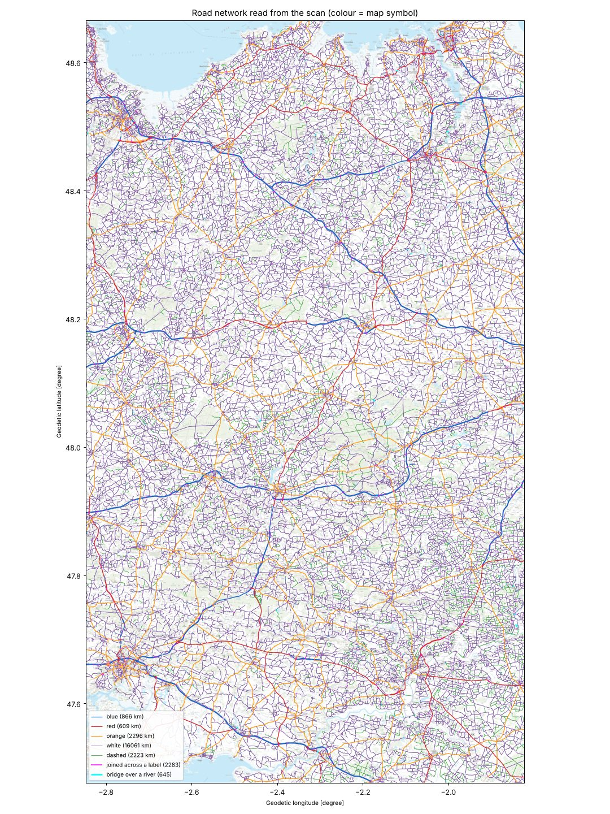
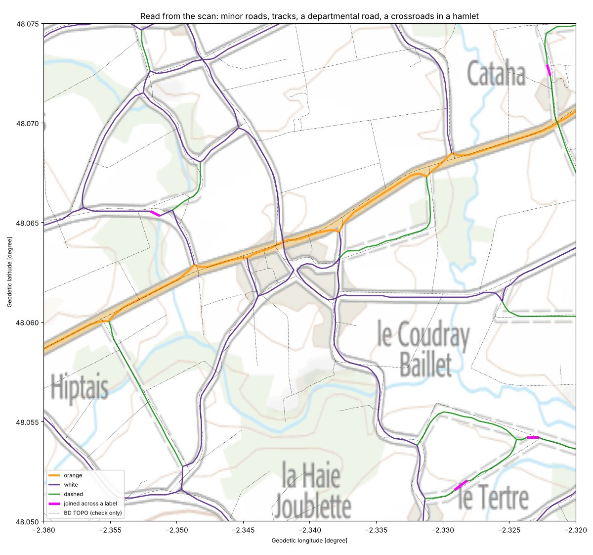
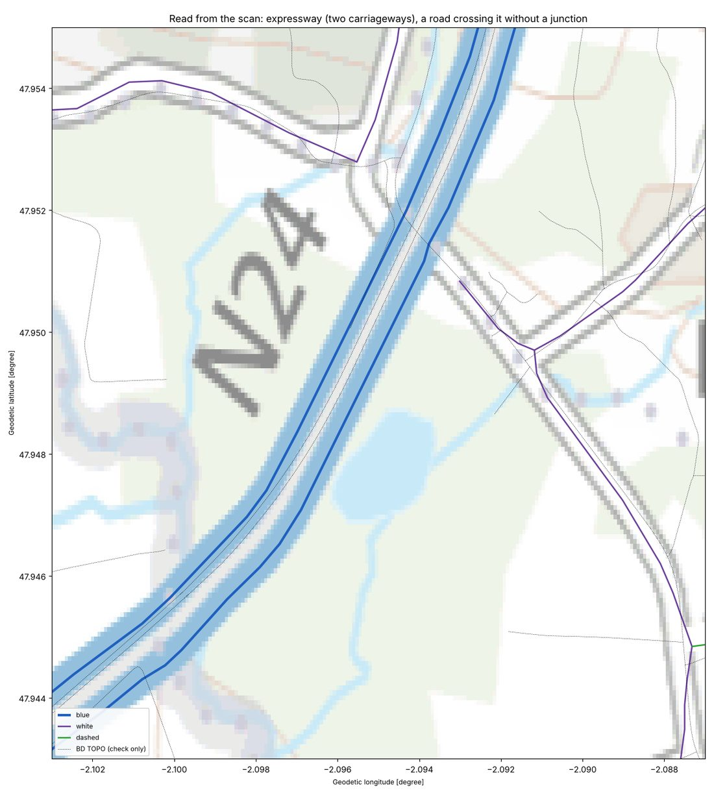
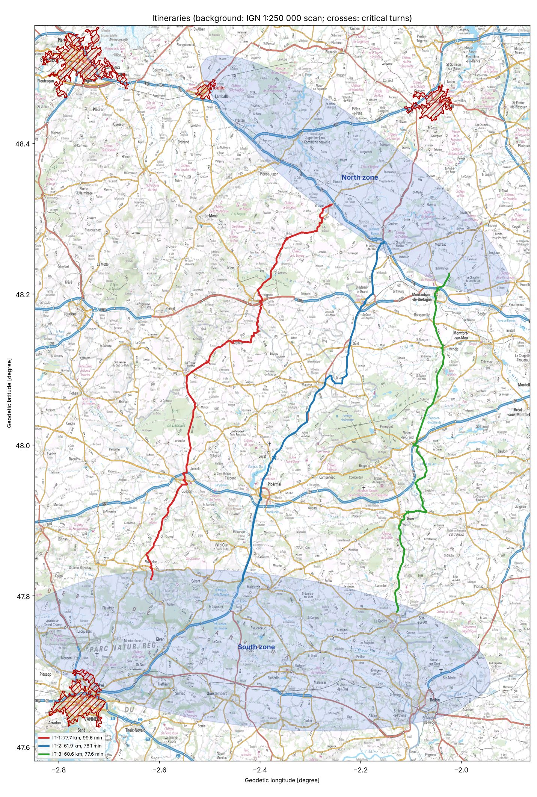

# Image input: the road network read from the scanned maps

*9 November 2026. Branch `scan-roads`, on top of main (`c283197`). The pipeline on main is unchanged: `coa-net exercise --network bdtopo` and `coa-net plan --bdtopo` still run it.*

## 1. Why

The organisers' description says: "However focusing on the image input and keeping the shapefiles for sanity checks is encouraged", and recommends multimodal models. Until now COA-Net used the images for three narrow jobs (town populations by OCR, built-up areas from the map tint, the georeferenced exercise sketch) and built the road network itself from the BD TOPO shapefile. On this branch the road network is read from the scanned IGN map. BD TOPO and OSM are kept, but only to measure how good the image network is, never as input to a plan.

The rest of COA-Net does not change. The image reader writes the same road graph that the shapefile loaders write (lon/lat polylines with canonical attributes, unknown values left as `None`), so the corridor graph, the requirement checks, the exercise solver, the planner and the incident loop run on it as they are.

## 2. Inputs

| scan | size | pixel | georeferencing |
| --- | --- | --- | --- |
| `Scenario1 100K.tif` (IGN 1:100 000) | 12,816 x 14,875 px, one band, 256-colour palette | 8e-5 degree (6.0 m east, 8.8 m north) | GeoTIFF, EPSG:4326, same extent as the shapefiles |
| `Scenario1 250K.tif` (IGN 1:250 000) | 5,127 x 5,950 px, palette | 2e-4 degree (14.9 m, 22.1 m) | GeoTIFF, EPSG:4326 |

Both scans carry their georeferencing, so no control points are needed; the sanity check measures it (section 5.2). A scan without georeferencing could be placed with the place-name matching that already georeferences the exercise sketch (`scanmap.georeference_sketch`), against a gazetteer; this is not needed for Scenario 1 and not built.

## 3. Method

The reader (`src/coa_net/scanroads.py`) is classical image processing: no training data, no GPU, and every step can be measured or shown on a figure. It runs on the whole 1:100 000 sheet in about 75 s on a 4-core CPU and 5 GB of memory.

**3.1 Symbol classes from colour.** IGN draws every road as a cased line: two thin grey edges (the casing) around a fill whose colour is the road's class. Each palette colour is put into one class by rules on hue, saturation and value (`classify_rgb`), so the same rules read both scales and any palette order:

| class | rule (HSV) | what it is on the map |
| --- | --- | --- |
| dark grey casing | saturation < 0.12, 0.22 <= value < 0.5 | edges of paved roads |
| mid grey casing | saturation < 0.12, 0.5 <= value <= 0.72 | edges of tracks (dashed); minor roads on the 1:250 000 |
| blue fill | hue 0.50-0.62, saturation > 0.7, value < 0.8 | expressways and dual carriageways |
| red fill | hue < 0.045 or > 0.96, saturation > 0.5 | main roads |
| orange fill | hue 0.075-0.14, saturation > 0.55 | departmental roads |
| light blue | hue 0.50-0.62, saturation > 0.2, value > 0.75 | water (rivers, streams, lakes, sea) |
| black | value < 0.22 | lettering |
| white | saturation < 0.04, value > 0.96 | background, and the inside of white roads |

**3.2 Road body.** Coloured roads are their fill. A white road is the *channel* between two casing lines: a white pixel with casing at most 4 pixels away on both opposite sides, in one of four directions. A built-up block's grey outline encloses a beige tint, not white, so blocks do not make channels; lettering is excluded with a 2-pixel rim, because its anti-aliased edge has casing colours. A closing with a 7-pixel line in four directions joins the dashes of a track, a 2-pixel disc joins each fill to its junctions, and large thick blobs (areas, not roads) are removed. The body is built tile by tile (2048 px tiles with a 48 px overlap, larger than every kernel) and thinned once on the whole sheet, so no road is cut at a tile edge.

**3.3 Centre lines and junctions.** The body is thinned to a one-pixel skeleton. Pixels with three or more skeleton neighbours form junction clusters; the pixel chains between them are the roads. Dead-end branches shorter than 60 m are thinning artefacts and are pruned. A crossroads thins into two T-junctions joined by a stub about one road width long: stubs shorter than 60 m between two junctions are contracted, and the junction sits at the mean of the two (5,477 crossroads merged on the 1:100 000).

**3.4 Symbol of each road.** Along each chain: the fill colour on the centre line gives blue, red or orange; otherwise the casing decides: probes perpendicular to the line that meet a dark casing on fewer than half of the points make a track (dashed, mid grey), the others a white road. On Scenario 1 this split is clean: white roads score 0.9-1.0 and tracks 0-0.1. The symbol gives the road class:

| symbol | canonical class | rank | paved |
| --- | --- | --- | --- |
| blue | trunk | 1 | yes |
| red | primary | 2 | yes |
| orange | secondary | 3 | yes |
| white | unclassified | 5 | yes |
| dashed | track | 6 | no |

White roads are one symbol on the 1:100 000 for BD TOPO importance 4 and 5 (measured: the white symbol's median width is 4-5 pixels for both), so the image cannot rank them. White roads are therefore rank 5, and an exercise on the image network searches roads of rank 5 and better (rank 4 on BD TOPO).

**3.5 Water crossings.** Light blue water at least 5 pixels wide on both sides of a road makes a bridge, split out as its own short section (the requirement layer then treats it as a bridge of unknown load class, as on BD TOPO). A thinner stream line on both sides is recorded as a stream crossing (culvert or small bridge, attribute `scan_stream`), not as a bridge. On a blue road no bridge is read, because the blue fill's anti-aliased edge has water colours. A dark blue line with water well beyond its edges on both sides is a line drawn on the sea or a lake (limits, ferry lines) and is dropped.

**3.6 Expressways have no level crossing.** A road drawn across an expressway is a flyover or an underpass, but on the image the two symbols touch. At a junction with two or more blue arms, every pair of other arms that runs straight through (more than 150 degrees) gets its own node, so a route cannot turn onto the expressway there; slip roads, which join at an angle, stay connected. For the same reason a label gap (3.7) between a blue road and another road is joined only at a shallow angle (under 45 degrees, a slip road).

**3.7 Gaps.** Labels printed over roads cut the skeleton. A dead end is joined to the nearest line ahead of it within 120 m and 40 degrees of its heading, or, failing that, to the nearest line in any direction within 40 m. Each join is flagged `scan_gap`; the exercise prices it at 1.5 times its travel time, so a route uses an unconfirmed link only when it pays. Isolated pieces shorter than 400 m (letters, symbols) are dropped first.

**3.8 Geometry.** Chains are smoothed with a 7-pixel moving average (the pixel staircase would otherwise read as a string of tight turns), simplified (Douglas-Peucker, 0.3 pixel) and converted to lon/lat with the GeoTIFF transform. Every road is two-way (one-way arrows are not read).

**3.9 What the image gives, and what it does not.**

| attribute | from the image | from BD TOPO (main) |
| --- | --- | --- |
| geometry, junctions | yes, displaced by cartographic generalisation (section 7) | yes |
| road class, speed | yes, from the symbol (importance 4 and 5 merged) | yes |
| paved or track | yes | yes |
| bridges | over rivers, as above | yes, also over roads and railways |
| built-up areas, towns over a population | yes (already read from the scan on main) | no population |
| width | no (unknown) | `LARGEUR`, rounded |
| slope | no (contours are on the map, not read in this version) | from end altitudes |
| load class, height limit | no | no |
| one-way | no (all two-way) | yes |
| road numbers | no (not read by OCR in this version) | yes |

Unknown widths and slopes do not block a road; they are priced as risk, as COA-Net does for every unknown, and the decision text says the values are not on the map.

## 4. How the shapefiles are used: sanity checks only

`src/coa_net/scancheck.py` measures the image network against BD TOPO and OSM with the usual road-extraction measures. Nothing it computes feeds a plan.

- **Correctness**: share of the image network's length that has a BD TOPO (or OSM) road within a buffer (15, 25, 40 m). Does every road read on the image exist?
- **Completeness**: share of the reference length that has an image road within the buffer, by BD TOPO class (the 1:100 000 does not draw every lane or track, so completeness of minor lanes is low by design).
- **Quality** (Wiedemann): matched reference length over reference length plus unmatched image length.
- **Registration**: median distance and mean offset vector between matched points.
- **Class agreement**: map symbol against BD TOPO importance, length-weighted.
- **Junctions**: precision (image junctions near any BD TOPO junction) and recall (BD TOPO junctions of importance 1-4 roads, all drawn on the map, that have an image junction near them).
- **Routes** (APLS-like): shortest-path length between the same pairs of junctions, 5 to 40 km apart, on both networks; score 1 when the lengths agree, 0 when the image network has no route.
- **Bridges**: image bridges near a BD TOPO bridge section.
- **Per itinerary** (in `coa-net exercise`): share of each itinerary within 25 m and 50 m of a BD TOPO road and within 25 m of an OSM road, and the longest stretch with no BD TOPO road within 50 m.

## 5. Results on Scenario 1

All numbers are measured on the organisers' data with loader version 6 (`coa-net scan-roads`, outputs in `out/scan100` and `out/scan250`).

### 5.1 The network read from the 1:100 000



| item | value |
| --- | --- |
| road length read | 22,260 km (BD TOPO has 50,430 km, most of it lanes and tracks the map does not draw) |
| polylines / junctions | 58,605 / 41,062 |
| by symbol | white 15,785 km, dashed 2,315, orange 2,169, blue 939, red 592 |
| crossroads merged / label gaps joined / dead ends left | 5,477 / 3,082 / 9,053 |
| roads kept apart at expressways (flyover or underpass) | 17 |
| bridges read (water on both sides) | 645 |
| time | about 75 s for the extraction, 2.5 min with every sanity check; about 5 GB of memory |

### 5.2 Sanity checks against BD TOPO and OSM

| measure | 15 m | 25 m | 40 m |
| --- | --- | --- | --- |
| correctness vs BD TOPO | 65.4% | 85.4% | 95.6% |
| correctness vs OSM | | 84.6% | |
| correctness vs either shapefile | | **86.5%** | |
| completeness vs BD TOPO, all classes | | 43.3% | |

At 40 m, 95.6% of what the image reader draws is a real road. Completeness is low overall because the 1:100 000 does not draw most lanes and tracks; by class it is:

| BD TOPO class | 1 | 2 | 3 | 4 | 5 | track |
| --- | --- | --- | --- | --- | --- | --- |
| completeness at 25 m | 46% | 72% | 83% | 77% | 54% | 14% |

Importance 1 scores low only because the map draws each dual carriageway as one wide symbol between the two BD TOPO carriageways (blue correctness is 52% for the same reason, while red is 81.5%, orange 88.1%, white 87.4% and dashed 82.8%). Wiedemann quality is 0.41 on all classes and 0.57 on main roads.

| other measure | value |
| --- | --- |
| registration | median distance 8.9 m (90th percentile 19.7 m), mean offset 1.1 m east and 1.4 m north: the georeferencing is right, the error is the drawing |
| symbol vs BD TOPO class | orange is importance 3 for 85% of its length, red is importance 2 for 72%, dashed is a track for 65%, white is importance 4 (24%) or 5 (71%) |
| junction precision (near any BD TOPO junction) | 33% within 30 m, 75% within 60 m |
| junction recall (importance 1-4 junctions) | 19% within 30 m, 48% within 60 m; median offset 63 m (generalisation, roundabouts drawn as one point) |
| routes, APLS-like, vs every BD TOPO road | score 0.78, median length ratio 1.14 |
| routes vs BD TOPO importance 1-4 | score 0.87, ratio 1.08, 59% of the pairs within 10% |
| bridges | 28% of the 645 bridges read are within 50 m of a BD TOPO bridge section |
| label gaps joined | 184 km, 75.5% of it on a BD TOPO road |





### 5.3 The 1:250 000

| measure | 1:100 000 | 1:250 000 |
| --- | --- | --- |
| road length | 22,260 km | 10,030 km |
| correctness vs BD TOPO at 25 m | 85.4% | 75.0% |
| correctness vs either shapefile | 86.5% | 76.4% |
| completeness, importance 2 / 3 / 4 | 72% / 83% / 77% | 55% / 66% / 53% |
| registration (median) | 8.9 m | 9.2 m |
| junction recall within 60 m | 48% | 14% (median offset 208 m) |
| routes vs importance 1-4: score, length ratio | 0.87, 1.08 | 0.62, 1.32 |

The 1:250 000 is read with the same rules (parameters scaled by `ScanParams.for_scan`). It has fewer roads and much more displacement, and it draws no tracks. **The 1:100 000 is the source; the 1:250 000 is a fallback** for an area the 1:100 000 does not cover.

## 6. COA-Net on the image network

### 6.1 Exercise 1 (three separate itineraries, South to North)

`coa-net exercise --network scan` solves exercise 1 with no shapefile as input: **19 of 19 checks pass**, in 31 s with the map and OCR caches. 87,168 of the 102,502 directed road sections are allowed.



| itinerary | image network | within 25 m of a BD TOPO road | within 50 m | longest stretch with no BD TOPO road within 50 m | BD TOPO network (main) |
| --- | --- | --- | --- | --- | --- |
| IT-1 | 77.7 km, 99.6 min | 91.4% | 99.9% | 50 m | 60.8 km |
| IT-2 | 61.9 km, 78.1 min | 86.0% | 97.9% | 300 m | 55.0 km |
| IT-3 | 60.6 km, 77.6 min | 91.3% | 99.2% | 150 m | 65.6 km |

Every itinerary drives on real roads: 98-100% of each lies within 50 m of BD TOPO, which is the map's own displacement. IT-2 and IT-3 follow the BD TOPO itineraries for 65-69% of their length (within 200 m); IT-1 takes a different corridor, longer because the image network does not have the lanes BD TOPO uses. The 300 m stretch on IT-2 is a crossing of a red road that is a flyover in reality: grade separation is only known for expressways (section 7). Total 200 km against 181 km on BD TOPO.

### 6.2 The full planner with incidents

`coa-net plan --scan "data/Scenario1 100K.tif"` on the Scenario 1 order (three convoys: C1 Vannes to Dinan with fuel, C2 Questembert to Broons, C3 Redon to Caulnes) with the four test incidents, roads of rank 5 and better:

- **Valid plan**: 2,168 checks, no violation, 2 shortfalls (control posts more than 15 km apart), 17 unknowns priced as risk (width, slope, bridge load class: not on the map).
- C1: MSR LION 127.9 km, 158 min, ASR WOLF; C2: MSR TIGER 93.4 km, 116 min, ASR EAGLE and FALCON; C3: MSR BEAR 93.4 km, 96 min. All arrive before their deadlines.
- The four incidents are handled as on BD TOPO: the two destroyed bridges are matched to bridges read on the scan (the one on the D766 is flagged "to confirm", because the image network has no road numbers), the ambush raises a threat zone over MSR LION, and the breakdown gives a FRAGO with new times.
- 68 s in all, 36 s of it candidate routes on the denser graph.

With `--max-rank 3` the planner finds no route for C1: on the image every white road is rank 5, so rank 3 keeps only orange, red and blue roads. On the image network use `--max-rank 5` or leave it out.

## 7. Limits

- **Cartographic displacement.** The map moves roads apart to draw them legibly: median 9 m, up to 20-40 m, and junctions about 60 m. Itineraries are right as road choices; coordinates for control points should be snapped to BD TOPO or checked on the ground.
- **Importance 4 and 5 are one symbol.** The image cannot tell a good local road from a narrow lane when both are white.
- **Grade separation only for expressways.** A road crossing a red or orange road on a bridge is read as a crossroads; this is IT-2's 300 m.
- **Bridges vs culverts.** Only 28% of the bridges read match a BD TOPO bridge; many are small crossings that BD TOPO does not split out. Every bridge has an unknown load class anyway, priced as risk.
- **Label gaps are a guess.** 75% of the joined length lies on a real road; the 1.5 times price keeps routes off the uncertain ones unless they pay.
- **Turns.** Turn radii from a smoothed pixel line are indicative only.
- **Lettering in blue water colours** occasionally makes a short phantom line; most are dropped as lines on water.
- **Not read:** one-way streets (every road is two-way), widths, slopes (the contours are on the map but not read), road numbers.
- **The 1:250 000 is much weaker** (section 5.3).

## 8. Where a vision model could help

Consistent with the symbol reader, code does the measuring and a model only names and checks. A local vision model (SmolVLM2 or the served multimodal model) could look at a small crop around each uncertain element and answer one closed question: is this label gap a road under a label, is this crossing a flyover, is this blue mark a bridge. The few thousand crops are a few minutes on the H100, and a "no" removes or splits the element. Road numbers could be read the same way, by OCR on the labels along each road, which would let incident reports that name a road ("the D766") be matched by name. None of this is built yet.

## 9. Proposed experiments

1. Buffer sweep (10-60 m) and completeness by class on the 1:100 000 vs the 1:250 000 (done above at 15/25/40 m).
2. Ablations, one step at a time: no channel detection, no gap joining, no crossroads merge, no grade separation; measure correctness, junction recall and APLS.
3. Gap penalty 1.0 / 1.5 / 3.0 on exercise 1: itinerary length and share on BD TOPO.
4. Snap the image itineraries to BD TOPO afterwards (map matching) and compare with solving on BD TOPO directly.
5. Read contours for slope on the routes chosen, and test against BD TOPO altitudes.

## 10. Commands and outputs

```bash
# read the network and run every sanity check (2.5 min)
coa-net scan-roads --data data --scale 100k --out out/scan100
coa-net scan-roads --data data --scale 250k --out out/scan250

# exercise 1 on the image network (default) or on BD TOPO as on main
coa-net exercise --network scan    --out out/ex1_scan
coa-net exercise --network bdtopo  --out out/ex1_bd

# full planner on the image network
coa-net plan --scan "data/Scenario1 100K.tif" --places examples/places_scenario1.json \
    --order examples/order_scenario1.txt --max-rank 5 --incident "06:40@Bridge destroyed near Ploermel ..." --out out/plan_scan
```

`scan-roads` writes `network.geojson` (the image network, with its map symbol per road), `scan_report.md`, `map_network.png`, and `validation.md` / `validation.json`. The exercise writes its usual outputs plus the BD TOPO agreement of each itinerary in `decision_process.txt`. The figures in this document are made by `docs/figures/scan/make_scan_figures.py`.
