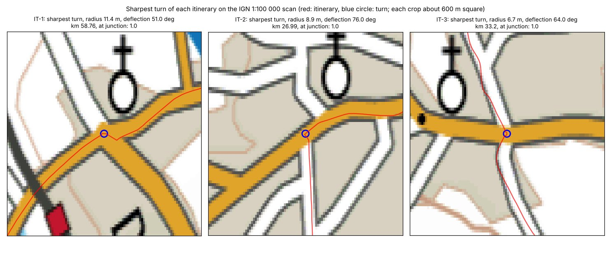
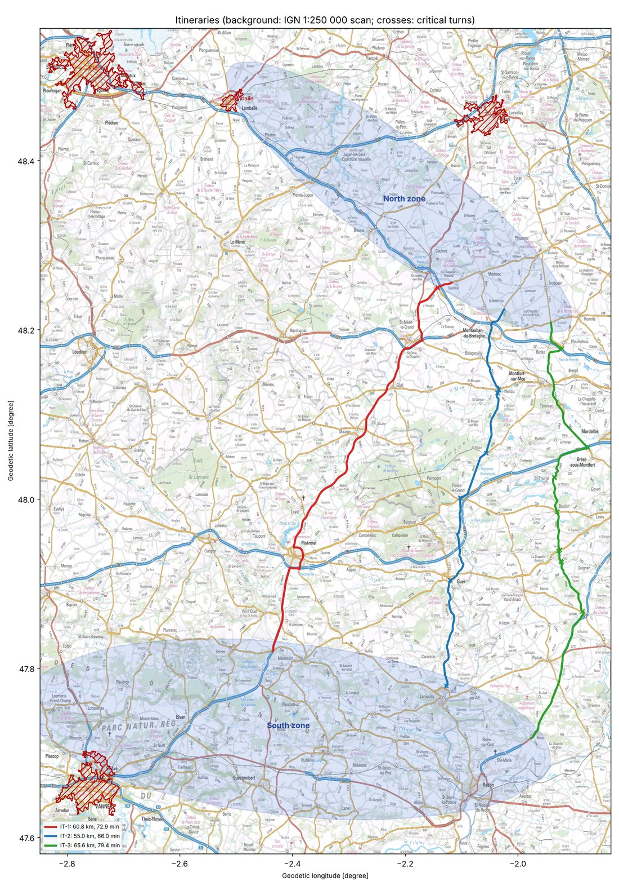
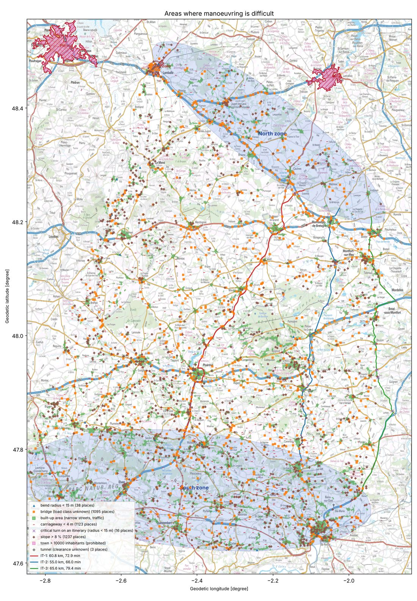

# COA-Net on the organisers' Scenario 1 data: inspection, adaptation and validation

This document records what was found in the data the organisers sent (Scenario 1 shapefiles and scans, the rules, the preliminary description and the preparation exercise), what had to change in COA-Net because of it, and what the pipeline produced when run on that data. Every number below was measured on these files in this repository's environment (4-core CPU, 15 GB RAM, no GPU, no language model); nothing is quoted from expectations. Commands to reproduce are at the end.

**Summary of the results.**

- **Data** (sections 1 to 3). BD TOPO v2 ROUTE (332,040 sections, Windows-1252, no `.prj`: EPSG:4326 inferred from the bounds), Geofabrik OSM (235,345 ways, not split at junctions), two IGN scans (EPSG:4326, aligned with the vectors to about one pixel) and three PDFs. No bridge has a load class and no tunnel a clearance, there is no halt area, widths are rounded to whole metres and altitudes are precise to 1 to 2.5 m. The method was adapted to each of these facts, and the assumptions it makes are printed in its outputs.
- **Exercise 1** (section 4), with the statement and the zones read from the PDF: three itineraries of 60.8, 55.0 and 65.6 km, at least 6.39 km apart and not intersecting, avoiding the five towns over 10,000 inhabitants. All 19 independent checks pass, and 99.9 to 100 % of each itinerary lies within 25 m of an OSM road. From a fresh clone: 5 min 43 s for the first run (OCR included), 1 min 53 s once the cache is built.
- **Full plan** (section 6), three convoys and four incidents injected at set times: four COAs, all verified valid; each incident handled in 1 to 39 s (the bridge destroyed on C1's main route: playbook and FRAGO in 38.9 s, plan verified valid); 27 min 24 s in all, two thirds of it in the verification, playbook and reconnaissance stage.
- **Errors** (section 7): 26 found by running on the real data, all fixed, 19 of them with a unit test (82 tests in all).
- **Remaining limits** (section 9): bridge classes, tunnel clearances, halt areas and the PFM's figures are assumptions to confirm with the ETLO; the design solver stops at its time limit, so the COAs are not proven optimal and two runs can differ; valuing reconnaissance dominates the plan's run time.

## 1. What was supplied

| File | What it is (measured) | Used for |
| --- | --- | --- |
| `Scenario1_BDTopo.shp/.dbf/.shx` | 332,040 polylines, IGN BD TOPO **version 2** ROUTE schema (upper-case fields `NATURE`, `IMPORTANCE`, `LARGEUR`, `NB_VOIES`, `POS_SOL`, `FRANCHISST`, `SENS`, `Z_INI`, `Z_FIN`, `PREC_ALTI`, `INSEECOM_G`...), Windows-1252 text, already noded at junctions. **No `.prj` and no `.cpg`.** Bounds -2.8477..-1.8224 E, 47.476..48.666 N (Brittany, Vannes and Redon to Saint-Brieuc and Saint-Malo). | Routing graph and road attributes |
| `Scenario1_OSM.shp/.dbf/.shx` | 235,345 polylines, Geofabrik schema (`fclass`, `oneway` B/F/T, `bridge`, `tunnel`, `layer`, `maxspeed`, `ref`), UTF-8, roads, waterways and railways in one layer, ways **not** split at junctions. No `.prj`, no `.cpg`. Same bounds. | Independent cross-check of the itineraries |
| `Scenario1 100K.tif` | 12,816 x 14,875 px, one band, palette, EPSG:4326 in the GeoTIFF, 8e-5 degree pixels (about 6 m), IGN 1:100 000 map. Prints town names with the population in thousands next to them. | Town populations (OCR), built-up areas (tint), georeferencing the sketch, image check of the itineraries |
| `Scenario1 250K.tif` | 5,127 x 5,950 px, palette, EPSG:4326, 2e-4 degree pixels (about 15 m), IGN 1:250 000 map, same extent. | Alignment check only |
| `exercise_for_preparation.pdf` | One page: the statement of exercise 1 and an illustration (829 x 1,173 px JPEG) with two blue zones drawn on a map. | Exercise statement and zones |
| Rules (`20261026_NP_AMIAD_COE IA Règlement Hackathon.pdf`) | MIT licence with a `LICENSE` file at the repository root (art. 9.3, 15.2); documentation and a final report with a data log, models used and risks (art. 9.4, 12.4); jury criteria: exercises solved in time, number of context elements, model mastery (error detection, clarity of the route-choice criteria, model type), model size, autonomy (local, open weights, retrainable, licences), response time, report quality (art. 13.3); weights given at launch; identical incidents injected at set times (art. 9.1). | Requirements on the deliverables |
| Preliminary description (`20260211_NP_Preliminary_description_Hackathon.pdf`) | Exercises = illustration + ETLO constraints + desired outputs; maps as TIFF, OSM and BD TOPO shapefiles; "focusing on the image input and keeping the shapefiles for sanity checks is encouraged"; multimodal models recommended; H100 server and a Mistral token budget available. | Design choices below |

Exercise 1, as stated: move a motorised floating bridge (PFM) from the South zone to the North zone; give 3 itineraries that do not intersect and are at least 5 km apart; avoid towns of more than 10,000 inhabitants; deliver a layer of the itineraries, a layer of the areas where manoeuvring is difficult, a GeoJSON with the itineraries and the location and curvature radius of the difficult turns, and a text describing the decision process.

## 2. Data audit (`coa-net audit`)

| Check | Result |
| --- | --- |
| CRS | Neither shapefile declares one; both have lon/lat bounds, so EPSG:4326 is assumed (the reader refuses to guess when the bounds are not lon/lat). All distances, separations and radii are computed in Lambert-93 (EPSG:2154). |
| Encodings | BD TOPO decodes only as Windows-1252, OSM as UTF-8. |
| BD TOPO content | 317,248 sections kept after removing footpaths (13,756), cycle tracks (870), steps (132) and roads under construction (34); 231,829 junctions, 553,313 directed edges, 49,257 km; 99.5 % of the junctions in one strongly connected component. |
| OSM content | 173,195 drivable ways kept (footways, paths, cycleways, steps, bridleways, busways, waterways and railways removed); 43,790 km. |
| BD TOPO against OSM | 99.9 % of the BD TOPO classified roads (importance 1 to 4, 9,041 km) lie within 20 m of an OSM drivable road; 98.4 % of the OSM main roads (8,956 km) lie within 20 m of a BD TOPO road; for all drivable roads, 84.9 % and 90.2 %. |
| Bridges | 3,017 BD TOPO drivable bridge sections, 2,629 OSM drivable bridge ways; 63.1 % of the BD TOPO bridges have an OSM bridge within 30 m. **Neither source has a load class (MLC) or a weight limit on any bridge.** |
| Tunnels | No clearance in either source. |
| Widths | `LARGEUR` = 0 (unknown) on part of the network; treated as unknown, not as 0 m. |
| Altitudes | `PREC_ALTI` is 1 m on 281,150 sections, 2.5 m on 42,854, 20 m on 5 and 9999 (unknown) on 8,031. The share of sections steeper than 15 % falls from 0.57 % for 20 to 50 m sections to 0.03 % for sections over 200 m, so short-section slopes are dominated by altitude error. |
| Scan alignment | On BD TOPO main roads, 88.5 % of sample points fall on road ink of the 1:100 000 scan at zero shift; the best shift is 1 pixel (about 6 to 9 m). 1:250 000: 86.3 %, best shift 1 pixel. The scans and the vectors agree to about a pixel. |

## 3. What the data changed in the method

| Finding (measured) | What would have happened | Change | Code |
| --- | --- | --- | --- |
| No `.prj` or `.cpg`, two encodings | Wrong CRS or mangled names | CRS inferred only from lon/lat bounds, explicit encodings, metric work in Lambert-93 | `realdata.read_lines` |
| BD TOPO v2 schema, not the v3 GeoPackage the loader expected | Loader unusable | New attribute mapping: nature and importance to road class, width (0 = unknown), lanes, bridge/tunnel/ford, one-way direction, road number, end altitudes | `realdata._bd_attrs` |
| OSM ways not split at junctions; rivers and railways in the road layer | Missing junctions, rivers as roads | Ways cut at every vertex shared with another way; drivable classes only | `realdata.osm_segments` |
| 553,313 directed edges | Slow planning | Chains of identical sections merged; corridor backbone limited to road ranks 1 to 4 plus every critical element (`--max-rank 4`) | `realdata.simplify_chains`, `CorridorGraph(max_rank)` |
| No bridge load class anywhere | The seed rule R-01 (unknown class means forbidden) closed all 5,017 directed bridge edges and the first run found **0 itineraries** | A requirement whose attribute is missing on at least 90 % of the roads it looks at switches from `forbid` to `risk`; the change is printed in the decision text; the bridges of unknown class are counted on every itinerary and designated route (verification) and drawn on the difficult-areas layer, to be classified before the move | `realdata.systemic_unknowns` |
| Altitude precision of 1 to 2.5 m on short sections; 69 sections "steeper" than 35 % (up to 437 %), none of them bridges or tunnels | Steep-looking short sections, and altitude errors, closed for the column | Slope kept as an interval; a section is closed only if its low bound exceeds the limit, otherwise it is priced as a risk; slopes above 35 % are treated as data errors (slope unknown, priced as a risk) | `realdata.build_graph`, `costing.GroupCoster.evaluate` |
| `LARGEUR` is rounded (mostly whole metres, some half metres; the rounding is not stated, so whole values are read as ±0.5 m and half values as ±0.25 m, an assumption): 23,994 directed sections are recorded at 3 m, among them 19,719 unclassified, 2,657 tertiary, 1,153 secondary and 193 primary sections and 269 of the 1,073 slip roads | R-04 (width plus 0.5 m) closed every 3 m road to the PFM (3.5 m needed) and to 2.55 m trucks (3.05 m): 24,020 sections lost in exercise 1, longer itineraries (194.3 km and 237.4 min in total), and Vannes cut off from the network in the full plan | Width kept as an interval: a road is closed only if it is too narrow even at the top of its rounding; otherwise it stays usable, is priced as a risk (x1.5 in the exercise) and its length is reported per itinerary. R-04 now closes 28 sections for the PFM; the itineraries total 181.4 km and 218.4 min, with 2.6 km of roads possibly under 3.5 m | `realdata._bd_attrs`, `costing.GroupCoster.evaluate` |
| Missing road names read as `nan` | Reconnaissance tasks titled "Measure nan" | Missing text fields mapped to empty names | `realdata._text` |
| Town labels sit on side streets and tracks: the node nearest to "Questembert" is on an unpaved track, the one nearest to "Vannes" is in streets 3 m wide | The baseline full plan routed only 1 of its 3 convoys | Order places snap to the nearest secondary road or better (`add_places(snap_max_rank=3)`); a group whose origin still cannot reach the network its column can use (or whose destination cannot be reached from it) has the terminal moved to the nearest usable junction, at most 5 km away, with a note in the plan | `loaders.add_places`, `mission._usable_terminals` |
| Town populations exist only on the 1:100 000 scan | The "towns over 10k" rule cannot be applied | OCR of the scan (RapidOCR, ONNX on CPU), pairing of each upper-case name with its figure, second pass at 2x on unpaired names, town areas from the scan's built-up tint | `scanmap` |
| The zones exist only as blue shapes on the exercise illustration | No origin or destination | Place names read on the illustration matched to the scan's labels, RANSAC affine fit, blue areas vectorised; itineraries start and end at least one fit residual inside the zones | `scanmap.georeference_sketch`, `scanmap.sketch_zones`, `scenario.run_exercise` |
| The exercise asks for k separated, non-intersecting itineraries | Not expressible with the 26 templates | Templates NET.DISTINCT and SEG.TOWN, exercise parser, distinct-itinerary solver | `requirements`, `exercise.parse_exercise`, `exercise.solve_distinct` |
| The exercise asks for difficult turns with their radius | Not produced | Radius from heading change over a 20 m window of the centreline; junction turns priced inside the route search (line graph) | `exercise.turns_on`, `exercise.TurnRouter` |
| The brief encourages the image and keeps shapefiles for sanity checks | Vector-only answer | The scan supplies the towns, built-up areas and zones; each itinerary is checked against OSM and against the scan's road ink | `scenario.run_exercise`, `audit.scan_agreement` |
| Exercise statements come as PDF | Manual copy | `--pdf` reads the statement and the largest image of the PDF | `scenario.exercise_from_pdf` |
| On this graph a full plan stalled in the reconnaissance stage (what-if worlds re-costed all 553k edges; each element-disjoint pair took 12 to 15 s in networkx's network simplex) | More than 30 minutes per plan | What-if costers derived from the base one (only changed roads re-costed); value of information capped to the elements closest to the designated network; two-unit minimum-cost flow by successive shortest paths (same optimum on every case tested, 0.07 to 0.54 s); cached gazetteer | `costing.GroupCoster.derived`, `anticipation.value_of_information`, `candidates._two_unit_min_cost_flow`, `graph.gazetteer` |
| With all three convoys routed, the value of information took about 9 minutes per COA: each answer to a reconnaissance question is a what-if world, and 80 % of a world's time went into regenerating candidate routes (profile of the running plan) | About half an hour per plan | What-if worlds are shared by the COAs of a plan (only the design step depends on the COA), and a group whose routing an answer does not change keeps its base candidates (exact: same terminals, and on every changed road the same evaluation or unusable in both worlds); both are checked against the plain computation by unit tests and on this map (section 6) | `anticipation.value_of_information(world_cache, base_cands)` |
| No halt area in either source, while the seed doctrine plans a halt at a halt area every 2 hours of driving (R-23, R-24) | C1's fastest route takes 141 min: it violated R-23, every alternate was rejected for the same reason (1 candidate route, 0 of 33 replacement routes), so C1 had no alternate route, 34 irreducible single points of failure, and every COA was INVALID | When the data has no halt area, junctions where three or more roads of rank 3 or better meet (bridges and tunnels excluded) become roadside halt candidates, capacity 30 vehicles assumed: 4,917 junctions, 1,546 of them at least 800 m from bridges and tunnels (R-36). They are decision points already, so the corridor graph does not change. C1 then gets 23 candidate routes, 149 of 149 replacement routes and 1 irreducible single point of failure. The halts a plan uses are listed for confirmation by reconnaissance | `realdata.roadside_halts`, `candidates.allowed_halt_nodes` (vectorised, cached) |

## 4. Exercise 1 on the real data

Command: `coa-net exercise --data DATA --pdf exercise_for_preparation.pdf --out outputs/exercise1`. The statement and the sketch are read from the PDF; nothing was typed in by hand.

**Three itineraries; all 19 checks pass.** The checks are recomputed from the output geometry, independently of the search.

| | IT-1 | IT-2 | IT-3 |
| --- | --- | --- | --- |
| Length, time | 60.8 km, 72.9 min | 55.0 km, 66.0 min | 65.6 km, 79.4 min |
| Roads | N166, N24, D8, D766E, D8E, D766, D166, N164, D125, D166, D220 | D773, D311, D772, D311, D259, D59, D224, D61, D40, D61, D31, D61 | D177, D772, D69, D42, D776, D69, D38, D69, N24, D62, D35, D62 |
| Bridges (load class unknown) | 21 | 11 | 14 |
| Built-up length, towns crossed (all under 10,000) | 2.5 km, Ploërmel | 8.2 km, Guer and Montauban | 5.4 km, Montfort |
| Turns: critical (radius < 15 m) / difficult (< 30 m), smallest radius | 2 / 35, 11.4 m | 6 / 15, 8.9 m | 10 / 14, 6.7 m |
| Width possibly under the 3.5 m the column needs / unknown | 1.9 km / 0 | 0.7 km / 0 | 0 / 0.2 km |
| Steepest section | 5.0 % | 7.6 % | 10.9 % |
| Within 25 m of an OSM drivable road | 99.9 % | 100.0 % | 100.0 % |
| On road ink of the 1:100 000 scan (2 px) / same line moved 300 m east | 97.0 % / 8.3 % | 80.5 % / 6.9 % | 61.5 % / 9.2 % |

- **Separation:** minimum distances between centrelines are 7.49 km (IT-1/IT-2), 14.08 km (IT-1/IT-3) and 6.39 km (IT-2/IT-3); no two itineraries intersect.
- **Zones and towns:** every itinerary starts in the South zone and ends in the North zone, at least 1,234 m (the georeferencing residual) inside them, and enters none of the towns read as over 10,000: Vannes with Saint-Avé (53,000), Saint-Brieuc with Plérin and Ploufragan (45,200), Saint-Malo (46,000), Dinan (14,000), Lamballe (13,300).
- **Roads the column may use:** 370,044 of the 553,313 directed road sections. First blocking reason: unpaved track 148,718; inside a town over 10,000: 34,290; slope over 15 % even at the low end of its precision interval: 189; tunnel clearance unknown: 44; width under 3.5 m even at the top of its rounding: 28.
- **Search:** 20 first-itinerary seeds, 60 completions, 47 distinct feasible sets of three. The generalised costs of the five best sets are 258, 260, 261, 263 and 264: the runners-up are within 2.3 % of the chosen set (see section 9).
- **Turns priced in the search:** without turn costs the same solver gives 173.6 km and 208.5 min in total with 56 critical turns (35 junction turns over the sharp threshold) in 18 s; on the line graph it gives 181.4 km and 218.4 min with 18 critical turns (4) in 28 s. The column drives 4.5 % further and 4.8 % longer for 68 % fewer critical turns.
- **Difficult areas** (study area = convex hull of the two zones, 5,200 km²): 1,321 bridge sections of unknown class, 4,804 sections with a carriageway under 4 m, 1,775 sections steeper than 8 %, 38 bends under 15 m on classified roads, 1,174 built-up polygons (296 km²), 3 tunnels of unknown clearance, 5 prohibited towns and the 18 critical turns of the itineraries. The map legend counts places (overlapping markers merge), so it shows 16 places for the 18 turns.

Sanity checks. OSM is an independent source: 99.9 to 100 % of each itinerary lies within 25 m of an OSM drivable road. The scan check samples a point every 25 m and asks whether a road-ink colour lies within 2 pixels; the colours are learnt from the BD TOPO classified roads, and the same line moved 300 m east measures the chance level (7 to 9 %). The 1:100 000 map draws motorway-class roads in blue, primary roads in red and secondary roads in orange, but tertiary and unclassified roads in white, the colour of 41 % of the map (palette counts under the BD TOPO roads of each class). Per road class, the points on primary and secondary roads fall on ink 84 to 97 % of the time and those on motorway-class roads 60 to 97 %, while tertiary roads reach only 39 to 58 % and unclassified roads 5 %. IT-3 uses the most minor roads, hence its lower score; nothing indicates a misplaced itinerary. A first version learnt the colours from trunk, primary and secondary roads only and missed the blue dual-carriageway symbol (23 % of IT-1's motorway-class points, against 97 % once the colours are learnt from all classified roads); this was fixed during the validation.

Turn check by eye. The sharpest turn of each itinerary, drawn on the scan: IT-2's (8.9 m, 76 degrees) is a real right turn from a minor road onto a main road in a village, and IT-3's (6.7 m, 64 degrees) is a staggered crossroads, two short turns across a main road. IT-1's (11.4 m, 51 degrees) is not a turn: the route goes straight on along the same road, and the radius comes from a jog of the BD TOPO centreline at a junction node. Turn radii at junctions therefore include false alarms of this kind (section 9).







**Run time** (4-core CPU, no GPU), measured from a fresh clone of the commit: the first run took 5 min 43 s, of which 2 min 33 s for the OCR of the 1:100 000 scan and 45 s to parse BD TOPO; a second run, with the cache under `outputs/exercise1/cache`, took 1 min 53 s, of which 43 s for the two itinerary searches and 22 s for the per-road evaluation. Both runs printed the itineraries and checks above; the second run's itinerary, zone, town and difficult-area files are byte for byte those of the run that produced this section.

## 5. Element-disjoint route pairs: new solver against networkx

`candidates.disjoint_pair` looks for two routes that share no critical element (bridge, tunnel, ford, junction). It is a two-unit minimum-cost flow on a network with about 50,000 nodes and 66,000 arcs per group on this map. It used networkx's network simplex; it now uses two Dijkstra passes with potentials (successive shortest paths), which is exact for two units. Measured on the Scenario 1 corridor graph with the convoy profiles of the test order (`order_scenario1.txt`) and the places snapped as in the final code, while two plan runs shared the 4-core machine (both solvers equally exposed):

| Case | Network (nodes / arcs) | Network simplex | Successive shortest paths | Optimal cost (both) |
| --- | --- | --- | --- | --- |
| C1 Vannes to Dinan, heavy trucks and tankers | 50,476 / 66,283 | 16.9 s | 0.28 s | 28,296 |
| C2 Questembert to Broons, PFM carriers | 50,475 / 66,281 | 10.3 s | 0.39 s | 21,460 |
| C3 Redon to Caulnes, medium trucks | 52,521 / 68,674 | 10.7 s | 0.36 s | 16,554 |
| Redon to Caulnes (C3 profile) | same as C3 | 12.8 s | 0.41 s | 16,554 |
| Vannes to Caulnes | same | 14.5 s | 0.43 s | 19,831 |
| Redon to Dinan | same | 13.1 s | 0.34 s | 20,266 |
| Questembert to Dinan | same | 12.6 s | 0.40 s | 21,658 |
| Vannes to Broons | same | 12.4 s | 0.37 s | 19,721 |

Same optimum in all 8 cases, 26 to 60 times faster. Before the place fix, the same benchmark found C1, C2 and the two cases starting in Vannes infeasible with both solvers (the start was cut off, section 7), and the four feasible cases matched as well. A unit test compares the two solvers on the synthetic theatre and on 30 random networks.

## 6. Full plan with incidents on the real network (`coa-net plan --bdtopo`)

`coa-net plan` runs the whole of COA-Net on the BD TOPO graph: order and intent, candidate routes, criticality, a network design per COA, refinement, movement credits, verification, playbooks, value of information, simulation, explanations and briefing, then the incidents. The corridor backbone keeps the roads of rank 1 to 4 and every critical element (`--max-rank 4`): 21,171 corridors, 16,606 decision points and 2,755 critical elements, built in 4 s. The order is `examples/order_scenario1.txt`, written for this validation (it is not an ETLO order): C1, 6 heavy trucks and 2 fuel tankers, Vannes to Dinan before 10:30, priority 1; C2, 6 PFM carriers, Questembert to Broons before 10:00; C3, 4 medium trucks and an ambulance, Redon to Caulnes; intent "Deliver the fuel to Dinan before 10:30. The enemy is likely to strike the crossings. Keep the tankers out of the towns." Four incidents are injected at set times (command in section 10).

**How the plan changed as the errors of section 7 were fixed** (each row is a complete run on the same files and order):

| Code | Convoys routed | C1 alternate route | Irreducible single points of failure | Verification of the COAs | Plan time |
| --- | --- | --- | --- | --- | --- |
| Before this validation | C3 only (C1 and C2 started on a track and in 3 m streets) | - | - | - | 31.6 min, of which 30.0 min in the reconnaissance stage |
| Places, widths and one-way bridges fixed, value of information sped up | 3 | none: 1 candidate route, 0 of 33 replacement routes (no halt area for R-23) | 34 | INVALID (R-23) for all 3 | 9 min 25 s |
| Roadside halt candidates, and the fixes of this section (final) | 3 | 2: WOLF, 117.4 km, 140.9 min (LION's roads except along the N166) and EAGLE, 118.6 km, 142.3 min (by Josselin) | 1: C1's first junction out of Vannes, which every road from the start passes | valid for all 4 | 27 min 24 s, of which 18 min 23 s in the reconnaissance stage and 2 min 49 s for the four incidents |

**The final run.** Four COAs, all verified valid. The default COA is the design for the commander's intent order (I), merged with the near-identical network of the protected order (P); the resilient (R), fast (F) and economical (E) orders give the others. Every COA keeps the same main routes for C1 (LION, 117.2 km, 140.7 min; COA E: 117.5 km) and C3 (BEAR, 80.1 km, 80.1 min); they differ in C2's main route (TIGER, 86.3 km in COAs I=P and R, 85.5 km in F and E) and in the alternates.

| | COA I=P (default) | COA R | COA F | COA E |
| --- | --- | --- | --- | --- |
| Designated length, control posts | 497.6 km, 126 | 542.3 km, 138 | 502.4 km, 118 | 458.3 km, 109 |
| Resilience (expected delay over the loss scenarios) | 148.3 veh.min | 135.8 veh.min | 146.8 veh.min | 188.2 veh.min |
| Travel time | 6,144.9 veh.min | 6,144.9 veh.min | 6,133.7 veh.min | 6,146.0 veh.min |
| Lateness, dangerous goods in towns, threat exposure | 0 | 0 | 0 | 0 |
| Verification (checks, T2 shortfalls, unknowns priced as risk, irreducible) | 5,911, 7, 30, 1 | 6,517, 7, 33, 1 | 5,067, 5, 26, 1 | 4,597, 7, 22, 1 |
| Design solver | 29.4 s, time limit reached | 17.4 s, time limit reached | 3.3 s, optimal | 40.7 s, time limit reached |

The irreducible point is the same in every COA: C1's first junction out of Vannes (junction 216739). The shortfalls of the default COA are T2 rules: control posts more than 15 km apart on four routes (R-31, up to 18.1 km) and alternates without a lateral link to the main route over 67 to 100 km (R-30). The unknowns are the bridge classes, slopes within the altitude precision and widths within the rounding (section 3). The simulated on-time probability is 0.95 for C1 and 1.00 for C2 and C3 in every COA (20 replications). The chosen COA (I=P) has C1 leave Vannes at 06:00 and reach Dinan at 08:36 (deadline 10:30), C2 06:00 to 07:44 (deadline 10:00), C3 06:15 to 07:35. The briefing states each COA's gains and costs against the default, for example "COA R (resilient) gains resilience by 12.5 veh.min and costs network_size by 44.7 km against COA I=P".

**Run-to-run variation.** The previous complete run, with the same design code and inputs, gave three COAs: the intent, protected and fast orders gave near-identical networks, merged into one COA whose design is that of COA F above. In this run the default COA's design is 4.8 km shorter, with resilience 1.5 veh.min and travel time 11.2 veh.min worse, both within the 10 % tolerance of these objectives. The design solver stops at its time limit (10 s per solver call) for three of the four COAs, and where it stops depends on the machine's speed at that moment, so two runs can give different COAs (section 9).

**Value of information after the fix of section 7.** In the previous run COA R credited six tunnels with value whatever the answer; in this run no answer about the six valued tunnels changes any COA's plan. The 16 other unknown elements of each COA are listed as not valued (`--recce-max 6`).

**Value of information: the two speed-ups measured on this map.** The same code was run twice on the same order, at the same time on the same machine, once with the what-if worlds shared between COAs and the base candidates reused, once without (a wrapper that calls the function without them). The reconnaissance stage took 1,764.7 s without the speed-ups and 300.0 s with them (5.9 times faster; whole plan 33 min 22 s and 9 min 25 s). The outputs are the same: the console logs differ only in the times, `facts.md` is identical, `metrics.json` is identical apart from the timings, and the 22 reconnaissance tasks of the report are identical, word for word.

**Where the time goes now.** With C1's alternates the design problem is larger (23 candidate routes for C1 instead of 1), and the reconnaissance stage of the final plan took 1,102.6 s for four COAs (the previous run took 1,160.0 s for three). A diagnostic run on the default COA (2 elements valued) measured 8 what-if design solves of about 12.5 s each: 8 CP-SAT calls per solve, one of which stops at its 5 s limit; the design solves were 100.6 s of the 149.6 s, candidate generation 27.9 s. A profile of the whole run attributes 95 % of the reconnaissance stage to these design solves. The explanations stage took 172.5 s, half of it recomputing the same doctrine-free road route once per group and COA; it is now computed once per group (128.3 s for four COAs in the final run, against 172.5 s for three before). The HTML report was 164 MB, with 27 MB per map panel; it is now 10.8 MB, with 1.3 MB per map panel.

**Incidents.** The response time is the time to the FRAGO (or to the decision that none is needed); the restoration options for the single points of failure left by a replan follow, and their time is given separately. I-4 was placed on purpose on a bridge of C1's main route that is still ahead of C1 at 07:30, to exercise the contingency path; its coordinates were read from the network layer of a previous run.

| Time | Report | Matched to (from the outcome) | Mode | Response time | Result |
| --- | --- | --- | --- | --- | --- |
| 06:40 | Bridge destroyed near Ploërmel (A1) | Bridge B1135 on the D8, 2,006 m from Ploërmel; 20 other bridges less than 1 km farther, "to confirm" | logged | 1.07 s | The bridge is on no designated route |
| 07:05 | Ambush near Josselin (B2) | 61 road segments within 300 m | logged | 1.93 s | No column drives through the zone; the outcome names C1's alternate EAGLE and C2's alternate HAWK as crossing it, not to be used while the threat stands |
| 07:20 | C2 breakdown, 30 min | C2 | reschedule | 2.11 s | C2 pulls aside (the road stays open); arrival 07:44 to 08:14; halts kept; plan verified valid; FRAGO 01 to C2 only |
| 07:30 | Bridge destroyed at (-2.13116, 48.31238) on the D766 (A1) | Bridge B1858 on the D766, 0 m, on the road the report names | playbook PB-11 | 38.9 s, restoration options 124.9 s more | C1 turns onto a new main route (PUMA) from where it is (RH-4613), arrival 08:36 to 08:38; LION and WOLF prohibited (both use the D766), the alternates re-designated from the columns' positions; the D166 becomes C3's irreducible point, with options (protect it, request a gap-crossing asset, accept the risk); plan verified valid (2,166 checks, 1 shortfall, 20 unknowns, 1 irreducible); FRAGO 02 |

Before the fixes of section 7, the same four incidents gave: no word on which bridge I-1 had closed, no word on the alternate route crossing I-2's threat zone, an invalid plan after I-3 (halts dropped), and I-4 still being handled after 9 minutes.


## 7. Errors found on the real data and how they were fixed

| Symptom (observed when running on Scenario 1) | Cause | Fix |
| --- | --- | --- |
| `UnicodeDecodeError` reading BD TOPO | Windows-1252 file, no `.cpg` | Encoding per source |
| First exercise run: 0 itineraries | Seed rule R-01 forbids unknown bridge classes and no bridge has a class | `systemic_unknowns` (section 3), reported in the decision text |
| Ploërmel (9,500) and other towns missing from the OCR towns | The figure is printed above the name for some towns, below for others, and small figures are misread at 1x | Symmetric pairing rule and a second OCR pass at 2x on unpaired names; crops checked by eye |
| Radii of known arcs read too small | Three-point circumradius on a 5 m resampled polyline | Heading change over path length on a 20 m window; unit test on 20 m and 50 m arcs and on a right-angle corner |
| Full plan stalled for more than 20 minutes in the reconnaissance stage | Every what-if world re-costed the whole graph, and each element-disjoint pair took 12 to 15 s | Derived costers, value-of-information cap, successive-shortest-path flow (section 3); unit tests check the derived coster against a fresh one and the new flow against networkx on the synthetic theatre and 30 random networks |
| Short steep sections closed for the PFM | Slope from end altitudes with 1 to 2.5 m precision on 20 m sections | Slope interval (section 3), unit test |
| Cached zones or OCR could be reused for another map or exercise | Cache files named without their input | Cache names keyed by the input file (size and date, or the sketch bytes) |
| Baseline full plan: C1 (Vannes to Dinan) and C2 (Questembert to Broons) without any route, every incident "logged", "C2 breakdown" applied to no unit | Order places snapped to the node nearest to the town label: an unpaved track for Questembert, streets 3 m wide for Vannes (closed to 2.55 m trucks by R-04's 0.5 m margin); at the corridor level C1's origin reached 614 of 16,606 decision points | Places snap to secondary roads or better, and unreachable terminals move to the nearest usable junction with a note (section 3); unit test |
| Exercise 1: 24,020 sections closed by R-04 and itineraries of 194.3 km and 237.4 min in total; full plan: Vannes still cut off after the place fix | Every road recorded 3 m wide (23,994 directed sections, slip roads included) was closed by R-04's 0.5 m margin, although its true width may be up to 3.5 m | Width interval (section 3); unit test |
| Reconnaissance tasks titled "Measure nan" and "No deadline (affected groups already moving)" when no group depended on the answer | Missing names read as NaN; one message for two cases | `_text` for names; the message now says no group's plan depends on the answer |
| Full plan with the three convoys routed: `KeyError` in the explanation step, after the reconnaissance stage | Explaining a single point of failure listed the blocked bridges by walking each crossing's corridor forward; the bridges of dual carriageways are one-way and some exist only backward (the synthetic theatre has none) | Walk the direction the corridor has; unit test with one-way bridges in both directions (fails before the fix, passes after) |
| Full plan: C1 without any alternate route, 34 irreducible single points of failure, every COA INVALID (R-23) | No halt area in the data (section 3) | Roadside halt candidates; unit tests for the candidates and for the faster halt filter (same result as the element-by-element check) |
| "C2 breakdown, 30 min" stopped no unit ("None stopped 30 min", no change to the schedule) | The pattern parser reads a convoy only after the word "convoy" | The incident loop looks for a known convoy or march-unit id in the report; unit test (fails before the fix) |
| The risk lists of the facts table and the verification had one line per slope value ("slope 0 % may exceed 15 %", "slope 0.5 % ..."), dozens per route | The undecided slope and width texts carried the measured value | One text per rule and profile, so the roads add up into one line per route with a count and a length |
| Slopes of 130 % and 437 % blocking roads | Altitude errors in the data | Slopes above 35 % left unknown (section 3); unit test |
| Full plan with the halts: after "C2 breakdown, 30 min" the verifier rejected the rescheduled plan (INVALID, 2 violations), while the plan before the incident was valid | When the schedule is repaired, the halts on the rest of each moving unit's route were planned from its restart point as if it had not driven yet, so a halt still needed was dropped (C1's arrival moved from 08:36 to 08:21, which is its driving time alone: the halt was gone); the breakdown stop itself was counted as driving. Reproduced on the synthetic theatre with R-23 (2 hours of driving at most) lowered to 12 min: the same kind of breakdown gave an R-23 violation for every unit on the move | The halts on the rest of the route count the driving done since the unit's last halt, and may be taken where it restarts; a stop inside a leg (breakdown, or waiting at its end) is not driving. Unit test on three breakdown times (driving to the halt, during it, after it): all three fail before the fix and pass after |
| Full plan: a bridge destroyed on C1's main route (07:30) was still being handled more than 9 minutes later, when the run reached its time limit; the three incidents before it took 0.7 to 2.4 s | After a repair, the restoration options (what to do about the single points of failure left) value unknown elements with what-if plans; this ran before the FRAGO was written, and without the plan's cap on the number of elements valued | The FRAGO is written first and its time is the response time; the restoration options follow, valued under the same cap as the plan (`--recce-max`), and their time is reported separately; unit test (fails before the fix) |
| The HTML report of the full plan was 164 MB, each map panel 27 MB, and the maps were covered by 2,718 bridge labels | Every map drew each of the 287,836 roads as an SVG line and named every bridge and tunnel of the graph | Above 20,000 roads, maps draw the roads of the corridor backbone's ranks merged into one path per style and name only the bridges and tunnels of the designated routes and incidents: 1.2 MB per panel on Scenario 1 (measured on the real graph); unit test |
| The facts table and the concerns listed every reconnaissance task as "not in time" (22 per COA) | The label only read the task's feasibility, which is false when the task was not valued (beyond the cap of 6) or when no plan depends on the answer | Labels "in time", "not in time" (a plan depends on the answer and it comes too late), "not valued", "no deadline"; only "not in time" is a concern; unit test |
| Route texts read "via D5, D5, D5, D5, N166, N166, ..." | BD TOPO names a bridge after its road, and the text listed each critical element | Runs of one name are counted ("D5 x4, N166 x11"); unit test |
| The full plan's report did not say that bridge classes were assumed unknown-but-usable or that the halts are roadside candidates, and every junction that is a halt candidate appeared in the march table as "RH-641 (roadside, to confirm)", halt or not | The data-driven policy changes were printed on the console only; the candidate's full description was its label | The report's mission section lists the data facts and policy changes under "Data and assumptions (to confirm)"; candidates are labelled RH-n and described there; unit tests |
| In COA R, six tunnels were credited with the same value for every answer (+13.4 veh.min of travel time, C3 gaining another alternate), including "clearance under 3.5 m", which leaves every road as it is without the answer; four of them were raised as reconnaissance concerns "not in time" | Each answer's plan was solved again with 5 s per solver call and compared with the COA's own design, solved with 10 s per call. CP-SAT stops at its time limit on this map (status "feasible (time limit)" for the three COAs), and the shorter solves found a design as good on the higher priorities and 13.4 veh.min faster, whatever the answer: the value came from the solver, not from the tunnels | The plan without the answer is solved again by the same procedure, as was already done after a repair, and an answer that leaves every group's roads as they are keeps that plan without a new solve; unit test (fails before the fix: 5 solves for 4 answers) |
| "Bridge destroyed near Ploermel" closed a bridge on the D8, 2.0 km from the town, and neither the console nor the report said which bridge had been taken | A report names a place or coordinates, and the bridge nearest to them is taken; 20 other bridges lie less than 1 km farther from Ploërmel | The outcome says which bridge was matched, how far it is from the reported place and how many others are nearly as close ("to confirm"); a report that names a road the matched bridge is not on is flagged; unit test |
| "Ambush near Josselin" was logged without a word, although the threat zone lay on C1's alternate route WOLF (0 m from it; the main routes pass 11 km away) | A threat counted only when a column's remaining route crossed it; closures on designated routes already led to a replan, threats on reserved routes were ignored | The logged outcome names each designated route that crosses the zone, not to be used while the threat stands; unit test (fails before the fix) |
| The facts table read "Irreducible SPOFs: none" while the verification of the same COA counted 1 irreducible point | The table left out junctions; on Scenario 1 the irreducible point is C1's first junction out of Vannes, which every road from the start passes | Junctions every route must pass are listed in the table and the concerns; unit test (fails before the fix) |
| The report read "Mode: logged; FRAGO computed in 0.65 s" for incidents that need no FRAGO, and the console did not show the notes of an incident (for example that C2 pulls aside and leaves the road open) | One wording for every mode; only the restoration options were printed | "no FRAGO needed, assessed in ..." for logged incidents; the console prints the notes |

## 8. Tests

`pytest`: 82 tests, about 20 s. The real-data code is tested on small synthetic inputs (the Scenario files are not in the repository): BD TOPO v2 attribute mapping, OSM way splitting, chain merging, the slope and width intervals, turn radius on known arcs, town-name pairing, distinct itineraries on a grid (and an infeasible case reported as such), the turn-aware router, the exercise parser, the PDF reader, the scan check, implausible slopes, the move of a convoy terminal out of closed streets, the new two-unit flow against networkx, and the two speed-ups of the value of information (what-if worlds shared between COAs, base candidates kept for groups an answer does not affect), each checked to give the same reconnaissance tasks as the plain computation, the explanation of blocked crossings on one-way bridges, the roadside halt candidates (created only when the data has no halt area) and the faster halt filter (same result as the element-by-element check), a breakdown report that names the convoy by its id alone, the halts kept by a reschedule after a breakdown (a breakdown while driving to a halt, during it and after it; the three cases fail before the fix), the FRAGO written before the restoration options and their cap, the reconnaissance timing labels, the large-map drawing, the data assumptions in the report, the road routes shared by the explanations of the COAs (same sentences as without sharing), the compact route texts, the value of information compared with a re-solve by the same procedure (an answer that changes no road keeps the plan), the bridge a destruction report was matched to, a threat zone on a reserved route, and the junctions every route must pass in the facts table. The tests marked "fails before the fix" in section 7 were run against the code without the fix. The runs in sections 4 to 6 are the end-to-end validation on the real files.

## 9. Limitations and recommended next steps

Limitations, from the runs above:

1. **Bridge load classes and tunnel clearances are not in the data.** Bridges of unknown class stay usable at a priced risk; they are counted on every itinerary and designated route and drawn on the difficult-areas layer, and must be classified before the move. Tunnels of unknown clearance stay closed (R-03); in the full plan they are the reconnaissance tasks whose value is computed. The PFM's own figures are assumptions too (`vehicles.py:pfm_carrier`: 32 t, MLC 32, 3.0 m wide, 3.9 m high, 12 m long). Both must be confirmed with the ETLO; with real classes the same code closes the bridges that are too weak.
2. **Road widths are rounded in BD TOPO.** A road recorded 3 m wide may be 2.5 to 3.5 m wide. Such roads stay usable at a priced risk: 1.9 km of IT-1 and 0.7 km of IT-2 may be under the 3.5 m the PFM column needs (such roads are on the difficult-areas layer as carriageways under 4 m). The rounding rule (±0.5 m on whole metres) is inferred from the values, not documented.
3. **Halt areas are not in the data.** Roadside halt candidates at junctions of main roads (capacity 30 vehicles assumed) stand in for them; a halt at a junction is a proxy for a halt on the roadside nearby, to be chosen and confirmed on reconnaissance.
4. **Turn costs are not calibrated.** 1 min x (deflection / 90)^2 plus 1 min above 75 degrees is a planning assumption. The radius is measured on the BD TOPO centreline (planimetric precision 1.5 to 2.5 m), so a right-angle junction always reads as about 13 m: the "critical" label at junctions means "check the swept path", not "impossible". A jog of the centreline at a junction also reads as a sharp turn when the route goes straight on (IT-1's sharpest turn, section 4).
5. **The choice among the best sets is close.** The five best distinct sets of three itineraries cost 258 to 264 (generalised minutes): the chosen set wins on time by less than 1 %, so criteria other than time (unknown bridges, critical turns, roads possibly too narrow) could reasonably reorder them.
6. **OCR recall is not complete.** Names are used as read (for example `PLERIND` for Plérin, 14,100), some upper-case labels have no figure (listed in the decision text), and the 1:100 000 map's population figures are as old as the map.
7. **The zones come from a schematic illustration.** The georeferencing residual is about 1.2 km; end points are kept that far inside the zones, and the zone polygons should be confirmed by the operator.
8. **The image check is blind to minor roads.** The scan draws tertiary and unclassified roads in white, like 41 % of the map, so the colour test confirms main roads only (section 4).
9. **The value of information is the slow part of the full plan and is capped** to the 6 unknown elements closest to the designated network per COA (methodology deviation); the other unknown elements are listed as not valued. Since C1 has alternate routes, each what-if world's network design takes about 12 s of CP-SAT time (8 solver calls, one of which stops at its 5 s limit), and these design solves are about 95 % of the reconnaissance stage (profile of the full run): the full plan takes about 27 minutes on 4 cores for four COAs, while each incident is handled in 1 to 39 s (section 6). In the final run no valued answer changes any COA's plan.
10. **No language model was run.** The exercise statement is compiled by patterns that cover exercise 1's wording; a new wording at the event may need the model path.
11. **Output size.** `difficult_areas.geojson` is about 23 MB over the study area; simplify it if it has to be sent.
12. **Network designs are not proven optimal on this map, and two runs can differ.** CP-SAT stops at its time limit (10 s per solver call) for three of the four COAs of the final run (status "feasible (time limit)"), and the design it returns depends on how far it got, hence on the machine's load: two runs of the same design code on the same inputs gave three and four COAs (section 6). The value-of-information error of section 7 showed the size of the effect: shorter solves found a design for COA R as good on the higher priorities and 13.4 veh.min faster. Differences between COAs of that order are within the solver's variance.
13. **Incident reports are matched by position.** A destroyed bridge is the bridge nearest to the reported place or coordinates. The outcome now says which bridge was taken and flags the ambiguous cases (20 other bridges were nearly as close to Ploërmel as the one taken), but the road named in a report is only checked against the match, not used to make it.

Recommended next steps, in order of value for the event:

1. Ask the ETLO for the PFM characteristics and any bridge classification (or a rule by road class), load it as a reconnaissance file and rerun exercise 1.
2. Add a model path to `parse_exercise` with the same `ExerciseSpec` schema and verbatim-quote checks (Mistral Small 3.2 24B or Qwen3-32B, both open weights and runnable on one GPU), keeping the pattern compiler as the fallback, so that unseen exercise wording is handled and checked.
3. When the best distinct sets are within a few percent of each other, rank them by the doctrine's secondary criteria (bridges of unknown class, critical turns, built-up length, roads possibly too narrow) and give the operator the top two or three with their differences, instead of the time-only winner.
4. Cross-check the OCR populations with the INSEE legal populations joined on the commune codes already present in BD TOPO (`INSEECOM_G`, `INSEECOM_D`); log the table in the data log if used.
5. Calibrate the turn costs and the difficult-turn thresholds with the ETLO (swept path of the PFM carrier); measure junction turns between the approach and exit headings over 30 to 50 m so that centreline jogs drop out; add a swept-path check using vehicle length and wheelbase at junctions.
6. Keep the graph cache warm at the event: parse the map once, then every exercise on the same map starts from the cache (section 4 gives cold and warm timings).
7. Run the what-if worlds of the value of information in parallel (they are independent, and their design solves are most of the full plan's time, section 6), and give each design solve one time budget instead of 5 s per solver call; check that the reconnaissance tasks stay the same, as was done for the two speed-ups already made. Until then, a lower `--recce-max` shortens that stage, since each valued element adds its own what-if worlds.
8. Make the design solves reproducible and better: use CP-SAT's deterministic time limit (`max_deterministic_time`, a measure of work) instead of wall-clock seconds, so that a run gives the same COAs whatever the machine's load; start each solve from the best design already known (the base design for a what-if world, the other COAs' designs for a COA) with solution hints; report whether each design was proven optimal; give the solves more time on the event's server; then rerun section 6 to see whether the COAs keep their differences.
9. Choose a destroyed bridge on the road the report names when it names one, and ask the operator to confirm when several bridges are nearly as close to the reported place.
10. If the jury weights image use heavily: the scans line up with the vectors to about one pixel, so road ink can be extracted from the 1:100 000 scan and used as an independent graph. Colour is enough for the main roads; minor roads (white on white) need a line detector that looks for their grey casings. The attributes the doctrine needs (width, bridges, slope) would still come from BD TOPO.

## 10. Reproduce

```bash
pip install -e ".[real,dev]"
DATA=path/to/scenario1        # Scenario1_BDTopo.shp/.dbf/.shx, Scenario1_OSM.*, "Scenario1 100K.tif", "Scenario1 250K.tif"
coa-net audit --data $DATA --out outputs/audit.json
coa-net exercise --data $DATA --pdf exercise_for_preparation.pdf --out outputs/exercise1
coa-net plan --bdtopo $DATA/Scenario1_BDTopo.shp --places examples/places_scenario1.json \
    --order examples/order_scenario1.txt --max-rank 4 --recce-max 6 --reps 20 \
    --incident "06:40@Bridge destroyed near Ploermel, confirmed by the gendarmerie (A1)." \
    --incident "07:05@Ambush reported near Josselin, source usually reliable (B2)." \
    --incident "07:20@C2 breakdown, 30 min." \
    --incident "07:30@Bridge destroyed at (-2.13116, 48.31238) on the D766 north of Caulnes, confirmed by the gendarmerie (A1)." \
    --out outputs/scenario1_plan
pytest
```

The first `exercise` run reads the scan with OCR and parses BD TOPO; both are cached under `OUT/cache` (keyed by the input files), so later runs on the same map are faster. `examples/places_scenario1.json` holds the town positions read on the 1:100 000 scan; `examples/order_scenario1.txt` is a test order written for this validation, not an ETLO order.

## 11. Data log (for the final report)

| Data | Source | Licence | Date | How obtained | Role |
| --- | --- | --- | --- | --- | --- |
| Scenario 1 BD TOPO extract (v2 ROUTE) | Organisers (IGN BD TOPO) | Open licence per the rules (art. 10.4); IGN BD TOPO is published under Etalab 2.0, to confirm for this extract | Received 2026-11-02 | Provided | Routing graph and attributes |
| Scenario 1 OSM extract | Organisers (OpenStreetMap, Geofabrik schema) | ODbL (OpenStreetMap contributors) | Received 2026-11-02 | Provided | Cross-check |
| IGN 1:100 000 and 1:250 000 scans | Organisers (IGN) | Open licence per the rules (art. 10.4), to confirm | Received 2026-11-02 | Provided | Towns, built-up areas, zones, image check |
| Exercise 1 PDF, rules, preliminary description | Organisers | Rules art. 10.4 | Received 2026-11-02 | Provided | Statement, zones, requirements |
| RapidOCR 1.2.3 with the PP-OCRv3 detection and recognition and PP-OCR mobile v2.0 orientation models (ONNX) | `rapidocr_onnxruntime` package (models from PaddleOCR) | Apache-2.0 | Version installed for these runs | pip | Text detection and recognition on the scans |

No other data was used.
